## Учебный конспект книги «Building Applications with AI Agents» (Майкл Альбада / Michael Albada)

### 0. Полный список глав книги (номер, название по-английски — перевод)

Ниже представлен полный список глав из оглавления книги (версия Early Release):
* **Chapter 1: Introduction to Agents** — Введение в агентов
* **Chapter 2: Overview of Designing Agent Systems** — Обзор проектирования агентных систем
* **Chapter 3: User Experience Design for Agentic Systems** — Проектирование пользовательского опыта (UX) для агентных систем
* **Chapter 4: Skills** — Навыки (Skills)
* **Chapter 5: Orchestration** — Оркестрация (Orchestration)
* **Chapter 6: Knowledge and Memory** — Знания и память (Knowledge and Memory)
* **Chapter 7: Learning in Agentic Systems** — Обучение в агентных системах (Learning in Agentic Systems)
* **Chapter 8: From One Agent to Many** — От одного агента к множеству (From One Agent to Many)
*Примечание:* Главы 9–13 указаны в плане издания, но недоступны в текущей черновой версии книги (unavailable):
* *Chapter 9: Measurement and Validation* — Измерение и валидация (недоступна в Early Release)
* *Chapter 10: Monitoring in Production* — Мониторинг в продакшене (недоступна в Early Release)
* *Chapter 11: Protecting Agent Systems* — Защита агентных систем (недоступна в Early Release)
* *Chapter 12: Your New Teammate* — Ваш новый коллега (недоступна в Early Release)
* *Chapter 13: Humans and Agent* — Люди и агенты (недоступна в Early Release)

### 1. О чём книга в 3 предложениях

1. Книга Майкла Альбады «Building Applications with AI Agents» посвящена проектированию и практической реализации автономных агентных систем, сочетающих фундаментальные языковые модели с функциями планирования, использования навыков и памяти.
2. Автор детально разбирает ключевые архитектурные компоненты ИИ-агентов — ограничение задач (Scoping), выбор моделей, интерфейсы взаимодействия (UX), виды навыков, способы оркестрации, управление контекстом и механизмы обучения.
3. В руководстве описывается эволюция от простых одиночных агентов к масштабируемым мультиагентным системам с использованием фреймворка LangGraph, предлагая практические принципы координации и предотвращения инженерных ошибок.

### 2. Главные идеи по главам

#### Глава 1. Введение в агентов (Chapter 1. Introduction to Agents)

* **Автономия и асинхронность**: Агенты объединяют мощности больших языковых моделей (LLMs) с планированием и исполнением навыков, переходя от традиционной синхронной обработки к автономному асинхронному выполнению сложных задач.
* **Смена роли человека**: Внедрение агентов сдвигает роль человека от непосредственного исполнителя к менеджеру, проверяющему сгенерированные агентами черновики (письма, код, отчеты).
* **Область применения и ограничения**: Агенты наиболее эффективны при обработке неструктурированного текста, суммаризации больших объемов данных и автоматизации рутинных процессов, однако длинные цепочки логического рассуждения остаются для них вызовом.
* **Проектирование с учетом изменений**: Агентные системы должны закладывать масштабируемость (Scalability), модульность (Modularity), непрерывное обучение (Continuous Learning), отказоустойчивость (Resilience) и защиту от устаревания (Future-Proofing).
* **Фокус на фундаментальных фреймворках**: Основным практическим инструментарием книги выступает фреймворк LangGraph, упрощающий проектирование и управление состоянием автономных агентов.

#### Глава 2. Обзор проектирования агентных систем (Chapter 2. Overview of Designing Agent Systems)

* **Ограничение задачи (Scoping)**: Успех системы зависит от анализа операционного контекста, установления точных, реалистичных и привязанных ко времени целей (Precision, Realistic, Timely), а также учета технических, регуляторных и операционных ограничений.
* **Ловушки определения задач**: Главные ошибки — выбор слишком узкой задачи (недоиспользование агента), слишком широкой (взрывной рост сложности и потеря фокуса) или слишком размытой (разрастание рамок и непредсказуемость).
* **Базовые компоненты агента**: Системы строятся на четырех столпах: выбор фундаментальной модели (Foundation Model), навыки (Skills), память (Memory) и планирование (Planning).
* **Архитектурные компромиссы**: Проектирование требует балансирования между скоростью и точностью, масштабируемостью (динамическое распределение GPU-ресурсов) и надежностью, а также затратами и окупаемостью (ROI).
* **Архитектурные шаблоны**: Одноагентные структуры подходят для узких изолированных задач, тогда как мультиагентные обеспечивают специализацию и параллелизм, но требуют усложненной координации и потребляют больше токенов.

#### Глава 3. Проектирование пользовательского опыта для агентных систем (Chapter 3. User Experience Design for Agentic Systems)

* **Модальности взаимодействия**: В зависимости от контекста используются текстовые интерфейсы (прозрачность и асинхронность), графические (дашборды для визуального контроля статуса), голосовые (руки свободны, требуются низкие задержки) и видеоаватары.
* **Синхронные и асинхронные сценарии**: Синхронное взаимодействие требует краткости и низкой задержки, а асинхронное — прозрачного уведомления о статусе, прогрессе и результатах.
* **Сохранение контекста и непрерывность**: Для бесшовного опыта агент обязан поддерживать краткосрочное состояние сессии и долгосрочную память для персонализации и адаптации под привычки пользователя.
* **Коммуникация возможностей и ошибок**: Агент должен явно сообщать о границах своих возможностей, передавать уровень уверенности (Confidence Scores), запрашивать уточнения при неоднозначности и корректно обрабатывать сбои (Failing Gracefully).
* **Доверие и прозрачность**: Доверие формируется предсказуемостью поведения и предотвращением предвзятости автоматизации (Automation Bias), когда пользователь слепо доверяет сгенерированным решениям.

#### Глава 4. Навыки (Chapter 4. Skills)

* **Локальные и API-навыки**: Локальные навыки (Local Skills) выполняются встроенным детерминированным кодом (математика, правила), а API-навыки (API-Based Skills) подключают агента к внешним сервисам для работы с актуальными данными.
* **Плагины (Plug-in Skills)**: Готовые модули от вендоров (OpenAI, Claude, Gemini, Microsoft) и opensource-сообщества ускоряют интеграцию, но обладают меньшей гибкостью настройки.
* **Иерархии навыков (Skill Hierarchies)**: Группировка функций в иерархические структуры предотвращает смысловые коллизии (Semantic Collisions) — ситуации, когда агент путает схожие инструменты.
* **Автоматическое развитие навыков**: Агенты могут создавать навыки через генерацию кода в реальном времени (Real-Time Code Generation), обучение по наблюдениям (Imitation Learning) или обучение с подкреплением (Reinforcement Learning).

#### Глава 5. Оркестрация (Chapter 5. Orchestration)

* **Стратегии выбора навыков**: Выбор может быть генеративным (Generative — через prompt к LLM), семантическим (Semantic — поиск по эмбеддингам в FAISS), иерархическим (Hierarchical — сперва группа, затем навык) или на базе обученной модели (Machine Learned).
* **Параметризация и выполнение**: Процесс извлечения аргументов из контекста требует проверки типов и обработки таймаутов.
* **Топологии навыков**: Организация исполнения варьируется от одиночного (Single) и параллельного (Parallel) выполнения до цепочек (Chains), деревьев (Trees) и графов (Graphs) с функцией консолидации веток.
* **Подходы к планированию**: Включают итеративное («жадное») планирование, планирование с нулевым обучением (Zero-Shot) и адаптивное планирование ReAct (Reason-Act) / PlanReAct для корректировки действий на основе наблюдений.

#### Глава 6. Знания и память (Chapter 6. Knowledge and Memory)

* **Базовые подходы к памяти**: Использование скользящего окна контекста (Rolling Context Window) по принципу FIFO и извлечение ключевых слов (Keyword-Based Memory).
* **Семантическая память и RAG**: Преобразование текста в векторные эмбеддинги и сохранение в векторных хранилищах (Vector Stores) позволяет реализовать генерацию с поиском (Retrieval Augmented Generation, RAG) и семантическую память опыта (Semantic Experience Memory).
* **Graph RAG**: Использование графов знаний (Knowledge Graphs: узлы-сущности и ребра-связи) обеспечивает точный поиск с учетом сложных многошаговых взаимосвязей между сущностями.
* **Оперативная память (Working Memory)**: Реализация «черновиков» (Whiteboards / Scratchpads) и протоколирования заметок (Note Taking / Self-Notes) для промежуточных вычислений и рассуждений.

#### Глава 7. Обучение в агентных системах (Chapter 7. Learning in Agentic Systems)

* **Непараметрическое обучение**: Улучшение работы без изменения весов модели за счет хранения успешных примеров (Exemplar Learning), языковой рефлексии ошибок (Reflexion) и накопления опыта (Experiential Learning / ExpeL) с динамической промоцией и демоцией правил.
* **Параметрическое обучение (Fine-Tuning)**: Дообучение больших фундаментных моделей дает глубокую адаптацию к домену, но требует колоссальных вычислительных ресурсов и данных.
* **Потенциал малых моделей (Small Models)**: Малые языковые модели (LLaMA, Phi) предлагают высокую скорость, низкую задержку, конфиденциальность и экономичность, не уступая большим моделям на узких задачах.
* **Fine-Tuning для вызова функций**: Специализированная донастройка модели (Function Calling Fine-Tuning) повышает точность распознавания схем API, аргументов и восстановления после ошибок.

#### Глава 8. От одного агента к множеству (Chapter 8. From One Agent to Many)

* **Переход к мультиагентности**: Разделение на несколько агентов необходимо при росте числа навыков и обязанностей, когда один агент начинает путаться при выборе действий.
* **Принципы добавлению агентов**: Декомпозиция задач (Task Decomposition), специализация (Specialization), бережливость (Parsimony — минимум агентов), координация, надежность и эффективность.
* **Модели координации**: Демократическая (Democratic — консенсус), менеджерская (Manager — централизованный лидер), иерархическая (Hierarchical — многоуровневая), актор-критик (Actor-Critic — один действует, другой оценивает) и автоматическое проектирование систем (ADAS / MAS).
* **Мультиагентные фреймворки**: Выбор между собственной разработкой (DIY), LangGraph (языковые графы), AutoGen (гибкие взаимодействия), CrewAI (ролевые агенты) и Swarm (образовательный фреймворк от OpenAI).

### 3. Схема связей между главными идеями (Mermaid graph TD)

```mermaid
graph TD
    A[Постановка задачи и область / Scoping] --> B[Архитектура агентной системы]
    
    subgraph B [Core Components]
        B1[Фундаментальная модель / Foundation Model]
        B2[Навыки / Skills]
        B3[Память / Memory]
        B4[Оркестрация / Orchestration]
    end

    B1 --> B1_1[Большие LLM vs Малые SLM]
    
    B2 --> B2_1[Local Skills]
    B2 --> B2_2[API-Based Skills]
    B2 --> B2_3[Plug-in Skills]
    
    B3 --> B3_1[Контекстное окно / Rolling Window]
    B3 --> B3_2[Векторный RAG / Vector Stores]
    B3 --> B3_3[Graph RAG / Knowledge Graphs]
    B3 --> B3_4[Оперативная память / Whiteboards]

    B4 --> B4_1[Выбор навыков / Semantic Selection]
    B4 --> B4_2[Топология / Chains, Trees, Graphs]
    B4 --> B4_3[Адаптивное планирование / ReAct]

    B --> C[Проектирование UX и доверия]
    C --> C1[Модальности / Text, Voice, GUI]
    C --> C2[Прозрачность и Failing Gracefully]
    C --> C3[Защита от Automation Bias]

    B --> D[Механизмы обучения / Learning]
    D --> D1[Непараметрическое / Reflexion, ExpeL]
    D --> D2[Параметрическое / Function Calling Fine-Tuning]

    B --> E[Масштабирование / Multi-Agent Systems]
    E --> E1[Принципы / Parsimony, Specialization]
    E --> E2[Координация / Manager, Hierarchical, ADAS]
    E --> E3[Фреймворки / LangGraph, AutoGen, CrewAI]
```

### 4. Пошаговый чек-лист практических действий

1. **Шаг 1. Формулирование и ограничение задачи (Scoping & Task Definition)**
  * [ ] Проанализировать операционный контекст, доступные данные и границы прав агента.
  * [ ] Сформулировать точные, реалистичные и привязанные ко времени цели (Precision, Realistic, Timely).
  * [ ] Зафиксировать технические, регуляторные и операционные ограничения.
  * [ ] Проверить задачу на отсутствие ошибок: убедиться, что она не слишком узкая, не слишком широкая и не размытая.
2. **Шаг 2. Выбор базовой модели и проектирование UX (Model Selection & UX)**
  * [ ] Подобрать оптимальную модель с учетом компромиссов размера, стоимости, задержки и приватности.
  * [ ] Выбрать модальность взаимодействия (текст, графический дашборд, голос) и режим (синхронный/асинхронный).
  * [ ] Настроить способы передачи ограничений, уровней уверенности и сценарии «изящного сбоя» (Failing Gracefully).
3. **Шаг 3. Инженерия навыков (Skills Engineering)**
  * [ ] Реализовать детерминированные локальные навыки для вычислений и жесткой логики.
  * [ ] Настроить API-навыки с обработкой ошибок, авторизацией, лимитами запросов и таймаутами.
  * [ ] Организовать навыки в иерархические группы для исключения смысловых коллизий.
4. **Шаг 4. Построение системы памяти (Memory Systems)**
  * [ ] Настроить скользящее окно контекста (Rolling Context Window) для текущего диалога.
  * [ ] Подключить векторную базу данных (FAISS / VectorDB) и настроить RAG для семантического поиска.
  * [ ] При наличии сложных связей развернуть граф знаний и Graph RAG.
  * [ ] Добавить «черновик» (Whiteboard) или заметки (Self-Notes) для сложных многошаговых задач.
5. **Шаг 5. Настройка оркестрации и планирования (Orchestration & Planning)**
  * [ ] Внедрить семантический выбор навыков (Semantic Skill Selection) по векторным описаниям.
  * [ ] Определить топологию исполнения (цепочка, дерево или граф).
  * [ ] Настроить адаптивный цикл планирования ReAct / PlanReAct.
6. **Шаг 6. Интеграция механизмов обучения (Learning Systems)**
  * [ ] Настроить сохранение успешных выполнения (Exemplar Learning) для Few-Shot промптинга.
  * [ ] Внедрить модуль вербальной рефлексии (Reflexion) при неудачных запусках.
  * [ ] При необходимости провести дообучение малой модели вызову функций (Function Calling Fine-Tuning).
7. **Шаг 7. Масштабирование до мультиагентной системы (Multi-Agent Scaling)**
  * [ ] При перегрузке агента навыками декомпозировать задачи между несколькими ролями.
  * [ ] Соблюсти принцип бережливости (Parsimony) и выбрать модель координации (Manager, Hierarchical и т.д.).
  * [ ] Реализовать систему на базе LangGraph, AutoGen или CrewAI.
8. **Шаг 8. Валидация и вывод в прод (Evaluation & Production Testing)**
  * [ ] Провести функциональное и пограничное тестирование (Boundary Testing).
  * [ ] Собрать пользовательские сигналы (CSAT, NPS, явные оценки) и подключить валидацию экспертом (Human-in-the-loop).
  * [ ] Осуществить поэтапный раскат (Phased Rollout) с мониторингом метрик задержки и точности.

### 5. Типичные ошибки и как их избежать

* **Ошибка 1: Выбор слишком широкой или размытой задачи**
  * *Проблема:* Агент перегружается множеством доменов, теряет фокус, растет сложность архитектуры и расходование токенов, возникает смещение рамок (Scope Creep).
  * *Решение:* Разбивать широкие задачи на четкие подзадачи, ставить точные измеримые цели и распределять работу между узкими агентами.
* **Ошибка 2: Проявление предвзятости автоматизации (Automation Bias)**
  * *Проблема:* Пользователи слепо доверяют уверенным ответам агента, пропуская критические ошибки в ответственных сценариях.
  * *Решение:* Явно выводить оценки уверенности (Confidence Scores), запрашивать подтверждения пользователя перед важными шагами и побуждать к критической проверке результатов.
* **Ошибка 3: Перегрузка одного агента избыточным количеством навыков**
  * *Проблема:* При росте числа инструментов точность выбора нужного навыка моделью существенно падает из-за смысловых перекрытий.
  * *Решение:* Использовать иерархический выбор навыков (Hierarchical Skill Selection) или распределить инструменты по специализированным агентам.
* **Ошибка 4: Избыточная сложность топологии и планирования**
  * *Проблема:* Попытка использовать сложные графы и многошаговые циклы самоанализа там, где достаточно одной функции, приводит к огромным задержкам и высоким затратам.
  * *Решение:* Начинать с наипростейшего итеративного («жадного») планирования и усложнять топологию (Chains, Graphs, ReAct) только при объективной необходимости.
* **Ошибка 5: Отсутствие защитных механизмов при работе с API и генерации кода**
  * *Проблема:* Сбои внешних сервисов вызывают падение агента, а неконтролируемая генерация кода создает уязвимости безопасности.
  * *Решение:* Внедрять таймауты, fallback-сценарии, проверки типов аргументов, изоляцию исполняемого кода и принципы «изящного сбоя» (Failing Gracefully).
* **Ошибка 6: Бесконтрольное пложение агентов (Agent Proliferation)**
  * *Проблема:* Добавление агентов «на всякий случай» вызывает гигантские накладные расходы на коммуникацию, рост задержки и дублирование работы.
  * *Решение:* Строго следовать принципу бережливости (Parsimony) — добавлять нового агента только тогда, когда задача не может быть решена расширением функций текущих агентов.

### 6. 20 карточек «вопрос — ответ» для повторения

1. **В: Чем автономные ИИ-агенты отличаются от традиционных моделей машинного обучения (ML)?** **О:** Традиционные ML-модели решают узкие статические задачи (классификация, прогнозирование), а агенты сочетают LLM с планированием, использованием навыков и памятью, автономно выполняя многошаговые процессы в динамической среде.
2. **В: Какие три главных атрибута характеризуют правильно сформулированные цели агента?** **О:** Точность (Precision), реалистичность (Realistic) и привязка ко времени (Timely).
3. **В: В чем риски выбора слишком широкой задачи для агента?** **О:** Взрывной рост архитектурной сложности, размытие внимания, снижение качества решения отдельных задач и высокие затраты ресурсов.
4. **В: В чем разница между локальными навыками (Local Skills) и API-навыками (API-Based Skills)?** **О:** Локальные навыки выполняются во внутреннем коде (математика, правила) без внешних сервисов, а API-навыки обращаются к внешним сервисам для работы с актуальными данными.
5. **В: Что такое смысловая коллизия (Semantic Collision) в навыках и как ее избежать?** **О:** Это ситуация, когда несколько навыков перекрываются по функционалу и путают агента. Избегается группировкой навыков в иерархии (Skill Hierarchies).
6. **В: Как работает генерация кода в реальном времени (Real-Time Code Generation) агентом?** **О:** Агент автономно пишет и исполняет код «на лету» для взаимодействия с новыми API или решения незнакомых задач, итеративно исправляя ошибки.
7. **В: Чем семантический выбор навыков (Semantic Skill Selection) отличается от генеративного?** **О:** Генеративный запрашивает LLM выбрать инструмент из текста промпта, а семантический использует эмбеддинги и векторную базу данных (FAISS) для быстрого сопоставления запроса с описанием навыка.
8. **В: Какие существуют основные топологии навыков?** **О:** Одиночное выполнение (Single), параллельное (Parallel), цепочки (Chains), деревья (Trees) и графы (Graphs).
9. **В: В чем главное отличие топологии графа от дерева в навыках?** **О:** Граф поддерживает нелинейные связи и содержит специальное действие «консолидация» (consolidate) для объединения результатов из разных веток выполнения.
10. **В: В чем суть адаптивного планирования ReAct (Reason-Act)?** **О:** Агент чередует шаги рассуждения (Reasoning) и действия (Acting), оценивая промежуточные результаты и корректируя план на каждом шаге.
11. **В: Как работает скользящее окно контекста (Rolling Context Window)?** **О:** Оно сохраняет самые свежие сообщения сессии, вытесняя старые по принципу FIFO при заполнении лимита токенов.
12. **В: Что такое Graph RAG и в чем его преимущество перед обычным RAG?** **О:** Graph RAG использует графы знаний (сущности и связи), что позволяет извлекать контекст с учетом сложных многошаговых взаимосвязей между фактами.
13. **В: Какую роль выполняют «черновики» (Whiteboards / Scratchpads) в оперативной памяти агента?** **О:** Служат временным пространством хранения промежуточных данных и заметок при выполнении сложных многошаговых вычислений.
14. **В: В чем заключается подход Reflexion для обучения агентов?** **О:** При неудаче агент генерирует вербальную рефлексию о своих ошибках, сохраняет ее в память и использует как инструкцию при повторных попытках.
15. **В: В чем суть метода Experiential Learning (ExpeL)?** **О:** Агент извлекает обобщенные правила из опыта, а затем динамически повышает (promote), понижает (demote) или редактирует их значимость на основе новых испытаний.
16. **В: В чем преимущества малых языковых моделей (SLMs) при проектировании агентов?** **О:** Низкая задержка, минимальные затраты, возможность локального развертывания, прозрачность и сопоставимая с большими моделями точность на узких задачах.
17. **В: Что такое Function Calling Fine-Tuning?** **О:** Специфическое дообучение модели для точного понимания схем API, корректного извлечения аргументов и обработки ошибок вызова инструментов.
18. **В: В чем заключается принцип бережливости (Parsimony) при добавлении агентов?** **О:** Требование использовать минимально необходимое число агентов, чтобы избежать накладных расходов на коммуникацию и усложнения системы.
19. **В: В чем разница между менеджерской (Manager) и демократической (Democratic) координацией?** **О:** В менеджерской есть агент-лидер, распределяющий задачи (быстро, но единая точка отказа), а в демократической все агенты равны и принимают решения консенсусом (надежно, но медленно).
20. **В: Что такое Автоматизированное проектирование агентных систем (ADAS / MAS)?** **О:** Подход, в котором мета-агент (Meta-Agent) через алгоритм поиска автономно генерирует, тестирует и оптимизирует код других агентов.

### 7. 5 практических заданий на применение

#### Задание 1. Проектирование агента-стилиста для интернет-магазина одежды

* **Контекст:** Разработка AI-агента для помощи покупателям в подборе одежды и оформлении заказов.
* **Задача:**
  1. Сформулировать точные цели агента по критериям Precision, Realistic, Timely и зафиксировать технические/операционные ограничения.
  2. Описать один детерминированный локальный навык (Local Skill: расчет нужного размера одежды по сетке) и один API-навык (API-Based Skill: проверка остатков на складе).
  3. Разработать сценарий «изящного сбоя» (Failing Gracefully) на случай отсутствия нужного размера и предусмотреть вывод уровня уверенности (Confidence Score) при рекомендации стиля.

#### Задание 2. Мультиагентная система B2B-лидогенерации

* **Контекст:** Автоматизация поиска, квалификации и первичного контакта с B2B-клиентами.
* **Задача:**
  1. Провести декомпозицию задачи на 3 специализированных агентов: *Агент-исследователь целевых компаний*, *Агент оценки соответствия (Lead Scoring)* и *Агент персонализации коммерческих предложений*.
  2. Выбрать менеджерскую модель координации (Manager Coordination) с управляющим агентом и обосновать, почему она эффективнее демократической по скорости и потреблению токенов.
  3. Описать механизмы предотвращения предвзятости автоматизации (Automation Bias) при отправке писем.

#### Задание 3. Разработка сборщика данных на Claude / Python

* **Контекст:** Автоматизированный сбор и структурирование данных о товарах с веб-сайтов с использованием Python и API Claude.
* **Задача:**
  1. Реализовать навык веб-серфинга (аналог Wikipedia/Web Surfing из главы 4) для получения HTML-контента и извлечения сущностей.
  2. Настроить оперативную память формата «черновик» (Whiteboard) для сохранения промежуточных JSON-структур при многошаговом парсинге.
  3. Добавить обработку ошибок таймаутов, превышения Rate Limits API и корректное восстановление при невалидных ответах страницы.

#### Задание 4. Построение системы памяти Graph RAG для каталога и трендов одежды

* **Контекст:** Клиенты задают вопросы сложной логики: *«Подбери образ в стиле Casual для дождливой погоды, сочетающийся с моими ранее купленными белыми кроссовками»*.
* **Задача:**
  1. Разработать онтологию знания (сущности: Товар, Стиль, Погода, Цвет; ребра: сочетается_с, подходит_для).
  2. Описать пошаговый процесс пополнения графа знаний (Graph Population) из базы каталога.
  3. Сравнить точность извлечения контекста через Graph RAG со стандартным векторным RAG при многошаговых связях.

#### Задание 5. Внедрение цикла обучения Reflexion для B2B-агента продаж на Python / LangGraph

* **Контекст:** B2B-агент ведет переписку с потенциальными клиентами и сталкивается с отказами.
* **Задача:**
  1. Написать модуль языковой рефлексии (Reflexion) на Python, который при получении статуса STATUS: FAIL (отказ клиента) анализирует лог диалога и генерирует вербальный план исправления ошибки.
  2. Реализовать буфер памяти рефлексий для сохранения текстовых планов действий.
  3. Продемонстрировать подмешивание накопленных рефлексий в промпт при следующих контактах с похожими B2B-лидами для повышения конверсии.
💡 *Хотите перевести этот конспект в интерактивный формат — например, создать набор учебных карточек (Flashcards) или тест (Quiz) для проверки знаний по материалу книги?*