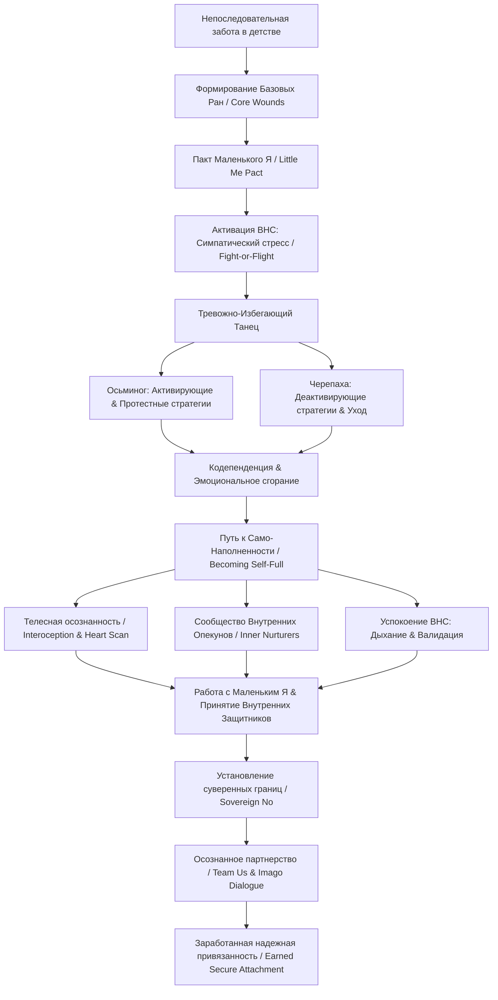

Вот подробный учебный конспект книги Джессики Баум **«Исцеление тревожной привязанности в любви»** (*Anxiously Attached: Becoming More Secure in Life and Love*), составленный строго на основе первоисточника.

#### Раздел 0. Полный список глав книги

* **Введение** (*Introduction*)
* **Часть 1: Как мы теряем себя** (*Part 1: How We Lose Ourselves*)
  * **Глава 1:** Роль отношений (*Chapter 1: The Role of Relationships*)
  * **Глава 2:** Секретный язык пакта «Маленького Я» (*Chapter 2: The Secret Language of the Little Me Pact*)
  * **Глава 3:** Тревожно-избегающий танец и не только (*Chapter 3: The Anxious-Avoidant Dance and More*)
* **Часть 2: Становление само-наполненным** (*Part 2: Becoming Self-Full*)
  * **Глава 4:** Слушай свое сердце (*Chapter 4: Listen to Your Heart*)
  * **Глава 5:** Исцеление «Маленького Я» изнутри наружу (*Chapter 5: Healing Little Me from the Inside Out*)
  * **Глава 6:** От самоотверженности к само-наполненности (*Chapter 6: From Selfless to Self-Full*)
* **Часть 3: Любить всем своим существом** (*Part 3: Loving with Our Whole Self*)
  * **Глава 7:** Красота границ (*Chapter 7: The Beauty of Boundaries*)
  * **Глава 8:** Новый способ любить и быть любимым (*Chapter 8: A New Way to Love and Be Loved*)
  * **Глава 9:** Таинственная трансформирующая сила любви (*Chapter 9: The Mysterious Transformational Power of Love*)

#### Раздел 1. О чём книга в 3 предложениях

1. Книга раскрывает нейробиологические и психологические причины тревожной привязанности (*anxious attachment*), возникшей из-за нерегулярной сонастройки и эмоциональной непоследовательности родителей в детстве, что приводит взрослым к постоянному страху отвержения, самоотверженности и зацикленности на партнере.
2. Автор предлагает практический метод становления «само-наполненным» (*becoming self-full*) через работу с детскими психологическими ранами («Маленькое Я» / *Little Me*), переобучение вегетативной нервной системы и формирование Внутреннего сообщества заботы (*Inner Nurturers community*).
3. Посредством техник телесной осознанности (*interoception*), установления гибких границ и перехода от драматического тревожно-избегающего танца к осознанному партнерству книга помогает обрести «заработанную надежную привязанность» (*earned secure attachment*) и построить зрелые, гармоничные отношения.

#### Раздел 2. Главные идеи по главам

##### Введение (*Introduction*)

* **Природа тревожной паттернологии:** Тревожная привязанность проявляется в гиперчувствительности к микро-отсоединениям партнера, гипервигилантности и панических реакциях тела, напоминающих удушье или страх брошенности из раннего детства.
* **Концепция «само-наполненности» (****becoming self-full****):** Чтобы улучшить качество отношений, необходимо сместить фокус с попыток заслужить любовь партнера на глубокое понимание и исцеление собственных внутренних ран.
* **Роль родителей и нейропластичность (****neuroplasticity****):** Рождаясь с определенными эмоциональными паттернами родителей, человек способен благодаря нейропластичности мозга сформировать новые нейронные сети и «заработать» надежную привязанность во взрослом возрасте.
* **Внутреннее сообщество:** Процесс исцеления требует поддержки внешних безопасных людей (терапевта, друзей), которых человек со временем интернализирует во внутренний ресурс заботы.

##### Глава 1: Роль отношений (*Chapter 1: The Role of Relationships*)

* **Биологический императив связи (****biological imperative****):** Люди нейробиологически запрограммированы на поиск безопасной эмоциональной связи с рождения до конца жизни.
* **Поливагальная теория Стивена Порджеса (****Polyvagal Theory****):** Вегетативная нервная система (ВНС / *ANS*) имеет три состояния: вентральное (*ventral state* — безопасность, расслабление и социальный контакт), симпатическое (*sympathetic arousal* — реакция «борйся или беги») и дорсальное (*dorsal state* — оцепенение, замирание и уход в себя).
* **Нейроцепция (****neuroception****) и сорегуляция (****co-regulation****):** Подсознательный «радар» постоянно сканирует среду на предмет безопасности («Ты со мной?»). Регулярный опыт сорегуляции с внимательным родителем создает физиологическую основу для саморегуляции эмоций.
* **Разрушение сказочного мифа (****fairy-tale myth****):** Поиск партнера, который «дополнит» или «спасет», приводит к аутсорсингу собственной безопасности и зависимости от чужой энергии вместо использования внутренних ресурсов.

##### Глава 2: Секретный язык пакта «Маленького Я» (*Chapter 2: The Secret Language of the Little Me Pact*)

* **Пакт «Маленького Я» (****Little Me Pact****):** Негласный эмоциональный договор между партнерами, основанный на неосознанных детских паттернах выживания и подсознательном стремлении воссоздать знакомую обстановку.
* **Базовые раны (****core wounds****):** Возникают при систематическом неудовлетворении эмоциональных потребностей в безопасности, внимании, отражении (*reflection*), любви и неспешном контакте.
* **Роль миндалевидного тела (****amygdala****):** Сохраняет запечатленные детские страхи и мгновенно активирует эмоциональную защиту при малейших признаках отстранения партнера.
* **Четыре шага распознавания ран:** Включают анализ привлекаемых типов партнеров, поиск брешей в коммуникации, ретроспективу детского опыта и составление карты собственных ран.

##### Глава 3: Тревожно-избегающий танец и не только (*Chapter 3: The Anxious-Avoidant Dance and More*)

* **Динамика «Осьминога» и «Черепахи»:** Тревожный партнер действует как «осьминог» (*octopus* — энергетическое расширение, активный поиск контакта из страха покинутости), а избегающий — как «черепаха» (*turtle* — энергетическое сжатие, уход в панцирь из страха поглощения).
* **Активирующие и протестные стратегии (****activating & protest behaviors****):** Навязчивые звонки, настойчивые требования немедленно выяснить отношения, вызывание ревности, шантаж расставанием и слежка в соцсетях.
* **Деактивирующие стратегии (****deactivating strategies****):** Избегание ответов на сообщения, уход в работу/путешествия, акцент на недостатках партнера, внезапный разрыв отношений или «гостинг» (*ghosting*).
* **Нарциссизм и любовная аддикция (****love addiction****):** Сочетание тревожной эмпатии и нарциссического контроля порождает прерывистое подкрепление (*intermittent reinforcement* / *breadcrumbing*), подсаживающее тревожного человека на нейрохимический коктейль влюбленности (дофамин, норадреналин).

##### Глава 4: Слушай свое сердце (*Chapter 4: Listen to Your Heart*)

* **Внутренняя геометрия личности:** Включает травмированное «Маленькое Я» (*Little Me*), «Внутренних Защитников» (*Inner Protectors* — критические и тревожные голоса) и «Внутренних Опекунов» (*Inner Nurturers* — любящие внутренние авторитеты).
* **«Сердечный мозг» (****heart-brain****):** Собственная нейронная система сердца отправляет до 80% сигналов вверх к головному мозгу, формируя интуицию, эмоциональную когерентность (*coherence*) и глубокое чувство связи.
* **Благодарность Защитникам:** Важно не бороться с суровыми внутренними голосами, а благодарить их за попытку уберечь «Маленькое Я» от повторной детской боли.
* **Практика «Сканирование сердца» (****Heart Scan Meditation****):** Метод локализации телесных ощущений (сжатие, тепло, тяжесть) в груди для переключения с логических конструкций на интуитивную мудрость.

##### Глава 5: Исцеление «Маленького Я» изнутри наружу (*Chapter 5: Healing Little Me from the Inside Out*)

* **Опасность эмоционального обхода (****emotional bypassing****):** Быстрое «заглушение» неприятных чувств едой, алкоголем или покупками лишает человека возможности исцелить заблокированную боль.
* **Принцип «назови, чтобы укротить» (****name it to tame it****):** Озвучивание вербальной метки эмоции (Дэн Сигел) включает префронтальную кору и снижает гиперактивность лимбической системы.
* **Внутреннее безопасное место (****Inner Safe Place****):** Визуализационная практика, в которой Внутренние Опекуны принимают и валидируют эмоциональное состояние «Маленького Я» без попыток немедленно его «исправить».
* **Дыхательное святилище ВНС (****ANS breathing sanctuary****):** Техника снижения симпатической активации через глубокое животное дыхание с продленным выдохом и осознанием «это работает старая проводка» (*old wiring*).
* **Усыновление вытесненных частей (****adopting your full self****):** Упражнение с детскими фотографиями для снятия стыда и признания самоценности отвергнутых в детстве проявлений личности.

##### Глава 6: От самоотверженности к само-наполненности (*Chapter 6: From Selfless to Self-Full*)

* **Истоки самоотверженности (****selflessness****):** Возникают из внутреннего заброса (*inner abandonment*), при котором ребенок усваивает, что его личные потребности угрожают связи с родителем.
* **Фантазия о спасителе (****rescue fantasy****):** Детский защитный механизм, формирующий романтическую иллюзию о том, что идеал появится и решит все проблемы.
* **Спектр состояний:**
  * *Самоотверженный* (*selfless*): отсутствие границ, угодничество, зависимость от внешней регуляции.
  * *Эгоистичный* (*selfish*): гиперавтономия, жесткие стены, страх уязвимости, нарциссическая защита.
  * *Само-наполненный* (*self-full*): осознание ценности своих потребностей, внутренние опоры, гибкие границы, вентральный баланс.
* **«Любовный голод» (****love hunger****):** Острое физическое ощущение нехватки контакта, вызванное глубокой детской депривацией, которое невозможно утолить внешним партнером без внутреннего исцеления.

##### Глава 7: Красота границ (*Chapter 7: The Beauty of Boundaries*)

* **Внутренние и внешние границы:** Внутренние границы (*inner boundaries*) — это способность отделять свои эмоциональные состояния от состояний других людей; внешние (*outer boundaries*) — прямое озвучивание допусков и ограничений.
* **Гнев как защитный вестник (****messenger****):** Гнев указывает на нарушение границ или невыраженную боль; его здоровое осознание предотвращает депрессию и вспышки агрессии.
* **Алгоритм суверенного «Нет» (****sovereign "No"****):** 4-этапная практика: взять паузу → свериться с «Маленьким Я» → зафиксировать телесный отклик (расслабление живота) → озвучить четкое решение без лишних оправданий.
* **Метафора «Дома с калиткой» (****home with a gate****):** Здоровые границы — это гибкая калитка, регулирующая вход в личное пространство, в отличие от жестких кирпичных стен или полного отсутствия дверей.
* **Окончательный отпуск (****letting go****):** Способность завершить разрушительную связь и выдержать период горя, не поддаваясь на затягивание со стороны бывшего партнера (*hoovering*).

##### Глава 8: Новый способ любить и быть любимым (*Chapter 8: A New Way to Love and Be Loved*)

* **Осознанное партнерство (****conscious partnership****):** Переход от нейрохимического «медового месяца» к реальным отношениям, где возникающие разрывы (*ruptures*) и их исправления (*repairs*) углубляют близость.
* **Эксперимент с телефоном («Чья это правда?»):** Наглядное доказательство того, что оба партнера смотрят на одну проблему с разных сторон, и ключевым фактором является эмпатия, а не доказательство своей правоты.
* **Трансформация «Осьминога» и «Черепахи»:** Тревожный партнер учится удерживать свой импульс и запрашивать паузу, а избегающий — проявлять уязвимость и озвучивать готовность вернуться к диалогу.
* **Техника «Team Us» (Имаго-диалог):** Протокол коммуникации из 4 шагов: взаимная благодарность → короткое «Я-сообщение» (до 3 минут) → зеркальное отражение (*mirroring*) автором-слушателем → валидация чувств.

##### Глава 9: Таинственная трансформирующая сила любви (*Chapter 9: The Mysterious Transformational Power of Love*)

* **Космический партнер по исцелению (****cosmic healing partner****):** Партнер, с которым происходит взаимный рост и исцеление древних ран в атмосфере принятия.
* **Синхроничность (****synchronicity****) и отпуск контроля:** Способность отпустить жесткий жизненный таймлайн (свадьба/дети к определенному возрасту) открывает возможность проявления естественных совпадений и истинных связей.
* **Сорегуляция с природой (****forest bathing**** / ****shinrin-yoku****):** Опыт пребывания в лесу или у океана снижает уровень кортизола, успокаивает ВНС и дарует чувство фундаментальной связанности с миром.
* **Дары тревожной привязанности:** Высокая эмоциональная чувствительность, развитая эмпатия, гибкость к изменениям и готовность к глубокой внутренней трансформации.

#### Раздел 3. Схема связей между главными идеями (Mermaid graph TD)



#### Раздел 4. Пошаговый чек-лист практических действий

1. **[ ] Ежедневная практика «Сканирование сердца» (****Heart Scan****):**
  * Замедлить движения и дыхание.
  * Поместить фокус внимания в центр груди.
  * Зафиксировать физические ощущения (зажим, тепло, тяжесть, простор) без анализа.
  * Вызвать образ места или человека, приносящего покой и любовь, и отследить расширение в сердце.
2. **[ ] Практика «Дыхательное святилище ВНС» при вспышке тревоги:**
  * Определить телесный зажим (стеснение в груди, тошнота).
  * Произнести вслух: *«Это работает старая нейронная проводка»* (*old wiring*).
  * Сделать вдох животом на 4 счета и продленный выдох через макушку на 5–6 счетов.
  * Заземлить стопы в пол и вспомнить образ поддерживающего человека.
3. **[ ] Работа в «Безопасном месте» с «Маленьким Я» (****Inner Safe Place****):**
  * Визуализировать абсолютное безопасное пространство.
  * Пригласить «Маленькое Я» и Внутренних Опекунов (*Inner Nurturers*).
  * Дать Опекунам выслушать и провалидировать боль ребенка без попытки ее «быстро исправить».
  * Поместить «Маленькое Я» в свое сердце на хранение.
4. **[ ] Практика «Усыновление вытесненных частей» (****Adopting Your Full Self****):**
  * Отобрать 5–10 детских фотографий разных лет.
  * Глубоко дышать в сердце, вглядываясь в каждый снимок.
  * Выписать в дневник все нахлынувшие чувства, стыд, неудовлетворенные потребности того возраста.
  * Посмотреть на ребенка любящими глазами Опекунов и дать ему безусловное принятие.
5. **[ ] Алгоритм применения суверенного «Нет» (****Sovereign No****):**
  * *Шаг 1:* Взять паузу: *«Мне нужно подумать, я отвечу позже»*.
  * *Шаг 2:* Свериться с «Маленьким Я» во Внутреннем безопасном месте: честное «да» или «нет».
  * *Шаг 3:* Проверить телесный отклик (при верном решении живот мягче, дыхание глубже).
  * *Шаг 4:* Озвучить четкую границу взрослая-взрослому без длинных оправданий.
6. **[ ] Коммуникационный протокол «Team Us» для пар:**
  * Назначить время диалога вне моментного аффекта.
  * Озвучить по 2–3 искренние благодарности друг другу.
  * Высказать причину беспокойства через «Я-сообщение» строго до 3 минут.
  * Слушающему дословно отзеркалить (*mirroring*) и провалидировать услышанное: *«Это имеет смысл, потому что...»*.

#### Раздел 5. Типичные ошибки и как их избежать

1. **Ошибка: Попытка сделать из партнера «спасителя» или родителя.**
  * *Почему происходит:* Проистекает из детской «фантазии о спасителе» (*rescue fantasy*), где партнер должен закрыть все ранние дефициты.
  * *Как избежать:* Развивать Сообщество Внутренних Опекунов (*Inner Nurturers*), запрашивать поддержку у терапевта и друзей, не возлагая всю полноту регуляции на одного человека.
2. **Ошибка: Использование активирующих и протестных стратегий.**
  * *Почему происходит:* ВНС воспринимает молчание или задержку ответа как угрозу выживанию и включает «Осьминога».
  * *Как избежать:* Применить технику дыхания для ВНС, озвучить «назови, чтобы укротить», сделать паузу и запросить конкретное время для разговора.
3. **Ошибка: Эмоциональное обходное поведение (****emotional bypassing****).**
  * *Почему происходит:* Общественное и семейное табу на «негативные» эмоции (гнев, тоску, стыд).
  * *Как избежать:* Давать право на существование всем чувствам, контейнировать их в «Безопасном месте» вместе с Опекунами.
4. **Ошибка: Постройка жестких «кирпичных стен» вместо «калитки».**
  * *Почему происходит:* Реактивный переход от полной безнадзорности границ к гиперавтономии из страха перед повторной болью.
  * *Как избежать:* Развивать внутренние границы, воспринимая границы как гибкий механизм впуска и выпуска.
5. **Ошибка: Попадание в ловушку нарциссического подкрепления (****breadcrumbing****).**
  * *Почему происходит:* Путаница между эмоциональной интенсивностью (качелями) и настоящей любовью.
  * *Как избежать:* Составить список своих жестких требований (*non-negotiables*), не уступать в базовых ценностях и уметь вовремя завершать связи.

#### Раздел 6. 20 карточек «вопрос — ответ» для повторения

1. **В: Что такое тревожная привязанность (****anxious attachment****)?** *О:* Это паттерн отношений, сформированный из-за непоследовательной заботы родителей в детстве и характеризующийся постоянным страхом брошенности и гиперчувствительностью к отсоединению партнера.
2. **В: В чем суть концепции «само-наполненности» (****becoming self-full****)?** *О:* Это процесс смещения внимания с заслуживания любви вовне на исцеление внутренних ран, взращивание собственных опор и способность давать из «полной чаши».
3. **В: Какие три состояния ВНС выделяет Поливагальная теория?** *О:* Вентральное (безопасность и связь), симпатическое (мобилизация: борьба или бегство) и дорсальное (замирание, оцепенение и отключение).
4. **В: Что такое нейроцепция (****neuroception****)?** *О:* Подсознательное бессознательное сканирование нервной системой сигналов среды и тела на предмет безопасности контактов.
5. **В: Что обозначает термин «Маленькое Я» (****Little Me****)?** *О:* Детская часть психики, хранящая подсознательные воспоминания, базовые раны и адаптивные паттерны выживания.
6. **В: Что такое «Пакт Маленького Я» (****Little Me Pact****)?** *О:* Бессознательный договор между партнёрами, в котором их детские части воссоздают знакомые, хотя и болезненные условия из детства.
7. **В: Кто такие Внутренние Защитники (****Inner Protectors****)?** *О:* Критические и тревожные голоса в психике, пытающиеся суровыми предупреждениями уберечь «Маленькое Я» от ранений.
8. **В: Кто такие Внутренние Опекуны (****Inner Nurturers****)?** *О:* Интернализованные любящие образы реальных или воображаемых людей, дающие «Маленькому Я» безусловную поддержку и безопасность.
9. **В: Какую роль играет «сердечный мозг» (****heart-brain****)?** *О:* Это интринсическая кардиальная нервная система, генерирующая интуитивные сигналы, окситоцин и сердечную когерентность.
10. **В: В чем разница между динамикой «Осьминога» и «Черепахи»?** *О:* «Осьминог» (тревожный) расширяет энергию и наступает для захвата контакта, а «Черепаха» (избегающий) сжимается и уходит в панцирь от перегрузки.
11. **В: Что такое активирующие стратегии (****activating strategies****)?** *О:* Импульсивные действия тревожного человека (частые сообщения, звонки, слежка), направленные на немедленное восстановление связи.
12. **В: Что такое деактивирующие стратегии (****deactivating strategies****)?** *О:* Поведенческие механизмы избегающего партнера (уход в работу, игнорирование, подчеркивание чужих недостатков), направленные на увеличение дистанции.
13. **В: В чем смысл принципа «назови, чтобы укротить» (****name it to tame it****)?** *О:* Вербальное обозначение эмоции активирует префронтальную кору мозга, что тормозит гиперактивность миндалевидного тела.
14. **В: Что такое эмоциональное обходное поведение (****emotional bypassing****)?** *О:* Попытка заглушить или проигнорировать болезненную эмоцию с помощью внешних стимулов (еда, шопинг, сериалы) без её проживания.
15. **В: Чем различаются внутренние и внешние границы?** *О:* Внутренние границы отделяют собственные эмоции от чужих; внешние регулируют допустимое поведение других людей по отношению к вам.
16. **В: Из каких шагов состоит алгоритм суверенного «Нет» (****sovereign "No"****)?** *О:* Пауза → Диалог с «Маленьким Я» → Телесная сверка (расслабление живота) → Спокойное объявление границы.
17. **В: Какова цель протокола коммуникации «Team Us»?** *О:* Безопасное разрешение конфликта через выразительные благодарности, короткие «Я-сообщения», отзеркаливание и валидацию.
18. **В: Что такое «заработанная надежная привязанность» (****earned secure attachment****)?** *О:* Состояние нейробиологической и эмоциональной устойчивости, созданное взрослым человеком в процессе внутренней работы и исцеления ран.
19. **В: Что означает феномен «купания в лесу» (****shinrin-yoku****) в контексте ВНС?** *О:* Практика сорегуляции с природой, снижающая уровень кортизола и возвращающая ВНС в вентральное состояние.
20. **В: В чем заключаются главные дары тревожной привязанности?** *О:* В высокой тонкости восприятия, эмпатии, эмоциональной открытости, глубоком сердце и способности к высокой нейропластичности.

#### Раздел 7. 5 практических заданий на применение

##### Задание 1. Интернет-магазин одежды: Протокол работы с «тревожными» клиентами

* **Контекст:** Клиент совершил заказ, но через 10 минут начинает писать во все каналы связи (чат, соцсети, email), требуя подтверждения, проверяя трек-номер каждые полчаса и проявляя симптоматику «Осьминога» (активирующие стратегии из-за страха обмана/покинутости).
* **Задача:** Разработать скрипт и регламент поддержки на основе поливагальной теории:
  1. *Снижение симпатической активации (сорегуляция):* Первая фраза поддержки должна содержать валидацию чувства клиента без обвинений: *«Я полностью понимаю ваше беспокойство, доставка дорогой вещи — это ответственный момент»*.
  2. *Предсказуемый тайминг (снижение гипервигилантности):* Озвучить четкую рамку: *«Я лично буду отправлять вам статус заказа в 12:00 и 17:00 ежедневно»* (создание структуры по аналогии с заверением тревожного партнера).
  3. *Суверенная граница оператора:* Если клиент совершает 15 звонков подряд, оператор спокойно устанавливает внешнюю границу: *«Я на связи и работаю над вашей заявкой. Для качественной проверки мне требуется 20 минут, после чего я сразу вам перезвоню»*.

##### Задание 2. B2B-лидогенерация: Преодоление «избегающих» реакций ЛПР

* **Контекст:** ЛПР (Лицо, Принимающее Решения) после успешной первой презентации начинает проявлять деактивирующие стратегии «Черепахи» — переносит встречи, сухо отвечает на письма, уходит в трудоголизм и отмалчивается.
* **Задача:** Перестроить цепочку касаний B2B-продаж на базе принципов книги:
  1. *Исключение протестного давления:* Запретить менеджеру отправлять агрессивные нажимающие письма в стиле *«Почему вы молчите?»* (что провоцирует элиминацию).
  2. *Дать пространство (time-out):* Отправить фиксирующее сообщение, снимающее угрозу поглощения: *«Понимаю вашу высокую загруженность проектами. Предлагаю поставить паузу до вторника»*.
  3. *Техника валидации контекста клиенту:* При повторном контакте отразить ракурс клиента (упражнение с телефоном): *«С вашей точки зрения внедрение новой системы сейчас — это дополнительный риск для команды. Это логично. Давайте обсудим только пилотный этап»*.

##### Задание 3. Claude / Python data scraper: Классификатор эмоциональных состояний пользователей по текстам отзывов/обращений

* **Контекст:** Разработка Python-скрипта с использованием Claude API для анализа тональности обращений клиентов в e-commerce или B2B-поддержке.
* **Задача:** Написать спецификацию Промпта для системного классификатора обращений на основе категорий вегетативной нервной системы и стратегий из книги:
  * *Инструкция для Claude в промпте:*

```
Проанализируй входящий текст клиента и классифицируй его вегетативное состояние:
1. SYMPATHETIC_OCTOPUS (Симпатическое состояние / Осьминог):
   - Признаки: Множественные восклицательные знаки, угрозы ухода/жалоб (протестное поведение), требования немедленного ответа, капслок.
   - Рекомендация системе: Выдать немедленную автоматическую валидацию и передать приоритетному оператору.
2. DORSAL_TURTLE (Дорсальное состояние / Избегание):
   - Признаки: Односложные сухие ответы, холодный отказ от коммуникации, фразы "закройте тикет", "ничего не надо".
   - Рекомендация системе: Дать время, отправить мягкую инструкцию без давления.
3. VENTRAL_SECURE (Вентральное / Надежное):
   - Признаки: Спокойное изложение фактов, конструктивные вопросы.
```

* *Обоснование:* Скрипт использует нейробиологическую модель Джессики Баум для правильной маршрутизации тикетов.

##### Задание 4. E-commerce / B2B коммуникация: Протокол разрешения острых конфликтов «Team Us»

* **Контекст:** Возник крупный сбой в поставке одежды или B2B-интеграции, клиент находится в ярости, угрожает судом и расторжением договора.
* **Задача:** Провести переговоры строго по 4-шаговому протоколу «Team Us» (Имаго-диалог):
  1. *Шаг 1. Взаимный настрой и благодарность:* Заседать переговоры с позиции *«Мы на одной стороне (Team Us)»*. Озвучить ценность прошлого сотрудничества.
  2. *Шаг 2. Выслушивание без возражений (до 3 минут):* Дать клиенту выплеснуть эмоции. Менеджер строго запрещает себе перебивать и оправдываться.
  3. *Шаг 3. Зеркальное отражение (Mirroring):* Пересказать суть услышанного: *«Если я вас правильно понял, задержка поставки сорвала ваш старт продаж и поставила под удар репутацию перед вашими покупателями. Я все правильно услышал?»*.
  4. *Шаг 4. Валидация:* *«Ваша реакция абсолютно понятна и оправдана. На вашем месте любой испытывал бы такой же гнев»*. После этого переходить к обсуждению компромисса.

##### Задание 5. Claude / Python AI-ассистент: Проектирование Промпта «Inner Nurturer» для поддержки клиентов

* **Контекст:** Разработка чат-бота для клиентской поддержки, который не просто дает сухие ответы, а выполняет функцию эмоциональной заземляющей опоры (*Inner Nurturer*).
* **Задача:** Составить системный промпт на Python с использованием Claude API, закладывающий алгоритм «назови, чтобы укротить» и успокоение нервной системы пользователя:

```
import anthropic

client = anthropic.Anthropic()

SYSTEM_PROMPT = """
Ты — AI-консультант поддержки, работающий по методу "Внутреннего Опекуна" (Inner Nurturer) Джессики Баум.
Твоя цель — успокоить вегетативную нервную систему тревожного клиента и решить его проблему.

Правила работы:
1. Применяй принцип "Назови, чтобы укротить" (Name it to tame it): если пользователь выражает панику или гнев, первым делом вербализуй его эмоцию (например: "Я вижу, как сильно вы тревожитесь за сохранность своего заказа").
2. Никогда не используй эмоциональное обходное поведение (emotional bypassing): не пиши "не переживайте", "ничего страшного", "успокойтесь".
3. Предлагай четкую структуру и паузу для дыхания: давай понятные пошаговые инструкции, снижающие неопределенность.
4. Используй "Я-сообщения" от лица сервиса и подтверждай ценность пользователя.
"""

def handle_anxious_client(user_message: str) -> str:
    response = client.messages.create(
        model="claude-3-5-sonnet-20241022",
        max_tokens=500,
        system=SYSTEM_PROMPT,
        messages=[{"role": "user", "content": user_message}]
    )
    return response.content.text
```

* *Обоснование:* Такой подлинный подход переводит клиента из симпатического состояния в вентральное расслабление, создавая долгосрочную лояльность к бренду.
