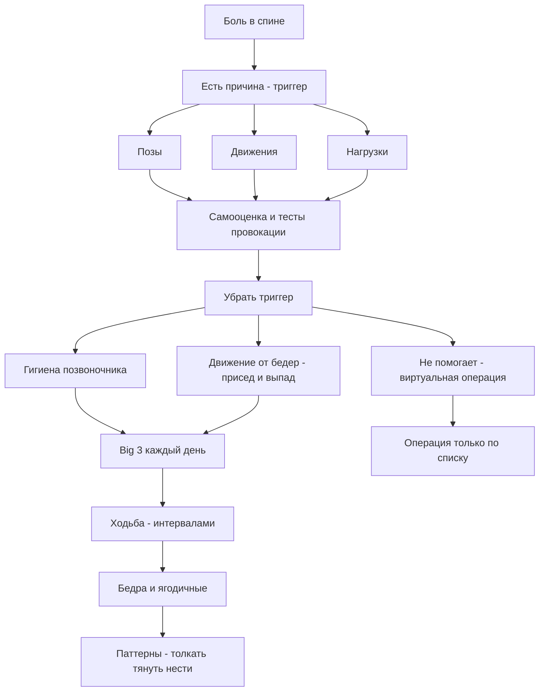

<!-- Claude Sonnet по тексту книги, Back Mechanic (Stuart McGill, 2015), конспект; 17.10.2026; не сверено -->

# Back Mechanic (Стюарт Макгилл, 2015) — конспект «Механик спины»

Важно: это пересказ книги для учёбы, а не медицинская рекомендация. Всё, что с цифрами и упражнениями, — «по книге». Вита не врач и не тренер; при боли нужен живой специалист.

## 0. Полный список глав (по тексту книги)

- Введение (Introduction): секреты здоровой спины
- Часть 1. «Why me?» — понять свою боль
 - Гл. 1. Myth busting — развенчание мифов
 - Гл. 2. Back to basics — как устроена спина и откуда боль
 - Гл. 3. Is surgery for you? — нужна ли операция: обязательный список
 - Гл. 4. The Code — кодекс: 10 правил здоровой спины
- Часть 2. Самооценка: найти причину боли
 - Гл. 5. Using the McGill approach to find your pain trigger — как автор ищет триггер боли
 - Гл. 6. Your self-assessment — ваша самооценка (списки, тесты, категории боли)
- Часть 3. «Ремонт»: сделать активность безболезненной
 - Гл. 7. Removing the cause of pain — базовые инструменты движения (бресинг, присед, выпад, стоп-твист)
 - Гл. 8. Spine hygiene — гигиена позвоночника
 - Гл. 9. Building a resilient back: the «Big 3» — обязательная тройка упражнений
 - Гл. 10. The walking program — программа ходьбы
 - Гл. 11. The core program — базовая ежедневная программа
 - Гл. 12. Restoring the hips — восстановление бёдер
- Часть 4. Тонкая настройка
 - Гл. 13. Next level training — возвращаем активный образ жизни
 - Гл. 14. Special conditions — ишиас, кифоз, сколиоз, стеноз, лишний вес и др.
 - Гл. 15. Solutions that solve back pain — кейсы и образцы программ
 - Гл. 16. Q and A with the Back Mechanic — вопросы и ответы (секс, матрас и др.)
 - Гл. 17. In Conclusion — заключение
- Глоссарий, предметный указатель, приложение с журналами (Pain and Activity Ability, Exercise Log), об авторе.

(Всего 17 глав + введение; в файле-источнике 172 страницы, текст читаемый, это не скан.)

## 1. О чём книга в 3 предложениях

Автор, профессор биомеханики позвоночника, утверждает, что «неспецифической» боли в спине не бывает: у боли есть причина — повторяющиеся позы, движения и нагрузки («триггеры»), которые можно найти самому с помощью тестов. Лечение — это убрать триггеры, заменить их безболезненными движениями (сгибаться в бёдрах, а не в спине), укрепить выносливость корпуса тремя упражнениями «Big 3» и ходить в правильном стиле. Книга спорит с привычными советами (растяжки, пилатес и йога «для всех», пресс-скручивания, быстрая операция, лежание) и учит читателя стать «собственным механиком» своей спины.

## 2. Главные идеи по главам

**Введение.** Быстрых «5 шагов» нет; нужны дисциплина и детали. Автор не связан с фармой и хирургией; по его наблюдениям 95% пациентов получают пользу.

**Гл. 1 Мифы.**
- Боль не «в голове» и не пройдёт сама: чем дольше повторяешь провоцирующее движение, тем чувствительнее ткань («бьёшь молотком по пальцу»).
- МРТ показывает изменения, но не всегда причину боли; «дегенеративный диск» обычно просто возраст (потеря воды), как морщины.
- Растяжка «колени к груди» даёт 15–20 минут облегчения (рефлекс растяжения), а потом хуже; йога и пилатес не подходят всем.
- Выносливость важнее силы; бодибилдинг и «мощные» движения спины рискованны; лежать в кровати много — вредно (около 8 часов нормально).

**Гл. 2 Основы.**
- Позвоночник — «радиомачта с растяжками»: мышцы и связки держат его; нейтральная поза имеет три изгиба.
- Мышцы корпуса в основном останавливают движение (жёсткость), а мышцы рук и ног создают его; нужна «настраиваемая» жёсткость (как диммер).
- Сгибание позвоночника повторяется — диск трескается (грыжа), скручивание ведёт к разрыву, компрессия — к повреждению пластинки; решение — движение от бёдер.
- Боль чувствительна к тому, что мы повторяем («расковыривать корку»); безболезненные движения «заливают» ворота боли.
- «Каскад дегенерации»: травма запускает цепочку, но при правильном ведении боль управляется, примерно за 10 лет сустав «застывает».

**Гл. 3 Операция.**
- «Виртуальная операция»: притвориться, что операция сделана, и отдохнуть, начать программу.
- Операция рассматривается при серьёзных неврологических проблемах, травмах, непрерывной тяжёлой боли; эпизодическая боль — не повод.
- Список вопросов к хирургу; осторожность с «новыми» методами и искусственным диском.

**Гл. 4 Кодекс (10 ориентиров).**
- Двигаться каждый день; держать баланс сна, питания и активности; устранять причину; остерегаться клиницистов с бесконечными визитами и «пассивных» процедур; «один размер лечения не подходит всем»; регулярно пересматривать план.

**Гл. 5–6 Самооценка.**
- Исключить «зловещие» причины у врача; составить списки «что болит / что не болит»; ответить на основные вопросы; пройти тесты провокации (компрессия, падение на пятки, лежание на животе, разгибание, стенная планка, груз, наклон таза, осанка стоя).
- Категории боли: сгибание, динамическая нагрузка, сгибание шеи, компрессия, эпизодическая, на определённой дистанции ходьбы, разгибание/скручивание, только при определённых упражнениях. Тип личности A или B влияет на восстановление.

**Гл. 7 Инструменты движения.**
- Абдоминальный бресинг (не втягивание живота), присед «шорт-стоп», выпад для пола, стоп-твист; безболезненные позы лёжа, сидя, стоя.

**Гл. 8 Гигиена позвоночника.**
- Менять позы, готовиться к нагрузке, держать предметы близко, делить вес, не нагружаться сразу после сидения или кровати, использовать импульс, перерыв — противоположность задачи.

**Гл. 9 «Big 3» + кошка-верблюд.**
- Curl-up, side bridge, bird-dog по «убывающей пирамиде» (6-4-2), удержания по 10 секунд, ежедневно; убрать «superman», колени к груди, скручивания лёжа.

**Гл. 10 Ходьба.** Быстрая, с махом рук, прямая; начинать с коротких серий; цель 3 раза по 30 минут в день.

**Гл. 11 Базовая программа.** Через 4–6 недель: cat-camel, bird-dog, curl-up, side bridge + ходьба.

**Гл. 12 Бёдра.** Не растягивать рано; hip airplane, выпады, clamshell, ягодичный мост; один присед с весом тела в день.

**Гл. 13 Следующий уровень.** Паттерны Push, Pull, Lift, Carry; форма важнее веса.

**Гл. 14 Особые состояния.** Ишиас и «нервный флоссинг», стеноз, кифоз, «chest-poker», сколиоз, хромота, замена суставов, пожилые, лишний вес.

**Гл. 15 Кейсы.** Мэтт, Памела, Алиша (тип A), Брэд (тип B), Дэйв, Пенни, Пит, Кэмерон, Октавио, Лоретта, Самина и Сэди, «странные» пациенты.

**Гл. 16–17 Вопросы и заключение.** Эргономика, путешествия, матрас, пояса, растяжка, хиропрактика, секс, рецидив; ведите дневник действий, а не уровня боли.

## 3. Схема связей

## 4. Пошаговый чек-лист практических действий (по книге)

1. Сначала врач первичного звена: исключить «зловещие» причины (потеря контроля кишечника и мочевого пузыря, боль с температурой, постоянная ночная боль, онемение внутренней стороны бёдер и др.).
2. Прочитать книгу целиком, второй раз — выполняя тесты в тетради.
3. Составить два списка: что усиливает боль, что не усиливает; найти общее (поза, движение, нагрузка).
4. Ответить на основные вопросы (меняется ли боль, что усиливает, утро или вечер, отдаёт ли в ногу, помогает ли быстрая ходьба).
5. Пройти тесты провокации и облегчения; записать результаты. Если тесты не дают ясности — вести журнал дней.
6. Найти безболезненные позы (лёжа на животе с кулаками под подбородком, сидение с поясничной опорой, стояние с расслабленной поясницей).
7. Освоить абдоминальный бресинг (не втягивая живот), присед «шорт-стоп», выпад, стоп-твист.
8. Ввести гигиену позвоночника: менять позы, держать вес близко, делить груз, не вставать резко с кровати/после сидения, делать перерывы.
9. Начать «Big 3» с коротких удержаний по 10 секунд по схеме 6-4-2; 1–3 коротких сессии в день; не сразу после подъёма с кровати.
10. Убрать вредные упражнения: колени к груди, скручивания лёжа, «superman», сит-апы, растяжки спины.
11. Ходьба: начать с нескольких шагов в час, довести до 30 минут трижды в день, стиль — прямо, быстро, махи рук от плеч; микро-перерывы с возвратом в «сладкую точку».
12. Когда боль утихла, добавить бёдра (hip airplane, выпады, clamshell, ягодичный мост, один присед в день).
13. Затем, по желанию, паттерны Push, Pull, Lift, Carry с идеальной формой.
14. Наращивать повторы, а не время удержания; при боли вернуться на шаг назад.
15. Пересматривать план; вести дневник действий; при рецидиве лечь на живот с кулаком под подбородком и начать с первого этапа.
16. Операция — только по списку (виртуальная операция, неврологические признаки, травма, непрерывная сильная боль), и хирурга выбирать по вопросам из главы 3.

## 5. Типичные ошибки и мифы (по книге)

- «Боль в голове» / «привыкну» / «просто думай позитивно».
- Растягивать спину, прижимать колени к груди, делать скручивания лёжа.
- Делать «универсальные» йогу и пилатес при боли, «вдавливать» поясницу в пол, сит-апы и «roll-up».
- Верить, что сильные мышцы или бодибилдинг лечат; тренироваться «до силы» раньше выносливости.
- Думать, что МРТ всё объясняет; пугаться «дегенеративного диска».
- Втягивать живот вместо бресинга.
- Медленная «прогулочная» ходьба без маха руками.
- Оставаться в одной позе; сидеть на мягком диване; спать на мягком провисающем матрасе.
- Тип A: делать больше повторов, чем сказано; тип B: делать меньше.
- Лечиться только пассивно (ультразвук, массаж, регулярные манипуляции) и без плана.
- Идти на операцию без поиска триггеров; доверять хирургу, не объяснившему анатомию.
- Растягивать седалищный нерв или hamstrings при ишиасе.

## 6. 20 карточек «вопрос — ответ» (по книге)

1. Что такое «нейтральный позвоночник»? — Положение с тремя естественными изгибами (шея, грудь, поясница), где спина наиболее устойчива и менее всего нагружена.
2. Что такое «триггер боли»? — Конкретная поза, движение или нагрузка, которые вызывают или усиливают боль.
3. Куда надо сгибаться при наклоне? — В тазобедренных суставах (hip hinge), а не в позвоночнике.
4. Почему мышцы корпуса «другие»? — Они в основном останавливают движение (создают жёсткость), а мышцы конечностей создают движение.
5. Что такое абдоминальный бресинг? — Лёгкое напряжение мышц живота, как перед ударом, без втягивания и выпячивания; «настраивается» как диммер.
6. Почему «колени к груди» плохи? — Дают временное облегчение через рефлекс растяжения (15–20 минут), но раздражают диски и боль возвращается.
7. Что важнее — сила или выносливость? — Выносливость (чтобы удерживать правильную форму движения), сила потом.
8. Что такое «Big 3»? — Curl-up, side bridge, bird-dog.
9. Как работает «убывающая пирамида»? — Например, 6, 4, 2 повтора по 10 секунд, отдых 20–30 секунд между подходами; усложнять добавлением повторов, а не времени.
10. Почему нельзя делать сит-апы? — Они дают лишнюю нагрузку на диски; в курле-апе поясница не двигается.
11. Что такое «виртуальная операция»? — Притвориться, что операция сделана: отдых и поэтапная программа (убрать причину, безболезненные движения, ходьба, упражнения).
12. Какая ходьба «бальзам для спины»? — Быстрая, с махом рук от плеч, с прямой осанкой и лёгким бресингом.
13. Цель программы ходьбы? — 30 минут три раза в день (до завтрака, в середине дня, после ужина).
14. Что такое «nerve flossing»? — Скольжение нерва без натяжения: одновременно разгибание шеи и колена и обратно, 10 циклов на ногу; может и помочь, и вызвать боль.
15. Что делать, если больно лежать и встать? — Лечь на живот, кулак под подбородком, дышать, поясница «тонет» в пол; встать без движения позвоночника.
16. Почему утром спина жёстче? — Диски за ночь набухают водой; около 8 часов в кровати нормально, дольше вредно; утром избегать наклонов и сит-апов.
17. Что такое пассивное и активное лечение? — Пассивное: что-то делают с вами (ультразвук); активное: вы участвуете и учитесь двигаться без триггеров.
18. Как подобрать матрас? — Зависит от формы тела: людям с большим прогибом и выступающими ягодицами — твёрдый матрас с мягким верхом; не футон; подушка под коленями может усиливать уплощение поясницы.
19. Нужно ли заниматься ежедневно? — Да, по книге; даже дважды в день, короткими сессиями.
20. Почему тип A и тип B мешают восстановлению? — A делает слишком много и не даёт спине отдохнуть; B делает слишком мало и не набирает нужной формы.

## 7. 5 практических заданий для Виты (жизнь, здоровье, учёба; Вита не врач и не тренер)

1. Мини-эксперимент «два списка»: на листе слева запишите, что в течение дня вызывает дискомфорт в спине или шее (долгое сидение, наклон над столом и т.п.), справа — что не вызывает. Через три дня посмотрите, есть ли общее (поза, длительность). Это упражнение на наблюдательность, не диагноз.
2. Практика «hip hinge» без нагрузки: по книге, поставьте ладони на бёдра и отводите таз назад, как при «шорт-стопе», перед зеркалом; следите, чтобы спина не сутулилась. Цель — понять, как движение идёт от бёдер.
3. Учебная карточка: перепишите 10 карточек из раздела 6 своими словами и проверьте себя через день, через 3 дня и через неделю (метод самопроверки из скилла kak-uchitsya).
4. Рабочий стол: попробуйте по книге менять позу каждые 20 минут (встать, потянуться руками вверх, глубоко вдохнуть) и отметьте в тетради, как вы себя чувствуете. Если появится новая или сильная боль, остановитесь и обратитесь к врачу.
5. Ходьба: по книге ходьба «по делу» — прямо, с взмахами рук от плеч. Прогуляйтесь немного в таком стиле и сравните с обычной прогулкой по ощущениям; если нет противопоказаний (спросите врача), повторяйте. Книга не заменяет врача.

## 8. Что в книге спорно или устарело

- Некоторые утверждения автора — позиция одного исследователя и его лаборатории (например, о йоге/пилатесе, растяжках, сроках заживления «до 10 лет», «95% получат пользу»); книга не даёт ссылок на каждое исследование в тексте, цифры «по книге».
- Резкие высказывания о врачах, хирургах и хиропрактиках («не пускали бы и шуруп вкрутить в стену подвала», «Брэд заслуживает свою боль») — оценочные, не научные выводы.
- Некоторые советы (например, про матрасы, пояса, «стоя в каноэ» и т.д.) — частные мнения; подходящую практику лучше обсуждать с врачом.
- Книга 2015 года; с тех пор появилось много новых исследований по боли в спине (в самой книге их нет, поэтому здесь не комментируются).
- Автор продаёт товары через сайт backfitpro.com (Lumbair, McGill Sleeper), это стоит учитывать при чтении рекомендаций о покупке.
- Не заменяет консультацию врача, особенно при симптомах из списка «зловещих причин».
