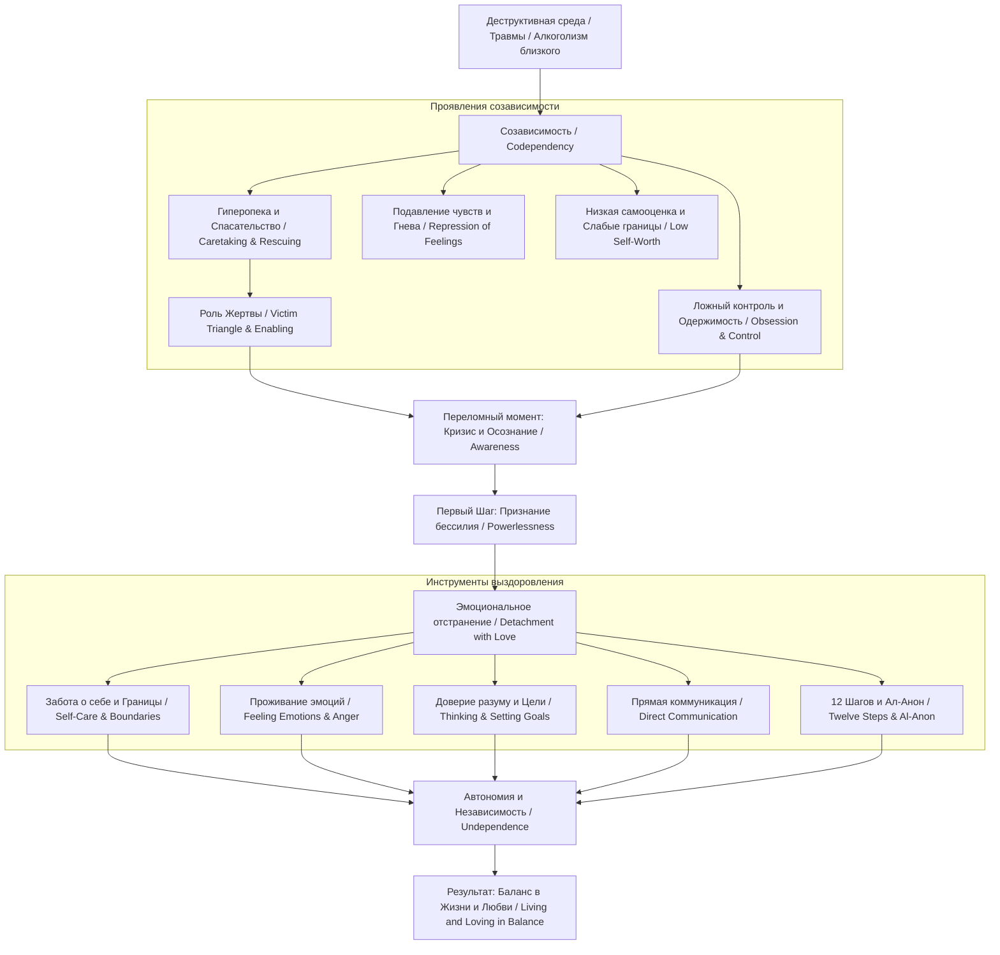

<!-- NotebookLM (Freya), Codependent No More (Beattie), учебный конспект v2 (источники: полный текст, главы 18–20 и Epilogue включены); 23.10.2026; не сверено -->

## Подробный учебный конспект книги Melodie Beattie «Codependent No More» («Освобождение от созависимости»)

### 0. Полный список глав и разделов книги

#### Предисловия и вступительные тексты

* **A Twenty-fifth Anniversary Message from Melody Beattie** / Послание Мелоди Битти к 25-летнему юбилею
* **Author’s Preface to the 2001 Fifteenth Anniversary Edition** / Предисловие автора к 15-летнему юбилейному изданию 2001 года
* **Author’s Preface to the 1992 Edition** / Предисловие автора к изданию 1992 года
* **Introduction** / Введение

#### Part I: What’s Codependency, and Who’s Got It? / Часть I. Что такое созависимость и кто ей подвержен?

* **Chapter 1. Jessica’s Story** / Глава 1. История Джессики
* **Chapter 2. Other Stories** / Глава 2. Другие истории
* **Chapter 3. Codependency** / Глава 3. Созависимость
* **Chapter 4. Codependent Characteristics** / Глава 4. Характеристики созависимых

#### Part II: The Basics of Self-Care / Часть II. Основы заботы о себе

* **Chapter 5. Detachment** / Глава 5. Отстранение
* **Chapter 6. Don’t Be Blown About by Every Wind** / Глава 6. Не позволяйте качать себя любому ветру
* **Chapter 7. Set Yourself Free** / Глава 7. Освободите себя
* **Chapter 8. Remove the Victim** / Глава 8. Уберите жертву
* **Chapter 9. Undependence** / Глава 9. Независимость
* **Chapter 10. Live Your Own Life** / Глава 10. Живите своей собственной жизнью
* **Chapter 11. Have a Love Affair with Yourself** / Глава 11. Полюбите себя (Роман с самим собой)
* **Chapter 12. Learn the Art of Acceptance** / Глава 12. Научитесь искусству принятия
* **Chapter 13. Feel Your Own Feelings** / Глава 13. Чувствуйте свои собственные чувства
* **Chapter 14. Anger** / Глава 14. Гнев
* **Chapter 15. Yes, You Can Think** / Глава 15. Да, вы можете думать
* **Chapter 16. Set Your Own Goals** / Глава 16. Ставьте свои собственные цели
* **Chapter 17. Communication** / Глава 17. Общение
* **Chapter 18. Work a Twelve Step Program** / Глава 18. Работайте по Двенадцатишаговой программе
* **Chapter 19. Pieces and Bits** / Глава 19. Разные фрагменты
* **Chapter 20. Learning to Live and Love Again** / Глава 20. Учимся жить и любить снова

#### Заключительный раздел

* **Epilogue** / Эпилог

### 1. О чём книга в 3 предложениях

1. Книга Мелоди Битти **«Codependent No More»** исследует созависимость (**codependency**) как эмоциональное и поведенческое расстройство, при котором человек полностью поглощен жизнью, проблемами и зависимостями другого человека, теряя контроль над собственным существованием.
2. На примере многочисленных реальных историй автор показывает, как попытки спасать, контролировать и опекать проблемных близких неизбежно приводят к выгоранию, роли Жертвы, гиперответственности и подавлению собственных чувств.
3. Книга предлагает системное руководство по выздоровлению через эмоциональное отстранение (**detachment**), восстановление личных границ, принятие своего бессилия перед чужим поведением, работу по 12 Шагам и возвращение себе права на собственную жизнь и щастье.

### 2. Главные идеи по главам

#### Предисловия и Введение

##### A Twenty-fifth Anniversary Message / Послание к 25-летию

* Созависимость — это не краткосрочная мода (**fad**), а глубокая семейная проблема, проходящая циклы в обществе.
* Взрослый человек сам выбирает, оставаться ли ему Жертвой; в 99% случаев мы способно выбрать не делать себя жертвой.
* Современные фармпрепараты и смартфоны часто используются как маски, скрывающие эмоциональный дискомфорт и одержимость.
* На выработку созависимых защитных механизмов уходят десятилетия, поэтому их отпускание требует времени и терпения.

##### Author’s Preface to the 2001 Edition / Предисловие к изданию 2001 года

* С 1986 по 2001 год произошел сдвиг: созависимость признана обществом и медициной, а слово вошло в лексикон и компьютерные словари.
* Забота о себе — это первичная обязанность человека в жизни, а не проявление эгоизма.
* В США около 43% населения подвержены воздействию семейного алкоголизма, а 1 из 8 взрослых пьет проблемно.

##### Author’s Preface to the 1992 Edition / Предисловие к изданию 1992 года

* Книга создавалась Мелоди Битти в период глубокой личной боли, когда она воспитывала двоих детей на пособии по безработице (**welfare**).
* Автор пережила трагическую гибель 12-летнего сына Шейна (**Shane**) в 1991 году, научившись проходить через горе и восстанавливать внутренний баланс.
* Не нужно погружаться всё глубже в созависимость — необходимо использовать знания и шагать вперед к своей судьбе.

##### Introduction / Введение

* Созависимые — это люди, страдающие от поведения других, но одновременно служащие «спасательным кругом» для зависимых.
* Патологическая зацикленность на чужом поведении разрушает здоровье, карьеру и психику самого созависимого.
* Помощь нужна не только самому алкоголику или проблемному человеку, но в первую очередь его созависимому окружению.

#### Part I: What’s Codependency, and Who’s Got It?

##### Chapter 1. Jessica’s Story / Глава 1. История Джессики

* **История Джессики:** Будучи замужем за алкоголиком, Джессика превратила свою жизнь в бесконечный контроль, слежку, прятанье бутылок и попытки спасти мужа, потеряв контроль над собственным домом, эмоциями и здоровьем.
* Созависимость развивается постепенно: от первых попыток «помочь» до полной потери собственного «Я».
* Первые фундаментальные истины выздоровления: созависимый не сходит с ума — он болен созависимостью; это семейная болезнь; человек должен сместить фокус внимания на себя.

##### Chapter 2. Other Stories / Глава 2. Другие истории

* Созависимость проявляется во множестве форм: браки с несколькими алкоголиками подряд, опека над компульсивными игроками, шопоголиками или взрослыми детьми.
* **Примеры:** Эллен (выходила замуж только за неработающих алкоголиков); Джеральд (контролировал жизнь своей матери-алкоголички).
* Общий знаменатель всех историй — компульсивная попытка управлять чужой жизнью из-за внутренней пустоты и страха.

##### Chapter 3. Codependency / Глава 3. Созависимость

* **Определение созависимого:** Созависимый — это человек, который позволил поведению другого человека повлиять на него и который полностью поглощен контролем над поведением этого другого человека.
* Созависимость включает в себя элементы опеки (**caretaking**), контроля (**controlling**), низкой самооценки и зависимости от реакции окружающих.
* Созависимость — это адаптационная реакция на хаос и травму в деструктивной семейной системе.

##### Chapter 4. Codependent Characteristics / Глава 4. Характеристики созависимых

* Основные кластеры характеристик созависимых:
  * **Забота/Опека (Caretaking):** ощущение ответственности за чужие чувства, мысли и судьбы.
  * **Низкая самооценка (Low Self-Worth):** поиск одобрения извне, виновность за чужие ошибки.
  * **Репрессия чувств (Repression):** страх перед своими эмоциями, подавление гнева.
  * **Компульсивный контроль (Obsession & Control):** попытки управлять поведением других через мольбы, угрозы и манипуляции.
  * **Слабые границы (Boundaries):** неспособность сказать «нет» и защитить свое личное пространство.

#### Part II: The Basics of Self-Care

##### Chapter 5. Detachment / Глава 5. Отстранение

* **Отстранение (Detachment):** это не эмоциональное предательство или холодность, а отсоединение от боли чужого поведения и признание того, что мы не можем контролировать других.
* **Отстранение с любовью (Detachment with love):** позволяет любить человека, но не принимать участия в его разрушительных действиях.
* Попытки контролировать чужую зависимость делают созависимого безумным и лишают сил обоих партнеров.

##### Chapter 6. Don’t Be Blown About by Every Wind / Глава 6. Не позволяйте качать себя любому ветру

* Созависимый — это профессиональный «реакционер» (**reactionary**), который только отвечает на чужие стимулы вместо того, чтобы действовать осознанно.
* Реактивность приводит к тому, что чужое настроение, слова или запой полностью управляют днем созависимого.
* Нужно сделать паузу между стимулом и реакцией, вернуть себе самообладание и выбирать собственную модель поведения.

##### Chapter 7. Set Yourself Free / Глава 7. Освободите себя

* Контроль — это иллюзия: мы не можем заставить другого человека бросить пить, начать работать или измениться.
* Чем больше созависимый надает, контролирует и лезет с нотациями, тем сильнее сопротивление второго партнера.
* Единственный человек, которого мы можем законно изменить и контролировать — это мы сами.

##### Chapter 8. Remove the Victim / Глава 8. Уберите жертву

* **Треугольник Драмы (Drama Triangle):** Созависимый бегает по кругу от Спасателя (**Rescuer**) к Преследователю (**Persecutor**) и попадает в роль Жертвы (**Victim**).
* **Попустительство (Enabling):** Попытки спасти человека от естественных последствий его поступков (оплата долгов, звонки началу с враньем) подпитывают его болезнь.
* Чтобы выйти из роли Жертвы, нужно перестать спасать и позволить людям сами нести ответственность за свои действия.

##### Chapter 9. Undependence / Глава 9. Независимость

* **Независимость (Undependence):** это эмоциональная и практическая автономность, при которой самоуважение человека не зависит от наличия или поведения партнера.
* Созависимые часто панически боятся остаться в одиночестве и верят, что не способны прокормить или защитить себя.
* Настоящая зрелость — это способность опираться на себя, Высшую Силу и здоровые социальные связи.

##### Chapter 10. Live Your Own Life / Глава 10. Живите своей собственной жизнью

* Самый быстрый способ сойти с ума — влезать в чужие дела; самый быстрый способ обрести покой — заниматься своими делами.
* Созависимые глубоко забивают на свои хобби, карьеру, отдых и здоровье из-за гиперопеки над близкими.
* Возвращение к своей жизни включает восстановление личных интересов и ежедневных радостей.

##### Chapter 11. Have a Love Affair with Yourself / Глава 11. Полюбите себя

* Завещание «полюби ближнего, как самого себя» превращается у созависимых в уничтожение самого себя ради ближнего.
* Любовь к себе включает принятие своих недостатков, прекращение самокритики, заботу о теле и празднование собственных успехов.
* Вы — самый важный человек, с которым вам предстоит прожить всю свою жизнь.

##### Chapter 12. Learn the Art of Acceptance / Глава 12. Научитесь искусству принятия

* Принятие (**Acceptance**) — это не смирение с насилием, а признание текущих фактов реальности без иллюзий.
* **5 стадий горевания (по Элизабет Кюблер-Росс):** Отрицание (**Denial**) → Гнев (**Anger**) → Торг (**Bargaining**) → Депрессия (**Depression**) → Принятие (**Acceptance**).
* Отрицание — это «амортизатор для души», защищающий от боли до тех пор, пока не появятся ресурсы для проживания реальности.

##### Chapter 13. Feel Your Own Feelings / Глава 13. Чувствуйте свои собственные чувства

* Эмоции — это встроенные индикаторы наших потребностей и безопасности; вытеснение эмоций ведет к психосоматике («желудок ведет счет»).
* **История Мелоди Битти в Уиллмаре (1973):** Формула из 5 слов: *«Feel your feelings, and talk»* («Чувствуйте свои чувства и говорите»).
* Чувства не бывают правильными или неправильными; их нужно проживать без самоосуждения, разделяя эмоцию и действие.

##### Chapter 14. Anger / Глава 14. Гнев

* Гнев — естественная эмоциональная энергия при жизни с разрушительным человеком; созависимые имеют полное право злиться.
* **Парадокс трезвости:** Гнев созависимого часто достигает пика именно тогда, когда зависимый становится трезвым.
* Существует **19 мифов о гневе** (что гнев — это грех, что из-за гнева люди уходят). Гнев нужно проживать через спорт, письма без отправки и честный диалог.

##### Chapter 15. Yes, You Can Think / Глава 15. Да, вы можете думать

* Из-за хаоса, лжи и газлайтинга созависимые теряют веру в свой ум и страдают от ужаса нерешительности (**horror of indecision**).
* **История о покупке отбеливателя:** Клиентка тратила 15 минут в магазине на выбор между отбеливателем за 59 и 63 цента.
* Решения не должны быть идеальными (в бизнесе 30% правильных решений делают человека успешным); нужно прекратить ментальный абьюз (беспокойство и одержимость).

##### Chapter 16. Set Your Own Goals / Глава 16. Ставьте свои собственные цели

* Постановка целей (**Goal setting**) переключает человека из реактивного состояния в активное созидание своей жизни.
* **Правило:** Превращать любую проблему в цель по её решению (записывать цели на бумаге и отпускать их реализацию).
* Цитата Денниса Холи (*Dennis Wholey*): Ожидание — это искусство; вещи происходят тогда, когда пришло время.

##### Chapter 17. Communication / Глава 17. Общение

* Созависимое общение непрямолинейно (**indirect**): «мы не говорим то, что имеем в виду, и не имеем в виду то, что говорим».
* Примеры манипуляций: вызов вины, вздохи (Даниэль и Стейси), шантаж и покрывательство (Роберт и Салли).
* Правила прямого общения: учиться говорить «нет», открыто заявлять о своих потребностях, пресекать бред и манипуляции.

##### Chapter 18. Work a Twelve Step Program / Глава 18. Работайте по 12-шаговой программе

* Двенадцатишаговые программы (Al-Anon, A.A., ACOA) — это простая и фундаментальная система выздоровления.
* Подробный разбор 12 Шагов с комментариями автора; Первый Шаг — признание бессилия перед болезнью и чужим поведением.
* Метафора **«Невидимая лодка» (The Invisible Boat):** Терапия дает старт (круизный лайнер), но до острова Покоя можно доплыть только регулярной «греблей» по 12 Шагам.
* Полный список 20 вопросов Al-Anon, опросников O-Anon и ACOA.

##### Chapter 19. Pieces and Bits / Глава 19. Разные фрагменты

* Прикладные аспекты заботы о себе:
  * Преодоление зависимости от драмы и «возбужденного несчастья» (**excited misery**).
  * Осознание ожиданий и сброс нереалистичных требований.
  * Преодоление «синдрома лягушки» (**the frog syndrome**) — выбор проблемных партнеров в надежде их переделать.
  * Восстановление физического здоровья, веселья, финансовой независимости, уважения к сексу и доверия к себе (разница между доверием и глупостью).

##### Chapter 20. Learning to Live and Love Again / Глава 20. Учимся жить и любить снова

* Главная задача выздоровления — научиться жить своей жизнью и любить **одновременно**.
* **Формула «HOW» для старта:** **H**onesty (Честность), **O**penness (Открытость), **W**illingness to try (Готовность пробовать).
* **История о пожаре за 2 недели до Рождества:** Потеря дома в пожаре заставила Мелоди Битти активными действиями (ремонт, стройка) сжечь страх и депрессию и восстановить баланс.
* Рост включает падения («носом в асфальт») — это нормально, нужно подняться и продолжить заботу о себе.

##### Epilogue / Эпилог

* Опыт созависимости и перенесенные страдания не были напрасны — они стали необходимым путем к пробуждению собственного «Я».
* Автор пишет книги не как «гуру», а как человек, расставляющий ориентиры на пути к свободе.
* Ничто в прошлом не потрачено впустую: всё подготовило нас к текущему моменту.

### 3. Схема связей между главными идеями (Mermaid)

### 4. Пошаговый чек-лист практических действий

1. **Осознание и признание (Awareness):** Признать, что вы бессильны перед поведением, зависимостями и чувствами других людей (Первый Шаг).
2. **Остановка спасательства (Stop Rescuing):** Прекратить покрывать чужие ошибки, платить чужие долги, врать началу или прятать алкоголь/продукты.
3. **Эмоциональное отстранение (Detachment with Love):** Отсоединить свое эмоциональное состояние от чужих срывов, запоев и настроений.
4. **Выход из Треугольника Драмы (Remove the Victim):** Перестать быть Спасателем, чтобы не превращаться в Преследователя и Жертву.
5. **Разрешение на чувства (Feel Your Feelings):** Назвать и прожить свои текущие эмоции (mad, sad, glad, scared) без самоосуждения.
6. **Работа с гневом (Anger Processing):** Разрядить физическую энергию гнева (спорт, уборка, неотправляемые письма) и использовать «Я-сообщения».
7. **Возврат доверия к своему разуму (Trust Your Mind):** Перестать заниматься ментальным абьюзом (беспокойством), собирать факты и принимать решения без страха ошибки.
8. **Установка личных границ (Set Boundaries):** Четко научиться говорить «нет», формулировать свои пределы (*«Это мой предел, я не буду этого терпеть»*) и пресекать бред.
9. **Формулирование собственных письменных целей (Set Goals):** Превратить каждую проблему в письменную цель и переключить фокус на развитие собственной жизни.
10. **Интеграция в содружество (12 Steps & Al-Anon):** Регулярно посещать собрания групп взаимопомощи, читать литературу и применять духовные принципы в жизни.

### 5. Типичные ошибки и как их избежать

| № | Типичная ошибка | Причина ошибки | Как избежать (по книге) |
| --- | --- | --- | --- |
| 1 | Попытки контролировать и перевоспитывать другого человека | Иллюзия, что от нашего поведения зависит чужая трезвость или исправление. | Применить Первый Шаг и отстранение с любовью. Признать бессилие: мы не создавали эту болезнь, не можем ее вылечить и не можем ее контролировать. |
| 2 | Компульсивное спасательство (Rescuing / Enabling) | Страх перед чужим гневом, чувство вины, потребность быть нужным. | Позволить человеку встретиться с естественными последствиями его поступков. Спросить: «Что ты сам планируешь с этим делать?». |
| 3 | Застревание в роли Жертвы (Victimization) | Привычка жаловаться, ожидание, что кто-то придет и спасет. | Взять ответственность за свои выбор и действия. Убрать мысль «я беспомощен», научиться заявлять о своих потребностях. |
| 4 | Подавление гнева и эмоций из-за чувства вины | Подчинение мифам о том, что «хорошие люди не злятся» или что гнев — грех. | Признать, что гнев — это просто эмоциональная энергия. Дать ей физический и письменный выход, отказаться от незаслуженной вины. |
| 5 | Магическое мышление (Magical Thinking) | Иллюзия, что «как только проблема X решится, наступит вечное счастье». | Принять реальность. Понять, что проблемы возникают и решаются всю жизнь, а счастье создается в процессе ежедневной заботы о себе. |

### 6. 20 карточек «вопрос — ответ» для повторения

1. **Вопрос:** Что такое созависимость (**codependency**) по определению Мелоди Битти?
**Ответ:** Это состояние, при котором человек позволил поведению другого повлиять на него и полностью поглощен контролем над поведением этого другого человека.
2. **Вопрос:** Что означает отстранение с любовью (**detachment with love**)?
**Ответ:** Это эмоциональное отделение от боли и проблем другого человека при сохранении заботы и любви к нему, без попыток его контролировать или спасать.
3. **Вопрос:** В чем разница между Спасательством (**Rescuing**) и реальной помощью?
**Ответ:** Спасательство — это выполнение за человека того, что он может и должен сделать сам, что приводит к роли Жертвы; реальная помощь не лишает человека ответственности.
4. **Вопрос:** Что такое попустительство (**enabling**)?
**Ответ:** Это поведение созависимого, которое ограждает зависимого от естественных последствий его поступков и тем самым помогает болезни прогрессировать.
5. **Вопрос:** Какова главная мысль Первого Шага 12-шаговой программы?
**Ответ:** Признание своего бессилия перед чужим поведением/зависимостью и признание того, что наша собственная жизнь стала неуправляемой.
6. **Вопрос:** Какие 5 стадий горевания проходит созависимый при принятии реальности?
**Ответ:** Отрицание (**Denial**), Гнев (**Anger**), Торг (**Bargaining**), Депрессия (**Depression**), Принятие (**Acceptance**).
7. **Вопрос:** Что означает выражение «мои желудок ведет счет»?
**Ответ:** Это цитата Джона Пауэлла о том, что вытесненные и подавленные эмоции неизбежно превращаются в психосоматические болезни тела.
8. **Вопрос:** Каковы 4 базовые эмоции, выделяемые многими терапевтами?
**Ответ:** Злой (**mad**), печальный (**sad**), радостный (**glad**), испуганный (**scared**).
9. **Вопрос:** Что такое парадокс гнева при наступлении трезвости партнера?
**Ответ:** Когда партнер бросает пить, накопившийся за годы гнев созависимого часто достигает пика, так как уходит отрицание и становится безопасно чувствовать.
10. **Вопрос:** Что такое «ужас нерешительности» (**horror of indecision**)?
**Ответ:** Парализующее состояние созависимого, при котором из-за потери веры в свой ум даже простейший бытовой выбор вызывает мучение и страх ошибки.
11. **Вопрос:** Какой процент правильных решений в бизнесе делает человека успешным по цитате из книги?
**Ответ:** **30 процентов** (*30 percent*).
12. **Вопрос:** Как Мелоди Битти рекомендует работать с проблемами при постановке целей?
**Ответ:** Превращать каждую проблему в письменную цель по её решению и отпускать её реализацию Высшей Силе.
13. **Вопрос:** Каковы ключевые признаки созависимого общения (**indirect communication**)?
**Ответ:** Непрямолинейность, намеки, манипуляция виной, вздохи, неспособность прямо сказать «нет» и сформулировать свои желания.
14. **Вопрос:** В чем заключается метафора «Невидимая лодка» (**The Invisible Boat**)?
**Ответ:** Терапия — это круизный лайнер, доходящий только до середины пути; до острова Покоя можно добраться только регулярной «греблей» по 12 Шагам на невидимой лодке.
15. **Вопрос:** Назовите критерий прохождения теста из 20 вопросов Al-Anon.
**Ответ:** Ответ «Да» на **3 или более вопросов** указывает на необходимость посещения групп Ал-Анон.
16. **Вопрос:** Что такое «возбужденное несчастье» (**excited misery**)?
**Ответ:** Эмоциональная зависимость от драм, хаоса и кризисов, возникающая из-за привычки жить в постоянном стрессе.
17. **Вопрос:** В чем заключается «синдром лягушки» (**the frog syndrome**)?
**Ответ:** Хроническая склонность выбирать проблемных партнеров в надежде «поцелуем» превратить их в принцев, заканчивающаяся превращением самого спасателя в «лягушку».
18. **Вопрос:** В чем разница между доверием и глупостью по Мелоди Битти?
**Ответ:** Доверие к человеку, который регулярно врет и срывается — это глупость; настоящее доверие заслуживается действиями на протяжении времени.
19. **Вопрос:** Что означает аббревиатура «HOW» для начала изменений?
**Ответ:** **H**onesty (Честность), **O**penness (Открытость), **W**illingness to try (Готовность пробовать).
20. **Вопрос:** Как пожар в доме Мелоди Битти помог ей восстановить баланс?
**Ответ:** Необходимость принимать решения, заниматься ремонтом и физическим трудом вытащила её из депрессии, сжгла страх и вернула веру в свой разум.

### 7. 5 практических заданий на применение

#### Задание 1. Интернет-магазин одежды: Пресечение токсичного обслуживания и отстранение от манипуляций клиентов

* **Контекст:** Клиентка интернет-магазина заказывает вечернее платье, надевает его на мероприятие, срезает бирки, пачкает его виноградным соком, а затем со скандалом, вздохами и угрозами натравить Роспотребнадзор и написать негативные отзывы во все соцсети требует немедленного полного возврата денег.
* **Применение принципов книги:**
  1. *Отстранение и отказ от «возбужденного несчастья» (Chapter 5 & 19):* Менеджер не впадает в эмоциональную реактивность, не оправдывается и не берет на себя вину за эмоции клиентки.
  2. *Выход из роли Спасателя (Chapter 8):* Перестать спасать клиентку от результатов её собственного поведения (попытка сдать испорченную вещь).
  3. *Ассертивная коммуникация (Chapter 17):* Ответить строго по регламенту и закону: *«Это наш предел. Согласно Закону о защите прав потребителей, вещи со следами носки и повреждениями возврату не подлежат. Мы вынуждены отказать в возврате»*. Повторять формулировку без вступления в споры.

#### Задание 2. B2B-лидогенерация: Прекращение попустительства (Enabling) и прямые границы в SLA

* **Контекст:** Заказчик B2B-лидогенерации получает качественные целевые лиды, но его собственный отдел продаж не прозванивает их сутками, «сливая» сделки. Заказчик устроил эмоциональную тираду, обвиняя агентство в «мусорном трафике» и угрожая не платить за выполненный объем работы.
* **Применение принципов книги:**
  1. *Признание Первого Шага и бессилия (Chapter 18):* Агентство бессильно перед качеством работы отдела продаж клиента и не должно брать на себя ответственность за его отдел продаж.
  2. *Отказ от Попустительства (Chapter 8):* Перестать «спасать» клиента бесплатным наливом новых лидов взамен сожженных его менеджерами.
  3. *Прямая коммуникация и факт-базис (Chapter 15 & 17):* Собрать логи звонков из CRM (факты) и провести прямые переговоры: *«Мы отвечаем за поставку лидов по критериям SLA. Вы отвечаете за скорость и качество конверсии. Вот отчет: 80% лидов не прозвонены в течение 24 часов. Мы выполняем свою часть договора и требуем оплаты. Если вы хотите изменить скрипты продаж — это отдельная услуга»*.

#### Задание 3. Сборщики данных на Claude/Python: Архитектурные границы и отказ от «спасательства» плохих входных данных

* **Контекст:** Разработчик пишет скрипт парсинга/сбора данных на Python с использованием Claude API. Целевой сайт постоянно меняет верстку, отдаёт битый HTML и банит IP. Разработчик 48 часов без сна пишет бесконечные «костыли» (try-except на каждый чих), пытаясь заставить скрипт «любой ценой» переварить мусорные данные, погружаясь в выгорание и одержимость.
* **Применение принципов книги:**
  1. *Принятие реальности (Chapter 12):* Принять факт, что источник данных нестабилен и «нездоров», и никакие бесконечные костыли не сделают его стабильным.
  2. *Отстранение и личные границы в коде (Chapter 5 & 17):* Установить жесткий Data Contract (контракт валидации данных через Pydantic/JSON Schema).
  3. *Проектирование без костылей:* Вместо попыток «спасти» любой битый ответ скрипт должен отбрасывать невалидные данные, логировать ошибку в файл и останавливать пайплайн при превышении лимита ошибок (ErrorRate>10%), отправляя алерты: *«Data contract violation. Pipeline halted»*. Разработчик закрывает ноутбук и идет спать.

#### Задание 4. Интернет-магазин одежды: Делегирование и возврат к собственным целям (Set Your Own Goals)

* **Контекст:** Собственник интернет-магазина одежды контролирует каждый шаг сотрудников: сам проверяет упаковку каждой коробки, переписывает посты за копирайтером и сидит в чатах поддержки до 3 ночи. В результате у него нет времени на закупку новых коллекций, стратегию и личную жизнь; он чувствует себя истощенной Жертвой.
* **Применение принципов книги:**
  1. *Переход от Контроля к Независимости (Chapter 7 & 9):* Осознать, что микроконтроль — это созависимая иллюзия безопасности.
  2. *Полюби себя и живи своей жизнью (Chapter 10 & 11):* Сформировать список личных целей (Set Your Own Goals) по развитию бренда и личной жизни.
  3. *Практическое действие:* Составить четкие регламенты для сотрудников, передать ответственность за упаковку и посты команде, зафиксировать свое рабочее время до 19:00 и при возникновении ошибок сотрудников не переделывать за них, а давать обратную связь и позволять им исправлять свои ошибки самостоятельно.

#### Задание 5. B2B и IT-интеграция: Преодоление «ужаса нерешительности» и отказ от «возбужденного несчастья» в проекте

* **Контекст:** Проектная команда B2B-интегратора полгода находится в состоянии хаоса: клиент постоянно меняет ТЗ на лету, менеджер проекта боится зафиксировать рамки из-за «страха, что клиент уйдет» (horror of indecision) и заставляет разработчиков работать по выходным в режиме непрерывного аврала («excited misery»).
* **Применение принципов книги:**
  1. *Отказ от зависимости от драм (Chapter 19):* Признать, что авралы и ночные правки — это не «эффективность», а эмоциональная патология управления.
  2. *Доверие своему разуму (Chapter 15):* Принять решение на основе фактов: текущая финансовая модель проекта убыточна.
  3. *Ассертивные границы (Chapter 17):* Назначить встречу с клиентом и озвучить жесткую позицию: *«Вот наш базовый периметр проекта. Все новые хотелки фиксируются в Change Request с отдельной оплатой и сдвигом сроков. Мы больше не принимаем правки в мессенджерах по выходным. Это наш предел»*.
