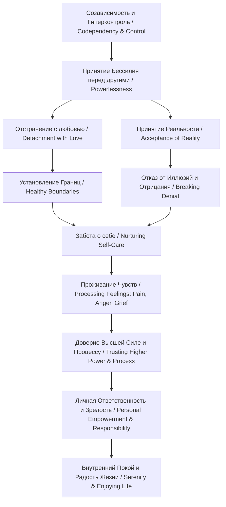

<!-- NotebookLM (Freya), The Language of Letting Go (Beattie), учебный конспект; 23.10.2026; не сверено -->

Представляю вам подробный учебный конспект книги Мелоди Битти **«Язык освобождения» (The Language of Letting Go: Daily Meditations for Codependents)**.Полный конспект также сохранён в виде артефакта **beattie_language_of_letting_go_study_guide.md** в вашей панели Studio.

## Учебный конспект книги Мелоди Битти «Язык освобождения» (The Language of Letting Go)

### 0. Структура книги: Introduction и полный список медитаций

#### Введение (Introduction)

Книга представляет собой сборник ежедневных медитаций, призванных помочь читателю ежедневно выделять несколько минут для восстановления контакта с собой и внутренней мудростью. Книга опирается на ключевые принципы предыдущих бестселлеров Мелоди Битти *«Спасать или спасаться?» (Codependent No More)* и *«Запеть собственным голосом» (Beyond Codependency)*, а также включает новые идеи. Главная цель медитаций — поддержать процесс выздоровления от созависимости, укрепить навыки заботы о себе (*self-care*) и научить отпускать гиперопеку и контроль.

#### Полный календарный список ежедневных медитаций (366 дней)

##### Январь (January)

* **1 января (January 1)**: The New Year — Новый год (The New Year)
* **2 января (January 2)**: Healthy Limits — Здоровые лимиты и границы (Healthy Limits)
* **3 января (January 3)**: Nurturing Self-Care — Взращивание заботы о себе (Nurturing Self-Care)
* **4 января (January 4)**: Separating from Family Issues — Отделение от семейных проблем (Separating from Family Issues)
* **5 января (January 5)**: Accepting Help — Принятие помощи (Accepting Help)
* **6 января (January 6)**: Relationships — Отношения (Relationships)
* **7 января (January 7)**: Dealing with Painful Feelings — Проживание болезненных чувств (Dealing with Painful Feelings)
* **8 января (January 8)**: Vulnerability — Уязвимость (Vulnerability)
* **9 января (January 9)**: Responsibility for Ourselves — Ответственность за себя (Responsibility for Ourselves)
* **10 января (January 10)**: Fear — Страх (Fear)
* **11 января (January 11)**: Letting Go of Guilt — Отпускание чувства вины (Letting Go of Guilt)
* **12 января (January 12)**: Finding Balance — Поиск баланса (Finding Balance)
* **13 января (January 13)**: Good Feelings — Хорошие чувства (Good Feelings)
* **14 января (January 14)**: Accepting Anger — Принятие гнева (Accepting Anger)
* **15 января (January 15)**: Standing Up for Ourselves — Защита своих интересов (Standing Up for Ourselves)
* **16 января (January 16)**: Prayer — Молитва (Prayer)
* **17 января (January 17)**: Acting As If — Действовать «как если бы» (Acting As If)
* **18 января (January 18)**: Gratitude — Благодарность (Gratitude)
* **19 января (January 19)**: Owning Our Power — Владение своей силой (Owning Our Power)
* **20 января (January 20)**: New Beginnings — Новые начала (New Beginnings)
* **21 января (January 21)**: Wants and Needs — Желания и потребности (Wants and Needs)
* **22 января (January 22)**: Appreciating Our Past — Ценить свое прошлое (Appreciating Our Past)
* **23 января (January 23)**: New Energy Coming — Приход новой энергии (New Energy Coming)
* **24 января (January 24)**: Clearing the Slate — Чистый лист (Clearing the Slate)
* **25 января (January 25)**: We — Мы (We)
* **26 января (January 26)**: Off The Hook — Снятие с крючка (Off The Hook)
* **27 января (January 27)**: Needing People — Потребность в людях (Needing People)
* **28 января (January 28)**: Staying in the Present Moment — Оставаться в настоящем моменте (Staying in the Present Moment)
* **29 января (January 29)**: Going to Meetings — Посещение собраний (Going to Meetings)
* **30 января (January 30)**: Religious Freedom — Религиозная свобода (Religious Freedom)
* **31 января (January 31)**: Asking for What We Need — Просьба о том, что нам нужно (Asking for What We Need)

##### Февраль (February)

* **1 февраля (February 1)**: Step Two — Шаг Второй (Step Two)
* **2 февраля (February 2)**: Trusting Our Higher Power — Доверие нашей Высшей Силе (Trusting Our Higher Power)
* **3 февраля (February 3)**: Rejecting Shame — Отвержение стыда (Rejecting Shame)
* **4 февраля (February 4)**: Enjoying Recovery — Радость выздоровления (Enjoying Recovery)
* **5 февраля (February 5)**: Financial Responsibility — Финансовая ответственность (Financial Responsibility)
* **6 февраля (February 6)**: Stopping Victimization — Остановка виктимизации (Stopping Victimization)
* **7 февраля (February 7)**: Owning Our Power — Владение своей силой (Owning Our Power)
* **8 февраля (February 8)**: Letting Go of Guilt — Отпускание чувства вины (Letting Go of Guilt)
* **9 февраля (February 9)**: Letting Go in Love — Отпускание с любовью (Letting Go in Love)
* **10 февраля (February 10)**: Letting Go of Sadness — Отпускание печали (Letting Go of Sadness)
* **11 февраля (February 11)**: Divinely Led — Под божественным руководством (Divinely Led)
* **12 февраля (February 12)**: Letting Go of Those Not in Recovery — Отпускание тех, кто не в выздоровлении (Letting Go of Those Not in Recovery)
* **13 февраля (February 13)**: Trusting Ourselves — Доверие себе (Trusting Ourselves)
* **14 февраля (February 14)**: Valentine’s Day — День Святого Валентина (Valentine’s Day)
* **15 февраля (February 15)**: Control — Контроль (Control)
* **16 февраля (February 16)**: Detachment — Отстранение (Detachment)
* **17 февраля (February 17)**: Acceptance — Принятие (Acceptance)
* **18 февраля (February 18)**: Being Right — Правота (Being Right)
* **19 февраля (February 19)**: Our Path — Наш путь (Our Path)
* **20 февраля (February 20)**: Setting Our Own Course — Прокладывание собственного курса (Setting Our Own Course)
* **21 февраля (February 21)**: Living in the Present — Жизнь в настоящем (Living in the Present)
* **22 февраля (February 22)**: Solving Problems — Решение проблем (Solving Problems)
* **23 февраля (February 23)**: Strength — Сила (Strength)
* **24 февраля (February 24)**: Recognizing Feelings — Распознавание чувств (Recognizing Feelings)
* **25 февраля (February 25)**: Accepting Imperfection — Принятие несовершенства (Accepting Imperfection)
* **26 февраля (February 26)**: Twelve Step Programs — Программы Двенадцати Шагов (Twelve Step Programs)
* **27 февраля (February 27)**: People-Pleasers — Люди-угодники (People-Pleasers)
* **28 февраля (February 28)**: Letting Go of Denial — Отпускание отрицания (Letting Go of Denial)
* **29 февраля (February 29)**: You Are Lovable — Ты достоин любви (You Are Lovable)

##### Март (March)

* **1 марта (March 1)**: Letting Go of Anger — Отпускание гнева (Letting Go of Anger)
* **2 марта (March 2)**: Feelings on the Job — Чувства на работе (Feelings on the Job)
* **3 марта (March 3)**: Accepting Ourselves — Принятие себя (Accepting Ourselves)
* **4 марта (March 4)**: Higher Power as a Source — Высшая Сила как источник (Higher Power as a Source)
* **5 марта (March 5)**: Be Who You Are — Будь собой (Be Who You Are)
* **6 марта (March 6)**: Peace — Мир и покой (Peace)
* **7 марта (March 7)**: Fulfillment — Исполнение и удовлетворение (Fulfillment)
* **8 марта (March 8)**: Surrender — Сдача и капитуляция (Surrender)
* **9 марта (March 9)**: Taking Care of Ourselves — Забота о себе (Taking Care of Ourselves)
* **10 марта (March 10)**: Living with Families — Жизнь с семьей (Living with Families)
* **11 марта (March 11)**: Letting Go of Confusion — Отпускание путаницы (Letting Go of Confusion)
* **12 марта (March 12)**: Timing — Тайминг и выбор времени (Timing)
* **13 марта (March 13)**: Clarity and Direction — Ясность и направление (Clarity and Direction)
* **14 марта (March 14)**: Trusting Ourselves — Доверие себе (Trusting Ourselves)
* **15 марта (March 15)**: Removing the Victim — Устранение роли жертвы (Removing the Victim)
* **16 марта (March 16)**: Positive Energy — Позитивная энергия (Positive Energy)
* **17 марта (March 17)**: Empowering — Наделение силой (Empowering)
* **18 марта (March 18)**: Safety — Безопасность (Safety)
* **19 марта (March 19)**: Staying Out of the Middle — Не лезть в середину чужих конфликтов (Staying Out of the Middle)
* **20 марта (March 20)**: Releasing — Освобождение (Releasing)
* **21 марта (March 21)**: Considering Commitment — Размышления об обязательствах (Considering Commitment)
* **22 марта (March 22)**: Letting Go of Being a Victim — Отпускание роли жертвы (Letting Go of Being a Victim)
* **23 марта (March 23)**: Flack from Setting Boundaries — Сопротивление при установлении границ (Flack from Setting Boundaries)
* **24 марта (March 24)**: Appreciating Ourselves — Ценить себя (Appreciating Ourselves)
* **25 марта (March 25)**: Letting Go of Worry — Отпускание тревоги (Letting Go of Worry)
* **26 марта (March 26)**: Gifts, Not Burdens — Дары, а не обуза (Gifts, Not Burdens)
* **27 марта (March 27)**: After-Burn — Эмоциональное послевкусие (After-Burn)
* **28 марта (March 28)**: Balance — Баланс (Balance)
* **29 марта (March 29)**: Getting Needs Met — Удовлетворение потребностей (Getting Needs Met)
* **30 марта (March 30)**: Experiment — Эксперимент (Experiment)
* **31 марта (March 31)**: Finances — Финансы (Finances)

##### Апрель (April)

* **1 апреля (April 1)**: Going Easy — Легкое отношение к себе (Going Easy)
* **2 апреля (April 2)**: Facing Our Darker Side — Встреча с нашей теневой стороной (Facing Our Darker Side)
* **3 апреля (April 3)**: Acceptance — Принятие (Acceptance)
* **4 апреля (April 4)**: Negotiating Conflicts — Урегулирование конфликтов (Negotiating Conflicts)
* **5 апреля (April 5)**: Detaching in Love — Отстранение с любовью (Detaching in Love)
* **6 апреля (April 6)**: Patience — Терпение (Patience)
* **7 апреля (April 7)**: Those Old-Time Feelings — Старые привычные чувства (Those Old-Time Feelings)
* **8 апреля (April 8)**: Self-Care — Забота о себе (Self-Care)
* **9 апреля (April 9)**: Giving — Умение отдавать (Giving)
* **10 апреля (April 10)**: Using Others to Stop Our Pain — Использование других для глушения боли (Using Others to Stop Our Pain)
* **11 апреля (April 11)**: Financial Goals — Финансовые цели (Financial Goals)
* **12 апреля (April 12)**: Letting Go of Fear — Отпускание страха (Letting Go of Fear)
* **13 апреля (April 13)**: Enjoyment — Наслаждение (Enjoyment)
* **14 апреля (April 14)**: Perfectionism — Перфекционизм (Perfectionism)
* **15 апреля (April 15)**: Communication — Коммуникация (Communication)
* **16 апреля (April 16)**: Letting Things Happen — Позволить вещам происходить (Letting Things Happen)
* **17 апреля (April 17)**: Taking Care of Ourselves — Забота о себе (Taking Care of Ourselves)
* **18 апреля (April 18)**: Freedom — Свобода (Freedom)
* **19 апреля (April 19)**: Accepting Change — Принятие изменений (Accepting Change)
* **20 апреля (April 20)**: Deadlines — Дедлайны (Deadlines)
* **21 апреля (April 21)**: Waiting — Ожидание (Waiting)
* **22 апреля (April 22)**: Coping with Stress — Совладание со стрессом (Coping with Stress)
* **23 апреля (April 23)**: Opening Ourselves to Love — Открытие себя для любви (Opening Ourselves to Love)
* **24 апреля (April 24)**: Lessons on the Job — Уроки на работе (Lessons on the Job)
* **25 апреля (April 25)**: Finding Our Own Truth — Поиск собственной правды (Finding Our Own Truth)
* **26 апреля (April 26)**: Resisting Negativity — Сопротивление негативу (Resisting Negativity)
* **27 апреля (April 27)**: Letting Go of the Need to Control — Отпускание потребности контролировать (Letting Go of the Need to Control)
* **28 апреля (April 28)**: Anger at Family Members — Гнев на членов семьи (Anger at Family Members)
* **29 апреля (April 29)**: Initiating Relationships — Инициация отношений (Initiating Relationships)
* **30 апреля (April 30)**: Balance — Баланс (Balance)

##### Май (May)

* **1 мая (May 1)**: Recovery Prayer — Молитва выздоровления (Recovery Prayer)
* **2 мая (May 2)**: Our Higher Power — Наша Высшая Сила (Our Higher Power)
* **3 мая (May 3)**: Freedom from Self-Seeking — Свобода от эгоцентризма (Freedom from Self-Seeking)
* **4 мая (May 4)**: Freedom from Compulsive Disorders — Свобода от компульсивных расстройств (Freedom from Compulsive Disorders)
* **5 мая (May 5)**: Control — Контроль (Control)
* **6 мая (May 6)**: Feeling Good — Хорошее самочувствие (Feeling Good)
* **7 мая (May 7)**: Letting Go of Fear — Отпускание страха (Letting Go of Fear)
* **8 мая (May 8)**: Giving Ourselves What We Deserve — Давать себе то, чего мы заслуживаем (Giving Ourselves What We Deserve)
* **9 мая (May 9)**: Learning New Behaviors — Обучение новому поведению (Learning New Behaviors)
* **10 мая (May 10)**: Enjoying the Good Days — Наслаждение хорошими днями (Enjoying the Good Days)
* **11 мая (May 11)**: Perfection — Совершенство (Perfection)
* **12 мая (May 12)**: Intimacy — Близость (Intimacy)
* **13 мая (May 13)**: Property Lines — Линии собственности и границы (Property Lines)
* **14 мая (May 14)**: Honesty — Честность (Honesty)
* **15 мая (May 15)**: Take Risks — Рискуй (Take Risks)
* **16 мая (May 16)**: Self-Love — Любовь к себе (Self-Love)
* **17 мая (May 17)**: Boundaries — Границы (Boundaries)
* **18 мая (May 18)**: Living Our Lives — Проживание своей жизни (Living Our Lives)
* **19 мая (May 19)**: Solving Problems — Решение проблем (Solving Problems)
* **20 мая (May 20)**: Sadness — Печаль (Sadness)
* **21 мая (May 21)**: Getting Needs Met — Удовлетворение потребностей (Getting Needs Met)
* **22 мая (May 22)**: Times of Reprogramming — Времена перепрограммирования (Times of Reprogramming)
* **23 мая (May 23)**: Enjoyment — Наслаждение (Enjoyment)
* **24 мая (May 24)**: Letting the Cycles Flow — Позволить циклам течь (Letting the Cycles Flow)
* **25 мая (May 25)**: Loving Ourselves Unconditionally — Безусловная любовь к себе (Loving Ourselves Unconditionally)
* **26 мая (May 26)**: Gossip — Сплетни (Gossip)
* **27 мая (May 27)**: Recognizing Choices — Распознавание выбора (Recognizing Choices)
* **28 мая (May 28)**: Letting Go of Self-Doubt — Отпускание сомнений в себе (Letting Go of Self-Doubt)
* **29 мая (May 29)**: Powerlessness and Unmanageability — Бессилие и неуправляемость (Powerlessness and Unmanageability)
* **30 мая (May 30)**: Commitment — Обязательства (Commitment)
* **31 мая (May 31)**: What If? — Что если? (What If?)

##### Июнь (June)

* **1 июня (June 1)**: Directness — Прямота (Directness)
* **2 июня (June 2)**: Owning Our Power — Владение своей силой (Owning Our Power)
* **3 июня (June 3)**: Charity — Благотворительность и милосердие (Charity)
* **4 июня (June 4)**: Trusting God — Доверие Богу (Trusting God)
* **5 июня (June 5)**: Combating Shame — Борьба с токсичным стыдом (Combating Shame)
* **6 июня (June 6)**: The Gift of Readiness — Дар готовности (The Gift of Readiness)
* **7 июня (June 7)**: Into Orbit — Выход на свою орбиту (Into Orbit)
* **8 июня (June 8)**: Fun — Веселье и радость (Fun)
* **9 июня (June 9)**: Panic — Паника (Panic)
* **10 июня (June 10)**: Responsibility — Ответственность (Responsibility)
* **11 июня (June 11)**: Moving Forward — Движение вперед (Moving Forward)
* **12 июня (June 12)**: Spontaneity and Fun — Спонтанность и радость (Spontaneity and Fun)
* **13 июня (June 13)**: Hanging on to Old Relationships — Удержание старых отношений (Hanging on to Old Relationships)
* **14 июня (June 14)**: Letting Go of Timing — Отпускание сроков и тайминга (Letting Go of Timing)
* **15 июня (June 15)**: Competition Between Martyrs — Соревнование мучеников (Competition Between Martyrs)
* **16 июня (June 16)**: Feeling Good — Хорошее самочувствие (Feeling Good)
* **17 июня (June 17)**: Surrender — Сдача и капитуляция (Surrender)
* **18 июня (June 18)**: Being Vulnerable — Быть уязвимым (Being Vulnerable)
* **19 июня (June 19)**: Making Life Easier — Облегчение жизни (Making Life Easier)
* **20 июня (June 20)**: Relationship Martyrs — Мученики отношений (Relationship Martyrs)
* **21 июня (June 21)**: The Good Feelings — Хорошие чувства (The Good Feelings)
* **22 июня (June 22)**: Work Histories — История работы (Work Histories)
* **23 июня (June 23)**: Letting Go of Old Beliefs — Отпускание старых убеждений (Letting Go of Old Beliefs)
* **24 июня (June 24)**: Detachment — Отстранение (Detachment)
* **25 июня (June 25)**: Withholding — Удерживание чувств (Withholding)
* **26 июня (June 26)**: Surviving Slumps — Преодоление спадов (Surviving Slumps)
* **27 июня (June 27)**: Achieving Harmony — Достижение гармонии (Achieving Harmony)
* **28 июня (June 28)**: When Things Don’t Work — Когда ничего не работает (When Things Don’t Work)
* **29 июня (June 29)**: God’s Will — Воля Бога (God’s Will)
* **30 июня (June 30)**: Accepting Change — Принятие изменений (Accepting Change)

##### Июль (July)

* **1 июля (July 1)**: Receiving — Умение принимать (Receiving)
* **2 июля (July 2)**: Who Knows Best? — Кто знает лучше? (Who Knows Best?)
* **3 июля (July 3)**: Directness — Прямота (Directness)
* **4 июля (July 4)**: Celebrate — Празднуйте (Celebrate)
* **5 июля (July 5)**: Survivor Guilt — Вина выжившего (Survivor Guilt)
* **6 июля (July 6)**: Step Seven — Шаг Седьмой (Step Seven)
* **7 июля (July 7)**: Getting It All Out — Выражение всего накопившегося (Getting It All Out)
* **8 июля (July 8)**: Going with the Flow — Движение по течению жизни (Going with the Flow)
* **9 июля (July 9)**: Overspending and Underspending — Избыточные и недостаточные траты (Overspending and Underspending)
* **10 июля (July 10)**: Ending Relationships — Завершение отношений (Ending Relationships)
* **11 июля (July 11)**: Bring Any Request to God — Приноси любую просьбу Богу (Bring Any Request to God)
* **12 июля (July 12)**: Letting Go of Fear of Abandonment — Отпускание страха быть брошенным (Letting Go of Fear of Abandonment)
* **13 июля (July 13)**: God as We Understand God — Бог, как мы Его понимаем (God as We Understand God)
* **14 июля (July 14)**: We Are Lovable — Мы достойны любви (We Are Lovable)
* **15 июля (July 15)**: Family Buttons — Семейные «кнопки» (Family Buttons)
* **16 июля (July 16)**: Insisting on the Best — Настаивать на лучшем (Insisting on the Best)
* **17 июля (July 17)**: Love, in Words and Actions — Любовь в словах и поступках (Love, in Words and Actions)
* **18 июля (July 18)**: Time to Get Angry — Время разгневаться (Time to Get Angry)
* **19 июля (July 19)**: Proving It to Ourselves — Доказывать самому себе (Proving It to Ourselves)
* **20 июля (July 20)**: Letting Go of Resistance — Отпускание сопротивления (Letting Go of Resistance)
* **21 июля (July 21)**: Being Is Enough — Быть — уже достаточно (Being Is Enough)
* **22 июля (July 22)**: Learning to Trust Again — Учиться доверять снова (Learning to Trust Again)
* **23 июля (July 23)**: Making It Happen — Воплощение в жизнь (Making It Happen)
* **24 июля (July 24)**: Denial — Отрицание (Denial)
* **25 июля (July 25)**: Keep at It — Продолжай в том же духе (Keep at It)
* **26 июля (July 26)**: Owning Our Power — Владение своей силой (Owning Our Power)
* **27 июля (July 27)**: Letting Go — Отпускание (Letting Go)
* **28 июля (July 28)**: Fear — Страх (Fear)
* **29 июля (July 29)**: Have Some Fun — Повеселись (Have Some Fun)
* **30 июля (July 30)**: Accepting Powerlessness — Принятие бессилия (Accepting Powerlessness)
* **31 июля (July 31)**: Letting Go of What We Want — Отпускание того, чего мы хотим (Letting Go of What We Want)

##### Август (August)

* **1 августа (August 1)**: Gratitude — Благодарность (Gratitude)
* **2 августа (August 2)**: In-Between — Переходный период (In-Between)
* **3 августа (August 3)**: Owning Our Power in Relationships — Владение своей силой в отношениях (Owning Our Power in Relationships)
* **4 августа (August 4)**: Vulnerability — Уязвимость (Vulnerability)
* **5 августа (August 5)**: Attitudes Toward Money — Отношение к деньгам (Attitudes Toward Money)
* **6 августа (August 6)**: Solving Problems — Решение проблем (Solving Problems)
* **7 августа (August 7)**: Saying No — Умение говорить «нет» (Saying No)
* **8 августа (August 8)**: Saying Yes — Умение говорить «да» (Saying Yes)
* **9 августа (August 9)**: Asking for What We Need — Просьба о том, что нам нужно (Asking for What We Need)
* **10 августа (August 10)**: Letting Go of Perfection — Отпускание перфекционизма (Letting Go of Perfection)
* **11 августа (August 11)**: Healing — Исцеление (Healing)
* **12 августа (August 12)**: Directness — Прямота (Directness)
* **13 августа (August 13)**: Friends — Друзья (Friends)
* **14 августа (August 14)**: Owning Our Power — Владение своей силой (Owning Our Power)
* **15 августа (August 15)**: Leaving Room for Feelings — Оставлять место для чувств (Leaving Room for Feelings)
* **16 августа (August 16)**: Rescuing Ourselves — Спасение себя (Rescuing Ourselves)
* **17 августа (August 17)**: Healing Thoughts — Исцеляющие мысли (Healing Thoughts)
* **18 августа (August 18)**: Valuing this Moment — Ценность этого момента (Valuing this Moment)
* **19 августа (August 19)**: Letting Go of Shame — Отпускание стыда (Letting Go of Shame)
* **20 августа (August 20)**: Honesty in Relationships — Честность в отношениях (Honesty in Relationships)
* **21 августа (August 21)**: Detaching in Relationships — Отстранение в отношениях (Detaching in Relationships)
* **22 августа (August 22)**: Responsibility for Family Members — Ответственность за членов семьи (Responsibility for Family Members)
* **23 августа (August 23)**: Self-Care — Забота о себе (Self-Care)
* **24 августа (August 24)**: Step Eight — Шаг Восьмой (Step Eight)
* **25 августа (August 25)**: Willing to Make Amends — Готовность возместить ущерб (Willing to Make Amends)
* **26 августа (August 26)**: Making Amends — Возмещение ущерба (Making Amends)
* **27 августа (August 27)**: Procrastination — Прокрастинация (Procrastination)
* **28 августа (August 28)**: Taking Care of Ourselves on the Job — Забота о себе на работе (Taking Care of Ourselves on the Job)
* **29 августа (August 29)**: Owning Our Energy — Владение своей энергией (Owning Our Energy)
* **30 августа (August 30)**: Accepting Our Best — Принятие своего максимума (Accepting Our Best)
* **31 августа (August 31)**: Denial — Отрицание (Denial)

##### Сентябрь (September)

* **1 сентября (September 1)**: Patience — Терпение (Patience)
* **2 сентября (September 2)**: Detaching with Love with Children — Отстранение с любовью от детей (Detaching with Love with Children)
* **3 сентября (September 3)**: Word Power — Сила слова (Word Power)
* **4 сентября (September 4)**: Finding Direction — Поиск направления (Finding Direction)
* **5 сентября (September 5)**: Step Ten — Шаг Десятый (Step Ten)
* **6 сентября (September 6)**: The Good in Step Ten — Польза Десятого Шага (The Good in Step Ten)
* **7 сентября (September 7)**: Powerless over Others — Бессилие перед другими (Powerless over Others)
* **8 сентября (September 8)**: Stopping Our Pain — Остановка нашей боли (Stopping Our Pain)
* **9 сентября (September 9)**: Perspective — Перспектива (Perspective)
* **10 сентября (September 10)**: Self-Approval — Самоодобрение (Self-Approval)
* **11 сентября (September 11)**: Conflict and Detachment — Конфликт и отстранение (Conflict and Detachment)
* **12 сентября (September 12)**: Healing — Исцеление (Healing)
* **13 сентября (September 13)**: Times of Reprogramming — Времена перепрограммирования (Times of Reprogramming)
* **14 сентября (September 14)**: What’s Good for Me? — Что хорошо для меня? (What’s Good for Me?)
* **15 сентября (September 15)**: Getting Through Hard Times — Преодоление трудных времен (Getting Through Hard Times)
* **16 сентября (September 16)**: Revenge — Месть (Revenge)
* **17 сентября (September 17)**: New Relationship Behaviors — Новые модели в отношениях (New Relationship Behaviors)
* **18 сентября (September 18)**: Letting the Good Stuff Happen — Позволить хорошему случаться (Letting the Good Stuff Happen)
* **19 сентября (September 19)**: Apologies — Извинения (Apologies)
* **20 сентября (September 20)**: Spontaneity — Спонтанность (Spontaneity)
* **21 сентября (September 21)**: Letting Go of Urgency — Отпускание спешки и срочности (Letting Go of Urgency)
* **22 сентября (September 22)**: Trusting Ourselves — Доверие себе (Trusting Ourselves)
* **23 сентября (September 23)**: Tolerance — Толерантность (Tolerance)
* **24 сентября (September 24)**: Allowing Ourselves to be Needy — Разрешение себе испытывать нужду (Allowing Ourselves to be Needy)
* **25 сентября (September 25)**: Peace with the Past — Мир с прошлым (Peace with the Past)
* **26 сентября (September 26)**: Feeling Protected — Ощущение защищенности (Feeling Protected)
* **27 сентября (September 27)**: Temporary Setbacks — Временные неудачи (Temporary Setbacks)
* **28 сентября (September 28)**: Prayer — Молитва (Prayer)
* **29 сентября (September 29)**: The Importance of Money — Важность денег (The Importance of Money)
* **30 сентября (September 30)**: Not a Victim — Не жертва (Not a Victim)

##### Октябрь (October)

* **1 октября (October 1)**: Be Who You Are — Будь собой (Be Who You Are)
* **2 октября (October 2)**: Coping with Families — Взаимодействие с семьей (Coping with Families)
* **3 октября (October 3)**: Getting Through the Discomfort — Преодоление дискомфорта (Getting Through the Discomfort)
* **4 октября (October 4)**: Faith and Money — Вера и деньги (Faith and Money)
* **5 октября (October 5)**: Knowledge — Знание (Knowledge)
* **6 октября (October 6)**: Taking Care of Ourselves — Забота о себе (Taking Care of Ourselves)
* **7 октября (October 7)**: Letting Go of Naiveté — Отпускание наивности (Letting Go of Naiveté)
* **8 октября (October 8)**: Learning to Wait — Учиться ждать (Learning to Wait)
* **9 октября (October 9)**: Self-Disclosure — Самораскрытие (Self-Disclosure)
* **10 октября (October 10)**: Payoffs from Destructive Relationships — Вторичная выгода деструктивных отношений (Payoffs from Destructive Relationships)
* **11 октября (October 11)**: Recovery — Выздоровление (Recovery)
* **12 октября (October 12)**: Being Gentle with Ourselves During Times of Grief — Мягкость к себе во времена горя (Being Gentle with Ourselves During Times of Grief)
* **13 октября (October 13)**: Substance over Form — Суть важнее формы (Substance over Form)
* **14 октября (October 14)**: Controlling Versus Trust — Контроль против доверия (Controlling Versus Trust)
* **15 октября (October 15)**: Letting Go of Chaos — Отпускание хаоса (Letting Go of Chaos)
* **16 октября (October 16)**: Being Honest with Ourselves — Честность с самим собой (Being Honest with Ourselves)
* **17 октября (October 17)**: Feelings and Surrender — Чувства и капитуляция (Feelings and Surrender)
* **18 октября (October 18)**: Throwing Out the Rule Book — Выбросить свод правил (Throwing Out the Rule Book)
* **19 октября (October 19)**: Our Good Points — Наши достоинства (Our Good Points)
* **20 октября (October 20)**: Detaching with Love — Отстранение с любовью (Detaching with Love)
* **21 октября (October 21)**: Financial Responsibility — Финансовая ответственность (Financial Responsibility)
* **22 октября (October 22)**: Holding Your Own — Удержание своих позиций (Holding Your Own)
* **23 октября (October 23)**: Morning Cues — Утренние ориентиры (Morning Cues)
* **24 октября (October 24)**: Opening Ourselves to Love — Открытие себя для любви (Opening Ourselves to Love)
* **25 октября (October 25)**: Letting Go of the Past — Отпускание прошлого (Letting Go of the Past)
* **26 октября (October 26)**: Clarity — Ясность (Clarity)
* **27 октября (October 27)**: Step Eleven — Шаг Одиннадцатый (Step Eleven)
* **28 октября (October 28)**: Meditation and Prayer — Медитация и молитва (Meditation and Prayer)
* **29 октября (October 29)**: Acceptance — Принятие (Acceptance)
* **30 октября (October 30)**: Self-Value — Ценность себя (Self-Value)
* **31 октября (October 31)**: All Our Needs — Все наши потребности (All Our Needs)

##### Ноябрь (November)

* **1 ноября (November 1)**: Transformation Through Grief — Трансформация через горе (Transformation Through Grief)
* **2 ноября (November 2)**: The Grief Process — Процесс горевания (The Grief Process)
* **3 ноября (November 3)**: Denial — Отрицание (Denial)
* **4 ноября (November 4)**: Anger — Гнев (Anger)
* **5 ноября (November 5)**: Let’s Make a Deal — Давай договоримся / Торг (Let’s Make a Deal)
* **6 ноября (November 6)**: Enjoying Life — Наслаждение жизнью (Enjoying Life)
* **7 ноября (November 7)**: Relationships — Отношения (Relationships)
* **8 ноября (November 8)**: True to Ourselves — Верность себе (True to Ourselves)
* **9 ноября (November 9)**: Accepting Love — Принятие любви (Accepting Love)
* **10 ноября (November 10)**: Beliefs About Money — Убеждения о деньгах (Beliefs About Money)
* **11 ноября (November 11)**: Discipline — Дисциплина (Discipline)
* **12 ноября (November 12)**: Timing — Тайминг и выбор времени (Timing)
* **13 ноября (November 13)**: Taking Care of Ourselves — Забота о себе (Taking Care of Ourselves)
* **14 ноября (November 14)**: Letting Our Anger Out — Выражение своего гнева (Letting Our Anger Out)
* **15 ноября (November 15)**: Benefits of Recovery — Преимущества выздоровления (Benefits of Recovery)
* **16 ноября (November 16)**: The Victim Trap — Ловушка жертвы (The Victim Trap)
* **17 ноября (November 17)**: Grief and Action — Горевание и действия (Grief and Action)
* **18 ноября (November 18)**: Allowing Ourselves to be Nurtured — Разрешение заботиться о себе (Allowing Ourselves to be Nurtured)
* **19 ноября (November 19)**: Accepting Our Feelings — Принятие своих чувств (Accepting Our Feelings)
* **20 ноября (November 20)**: Wants and Needs — Желания и потребности (Wants and Needs)
* **21 ноября (November 21)**: Financial Fears — Финансовые страхи (Financial Fears)
* **22 ноября (November 22)**: The Magic of Gratitude and Acceptance — Магия благодарности и принятия (The Magic of Gratitude and Acceptance)
* **23 ноября (November 23)**: Healthy Sexuality — Здоровая сексуальность (Healthy Sexuality)
* **24 ноября (November 24)**: Surrender — Сдача и капитуляция (Surrender)
* **25 ноября (November 25)**: Awareness — Осознанность (Awareness)
* **26 ноября (November 26)**: Letting Go of Self-Criticism — Отпускание самокритики (Letting Go of Self-Criticism)
* **27 ноября (November 27)**: We Can Trust Ourselves — Мы можем доверять себе (We Can Trust Ourselves)
* **28 ноября (November 28)**: Back to the Steps — Возврат к Шагам (Back to the Steps)
* **29 ноября (November 29)**: Step Twelve — Шаг Двенадцатый (Step Twelve)
* **30 ноября (November 30)**: Detachment — Отстранение (Detachment)

##### Декабрь (December)

* **1 декабря (December 1)**: Letting People Be There for Us — Позволить людям быть рядом (Letting People Be There for Us)
* **2 декабря (December 2)**: Putting Our Life on Hold — Откладывание жизни на потом (Putting Our Life on Hold)
* **3 декабря (December 3)**: Developing Healthy Tolerance — Развитие здоровой толерантности (Developing Healthy Tolerance)
* **4 декабря (December 4)**: Letting Go — Отпускание (Letting Go)
* **5 декабря (December 5)**: Difficult People — Трудные люди (Difficult People)
* **6 декабря (December 6)**: Letting Go of Shame — Отпускание стыда (Letting Go of Shame)
* **7 декабря (December 7)**: When the Time Is Right — Когда придет время (When the Time Is Right)
* **8 декабря (December 8)**: Valuing Our Needs — Ценность наших потребностей (Valuing Our Needs)
* **9 декабря (December 9)**: Asking for Help — Просьба о помощи (Asking for Help)
* **10 декабря (December 10)**: Empowerment — Обретение силы (Empowerment)
* **11 декабря (December 11)**: Affirmations — Аффирмации (Affirmations)
* **12 декабря (December 12)**: God’s Will — Воля Бога (God’s Will)
* **13 декабря (December 13)**: Giving — Умение отдавать (Giving)
* **14 декабря (December 14)**: Clear Thinking — Ясное мышление (Clear Thinking)
* **15 декабря (December 15)**: Feelings — Чувства (Feelings)
* **16 декабря (December 16)**: Taking Care Of Ourselves Emotionally — Эмоциональная забота о себе (Taking Care Of Ourselves Emotionally)
* **17 декабря (December 17)**: Nurturing Ourselves — Забота о себе (Nurturing Ourselves)
* **18 декабря (December 18)**: Staying Open to Our Feelings — Сохранение открытости своим чувствам (Staying Open to Our Feelings)
* **19 декабря (December 19)**: Work Roles — Рабочие роли (Work Roles)
* **20 декабря (December 20)**: Expectations of Others — Ожидания окружающих (Expectations of Others)
* **21 декабря (December 21)**: Balance — Баланс (Balance)
* **22 декабря (December 22)**: Good Things Coming — Грядут хорошие времена (Good Things Coming)
* **23 декабря (December 23)**: Holiday Triggers — Праздничные триггеры (Holiday Triggers)
* **24 декабря (December 24)**: Getting Through the Holidays — Преодоление праздников (Getting Through the Holidays)
* **25 декабря (December 25)**: The Holidays — Праздники (The Holidays)
* **26 декабря (December 26)**: Growth — Рост (Growth)
* **27 декабря (December 27)**: Near the Top — Около вершины (Near the Top)
* **28 декабря (December 28)**: Panic — Паника (Panic)
* **29 декабря (December 29)**: Moving On — Движение дальше (Moving On)
* **30 декабря (December 30)**: Laying the Foundation — Закладка фундамента (Laying the Foundation)
* **31 декабря (December 31)**: Affirming the Good — Утверждение хорошего (Affirming the Good)

### 1. О чём книга в 3 предложениях

1. Книга «Язык освобождения» Мелоди Битти представляет собой руководство по ежедневному эмоциональному отстранению (*detachment*) от созависимости, гиперопеки и деструктивных попыток контролировать жизнь окружающих.
2. Автор учит смещать постоянный фокус внимания с чужого поведения на собственные чувства, границы и потребности, взращивая навыки осознанной заботы о себе (*self-care*).
3. Через повседневные медитации Битти показывает путь к внутреннему покою через принятие реальности (*acceptance*), проживание чувств и доверие Высшей Силе (*Higher Power*) и естественному процессу жизни.

### 2. Главные идеи по каждому месяцу

#### Январь (January)

* **Новые начинания и цели (****The New Year****)**: Выздоровление начинается с осознанной постановки личных целей и смещения фокуса с проблем других людей на свою собственную жизнь.
* **Здоровые лимиты и границы (****Healthy Limits****)**: Установление и защита личных границ является фундаментом самоуважения и защиты духовного покоя.
* **Забота о себе (****Nurturing Self-Care****)**: Ежедневное удовлетворение физических, эмоциональных и духовных потребностей — это не эгоизм, а личная ответственность за подарок своей жизни.
* **Эмоциональная сепарация от семьи (****Separating from Family Issues****)**: Освобождение от застарелых семейных сценариев и гиперопеки родных позволяет жить своей жизнью без чувства вины.

#### Февраль (February)

* **Доверие Высшей Силе (****Trusting Our Higher Power & Step Two****)**: Принятие того, что мы не можем всё контролировать, и передача заботы о сложных ситуациях Внутренней/Высшей Силе.
* **Отвержение стыда и вины (****Rejecting Shame & Guilt****)**: Осознание того, что манипулятивное чувство вины является ложным, а токсичный стыд разрушает способность к росту.
* **Финансовая ответственность (****Financial Responsibility****)**: Взятие под контроль своих финансов без впадания в крайности жалости к себе или безудержных трат.
* **Отказ от роли жертвы (****Stopping Victimization****)**: Возврат себе личной силы (*Owning Our Power*) и прекращение поиска виноватых.

#### Март (March)

* **Проживание гнева и эмоций на работе (****Feelings on the Job & Anger****)**: Конструктивное выразительное проживание служебных стрессов и гнева без подавления или взрывов.
* **Радикальное самопринятие (****Accepting Ourselves & Authenticity****)**: Отказ от перфекционизма и разрешение себе «быть тем, кто ты есть» (*Be Who You Are*).
* **Капитуляция и сдача (****Surrender****)**: Остановка бессмысленной борьбы с неизменяемыми обстоятельствами приносит моментальный покой и ясность.
* **Высшая Сила как источник ресурсов (****Higher Power as a Source****)**: Поиск опоры во внутренних ценностях, а не во внешнем одобрении.

#### Апрель (April)

* **Мягкость к себе и своему темпу (****Going Easy & Patience****)**: Преодоление внутренней самокритики и принятие неравномерности процесса выздоровления.
* **Встреча с теневой стороной (****Facing Our Darker Side****)**: Легализация «неудобных» чувств (страх, зависть, печаль) как часть исцеления.
* **Принятие реальности и адаптация (****Acceptance****)**: Перестать требовать от мира и людей соответствия нашим иллюзорным ожиданиям.
* **Отстранение с любовью в отношениях (****Detaching in Love****)**: Способность любить человека, не пытаясь спасать его от его собственных жизненных уроков.

#### Май (May)

* **Освобождение от компульсий и контроля (****Freedom from Compulsive Disorders & Control****)**: Осознание того, что попытка контролировать других — это лишь компульсивный способ заглушить собственную тревогу.
* **Освобождение от эгоцентризма (****Freedom from Self-Seeking****)**: Смещение фокуса с попыток быть «всемогущим» на служение и гармонию.
* **Разрешение себе чувствовать себя хорошо (****Feeling Good****)**: Легализация радости, удовольствия и покоя без чувства вины перед страдающими близкими.
* **Преодоление страха (****Letting Go of Fear****)**: Доверие процессу жизни даже тогда, когда будущие шаги еще не видны.

#### Июнь (June)

* **Прямота и открытая коммуникация (****Directness & Communication****)**: Отказ от намеков, манипуляций и угодничества в пользу честного выражения своих желаний.
* **Борьба с токсичным стыдом (****Combating Shame****)**: Разделение понятия «я сделал ошибку» и «я плохой человек».
* **Дар готовности к переменам (****The Gift of Readiness****)**: Принятие того, что перемены происходят тогда, когда мы к ним действительно созрели.
* **Право на радость и отдых (****Fun & Play****)**: Балансировка работы, психотерапии/выздоровления и спонтанного веселья.

#### Июль (July)

* **Умение принимать помощь и любовь (****Receiving****)**: Раскрытие способности принимать заботу от людей и Вселенной без немедленного чувства долга.
* **Преодоление вины выжившего (****Survivor Guilt****)**: Разрешение себе быть счастливым и успешным, даже если родственники или партнеры остаются в проблемах.
* **Очищение от обид (****Step Seven & Getting It All Out****)**: Избавление от накопившегося эмоционального мусора через искренность и прошение о помощи.
* **Движение по течению жизни (****Going with the Flow****)**: Отказ от искусственного форсирования событий и уважение естественных циклов.

#### Август (August)

* **Практика глубокой благодарности (****Gratitude****)**: Благодарность как трансформирующий инструмент, меняющий восприятие недостатка на изобилие.
* **Проживание переходных периодов (****In-Between****)**: Обучение комфортному пребыванию в состоянии неопределенности между прошлым и будущим.
* **Здоровое отношение к деньгам (****Attitudes Toward Money****)**: Баланс между разумной экономией и умением инвестировать в свой комфорт и радость.
* **Искусство твердого «Да» и «Нет» (****Saying No & Saying Yes****)**: Говорить «нет» чужим требованиям без оправданий и «да» собственным возможностям.

#### Сентябрь (September)

* **Отстранение с любовью от детей и близких (****Detaching with Love with Children****)**: Позволить взрослеющим близким нести ответственность за их действия.
* **Сила слова и внутреннего диалога (****Word Power****)**: Трансформация самокритичного внутреннего лексикона на поддерживающие аффирмации.
* **Ежедневный самоаудит (****Step Ten****)**: Регулярная проверка своих действий и реакций для немедленного исправления ошибок и сохранения покоя.
* **Принятие бессилия перед другими (****Powerless over Others****)**: Признание того, что мы не можем изменить ничье мнение, характер или зависимость.

#### Октябрь (October)

* **Сохранение идентичности в семье (****Coping with Families****)**: Умение присутствовать на семейных встречах без втягивания в старые роли и драмы.
* **Прохождение через эмоциональный дискомфорт (****Getting Through the Discomfort****)**: Понимание того, что рост всегда сопровождается временным дискомфортом.
* **Вера и финансовое благополучие (****Faith and Money****)**: Преодоление страха нищеты через доверие своему труду и Высшей Силе.
* **Отпускание наивности (****Letting Go of Naiveté****)**: Развитие реалистичного суждения о людях при сохранении доброты сердца.

#### Ноябрь (November)

* **Трансформация через скорбь и утрату (****Transformation Through Grief & The Grief Process****)**: Прохождение всех стадий горя (отрицание, гнев, торг, печаль, принятие) при потерях.
* **Верность самому себе (****True to Ourselves****)**: Отказ от предательства своих ценностей ради сохранения разрушительных связей.
* **Завершение иллюзий (****Denial & Letting Go of Illusions****)**: Мужество видеть вещи такими, какие они есть, без самообмана.
* **Наслаждение жизнью вопреки прошлому (****Enjoying Life****)**: Понимание того, что скорбь завершается, уступая место новой полноте жизни.

#### Декабрь (December)

* **Разрешение людям быть рядом (****Letting People Be There for Us****)**: Преодоление контрзависимости и гиперноши «я всё сам».
* **Остановка откладывания жизни на потом (****Putting Our Life on Hold****)**: Прекращение ожидания, пока изменится партнер/ситуация, чтобы начать жить.
* **Развитие здоровой толерантности (****Developing Healthy Tolerance****)**: Различение терпимости к человеческим слабостям и попустительства разрушительному поведению.
* **Подведение итогов без стыда (****Letting Go of Shame & Finishing Cycles****)**: Завершение года с благодарностью к пройденным урокам.

### 3. Схема связей между главными идеями (Mermaid graph TD)

### 4. Пошаговый чек-лист практических действий

1. **Пауза и Остановка Реакции (****Pause & Stop Reacting****)**
  * [ ] При возникновении стресса или драмы сделать глубокий вдох и воздержаться от немедленного спасательства, критики или спора.
2. **Проверка Собственных Границ и Ответственности (****Property Lines Check****)**
  * [ ] Спросить себя: *«Чья это проблема? Чья это ответственность — моя или другого человека?»*
  * [ ] Если проблема чужая — мысленно вернуть ответственность владельцу.
3. **Идентификация и Валидация Чувств (****Identify Feelings****)**
  * [ ] Назвать свою эмоцию (страх, гнев, обида, усталость, радость).
  * [ ] Принять это чувство без самоосуждения: *«Это нормально — чувствовать то, что я чувствую»*.
4. **Установление Здоровой Границы (****Set a Healthy Boundary****)**
  * [ ] Обозначить позицию прямо и без агрессии: сформулировать чёткое «нет» или условия взаимодействия.
  * [ ] Отказать без длинных оправданий и чувства вины.
5. **Действие по Заботе о Себе (****Self-Care Action****)**
  * [ ] Сделать прямо сегодня одно конкретное действие для своего тела, эмоционального покоя или духовного ресурса (прогулка, отдых, хобби).
6. **Отпускание Результата и Передача Высшей Силе (****Letting Go of Outcomes****)**
  * [ ] Передать контроль за исходом ситуации и реакциями других людей Высшей Силе / Естественному течению событий.
7. **Ежедневная Вечерняя Инвентаризация и Благодарность (****Step Ten & Gratitude****)**
  * [ ] В конце дня признать свои успехи, записать 3–5 пунктов благодарности и отпустить дневные промахи без стыда.

### 5. Типичные ошибки и как их избежать

1. **Ошибка 1: Использование отстранения как наказания или манипуляции (****Detachment as Punishment****)**
  * *Суть ошибки:* Игра в молчанку, холодность и демонстративный уход с целью заставить другого человека почувствовать вину.
  * *Как избежать:* Отстраняться с любовью (*Detaching with love*) — сохранять доброжелательность, но выходить из взаимодействия, защищая свой покой, а не атакуя собеседника.
2. **Ошибка 2: Синдром спасательства и гиперопека (****Rescuing & Fixing****)**
  * *Суть ошибки:* Постоянный поиск решений за других людей, бросание на помощь в ущерб своим делам и ресурсам.
  * *Как избежать:* Позволить другим людям сталкиваться с естественными последствиями их поступков. Помнить: «Спасая человека от его урока, мы лишаем его возможности вырасти».
3. **Ошибка 3: Накопление обид через угодничество (****People-Pleasing & Resentment****)**
  * *Суть ошибки:* Постоянное соглашательство на чужие просьбы вопреки своим интересам, ведущее к тихой ненависти и эмоциональным взрывам.
  * *Как избежать:* Практиковать прямую коммуникацию (*Directness*). Лучше честное «нет» сразу, чем вынужденное «да» с последующей обидой.
4. **Ошибка 4: Чувство вины за заботу о себе (****Self-Care Guilt****)**
  * *Суть ошибки:* Восприятие отдыха, личных увлечений или отказа от чужих проблем как «эгоизма».
  * *Как избежать:* Переосмыслить заботу о себе (*Self-care*) как главную ответственность перед собой и Высшей Силой. Из истощенного колодца нельзя напоить других.
5. **Ошибка 5: Перфекционизм и форсирование выздоровления (****Forcing Recovery & Perfectionism****)**
  * *Суть ошибки:* Требование от себя «идеального» отпускания, самокритика за срывы в старые паттерны созависимости.
  * *Как избежать:* Помнить о принципе «Прогресс, а не совершенство» (*Progress, not perfection*). Разрешать себе делать ошибки и двигаться шаг за шагом (*One day at a time*).

### 6. 20 карточек «вопрос — ответ» для повторения

**1. Вопрос:** Что такое «отстранение с любовью» (*Detachment with love*)?
**Ответ:** Это способность эмоционально освободиться от проблем, поведения и болезней другого человека, сохраняя к нему уважение и доброжелательность, но переставая контролировать его или спасать от последствий.**2. Вопрос:** В чем разница между здоровой заботой о себе (*Self-care*) и эгоизмом?
**Ответ:** Эгоизм — это требование, чтобы другие жили ради нас. Забота о себе — это взятие ответственности за собственное благополучие, чувства и потребности без посягательства на свободу окружающих.**3. Вопрос:** В чем суть Первого Шага (*Step One*) в контексте созависимости?
**Ответ:** Признание своего бессилия перед поведением, зависимостями и чувствами других людей и признание того, что наша жизнь стала неуправляемой из-за попыток их контролировать.**4. Вопрос:** Как Мелоди Битти определяет личные границы (*Boundaries*)?
**Ответ:** Границы — это невидимые линии собственности (*property lines*), определяющие, где заканчивается наша личность и ответственность и начинается личность и ответственность другого человека.**5. Вопрос:** Как справляться с ложным чувством вины при отказе на чужие просьбы?
**Ответ:** Проверить, нарушили ли мы чьи-то реальные права или просто не оправдали чужие эгоистичные ожидания. Если прав не нарушали — выдохнуть и отпустить вину как манипуляцию.**6. Вопрос:** Что такое вторичная выгода роли жертвы (*Victim Mentality*)?
**Ответ:** Снятие с себя ответственности за собственную жизнь, возможность жалеть себя, обвинять окружающих и получать сочувствие, ничего не меняя.**7. Вопрос:** Каков здоровый подход к проживанию гнева (*Anger*)?
**Ответ:** Принять гнев как естественный сигнал о нарушении границ, не подавлять его и не стыдиться, а выразить безопасно и использовать его энергию для защиты себя.**8. Вопрос:** Что означает концепция «Жить одним днем» (*Living One Day at a Time*)?
**Ответ:** Фокусироваться только на сегодняшнем дне, не пытаясь решить проблемы следующих месяцев или проживать заново прошлые ошибки.**9. Вопрос:** Что лежит в основе угодничества (*People-Pleasing*)?
**Ответ:** Глубинный страх отвержения, низкая самооценка и иллюзия, что через одобрение окружающих можно обрести безопасность.**10. Вопрос:** Какова роль Высшей Силы (*Higher Power*) в процессе отпускания?
**Ответ:** Высшая Сила выступает надежным источником опоры, которому можно доверить то, что находится вне нашего контроля (поведение людей, будущее, исходы событий).**11. Вопрос:** В чем разница между токсичным стыдом (*Shame*) и чувством вины (*Guilt*)?
**Ответ:** Вина говорит: «Я совершил ошибку / поступил неправильно». Токсичный стыд говорит: «Я сам по себе ошибка / я ущербен».**12. Вопрос:** Как преодолеть страх перемен и неопределенности (*Uncertainty*)?
**Ответ:** Принять дискомфорт как естественную часть роста, двигаться маленькими шагами и верить, что изменения ведут к лучшему.**13. Вопрос:** В чем заключается смысл Десятого Шага (*Step Ten Inventory*)?
**Ответ:** В ежедневном самоанализе своих поступков и мотивов: если мы были правы — порадоваться, если ошиблись — признать и немедленно возместить ущерб.**14. Вопрос:** Почему гиперконтроль над другими приводит к выгоранию?
**Ответ:** Потому что попытка контролировать то, что нам не принадлежит (чужой разум и волю), требует бесконечных энергозатрат и всегда оканчивается поражением.**15. Вопрос:** Как отпустить завышенные ожидания от близких (*Expectations*)?
**Ответ:** Принять людей такими, какие они есть, перестать требовать от них невозможного и научиться самостоятельно удовлетворять свои потребности.**16. Вопрос:** Что означает принцип «Действовать как если бы» (*Acting As If*)?
**Ответ:** Начать вести себя так, будто мы уже обладаем нужной уверенностью, спокойствием или верой, что помогает психике сформировать новые паттерны.**17. Вопрос:** Почему созависимым людям трудно просить о помощи (*Asking for Help*)?
**Ответ:** Из-за гордыни, иллюзии гиперавтономии («я всё сам») и страха показаться слабыми или быть отвергнутыми.**18. Вопрос:** Как правильно проходить процесс горя и утраты (*Grief Process*)?
**Ответ:** Разрешить себе последовательно прожить все эмоции (отрицание, гнев, торг, печаль, принятие) без попыток ускорить время или заглушить боль.**19. Вопрос:** Как развивать внутреннюю интуицию (*Intuition*)?
**Ответ:** Учиться слушать тихий внутренний голос в моменты тишины (*Quiet time*), доверять своим ощущениям в теле и отключать чужие мнения.**20. Вопрос:** В чем заключается истинная личная сила (*Owning Our Power*)?
**Ответ:** В осознании того, что мы сами выбираем свои реакции, выстраиваем свою жизнь и несем ответственность за свое счастье.

### 7. 5 практических заданий на применение в профессиональных сферах

#### Задание 1. Интернет-магазин одежды: Управление кассовым разрывом и претензиями клиентов

* **Контекст проблемы:** В интернет-магазине одежды произошла задержка поставки новой коллекции из-за логистического сбоя. Клиенты пишут гневливые отзывы, менеджеры в панике, основатель испытывает острый страх разорения и вину.
* **Применение принципов книги:**
  1. *Принятие реальности (**Acceptance**)*: Признать факт задержки без драмы и поиска виноватых: сбой уже произошел.
  2. *Отстранение от реакций клиентов (**Detachment**)*: Понять, что гнев покупателей адресован ситуации, а не личной ценности основателя.
  3. *Установление границ и прямая коммуникация (**Directness & Boundaries**)*: Написать клиентам честное письмо без оправданий, с указанием реальных сроков и вариантов компенсации (возврат или промокод).
* **Практическое упражнение:** Составить скрипт коммуникации для службы поддержки, исключающий угодничество (*people-pleasing*) и опирающийся на факты и уважение лимитов.

#### Задание 2. B2B-лидогенерация: Преодоление гиперконтроля за воронкой и навязчивого фоллоу-апа

* **Контекст проблемы:** Sales-менеджер B2B-агентства навязчиво звонит крупному клиенту по 5 раз в день, пытается «выжать» сделку, испытывает тревогу и гнев при задержке ответа.
* **Применение принципов книги:**
  1. *Принятие бессилия над чужими решениями (**Powerlessness over Others**)*: Мы можем контролировать качество нашего оффера, но не можем заставить ЛПР подписать контракт.
  2. *Отпускание результата (**Letting Go of Outcomes**)*: Сместить фокус с жгучего желания «закрыть сделку любой ценой» на системное выполнение квалифицированных касаний.
  3. *Доверие процессу (**Trusting the Process**)*: Дать клиенту пространственную паузу для принятия решения.
* **Практическое упражнение:** Разработать регламент фоллоу-апа с фиксированным числом касаний (3–4 касания) и правилом «Stop & Detach» — после 4-го касания переводить лид в автоворонку и переключаться на новые лиды.

#### Задание 3. Claude / Python Data Scraping: Обработка сбоев парсинга и антифрод-систем

* **Контекст проблемы:** Разработчик парсера на Python испытывает сильный стресс из-за того, что целевой сайт постоянно меняет верстку, вводит Cloudflare и забанил пулы IP. Разработчик сидит ночью, чувствуя себя неумехой.
* **Применение принципов книги:**
  1. *Отказ от перфекционизма (**Letting Go of Perfectionism**)*: 100% аптайм парсинга на чужих сайтах невозможен по определению.
  2. *Отпускание спешки и паники (**Letting Go of Urgency & Panic**)*: Ошибки 403/429 — это просто сигналы системы, а не личная катастрофа.
  3. *Операционные границы (**Retry & Fallback Boundaries**)*: Архитектурно заложить лимиты попыток вместо бесконечного цикла.
* **Практическое упражнение:** Написать код на Python с использованием библиотеки tenacity или backoff, где чётко заданы границы попыток (max_tries=3), логирование без эмоций и переключение на фоновый прокси-ротатор при исчерпании лимитов.

#### Задание 4. Интернет-магазин одежды: Преодоление угодничества при невалидных возвратах

* **Контекст проблемы:** Покупательница надела платье на мероприятие, испачкала его, а затем требует вернуть деньги, угрожая испортить репутацию бренда в соцсетях.
* **Применение принципов книги:**
  1. *Отвержение манипулятивной вины и страха (**Rejecting Guilt & Fear**)*: Не поддаваться на шантаж и страх негативного отзыва.
  2. *Установление жестких границ (**Healthy Limits**)*: Защищать экономические границы бизнеса.
  3. *Прямой и спокойный ответ (**Directness**)*: Отказать в возврате вежливо, аргументированно, ссылаясь на правила и экспертизу.
* **Практическое упражнение:** Разработать протокол обработки спорных возвратов для отдела заботы, исключающий страх перед «скандальными клиентами» и защищающий сотрудников от вербального абьюза.

#### Задание 5. B2B & Python Dev: Проработка выгорания и синдрома всемогущества в команде

* **Контекст проблемы:** Тимлид команды автоматизации B2B-маркетинга берет на себя всю разработку, не делегирует задачи по Claude API/Python подчиненным, работает по 14 часов и кричит на коллег при лагах.
* **Применение принципов книги:**
  1. *Признание бессилия перед ограничениями ресурса (**Acknowledging Limits**)*: Один человек не может компенсировать системные проблемы команды.
  2. *Делегирование и разрешение другим ошибаться (**Letting Others Be Responsible**)*: Позволить младшим разработчикам делать ошибки и учиться.
  3. *Ежедневная инвентаризация (**Step Ten Check-in**)*: В конце рабочего дня проводить чек-аут: что сделано, что передано, где проявился контрол-фрик.
* **Практическое упражнение:** Внедрить в workflow команды обязательный вечерний чек-аут и правило «Digital Detachment» — запрет на рабочие сообщения в Slack/Telegram после 19:00 для сохранения ментального здоровья.
