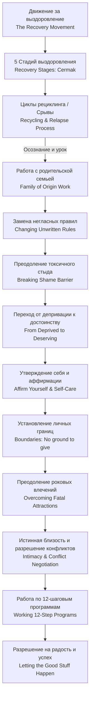

<!-- NotebookLM (Freya), Beyond Codependency (Beattie), учебный конспект; 23.10.2026; не сверено -->

## Учебный конспект книги Мелоди Битти «Beyond Codependency: And Getting Better All the Time» («За пределами созависимости»)

### 0. Полный список разделов и глав книги

#### Вводные материалы (Front Matter)

* **Dedication** — Посвящение
* **Acknowledgments** — Благодарности
* **Introduction** — Введение

#### Раздел I: Выздоровление (Section I: Recovery)

* **Chapter One: The Recovery Movement** — Глава 1: Движение за выздоровление
* **Chapter Two: Recovery** — Глава 2: Выздоровление
* **Chapter Three: The Process** — Глава 3: Процесс
* **Chapter Four: Your Story and Mine** — Глава 4: Ваша и моя история

#### Раздел II: Рецидив / Срыв (Section II: Relapse)

* **Chapter Five: Recycling: The Relapse Process** — Глава 5: Рециклинг: процесс срыва
* **Chapter Six: Common Recycling Situations** — Глава 6: Типичные ситуации рециклинга
* **Chapter Seven: Getting Through the Cycle** — Глава 7: Преодоление цикла

#### Раздел III: История и текущие события (Section III: History and Current Events)

* **Chapter Eight: Coming to Terms with Our Family of Origin** — Глава 8: Примирение с родительской семьей
* **Chapter Nine: Breaking Free** — Глава 9: Освобождение
* **Chapter Ten: Breaking Through the Shame Barrier** — Глава 10: Преодоление барьера стыда
* **Chapter Eleven: From Deprived to Deserving** — Глава 11: От депривации к чувству достойности
* **Chapter Twelve: Affirm Yourself** — Глава 12: Утверждайте и поддерживайте себя

#### Раздел IV: Отношения (Section IV: Relationships)

* **Chapter Thirteen: Improving Our Relationships** — Глава 13: Улучшение наших отношений
* **Chapter Fourteen: Overcoming Fatal Attractions** — Глава 14: Преодоление роковых деструктивных влечений
* **Chapter Fifteen: Boundaries** — Глава 15: Границы
* **Chapter Sixteen: Intimacy** — Глава 16: Близость / Интимность
* **Chapter Seventeen: Negotiating Conflicts** — Глава 17: Разрешение конфликтов
* **Chapter Eighteen: Dealing with Fear of Commitment** — Глава 18: Работа со страхом обязательств и привязанности
* **Chapter Nineteen: Sharing Recovery with Our Children** — Глава 19: Разделение выздоровления с нашими детьми

#### Раздел V: Движение вперед (Section V: Going Forward)

* **Chapter Twenty: Working One (or More) Programs** — Глава 20: Работа по одной (или нескольким) программам
* **Chapter Twenty-One: Letting the Good Stuff Happen** — Глава 21: Позволить хорошему случаться

#### Заключительные материалы (Back Matter)

* **Epilogue** — Эпилог
* **Bibliography** — Библиография

### 1. О чём книга в 3 предложениях

1. Книга Мелоди Битти **«Beyond Codependency»** («За пределами созависимости») — это практическое руководство по углубленному выздоровлению от созависимости (**codependency**) и паттернов взрослых детей из деструктивных семей (**adult children issues**), направленное на тонкую настройку заботы о себе (**self-care**) после того, как острая боль прекратилась.
2. Автор подробно разбирает ключевые этапы восстановления: прохождение повторных циклов возврата к старым моделям (**recycling/relapse**), освобождение от негласных правил родительской семьи (**family of origin**), преодоление токсичного стыда (**shame barrier**), депривации (**deprivation**) и формирование здоровых личных границ (**boundaries**).
3. Главная цель книги — научить человека взращивать любовь к себе (**self-love**), принимать блага и успех, строить зрелые отношения с истинной близостью (**intimacy**) и передавать здоровые паттерны следующим поколениям.

### 2. Главные идеи по главам

#### Introduction (Введение)

* **Продолжение выздоровления**: Первая книга авторки («Codependent No More») была посвящена остановке острой боли, а эта книга — тому, что делать дальше, когда жизнь начинает налаживаться (**continuing our recovery**).
* **Фокус на заботе о себе**: Основной упор сделан на овладении искусством глубокой заботы о себе (**self-care**) и тонкой настройке (**fine-tuning**) всех сфер жизни.
* **Центральная тема**: Развитие любви к себе (**growing in self-love**), самопринятия и способности принимать любовь от других и Высшей Силы (**Higher Power**).

#### Chapter 1: The Recovery Movement (Глава 1: Движение за выздоровление)

* **Масштаб движения**: Выздоровление от созависимости превратилось из изолированных групп в мощное социальное и психологическое движение (**recovery movement**).
* **Легализация боли**: Люди перестают считать себя «сумасшедшими» или изолированными, осознавая, что их реакция была лишь адаптацией к ненормальным условиям (**adaptation to stress**).
* **Гордость за выздоровление**: Участники движения переходят от стыда за свои проблемы к открытой гордости за процесс своего личного роста (**pride in recovery**).

#### Chapter 2: Recovery (Глава 2: Выздоровление)

* **Отсутствие единого определения**: Созависимость остаётся термином, под которым понимают феномен адаптации к проблемам других людей; ключевое признак выздоровления — прекращение боли.
* **Метафора пожара**: Когда пожарный автомобиль уезжает, пожар потушен (**the fire’s out**), но остаются тлеющие угли (**smoldering coals**) — глубокие установки и реакции, требующие длительной работы.
* **Возвращение ответственности**: Выздоровление — это смещение фокуса с попыток изменить других на управление собственной жизнью (**taking responsibility for self**).
* **Свобода выбора**: Переход от выживания (**survival**) к полноценному выбору собственного жизненного пути и чувств.

#### Chapter 3: The Process (Глава 3: Процесс)

* **Динамичность выздоровления**: Выздоровление — это поэтапный, постепенный и предсказуемый процесс (**predictable process**), а не разовое событие.
* **Пять стадий по Тиммену Чермаку (Timmen Cermak)**:
  1. *Выживание/Отрицание* (**survival/denial**): использование защитных механизмов, потеря контакта с собой;
  2. *Переидентификация* (**reidentification**): признание созависимости, капитуляция перед бессилием (**surrender**) и осознание неэффективности старых паттернов;
  3. *Работа с ключевыми проблемами* (**core issues**): проработка чувств (горя/гнева), установление границ, забота о себе;
  4. *Реинтеграция* (**reintegration**): обретение личной силы (**personal power**), возвращение к себе, способность любить и быть любимым;
  5. *Бытие/Бытие заново* (**genesis**): духовное перерождение, свобода и благодарность.
* **Баланс бессилия и силы**: Признание бессилия перед другими (**powerlessness**) дает личную силу управлять собой (**owning personal power**).

#### Chapter 4: Your Story and Mine (Глава 4: Ваша и моя история)

* **Значимость личной истории**: Осознание своей истории (**personal story**) помогает увидеть динамику травмы и освободиться от иллюзий.
* **Уникальность и общность**: При всей уникальности жизненных обстоятельств, созависимые проживают схожие эмоциональные фазы.
* **Доверие текущей точке**: Необходимость доверять тому этапу процесса (**trusting where we’re at**), на котором человек находится прямо сейчас, без самокритики.

#### Chapter 5: Recycling: The Relapse Process (Глава 5: Рециклинг: процесс срыва)

* **Сущность рециклинга**: Возврат к старым созависимым паттернам (**recycling/relapse**) — это нормальная и естественная часть процесса выздоровления, а не катастрофа.
* **Отказ от самообвинения**: Рецидив не означает, что весь предыдущий прогресс аннулирован; это спираль роста (**spiral of growth**), где каждый виток проходит на новом уровне осознанности.
* **Урок в рецидиве**: Каждый рециклинг содержит важную информацию о том, какая потребность была проигнорирована или какая граница нарушена.

#### Chapter 6: Common Recycling Situations (Глава 6: Типичные ситуации рециклинга)

* **Триггеры в работе (Recycling on the Job)**: Взятие на себя чужой ответственности, спасательство коллег, гиперопека (**caretaking**) и неспособность сказать «нет» началу перегрузок.
* **Триггеры в отношениях (Recycling in Relationships)**: Стресс, болезни близких, романтические увлечения или возобновление контактов с деструктивными людьми.
* **Симптомы погружения**: Замораживание чувств (**freezing feelings**), рост тревоги, попытки контроля (**controlling**) и пренебрежение собой (**self-neglect**).

#### Chapter 7: Getting Through the Cycle (Глава 7: Преодоление цикла)

* **Разрушение мифов**: Миф о том, что «после начала выздоровления созависимое поведение никогда не вернется», ведет к стыду и изоляции.
* **Практика альтернатив**: Остановка автоматических реакций через вопрос: «Как я могу позаботиться о себе прямо сейчас?» (**How to take care of myself?**).
* **Инструменты прохождения**: Капитуляция (**surrender**), принятие ситуации, обращение за поддержкой к спонсору или группе, и четкое определение сферы своего контроля.

#### Chapter 8: Coming to Terms with Our Family of Origin (Глава 8: Примирение с родительской семьей)

* **Незавершенные дела**: Непроработанные детские травмы и обиды (**unfinished business**) продолжают управлять взрослыми отношениями.
* **Метод генограммы**: Использование семейных схем и генограмм (**family geneagram**) для отслеживания передаваемых из поколения в поколение деструктивных паттернов.
* **Проживание горя**: Выздоровление требует оплакивания детских потерь (**grief work**), отказа от надежды изменить прошлое или исправить родителей.

#### Chapter 9: Breaking Free (Глава 9: Освобождение)

* **Негласные правила (Unwritten Rules)**: Дисфункциональные семьи живут по правилам: «Не верь, не чувствуй, не говори» (**Don’t trust, don’t feel, don’t speak**), а также «Не меняйся» и «Будь хорошим».
* **Замена правил**: Осознанное переписывание семейного сценария и формулирование новых правил (например: «Я имею право чувствовать», «Я имею право меняться»).
* **Индивидуация**: Выход из семейной системы (**differentiation**) без чувства вины за предательство рода.

#### Chapter 10: Breaking Through the Shame Barrier (Глава 10: Преодоление барьера стыда)

* **Здоровый vs Токсичный стыд**: Здоровый стыд сигнализирует об ошибке в поведении, тогда как токсический/злокачественный стыд (**malignant shame**) внушает, что сам человек «дефектен и плох».
* **Предотвращение контроля стыдом**: Токсичный стыд изолирует человека и делает его легко манипулируемым.
* **Шаги преодоления стыда**:
  1. Вывод стыда на свет/озвучивание (**exposing shame**);
  2. Отношение к стыду как к временному чувству, а не факту личности;
  3. Поиск корней стыда в детстве;
  4. Разделение своей ответственности и чужой;
  5. Отпускание стыда (**releasing shame**).

#### Chapter 11: From Deprived to Deserving (Глава 11: От депривации к чувству достойности)

* **Синдром депривации**: Систематический недостаток любви, безопасности и внимания в детстве формирует эмоциональную депривацию (**deprivation**).
* **Сверхскромность и самоограничение**: Созависимые часто считают, что не заслуживают хорошей жизни, нормального дохода или здоровых отношений (**feeling undeserving**).
* **Смена установки**: Переход от мышления дефицита к принятию того, что человек по праву рождения достоин любви, комфорта и радости (**from deprived to deserving**).

#### Chapter 12: Affirm Yourself (Глава 12: Утверждайте и поддерживайте себя)

* **Сила аффирмаций**: Аффирмации (**affirmations**) — это не магия, а инструмент перепрограммирования бессознательных негативных установок.
* **Действия-утверждения**: Настоящие аффирмации подкрепляются реальными поступками по заботе о себе (**actions that affirm**).
* **Самовоспитание и самодисциплина**: Развитие любящего внутреннего родителя, который одновременно поддерживает (**nurturing**) и обеспечивает самодисциплину (**self-discipline**).

#### Chapter 13: Improving Our Relationships (Глава 13: Улучшение наших отношений)

* **Динамика отношений**: Отношения — это живой организм (**living thing**), требующий постоянной заботы, но не спасательства.
* **Отказ от опеки (Caretaking)**: Замена гиперопеки и контроля на уважение к автономности партнера и фокус на собственной жизни.
* **Взаимность**: Построение отношений на основе равного обмена (**reciprocity**) и взаимной поддержки.

#### Chapter 14: Overcoming Fatal Attractions (Глава 14: Преодоление роковых деструктивных влечений)

* **Феномен «рокового влечения»**: Автоматическое и сильное романтическое влечение к недоступным, зависимым или деструктивным людям (**fatal attractions**).
* **Причина влечения**: Бессознательное стремление воспроизвести привычную детскую динамику и попытка «починить» партнеров.
* **Переучивание эмоционального отклика**: Обучение распознаванию здоровых, надежных людей, даже если на первых порах они кажутся «скучными» по сравнению с привычным хаосом.
* **Правило паузы**: Замедление темпа сближения и категорический отказ от спешки с сексуальной и эмоциональной близостью.

#### Chapter 15: Boundaries (Глава 15: Границы)

* **Определение границ**: Личные границы (**boundaries**) — это лимит того, что человек готов терпеть, отдавать и принимать в отношениях.
* **«Ни шагу назад» (No ground to give)**: Принцип защиты своего физического, эмоционального, ментального и финансового пространства.
* **Правила установки границ**: Границы должны быть четкими, конкретными, подкрепленными действиями (а не пустыми угрозами) и устанавливаться без оправданий.

#### Chapter 16: Intimacy (Глава 16: Близость / Интимность)

* **Сущность истинной близости**: Близость (**intimacy**) — это способность быть полностью открытым, уязвимым и честным перед другим человеком («into-me-see»).
* **Барьеры к близости**: Страх отвержения, маски, отсутствие границ, неоплаканные прошлые травмы и спешка.
* **Поэтапность**: Настоящая близость не возникает мгновенно; она требует времени, безопасности и проверки надежности партнера.

#### Chapter 17: Negotiating Conflicts (Глава 17: Разрешение конфликтов)

* **Конфликт как норма**: Конфликты — естественная часть любых здоровых отношений, а не показатель их краха.
* **Три базовых концепции**:
  1. У меня могут быть проблемы (**I can have problems**);
  2. У других могут быть проблемы (**Others can have problems**);
  3. Проблемы можно решать (**Problems can be solved**).
* **Разделение эмоций и разума**: Соединение эмоционального проживания с рациональным поис ком компромисса (**combining emotion with reason**) без манипуляций и ухода в обиду.

#### Chapter 18: Dealing with Fear of Commitment (Глава 18: Работа со страхом обязательств и привязанности)

* **Природа страха**: Страх обязательств (**fear of commitment**) часто произрастает из опасения потерять себя, быть поглощенным партнером или снова пережить измену/боль.
* **Физические симптомы**: Панические атаки, тревога, удушье, желания убежать при сближении.
* **Баланс привязанности и автономии**: Понимание того, что здоровое обязательство не лишает человека свободы и не уничтожает его границы.

#### Chapter 19: Sharing Recovery with Our Children (Глава 19: Разделение выздоровления с нашими детьми)

* **Прерывание межпоколенческой травмы**: Лучшее, что родитель может сделать для детей — это собственное выздоровление (**working own recovery**).
* **Честность по возрасту**: Признание своих ошибок перед детьми без сваливания на них взрослой ответственности.
* **Обучение границам и чувствам**: Разрешение детям открыто выражать любые эмоции и уважение к их личным границам.

#### Chapter 20: Working One (or More) Programs (Глава 20: Работа по одной (или нескольким) программам)

* **Необходимость структуры**: Использование 12-шаговых программ (Al-Anon, CoDA, ACA) как постоянного инструмента поддержки.
* **Роль спонсора и группы**: Поиск спонсора (**sponsor**) и регулярное посещение встреч для предотвращения изоляции.
* **Гибкость программ**: Возможность сочетать различные группы в зависимости от актуальных потребностей восстановления.

#### Chapter 21: Letting the Good Stuff Happen (Глава 21: Позволить хорошему случаться)

* **Преодоление самосаботажа**: Созависимые привыкли к кризисам и часто бессознательно блокируют успех, радость и покой (**blocking the good**).
* **Разрешение на счастье**: Осознанное принятие изобилия, гармонии и любви без ожидания немедленной расплаты.
* **Доверие жизни**: Способность расслабиться и позволить позитивным событиям разворачиваться своим чередом.

#### Epilogue (Эпилог)

* **Личное послание автора**: Мелоди Битти делится личным опытом писательства и любовью к читателям.
* **Непрерывность пути**: Выздоровление — это не конечный пункт назначения, а стиль жизни, наполненный надеждой, любовью и открытостью.

### 3. Схема связей между главными идеями (Mermaid graph TD)

### 4. Пошаговый чек-лист практических действий

1. **Ежедневная самодиагностика потребностей**: Задавайте себе вопрос 3–4 раза в день: *«Что я чувствую прямо сейчас и что мне нужно сделать, чтобы позаботиться о себе?»* (**How to take care of myself?**).
2. **Отказ от реактивности**: Сделайте паузу перед тем, как автоматически согласиться на чужую просьбу или броситься кого-то спасать.
3. **Составление семейной генограммы**: Нарисуйте схему своей родительской семьи (**family geneagram**), выпишите повторившиеся паттерны (зависимости, гиперопека, молчание, стыд).
4. **Ревизия негласных правил**: Запишите 5 правил вашей детской семьи (например: *«Не заставляй маму расстраиваться»*) и перепишите их на новые разрешения (например: *«Я имею право выражать свои чувства, даже если другие несогласны»*).
5. **Дневник стыда**: При возникновении чувства собственной «неполноценности» выпишите ситуацию на бумагу, разделите свою реальную ответственность и чужие ожидания (**exposing shame**).
6. **Формулирование формулы границ**: Составьте четкое утверждение границ для проблемных сфер: *«Я готов сделать X, но я не буду делать Y, если происходит Z»*.
7. **Практика аффирмаций действием**: Подкрепляйте позитивные установки конкретными поступками (купите себе качественную вещь, отдохните, сходите на прогулку, откажитесь от переработки).
8. **Правило медленных свиданий**: В новых отношениях намеренно замедляйте сближение, не спешите с сексом и эмоциональной откровенностью до проверки надежности человека.
9. **Работа в группе поддержки**: Посещайте регулярные встречи (Al-Anon, CoDA, ACA), найдите спонсора (**sponsor**) и делитесь опытом.
10. **Разрешение на радость**: Сделайте списки вещей, которые приносят вам удовольствие, и планируйте их в календаре как обязательные задачи.

### 5. Типичные ошибки и как их избежать

| № | Типичная ошибка | Как проявляется (в книге) | Как избежать (решение по книге) |
| --- | --- | --- | --- |
| 1 | Самогашение при рецидиве | Впадение в стыд и отчаяние при возврате к созависимому behaviors («Я снова все испортил!»). | Воспринимать рециклинг (recycling) как нормальный виток спирали роста; спросить: «Чему этот случай меня учит?». |
| 2 | Спасательство на работе | Взятие на себя чужих обязанностей, переработки, опека коллег и начальника (job caretaking). | Установить четкие рабочие границы, выходить из роли спасателя, занимать позицию здорового профессионализма. |
| 3 | Спешка в близости | Быстрый переход к сексу и глубоким откровениям на первых свиданиях. | Понимать, что истинная близость (intimacy) требует времени и эмоциональной безопасности; соблюдать правило паузы. |
| 4 | Попытки изменить родителей | Попытки доказать родителям их правоту или заставить их попросить прощения. | Пройти этап горевания (grief work), принять их ограничения и сфокусироваться на собственной жизни. |
| 5 | Маскировка токсичного стыда | Перфекционизм, угодничество (pleasing) или уход в изоляцию из-за страха быть «разоблаченным». | Выводить стыд на свет (exposing shame), проговаривать его с безопасными людьми и разделять оценку действий от оценки личности. |
| 6 | Самосаботаж при успехе | Бессознательное создание хаоса или тревоги, когда в жизни все становится спокойно и хорошо. | Отслеживать страх благополучия, давать себе осознанное разрешение принятие блага (letting the good stuff happen). |

### 6. 20 карточек «вопрос — ответ» для повторения

1. **В:** Чем книга «Beyond Codependency» отличается от «Codependent No More»? **О:** Первая книга была посвящена остановке острой боли и взятию контроля над жизнью, а эта — продолжению выздоровления, глубокой заботе о себе и строительству здоровой жизни.
2. **В:** Что такое «тлеющие угли» (smoldering coals) в контексте выздоровления? **О:** Это глубокие внутренние паттерны и установки созависимости, которые остаются после того, как острая кризисная ситуация («пожар») уже ликвидирована.
3. **В:** Перечислите 5 стадий выздоровления по Тиммену Чермаку. **О:** 1. Выживание/Отрицание (survival/denial); 2. Переидентификация (reidentification); 3. Работа с ключевыми проблемами (core issues); 4. Реинтеграция (reintegration); 5. Бытие заново (genesis).
4. **В:** Что такое «рециклинг» (recycling) в выздоровлении? **О:** Это временный возврат к старым созависимым паттернам поведения, являющийся естественной частью спирального процесса роста.
5. **В:** Является ли рециклинг признаком того, что выздоровление провалено? **О:** Нет. Это возможность осознать незамеченную потребность или нарушенную границу и пройти новый виток роста на более глубоком уровне.
6. **В:** Какое главное правило родительской семьи блокирует изменения? **О:** Правило «Не меняйся и не нарушай систему» (Don’t disrupt the system by growing or changing).
7. **В:** В чем разница между здоровым и токсичным стыдом? **О:** Здоровый стыд указывает на неподобающий поступок, а токсичный (malignant shame) внушает, что сам человек дефектен и плох.
8. **В:** Каковы 5 шагов преодоления барьера стыда? **О:** 1. Озвучивание/вывод на свет; 2. Отношение как к временному чувству; 3. Поиск детских корней; 4. Коррекция поведения; 5. Отпускание.
9. **В:** Что такое «эмоциональная депривация» (deprivation)? **О:** Хронический недостаток любви, безопасности, внимания и поддержки в детстве, формирующий привычку ограничивать себя во взрослой жизни.
10. **В:** Каковы главные составляющие эффективной аффирмации? **О:** Аффирмация должна быть позитивным утверждением в настоящем времени и обязательно подкрепляться реальными действиями по заботе о себе.
11. **В:** Что такое «роковые влечения» (fatal attractions)? **О:** Сильное автоматическое подсознательное влечение к эмоционально недоступным или деструктивным партнерам.
12. **В:** Почему созависимым здоровые партнеры часто кажутся «скучными»? **О:** По причине отсутствия привычного адреналина, хаоса и привычной роли спасателя.
13. **В:** Каков главный принцип личных границ по Мелоди Битти? **О:** «Ни шагу назад» (No ground to give) — четкое определение того, что человек готов и не готов терпеть и отдавать.
14. **В:** Что означают слова «into-me-see» применительно к близости (intimacy)? **О:** Истинная близость — это способность позволить другому увидеть тебя настоящего, без масок и защитных барьеров.
15. **В:** Назовите 3 базовые концепции успешного разрешения конфликтов. **О:** 1. У меня могут быть проблемы; 2. У других могут быть проблемы; 3. Проблемы можно решать.
16. **В:** Почему возникает страх обязательств (fear of commitment)? **О:** Из-за опасения потерять свою автономию, раствориться в партнере или снова переживать травму предательства.
17. **В:** Как лучше всего помочь своим детям в контексте выздоровления? **О:** Заниматься собственным выздоровлением, быть честными и уважать личные границы детей.
18. **В:** Какова роль 12-шаговых программ в процессе продолжения выздоровления? **О:** Они дают постоянную безопасную среду, структуру, поддержку единомышленников и инструменты саморефлексии.
19. **В:** Почему созависимые блокируют наступление хороших событий (blocking the good)? **О:** Из-за привычки жить в тревоге и страха, что за радостью обязательно последует наказание или катастрофа.
20. **В:** Что находится «за пределами созависимости» (beyond codependency)? **О:** Свобода быть собой, способность любить себя и других, принимать блага жизни и жить полноценной, радостной жизнью.

### 7. Практические задания на применение (для бизнес- и тех-контекстов)

*Примечание: Все задания основаны на адаптации психотерапевтических инструментов книги (границы, отказ от спасательства, проработка стыда, переговоры и преодоление самосаботажа) к профессиональной среде.*

#### Задание 1. Интернет-магазин одежды: Установление границ с «токсичными» клиентами и поставщиками

* **Контекст книги**: Глава 15 (*Boundaries: No ground to give*) и Глава 6 (*Recycling on the Job*).
* **Сценарий**: Клиенты интернет-магазина регулярно требуют бесплатную доставку вне правил, задерживают оплату или проявляют агрессию к менеджерам поддержке, а команда из созависимого угодничества (**pleasing**) пытается «спасти» каждого клиента себе в убыток.
* **Задание**:
  1. Разработайте «Регламент границ сервиса» (**Boundary Policy**), четко фиксирующий, какие претензии принимаются, а какие взаимодействия немедленно прекращаются.
  2. Проведите с отделом продаж упражнение по отказу от роли спасателя (**caretaker**): научите сотрудников отвечать вежливо, но твердо по формуле: *«Мы ценим ваш заказ, но не можем нарушать регламент возврата»*.

#### Задание 2. B2B-лидогенерация: Преодоление «роковых влечений» к деструктивным клиентам

* **Контекст книги**: Глава 14 (*Overcoming Fatal Attractions*) и Глава 11 (*From Deprived to Deserving*).
* **Сценарий**: Сейлз-команда B2B-агентства сфокусирована на выбивании контрактов с капризными, неуважительными заказчиками, которые постоянно меняют ТЗ и не платят вовремя, игнорируя надежных и адекватных клиентов («скучные клиенты»).
* **Задание**:
  1. Составьте список «Красных флагов деструктивного клиента» (**Fatal Attraction Indicators** в B2B): размытый бюджет, проявление неуважения на созвоне, требование работать по выходным.
  2. Внедрите правило квалификации лидов (Lead Qualification Rule): если клиент демонстрирует 2+ красных флага, лид дисквалифицируется, а ресурсы перенаправляются на стабильных B2B-партнеров.

#### Задание 3. Команда сборщиков данных на Claude / Python: Преодоление барьера стыда при сбоях парсеров

* **Контекст книги**: Глава 10 (*Breaking Through the Shame Barrier*) и Глава 17 (*Negotiating Conflicts*).
* **Сценарий**: Разработчик парсеров на Python/Claude допустил ошибку в скрипте, из-за чего сайт-донор заблокировал IP-адреса компании. Из-за токсичного стыда (**malignant shame**) и страха выглядеть некомпетентным разработчик скрывает ошибку полдня, усугубляя простой.
* **Задание**:
  1. Внедрите в инженерную культуру практику «Безопасных постотчетов» (**Blameless Post-Mortem**), разделяющую личность разработчика и факт ошибки в коде (согласно Главе 10: *«Код с ошибкой — это проблема кодинга, а не дефект вашей личности»*).
  2. Напишите алгоритм действий при сбое: логирование -> анонс в Slack без стыда -> совместный поиск решения через совмещение эмоций и разума (**combining emotion with reason**).

#### Задание 4. Переговоры и Scope Creep в e-commerce и IT-разработке

* **Контекст книги**: Глава 17 (*Negotiating Conflicts*) и Глава 9 (*Breaking Free*).
* **Сценарий**: Заказчик сайта одежды постоянно добавляет новые хотелки в смету (Scope Creep), а ПМ из страха конфликта соглашается на все доработки бесплатно, перегружая команду.
* **Задание**:
  1. Примените 3 концепции из Главы 17: *1. У нас есть проблема (растут часы); 2. У клиента есть проблема (нужна фича); 3. Проблему можно решить переговорами.*
  2. Подготовьте скрипт переговоров: *«Мы с радостью добавим этот модуль в ваш интернет-магазин, но это потребует доп. соглашения на 40 часов кода или переноса срока релиза на 2 недели. Какое решение выбираем?»*.

#### Задание 5. Разрешение на успех при масштабировании B2B и автотестов на Python

* **Контекст книги**: Глава 21 (*Letting the Good Stuff Happen*) и Глава 18 (*Fear of Commitment*).
* **Сценарий**: Команда успешно автоматизировала сбор данных и B2B-лидогенерацию через Python/Claude. Все метрики растут, но фаундеры испытывают фоновую тревогу, ищут подвох и начинаю вручную перепроверять рабочие скрипты, ломая автоматизацию.
* **Задание**:
  1. Проведите рефлексивную сессию по Главе 21: выпишите страхи (например: *«Если все работает идеально, скоро произойдет катастрофа»*).
  2. Замените паттерн самосаботажа на осознанное принятие успеха: зафиксируйте метрики автоматизации в дашборде и установите правило «Не чинить то, что отлично работает».
