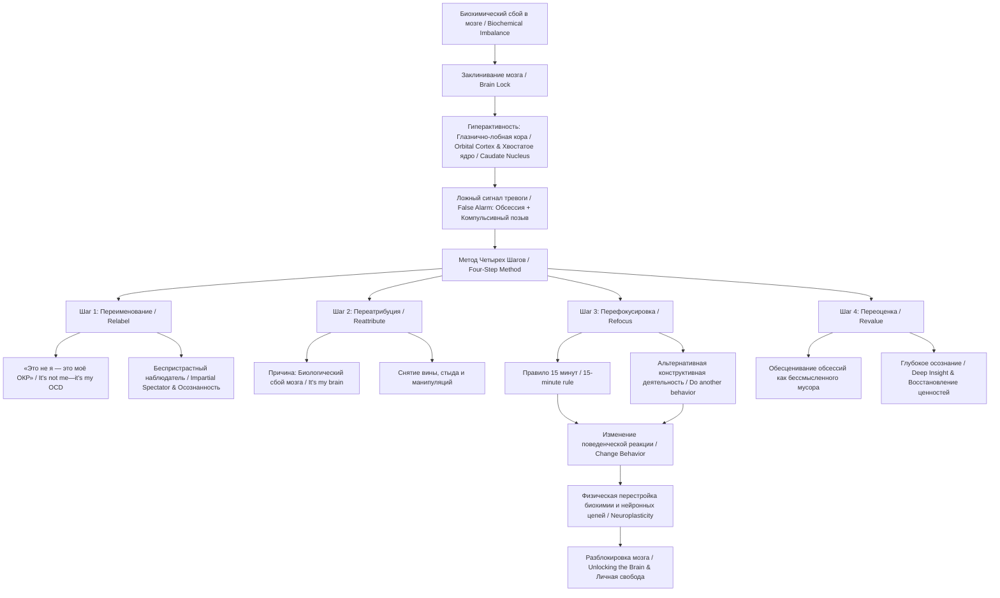

Этот учебный конспект книги Джеффри Шварца **«Brain Lock»** («Как преодолеть ОКР») составлен строго на основе материалов источника,.

#### 0. Полный список глав книги (Full List of Chapters)

**PART I: The Four Steps** (Часть I: Четыре шага)
* **Chapter 1. Step 1: Relabel: “It’s Not Me—It’s My OCD”** (Шаг 1: Переименование: «Это не я — это моё ОКР»).
* **Chapter 2. Step 2: Reattribute: “Unlocking Your Brain”** (Шаг 2: Переатрибуция: «Разблокировка вашего мозга»).
* **Chapter 3. Step 3: Refocus: “Wishing Won’t Make It So”** (Шаг 3: Перефокусировка: «Одного желания недостаточно»).
* **Chapter 4. Step 4: Revalue: “Lessons Learned from OCD”** (Шаг 4: Переоценка: «Уроки, извлечённые из ОКР»).
**PART II: Applying the Four Steps to Your Life** (Часть II: Применение четырёх шагов в вашей жизни)
* **Chapter 5. The Four Steps and Personal Freedom** (Четыре шага и личная свобода).
* **Chapter 6. OCD as a Family Disorder** (ОКР как семейное расстройство).
* **Chapter 7. The Four Steps and Other Disorders: Overeating, Substance Abuse, Pathological Gambling, and Compulsive Sexual Behavior** (Четыре шага и другие расстройства: переедание, злоупотребление веществами, патологическая игромания и компульсивное сексуальное поведение).
* **Chapter 8. The Four Steps and Traditional Approaches to Behavior Therapy** (Четыре шага и традиционные подходы к поведенческой терапии).
* **Chapter 9. OCD and Medication** (ОКР и медикаменты).
* **Chapter 10. University of Hamburg Obsession-Compulsion Inventory Screening Form** (Скрининговая форма Гамбургского опросника навязчивостей и компульсий).
* **Chapter 11. An OCD Patient’s Diary of Four-Step Self-Treatment** (Дневник пациента с ОКР, применяющего четырехшаговое самолечение).
**PART III: Self-Treatment Manual for the Four-Step Method** (Часть III: Руководство по самолечению по методу четырёх шагов).

#### 1. О чём книга в 3 предложениях

1. Книга Джеффри Шварца «Brain Lock» представляет собой руководство по **когнитивно-биоповеденческому самолечению** (cognitive-biobehavioral self-treatment) обсессивно-компульсивного расстройства (Obsessive-Compulsive Disorder, OCD),.
2. В основе авторского метода лежит четкая система **Четырех Шагов** — **Переименование** (Relabel), **Переатрибуция** (Reattribute), **Перефокусировка** (Refocus) и **Переоценка** (Revalue), — помогающая человеку осознать навязчивые мысли (obsessions) и компульсивные позывы (compulsive urges) как ложные биохимические сигналы мозга («заклинивание мозга», Brain Lock),,–.
3. Путем изменения поведенческой реакции и осознанного переключения внимания человек задействует **«беспристрастного наблюдателя»** (Impartial Spectator) и физически перестраивает гиперактивные нейронные цепи головного мозга без жесткой зависимости от фармакотерапии,,,,.

#### 2. Главные идеи по главам

##### **Глава 1. Step 1: Relabel: “It’s Not Me—It’s My OCD”**

* **Называние вещей своими именами**: необходимо четко отграничить реальность от симптомов, называя мысли обсессиями (obsessions), а позывы — компульсивными позывами (compulsive urges),,.
* **Принцип разделения «Я» и болезни**: главное оружие пациента — установка **«Это не я — это моё ОКР»** ("It's not me—it's my OCD"), предотвращающая отождествление личности с импульсом,.
* **Активация «Беспристрастного наблюдателя» (Impartial Spectator)**: использование осознанности (mindful awareness) по концепции Адама Смита для наблюдения за симптомами со стороны,,,.
* **Подшаги Предвосхищение (Anticipation) и Принятие (Acceptance)**: умение заранее ожидать появление навязчивости в известных триггерах и принимать факт ее присутствия без страха,,.
* **Вспомогательные инструменты**: применение диктофонных петель (tape loops) для десенсибилизации тревожных мыслей и ведение дневника успеха,,,.

##### **Глава 2. Step 2: Reattribute: “Unlocking Your Brain”**

* **Биологическая природа симптомов**: объяснение того, что навязчивости вызваны биохимическим сбоем и гиперактивностью глазнично-лобной коры (orbital cortex) и хвостатого ядра (caudate nucleus),,,,.
* **Перенос причины на биохимию**: формула **«Это не я, это биологическая проблема моего мозга»** ("It's not me—it's my brain") снимает с пациента чувство стыда и вины,,.
* **Хвостатое ядро как «коробка передач»**: при ОКР автоматический фильтр мозга заклинивает в нейтрали («заклинивание мозга», Brain Lock), переставая отсеивать ложные сигналы,,,.
* **Ложная тревога (False Alarm)**: осознание того, что ощущение «что-то не так» подобно замкнувшей автомобильной сигнализации, которую бессмысленно пытаться отключить усилием мысли,,.
* **Разрыв нейронной цепи**: систематическое изменение поведения при наличии тревожного сигнала способно физически перестроить метаболизм гиперактивных зон мозга,,.

##### **Глава 3. Step 3: Refocus: “Wishing Won’t Make It So”**

* **Действие как ядро терапии**: переключение внимания на альтернативное, конструктивное поведение (**do another behavior**) вопреки позыву,,,,.
* **Правило 15 минут (15-minute rule)**: обязательная задержка выполнения ритуала минимум на 15 минут с помощью активного погружения в заготовленное занятие,,,.
* **Ручное переключение передач**: альтернативное действие берет на себя функцию сломанного хвостатого ядра и заставляет нейронные цепи переключаться вручную,,,.
* **Принцип «Работаешь — побеждаешь»**: успех измеряется не мгновенным исчезновением тревоги, а способностью выполнять альтернативное действие несмотря на дискомфорт,,,.
* **Управление задержкой и дневник**: даже небольшая задержка в 1–5 минут на начальных этапах является победой и фиксируется в дневнике поведенческой терапии,,,,.

##### **Глава 4. Step 4: Revalue: “Lessons Learned from OCD”**

* **Обесценивание симптомов**: естественный результат первых трех шагов — осознание того, что навязчивости представляют собой бессмысленный «мусор» (garbage),,.
* **Формирование глубокого видения (Deep Insight)**: переход от поверхностного повторения фраз к глубокому пониманию ложности сигналов ОКР прямо в пик тревоги,,.
* **Снятие морального груза**: осознание того, что неприемлемые навязчивые мысли происходят вопреки воле человека и не отражают его нравственный облик,,,.
* **Развитие внутренней силы**: преодоление испытания ОКР приводит к ценностному сдвигу, росту сострадания и укреплению личной свободы,,,.
* **Запуск самоподдерживающегося цикла**: Переоценка облегчает Переименование и Переатрибуцию, ускоряет Перефокусировку и еще сильнее снижает интенсивность симптомов,,.

##### **Глава 5. The Four Steps and Personal Freedom**

* **Ообретение личной свободы**: освобождение от рабской подчиненности ритуалам и возвращение контроля над жизнью,.
* **Вопрос «Зачем я это делаю?»**: регулярный вопрос к себе с позиции «Беспристрастного наблюдателя» помогает мгновенно возвращаться к реальности,.
* **Самоуправляемая нейропластичность (Self-directed neuroplasticity)**: волевое ментальное усилие физически трансформирует биохимию и структуру мозга,.
* **Предотвращение руминаций**: применение техники ментальных заметок (mental notes) для остановки бытовых навязчивых размышлений,,.
* **Постоянная осознанность**: генерация здоровых мыслей прямо в момент остановки деструктивного ментального потока,.

##### **Глава 6. OCD as a Family Disorder**

* **Вовлечение семьи в болезнь**: члены семьи часто становятся невольными соучастниками ритуалов (enablers) и истощаются от постоянных требований заверений (reassurance),,.
* **Принцип «Не поддерживай ОКР — поддерживай терапию»**: близкие должны доброжелательно, но твердо отказывать в участии в проверках и выдаче заверений,,.
* **Вторичная выгода (Secondary Gain) и манипуляция**: использование симптомов ОКР в качестве непроизвольного «оружия» для контроля над родственниками,,,.
* **Семейные конфликты**: необходимость снижения уровня негативных эмоций и открытого обсуждения проблемы без взаимных обвинений,,.
* **Совместное преодоление**: объединение семьи вокруг поддержки пациента в выполнении правил задержки и Четырех Шагов,,.

##### **Глава 7. The Four Steps and Other Disorders: Overeating, Substance Abuse, Pathological Gambling, and Compulsive Sexual Behavior**

* **Расширение сферы применения**: применение 4 шагов к расстройствам импульсивного контроля (переедание, алкоголизм, игромания, компульсивный секс, трихотилломания),,.
* **Ключевое отличие от ОКР**: при ОКР позывы изначально воспринимаются как чужеродные (эго-дистонические), тогда как при аддикциях импульс приносит краткосрочное удовольствие,,.
* **Формирование эго-дистоничности**: работа по осознанию того, что аддиктивный позыв противоречит истинным долгосрочным ценностям личности,,.
* **Роль воли и ответственности**: осознание своей полной ответственности за поведенческую реакцию на биохимический импульс.
* **Занятость рук при трихотилломании**: обязательное включение моторики рук в Шаге 3 (вязание, лепка, сжатие эспандера) для блокировки выдергивания волос.

##### **Глава 8. The Four Steps and Traditional Approaches to Behavior Therapy**

* **Классическая экспозиция и предотвращение реакций (Exposure and Response Prevention, ERP)**: анализ традиционной методики разрушения связи между обсессией и тревогой,,.
* **Шкала SUDS (Subjective Units of Distress Scale)**: ранжирование страхов и компульсий от 0 до 100 баллов для постепенной проработки,.
* **Составление иерархии симптомов**: выбор начальных мишеней для терапии со среднего уровня дискомфорта (около 50 SUDS),.
* **Преимущество 4 шагов перед ERP**: метод Шварца дает активный алгоритм Перефокусировки и нейробиологическое понимание процесса вместо пассивного выдерживания тревоги,,.
* **Поэтапность и безопасность**: постепенный подъем по иерархии без применения травмирующего метода «погружения» (flooding),,.

##### **Глава 9. OCD and Medication**

* **Концепция «Нарукавников для плавания» (Waterwings)**: медикаменты (СИОЗС / SSRIs) рассматриваются лишь как временное средство для снижения уровня тревоги, облегчающее проведение поведенческой работы,,.
* **Препараты выбора**: применение селективных ингибиторов обратного захвата серотонина (флуоксетин, пароксетин, флувоксамин) и кломипрамина,.
* **Временной лаг эффекта**: фармакотерапия требует от 2 до 3 месяцев постоянного приема для разворачивания полного эффекта,.
* **Постепенное снижение дозировок**: по мере укрепления навыков 4 шагов доза медикаментов под контролем врача снижается вплоть до отмены,,.
* **Недостаточность только лекарств**: сами по себе медикаменты не меняют поведенческие паттерны и при отмене без терапии часто дают рецидив,.

##### **Глава 10. University of Hamburg Obsession-Compulsion Inventory Screening Form**

* **Гамбургский опросник навязчивостей и компульсий**: диагностический инструмент самооценки, разработанный др. Ивером Хандом и Рудигером Клепшем,.
* **Разделение на обсессии и компульсии**: опросник содержит 27 пунктов формата «Верно/Неверно», позволяющих отдельно подсчитать баллы выраженности обсессий и компульсий,.
* **Инвентаризация симптоматики**: диагностика охватывает мысли о заражении, контрастные мысли, проверки, счет, упорядочивание и повторение–.
* **Объективизация прогресса**: использование формы до и после курса самолечения для оценки динамики снижения симптомов,.

##### **Глава 11. An OCD Patient’s Diary of Four-Step Self-Treatment**

* **Иллюстрация личного дневника**: пример того, как реальный пациент с ОКР структурирует применение 4 шагов в повседневных записях.
* **Детализация Шага 1**: разбор типов обсессий (насилие, сквернословие, заражение) и компульсий (мыслительные, проверки, заверения).
* **Фиксация формулировок Шага 2**: использование заметок-напоминаний о биохимическом сбое («Застрял в передаче», «Это не я — это моё ОКР»).
* **Практика задержки и Перефокусировки**: фиксация времени задержки ритуала и выбранных видов альтернативной активности,.
* **Отслеживание динамики**: регулярные короткие записи помогают видеть прогресс и предотвращать деморализацию,.

#### 3. Схема связей между главными идеями в формате Mermaid (graph TD)

#### 4. Пошаговый чек-лист практических действий

1. **Провести инвентаризацию симптомов**: Составить полный список своих обсессий и компульсий, ранжировав их по шкале дискомфорта SUDS (от 0 до 100),.
2. **Завести дневник поведенческой терапии**: Подготовить записную книжку для фиксации ежедневных успехов и применения шагов,,.
3. **Применить Шаг 1 (Relabel) при приступе**: В момент возникновения позыва четко произнести: «Это не реальная угроза, это обсессия / компульсивный позыв ОКР»,.
4. **Применить Шаг 2 (Reattribute)**: Напомнить себе биологическую причину: «Это не моя воля, это ложный сигнал сбоя в хвостатом ядре моего мозга» ("Don't be polemical — it's just a chemical"),,,,.
5. **Включить «Правило 15 минут» (Шаг 3: Refocus)**: Засечь таймер минимум на 15 минут (или 5 минут на старте) и отложить выполнение ритуала,,.
6. **Переключиться на альтернативное действие**: Немедленно заняться заготовленным активным, приятным и конструктивным делом (спорт, хобби, прогулка, работа),,.
7. **Удерживать позицию «Беспристрастного наблюдателя»**: Наблюдать за волной тревоги со стороны, не вступая с ней в мысленные споры и не пытаясь заставить мысль исчезнуть силой,,,,.
8. **Зафиксировать успех в дневнике (Шаг 4: Revalue)**: По истечении 15 минут оценить динамику тревоги, констатировать бессмысленность ложного сигнала и записать победу в дневник,,,.

#### 5. Типичные ошибки и как их избежать

1. **Попытка спорить с ОКР (Mental debates)**:
  * *Ошибка*: Попытка логически доказать себе необоснованность страха в самый пик тревоги,,.
  * *Как избежать*: Не вступать в дискуссию с болезнью. Ограничиться Переименованием («Это ОКР») и сразу переходить к Перефокусировке на внешнее действие,.
2. **Пассивное ожидание (Passive waiting)**:
  * *Ошибка*: Просто сидеть, терпеть и ждать, пока тревога уйдет сама по себе,,.
  * *Как избежать*: Перефокусировка требует обязательного физического или ментального включения в другую деятельность (**do another behavior**),,.
3. **Попытка сделать всё и сразу**:
  * *Ошибка*: Попытка одномоментно прекратить выполнение всех сотен накопившихся ритуалов,.
  * *Как избежать*: Двигаться поэтапно по иерархии SUDS, начиная с менее стрессовых компульсий и постепенно наращивая самоконтроль,,,.
4. **Деморализация при срыве (Demoralization)**:
  * *Ошибка*: Восприятие выполнения ритуала как полного краха терапии и поводок опустить руки,,.
  * *Как избежать*: Относиться к срыву как к временному шагу назад: «Это была компульсия, ОКР выиграло этот раунд, но в следующий раз я продержусь дольше»,,,.
5. **Поиск «магической таблетки» (Magic pill mindset)**:
  * *Ошибка*: Пассивная надежда исключительно на медикаменты без самостоятельной поведенческой работы,,.
  * *Как избежать*: Помнить, что лекарства — это лишь «нарукавники для плавания», а физическое изменение нейронных цепей происходит благодаря активному выполнению 4 шагов,,.
6. **Запрос заверений у близких (Reassurance seeking)**:
  * *Ошибка*: Постоянные расспросы родственников с целью подтвердить безопасность или правильность действий,,.
  * *Как избежать*: Заранее договориться с членами семьи о том, чтобы они твердо и доброжелательно отказывались давать заверения, поддерживая терапию,,.

#### 6. 20 карточек «вопрос — ответ» для повторения

1. **В: Что такое Brain Lock («заклинивание мозга»)?**
**О**: Это биохимический сбой в мозге, при котором хвостатое ядро и глазнично-лобная кора «застревают» и непрерывно посылают ложные сигналы тревоги,,,.
2. **В: Назовите Четыре Шага метода Джеффри Шварца.**
**О**: 1) Переименование (Relabel), 2) Переатрибуция (Reattribute), 3) Перефокусировка (Refocus), 4) Переоценка (Revalue),–.
3. **В: В чем суть Шага 1 — Переименование (Relabel)?**
**О**: Назвать навязчивую мысль или позыв их настоящим именем: «Это не реальная необходимость, это обсессия / компульсивный позыв ОКР»,,.
4. **В: Какая ключевая фраза используется на Шаге 1?**
**О**: «Это не я — это моё ОКР» ("It's not me—it's my OCD"),,.
5. **В: В чем суть Шага 2 — Переатрибуция (Reattribute)?**
**О**: Отнести причину навязчивости к медицинскому состоянию и биохимическому дисбалансу мозга («Это не я, это мой мозг»),,.
6. **В: Какая структура мозга работает как «автоматическая коробка передач» и сбоит при ОКР?**
**О**: Хвостатое ядро (caudate nucleus), входящее в состав полосатого тела (striatum),,.
7. **В: Кто такой «Беспристрастный наблюдатель» (Impartial Spectator)?**
**О**: Концепция Адама Смита, обозначающая способность человека со стороны наблюдать за своими симптомами с позиции глубокой осознанности,,.
8. **В: В чем суть Шага 3 — Перефокусировка (Refocus)?**
**О**: Переключить внимание на другое конструктивное и приятное действие вопреки компульсивному позыву (**do another behavior**),,.

<!-- Продолжение (хвост, обрезанный в первом ответе), NotebookLM Freya, 18.10.2026: карточки 9–20 и раздел 7; не сверено -->

## Учебный конспект книги Джеффри Шварца «Brain Lock» (продолжение)

### Раздел 6. Вопросы и ответы для самопроверки (карточки № 9 — № 20)

#### Карточка № 9

**Вопрос:** Что такое «правило 15 минут» (*15-minute rule*)?
**Ответ:** Это ключевая техника задержки реагирования (*response prevention*) в рамках Шага 3 (**Перефокусировка / Refocus**). При возникновении компульсивного позыва (вымыть руки, проверить замок, переспросить) человек устанавливает таймер и обязуется выждать минимум **15 минут** перед тем, как совершить ритуал. В течение этих 15 минут человек не ждет пассивно спада тревоги, а сразу переключается на другое конструктивное, приятное или полезное поведение, продолжая выполняться **Переобозначение (Relabel)** и **Переатрибуцию (Reattribute)**. По истечении 15 минут позыв оценивается заново: часто его интенсивность снижается. Если позыв сохраняется, период задержки стараются продлить еще на 15 минут или объединить в цепь 15-минутных отрезков.

#### Карточка № 10

**Вопрос:** Что такое **Шаг 4: Переоценка (Step 4: Revalue)** и в чем заключается его главная цель?
**Ответ:** **Переоценка (Revalue)** — это завершающий шаг метода, являющийся естественным результатом регулярной и дисциплинированной практики первых трех шагов. Его цель — перестать принимать симптомы ОКР за чистую монету (*at face value*), обесценить их и осознать как абсолютно бесполезный биохимический «мусор» мозга (*worthless garbage*), не имеющий никакого духовного, морального или личностного значения. Переоценка позволяет разорвать связь между тревогой и компульсивным действием, вернуть самообладание, восстановить чувство собственного достоинства и пересмотреть жизненные приоритеты.

#### Карточка № 11

**Вопрос:** Что представляют собой подшаги «Две „А“» (*Two A’s*) и для чего они используются при работе с обсессиями?
**Ответ:** Это подшаги **Предвосхищать (Anticipate)** и **Принимать (Accept)**, применяемые в рамках Переобозначения и Переатрибуции для борьбы с навязчивыми мыслями (обсессиями):
1. **Предвосхищать (Anticipate)**: заранее ожидать появления навязчивых мыслей сотни раз в день, чтобы при их возникновении не удивляться и не пугаться, а сразу идентифицировать их как ложный сигнал мозга.
2. **Принимать (Accept)**: принимать факт наличия медицинского заболевания (ОКР) без самообвинения и стыда; понимать, что мысль возникает вопреки воле человека (*despite yourself, not because of yourself*), и не пытаться доказывать ее ложность путем бесконечных логических руминаций.

#### Карточка № 12

**Вопрос:** Кто такой **«Беспристрастный Наблюдатель» (Impartial Spectator)** и какова его роль в терапии?
**Ответ:** Понятие, заимствованное у Адама Смита — это внутренняя позиция осознанного наблюдателя, позволяющая человеку смотреть на собственные мысли, чувства и позывы со стороны, объективно и безэмоционально, как если бы он наблюдал за поведением другого человека. Беспристрастный Наблюдатель помогает четко отделить свое истинное «Я» от патологических сигналов мозга, оценить их бесполезность, задействовать осознанность (*mindful awareness*) и сознательно переправить внимание на здоровое поведение.

#### Карточка № 13

**Вопрос:** Что такое синдром **«заклинивания мозга» (Brain Lock)** с нейробиологической точки зрения?
**Ответ:** Это биохимический сбой в работе нейронных цепей головного мозга, при котором три структуры — **орбитофронтальная кора** (*orbitofrontal cortex*, «обнаружитель ошибок»), **хвостатое ядро** (*caudate nucleus*, «автоматическая трансмиссия» / фильтр стриатума) и **поясная извилина** (*cingulate gyrus*, вызывающая ощущение тревоги) — застревают в непрерывном замкнутом круге гиперактивности (подобно заклинившей передаче в автомобиле), посылая непрерывный ложный сигнал о том, что «что-то не так».

#### Карточка № 14

**Вопрос:** В чем заключается концепция **«водных крылышек» (waterwings)** при использовании медикаментов для лечения ОКР?
**Ответ:** Медикаменты (преимущественно СИОЗС / SSRIs: флуоксетин, пароксетин, флувоксамин, сертралин, а также кломипрамин и буспирон) выполняют роль временных «водных крылышек», помогающих ребенку научиться плавать. Они снижают интенсивность позывов и уровень тревоги на первых этапах терапии (у 1/2 – 2/3 пациентов), облегчая выполнение Перефокусировки. По мере того как человек осваивает Четыре Шага и его мозг физически перестраивается, дозировку лекарств постепенно снижают («выпускают воздух из крылышек»), вплоть до полного отказа от препаратов.

#### Карточка № 15

**Вопрос:** Какое главное правило должны соблюдать члены семьи пациента с ОКР (**«Don’t enable the OCD—enable the behavior therapy»**)?
**Ответ:** Семья не должна становиться «пособником» (*enabler*) болезни — то есть не должна выполнять компульсии за больного (мыть, проверять, успокаивать заверениями), поддаваться на шантаж или потакать ритуалам ради временного спокойствия. Правило гласит: **«Не потворствуйте ОКР — потворствуйте поведенческой терапии»**. Члены семьи должны стать ко-терапевтами: помогать пациенту удерживать задержку по «правилу 15 минут», спокойно напоминать: «Это не ты, это твое ОКР», и поддерживать его в выполнении Четырех Шагов.

#### Карточка № 16

**Вопрос:** Что такое **шкала SUDS** и как строится **поведенческая иерархия (behavioral hierarchy)** в поведенческой терапии?
**Ответ:** Шкала SUDS (*Subjective Units of Distress Scale*) — это шкала субъективных единиц дискомфорта от **0 до 100**, где 100 означает максимальную тревогу. Поведенческая иерархия — это список из **10–15** обсессий и компульсий пациента, ранжированных от наименее пугающих (уровень SUDS ~50) к наиболее тяжелым (уровень 100). Классическая экспозиция и предотвращение реакций (*exposure and response prevention, ERP*) начинаются с триггеров с уровнем SUDS ~50 и последовательно продвигаются вверх по мере снижения тревоги во время 90-минутных сессий.

#### Карточка № 17

**Вопрос:** В чем главное отличие применения Четырех Шагов при ОКР от применения при расстройствах контроля импульсов (переедание, гемблинг, зависимости)?
**Ответ:** При ОКР позывы изначально **эго-дистоничны (****ego-dystonic****)** — пациент воспринимает их как неприятные, чуждые и хочет от них избавиться. При расстройствах контроля импульсов поведение обладает **первично-подкрепляющими свойствами (****primary-reinforcing properties****)** и приносит удовольствие (еда, вещества, азарт). Поэтому при импульсивных расстройствах требуется дополнительная работа по осознанию скрытых мотивов, отказу от удовольствия и сознательному переходу позыва в эго-дистоничную форму («Это не я — это мой неадекватный позыв»).

#### Карточка № 18

**Вопрос:** Каким образом самолечение по методу Четырех Шагов физически изменяет работу и структуру головного мозга?
**Ответ:** Исследования UCLA с применением ПЭТ-сканирования головного мозга доказали, что сознательное волевое переключение внимания на здоровое поведение вопреки тревоге (Перефокусировка) меняет метаболизм и биохимию **хвостатого ядра** (*caudate nucleus*). «Автоматическая трансмиссия» мозга начинает работать нормально, раскодируя замкнутую цепь гиперактивности (*Brain Lock*) точно так же, как это делают медикаменты, но за счет собственного волевого усилия пациента.

#### Карточка № 19

**Вопрос:** Что такое концепция **«альтернативных издержек» (opportunity costs)** применительно к компульсивному поведению?
**Ответ:** Это экономическая концепция упущенных возможностей: время и энергия, потраченные на бессмысленные проверки, мытье или руминации, навсегда теряются для работы, учебы, общения с семьей, личных увлечений и полезных дел. Осознание альтернативных издержек помогает пациенту обесценить выполнение компульсий (Шаг 4: Переоценка) и понять, что ритуал не решает проблему, а лишь крадет его жизнь.

#### Карточка № 20

**Вопрос:** Что такое **осознанное наблюдение (mindful awareness / mindfulness)** и почему во время его применения не могут возникать нездоровые мысли?
**Ответ:** Осознанность — это здоровое состояние ума, при котором человек с помощью Беспристрастного Наблюдателя постоянно осознает текущий поток своих мыслей и делает **ментальные заметки (****mental notes****)**. Согласно закону осознанности, в любой момент, когда ум активно практикует осознанное наблюдение или использует Беспристрастного Наблюдателя, нездоровая, разрушительная мысль просто не может возникнуть. Наблюдение за мыслями автоматически направляет внимание в конструктивное русло.

### Раздел 7. Практические задания на применение методов книги

#### Задание 1 (Сфера: Интернет-магазин одежды / E-commerce)

**Сценарий:** Менеджер контента из-за обсессивного страха совершить ошибку в ценах, размерах или описаниях платьев по 20 раз перепроверяет каждую карточку товара перед публикацией. Он тратит на 5 карточек весь рабочий день и испытывает сильную тревогу («а вдруг там опечатка и компания разорится?»). **Задания на применение принципов книги:**
1. **Переобозначение (Relabel):** Сформулируйте фразу, с помощью которой менеджер должен идентифицировать позыв к 21-й проверке. *(Пример ответа: «Это не реальная необходимость проверки цены, это навязчивый позыв и обсессивная мысль о перфекционизме»)*.
2. **Переатрибуция (Reattribute):** Опишите причину возникновения этой тревоги через нейробиологическую модель книги. *(Пример ответа: «Это ложный сигнал ложно сработавшей автосигнализации мозга, заклинивание хвостатого ядра / Brain Lock, а не реальная угроза карточке товара»)*.
3. **Перефокусировка (Refocus) и правило 15 минут:** Составьте алгоритм действий менеджера при позыве снова открыть карточку. *(Пример ответа: Включить таймер на 15 минут, отойти от редактора карточек и заняться написанием текста для промо-рассылки или версткой баннера, активно игнорируя позыв)*.
4. **Переоценка (Revalue) и альтернативные издержки (opportunity costs):** Посчитайте издержки. *(Пример ответа: Потеря 6 часов рабочего времени, за которые можно было выложить 50 новых товаров и увеличить продажи магазину)*.

#### Задание 2 (Сфера: B2B-лидогенерация / Outbound Sales)

**Сценарий:** Специалист по B2B-лидогенерации перед отправкой писем потенциальным клиентам испытывает обсессивный страх отправить сообщение «не тому человеку» или с «неидеальной формулировкой». Он бесконечно перепроверяет профили в LinkedIn, застревает в руминациях (*ruminate*) и постоянно просит коллег подтвердить правильность текста (*seeking reassurance*). **Задания на применение принципов книги:**
1. **Подшаг «Предвосхищать» (Anticipate):** Как специалист должен подготовить свой ум перед началом работы с базой лидов? *(Пример ответа: Заранее настроиться на то, что во время отправки писем мозг за день пошлет сотни ложных тревожных импульсов «проверь еще раз», и не удивляться их появлению)*.
2. **Правило для коллег («Don’t enable the compulsion»):** Как должны поступить коллеги, когда специалист просит в 5-й раз проверить письмо? *(Пример ответа: Отказать в подтверждении, выступить со-терапевтами и сказать: «Я не буду проверять за тебя письмо. Это говорит твое ОКР. Подожди 15 минут»)*.
3. **Применение Беспристрастного Наблюдателя (Impartial Spectator):** Какую ментальную заметку (*mental note*) должен сделать специалист во время приступа сомнений? *(Пример ответа: «Я сейчас испытываю ментальную компульсию поиска заверений и руминацию из-за ложного сигнала мозга»)*.

#### Задание 3 (Сфера: Разработка сборщиков данных / Data Scraping на Python/Claude)

**Сценарий:** Разработчик настроил рабочий скрипт для сбора данных с сайтов на Python с использованием Claude API. Однако после успешного теста он испытывает компульсивный позыв (*compulsive urge*) бесконечно дописывать проверки edge-cases, переписывать структуру кода и перезапускать скрипт сотни раз из-за обсессивного страха: «вдруг парсер пропустит один нетипичный символ». **Задания на применение принципов книги:**
1. **Диагностика уловок ОКР (Relabel):** К каким типам компульсий и обсессивных оправданий из дневника пациента (Глава 11) относится поведение разработчика? *(Пример ответа: Потребность в идеальности / Need to be perfect, потребность в правильном ощущении / Right feeling и отговорка «What if?» / «Что если?»)*.
2. **Переатрибуция (Reattribute):** Как разработчик должен объяснить себе природу возникающего дискомфорта? *(Пример ответа: «Это биохимический шум / радиопомехи (static) и глюк в хвостатом ядре моего мозга, а не ошибка в коде Python»)*.
3. **Перефокусировка (Refocus):** Какое альтернативное действие должен выполнить разработчик вместо очередного перезапуска тестов? *(Пример ответа: Закрыть терминал с Python, запустить правило 15 минут и переключиться на написание документации к API или проектирование архитектуры новой базы данных)*.

#### Задание 4 (Сфера: Интернет-магазин одежды / Управление складскими запасами)

**Сценарий:** Владелец интернет-магазина одежды накапливает на складе и в каталоге тысячи позиций устаревшего, бракованного или неликвидного товара (аналогия с компульсивным накопительством из книги). При попытке списать или выкинуть вещи он испытывает сильный страх: «а вдруг это пригодится через 10 лет» (*future-deprivation of pleasure*) и застревает в сомнениях. **Задания на применение принципов книги:**
1. **Подшаг «Принимать» (Accept):** Как сформулировать принятие тревоги при списании первой партии товара? *(Пример ответа: Принять присутствие дискомфорта и страха как проявление биохимической болезни мозга, осознав, что страх существует вопреки воле человека)*.
2. **Поведенческая иерархия по шкале SUDS (0–100):** Составьте иерархию списания из 3 уровней. *(Пример ответа: SUDS 50 — списание единичной бракованной вещи; SUDS 75 — утилизация неликвидной коллекции 3-летней давности; SUDS 100 — очистка всего основного склада от накопившегося хлама)*.
3. **Переоценка (Revalue):** Как охарактеризовать накапливаемый хлам с опорой на книгу? *(Пример ответа: Осознать хлам как бесполезный мусор (worthless garbage), а потерянные годы и арендную плату за склад — как невосполнимые альтернативные издержки)*.

#### Задание 5 (Сфера: B2B-лидогенерация и Автоматизация сбора данных на Python)

**Сценарий:** Инженер данных и специалист по лидогенерации при сбоях в сети или получении кода ошибки 429 (Rate Limit) испытывают компульсивное желание непрерывно кликать кнопку «Перезапустить скрипт» / «Отправить заново», что приводит к блокировке IP-адресов и аккаунтов. **Задания на применение принципов книги:**
1. **Метафора «сломанной трансмиссии» (Broken automatic transmission):** Как проанализировать действия сотрудника через нейробиологическую модель книги? *(Пример ответа: Постоянное нажатие кнопки — это попытка вручную «продавить» заклинившую передачу мозгового стриатума, вызванную всплеском тревоги)*.
2. **Практика осознанности (Mindful awareness) за компьютером:** Сформулируйте ментальный вопрос для самоконтроля во время работы за ПК по аналогии с вопросом при трихотилломании («Знаю ли я, где мои руки?»). *(Пример ответа: «Уже 12 часов. Осознаю ли я, зачем нажимаю эту клавишу, или это автоматическая компульсия?»)*.
3. **Алгоритм предотвращения реакций (Response prevention):** Как технически и поведенчески применить правило 15 минут в данном сценарии? *(Пример ответа: Настроить в Python жесткую паузу (sleep) или отойти от компьютера на 15 минут, применив Перефокусировку на разбор рабочих бумаг)*.
