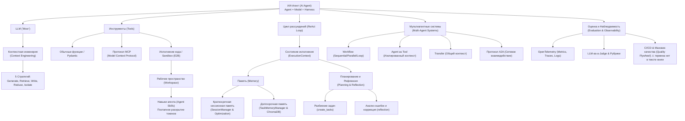

Вот подробный учебный конспект книги **«Build an AI Agent (From Scratch)»** (Создание агентов искусственного интеллекта с нуля) авторов Юнджуна Хура (Jungjun Hur) и Юнхи Сонг (Younghee Song).

#### Раздел 0. Полный список глав книги

**Часть 1. Создание вашего первого LLM-агента (Part 1. Building Your First LLM Agent)**
* **Глава 1:** Chapter 1. What is an AI agent? — *Что такое ИИ-агент?*
* **Глава 2:** Chapter 2. The brain of AI agents: LLMs — *Мозг ИИ-агентов: LLM*
* **Глава 3:** Chapter 3. Enabling actions: Tool use — *Включение действий: использование инструментов*
* **Глава 4:** Chapter 4. Implementing a basic ReAct agent — *Реализация базового ReAct-агента*
**Часть 2. Разработка продвинутых возможностей агента (Part 2. Developing Advanced Agent Capabilities)**
* **Глава 5:** Chapter 5. Building knowledge bases with RAG — *Создание баз знаний с помощью RAG*
* **Глава 6:** Chapter 6. Adding memory to your agent — *Добавление памяти вашему агенту*
* **Глава 7:** Chapter 7. Planning and reflection for complex tasks — *Планирование и рефлексия для сложных задач*
* **Глава 8:** Chapter 8. Empowering agents with code execution — *Расширение возможностей агентов с помощью исполнения кода*
* **Глава 9:** Chapter 9. Orchestrating multi-agent systems — *Оркестрация мультиагентных систем*
* **Глава 10:** Chapter 10. Evaluating agents — *Оценка агентов*

#### Раздел 1. О чём книга в 3 предложениях

1. Эта книга представляет собой практическое руководство по пошаговой реализации автономных ИИ-агентов (**AI agents**) на чистом Python с нуля, без использования сторонних абстрактных фреймворков.
2. Авторы подробнейшим образом разбирают фундаментальную концепцию **«Агент = Модель + Обвязка»** (**Agent = Model + Harness**), последовательно создавая базовый цикл рассуждений и действий (**think-act loop**), механизм вызова инструментов (**tool calling**), управление контекстом (**context engineering**), RAG, краткосрочную и долгосрочную память (**memory**), а также планирование и исполнение кода.
3. В завершение книга учит объединять узкоспециализированных агентов в мультиагентные системы (**multi-agent systems**) через сетевой протокол **A2A** и выстраивать автоматизированную систему непрерывной оценки качества (**evaluation**) с помощью **OpenTelemetry** и подхода **LLM-as-a-judge**.

#### Раздел 2. Главные идеи по главам

##### Глава 1. What is an AI agent? (Что такое ИИ-агент?)

* **Сущность автономного управления**: Агент — это программа, которая передаёт часть своего потока управления (**control flow**) языковой модели (LLM), позволяя ей самой решать, какие действия предпринимать и когда завершать работу.
* **Триггерная формула агента**: Автономия достигается связкой LLM+Инструменты+Цикл (LLM+Tools+Loop), где LLM выступает «мозгом», инструменты расширяют пространство действий, а цикл разворачивает процесс во времени.
* **Агенты против рабочих процессов**: В рабочих процессах (**workflows**) последовательность шагов строго запрограммирована разработчиком, тогда как в агентах (**agents**) модель динамически прокладывает путь к цели.
* **Контекстная инженерия (Context engineering)**: Производительность агента зависит от наполнения его рабочей памяти; выделяют 5 ключевых стратегий: генерация (**generate**), извлечение (**retrieve**), запись (**write**), сокращение (**reduce**) и изоляция (**isolate**).
* **Ориентир качества GAIA**: Для объективной отладки агентов используется бенчмарк **GAIA** (General AI Assistants), содержащий многошаговые задачи с чёткими и проверяемыми ответами.

##### Глава 2. The brain of AI agents: LLMs (Мозг ИИ-агентов: LLM)

* **Преимущество закрытых LLM**: Для старта разработки агентов предпочтительны закрытые модели (**closed LLMs** — OpenAI GPT, Anthropic Claude) благодаря стабильной поддержке вызова инструментов (**tool calling**) и структурированного вывода (**structured output**).
* **Унификация через LiteLLM**: Библиотека **LiteLLM** предоставляет единый интерфейс к более чем 100 языковым моделям, предотвращая привязку к конкретному провайдеру.
* **Отсутствие состояния в API**: API языковых моделей являются **stateless** (не сохраняют состояние), поэтому разработчик обязан вручную накапливать и передавать всю историю сообщений (**conversation history**) в каждом запросе.
* **Принципы промтинга агентов**: Системные промты (**system prompts**) агентов должны поощрять автономные действия при наличии явного намерения пользователя и задавать чёткие границы запрещённых действий (**behavioral boundaries**).
* **Границы возможностей LLM**: Эксперимент на GAIA показал, что без внешних инструментов даже сильные LLM способны решить лишь около 25% простых задач из-за отсутствия доступа к актуальным данным и файлам.

##### Глава 3. Enabling actions: Tool use (Включение действий: использование инструментов)

* **Преодоление ограничений LLM**: Инструменты устраняют временны́е ограничения (отсутствие свежих данных), взаимодействующие (невозможность менять внешний мир) и функциональные (слабость в точных вычислениях).
* **Механизм Tool Calling**: LLM не исполняет инструменты сама, а формирует текстовую спецификацию вызова (имя функции и аргументы), которую запускает внешняя система-хост.
* **Стандартизация через MCP**: Протокол **MCP** (Model Context Protocol) от Anthropic разделяет хост, клиент и сервер, позволяя агентам подключать любые MCP-совместимые сервисы без создания уникальных обёрток.
* **Разработка пользовательских инструментов**: Включает создание схемы инструмента (**tool definition**), написание рабочей функции, реализацию внешней системы выполнения и возврат результата обратно в контекст LLM.

##### Глава 4. Implementing a basic ReAct agent (Реализация базового ReAct-агента)

* **Паттерн ReAct**: Основополагающий шаблон работы агентов, заключающийся в чередовании рассуждения (**think**) и действия (**act**).
* **Нативный Tool Calling в ReAct**: В отличие от раннего ReAct с парсингом текста с помощью регулярных выражений, современный подход использует нативный вызов инструментов API, что устраняет ошибки формата.
* **Центральное хранилище ****ExecutionContext**: Контейнер состояния исполнения, хранящий последовательность событий (**events**), ID исполнения, счётчик шагов (**current_step**) и временные данные (**state**).
* **Слой связи с LLM**: Компоненты LlmRequest (формирует данные для отправки), LlmClient (выполняет API-запрос) и LlmResponse (унифицирует ответ) изолируют сетевую логику от класса Agent.
* **Гарантия формата через ****final_answer**: Передача структурированного типа ответа (output_type) реализуется через создание динамического инструмента final_answer, который модель вызывает при завершении работы.

##### Глава 5. Building knowledge bases with RAG (Создание баз знаний с помощью RAG)

* **Четыре метода поиска**: Для работы с непубличными данными используются ключевой (**keyword**), векторный (**vector**), графовый (**graph**) и структурный (**structure-based**) поиск.
* **Векторный поиск с нуля**: Включает разбиение документов на фрагменты (**chunking**), получение векторных представлений (**embeddings**) и расчёт косинусного сходства (**cosine similarity**).
* **Исследование файловой системы**: Для задач с архивами и папками агент применяет структурный поиск с помощью инструментов unzip_file, list_files, read_file и read_media_file.
* **Расширение агента через колбэки (Callbacks)**: before_tool_callback позволяет реализовать подтверждение опасных операций человеком (**Human-in-the-loop / HITL**), а after_tool_callback — автоматическое сжатие веб-поиска.

##### Глава 6. Adding memory to your agent (Добавление памяти вашему агенту)

* **Три паттерна памяти**: Разделяют оптимизацию контекста внутри одного запуска (**in-run context management**), непрерывность диалога между запусками (**continuous execution**) и долгосрочную память (**long-term memory**).
* **Иерархическая оптимизация контекста**: Для предотвращения «взрыва контекста» последовательно применяются компактификация (**compaction** — очистка аргументов и результатов) и суммаризация (**summarization**).
* **Сессии и асинхронный HITL**: Класс Session и SessionManager сохраняют состояние диалога; при запросе подтверждения опасного инструмента агент ставит выполнение на паузу (pending_confirmation), освобождая сервер, и возобновляет работу при получении ответа.
* **Долгосрочная память ****TaskMemoryManager**: С помощью ChromaDB извлекает из прошлых запусков структурированные уроки, проверяет их на дубликаты и сохраняет для последующего внедрения в новые сессии.

##### Глава 7. Planning and reflection for complex tasks (Планирование и рефлексия для сложных задач)

* **Проблема реактивности**: Агенты ReAct без планирования склонны к потере направления, повторным запросам, преждевременным выводам и зацикливанию при ошибках.
* **Инструмент планирования ****create_tasks**: Разбивает сложную цель на список подзадач со статусами (pending, in_progress, completed), фиксируя карту действий прямо в контексте.
* **Инструмент рефлексии ****reflection**: Даёт агенту «время подумать» (**time to think**), проанализировать причины сбоев (ERROR ANALYSIS) и запросить перепланирование (need_replan=True).
* **Синергия планирования и рефлексии**: Планирование задаёт вектор движения вперёд, а рефлексия оценивает прошлые шаги, реализуя стратегию генерации (**generation**) контекста.

##### Глава 8. Empowering agents with code execution (Расширение возможностей агентов с помощью исполнения кода)

* **Преимущества подхода CodeAct**: Написание и выполнение Python-кода расширяет пространство действий агента, позволяя выражать циклы и сложную логику за 1 вызов вместо десятков итераций вызова инструментов.
* **Облачные песочницы (Sandboxes)**: Исполнение генерируемого кода изолируется от хост-системы с помощью виртуальной среды **E2B**.
* **Портирование инструментов в песочницу**: Инструменты с меткой sandbox_executable=True переносятся внутрь песочницы, что позволяет обрабатывать массивные данные без передачи лишних токенов в промт.
* **Рабочее пространство (Workspace) и Навыки (Agent Skills)**: Агент получает доступ к файловой системе и CLI (bash_tool); концепция **Agent Skills** использует папки с файлами SKILL.md и YAML-заголовком для поэтапного раскрытия токенов (**progressive disclosure**).

##### Глава 9. Orchestrating multi-agent systems (Оркестрация мультиагентных систем)

* **Разделение ролей**: Разделение задачи между узкоспециализированными агентами (исследователь, кодер, писатель, рецензент) сокращает промты, снижает путаницу ролей и повышает точность.
* **Три паттерна взаимодействия**:
  1. **Workflow**: Порядок задан разработчиком (Sequential, Parallel, Loop).
  2. **Agent as Tool**: Главный агент вызывает узких специалистов как инструменты с полной изоляцией контекста.
  3. **Transfer**: Полная передача контроля другому агенту с сохранением общего контекста разговорной сессии.
* **Дерево агентов (Agent tree)**: Иерархическое связывание агентов через ссылки sub_agents и parent.
* **Протокол A2A (Agent-to-Agent)**: Открытый сетевой HTTP-протокол от Google, позволяющий агентам из разных систем обмениваться карточками агентов (agent.json) и задачами.

##### Глава 10. Evaluating agents (Оценка агентов)

* **Требование к автоматизации**: Из-за многошаговости и недетерминированности ручная проверка агентов немасштабируема; оценивать необходимо не только конечный ответ (**final output**), но и отдельные компоненты (**components**) и траекторию рассуждений (**trajectory**).
* **Сбор телеметрии (Observability)**: Сбор метрик, трейсов (**traces/spans**) и логов с использованием стандарта **OpenTelemetry (OTLP)** обеспечивает видимость внутренних процессов агента.
* **Таксономия ошибок и рубрики**: Через открытое кодирование (**open coding**) изучаются трассировки ошибок, создаётся таксономия сбоев (**failure taxonomy**), после чего формируются PASS/FAIL рубрики и метрики.
* **LLM-as-a-judge и CI/CD**: Модель-судья автоматически оценивает выводы агента по рубрикам, а автотесты в CI/CD блокируют регрессии, формируя постоянный «маховик качества» (**Agent Quality Flywheel**).

#### Раздел 3. Схема связей между главными идеями (Mermaid graph TD)

#### Раздел 4. Пошаговый чек-лист практических действий

1. **Подготовка среды и провайдеров**:
  * [ ] Установите Python версии 3.12+ и менеджер пакетов uv.
  * [ ] Настройте конфигурационный файл .env с API-ключами OpenAI, Tavily Search и Hugging Face (HF_TOKEN).
  * [ ] Подключите библиотеку LiteLLM для единого вызова моделей разных провайдеров.
2. **Сборка ядра базового ReAct-агента**:
  * [ ] Реализуйте базовый класс ExecutionContext для управления состоянием, событиями (Event) и лимитом шагов.
  * [ ] Создайте единую абстракцию инструментов BaseTool и декоратор @tool (FunctionTool).
  * [ ] Реализуйте слой связи с LLM: классы LlmRequest, LlmClient и LlmResponse.
  * [ ] Напишите класс Agent и его ключевые методы: run(), step(), think() и act().
  * [ ] Реализуйте гарантированный структурированный вывод с помощью специального инструмента final_answer и схем Pydantic.
3. **Расширение возможностями RAG и работы с файлами**:
  * [ ] Напишите модуль векторного поиска: фрагментация текста (**chunking**), генерация эмбеддингов и вычисление косинусного сходства.
  * [ ] Реализуйте инструменты работы с файловой системой и архивами (unzip_file, list_files, read_file, read_media_file).
  * [ ] Внедрите систему колбэков (before_tool_callbacks, after_tool_callbacks) для сжатия результатов веб-поиска и подтверждения человеком (HITL).
4. **Интеграция памяти и оптимизация контекста**:
  * [ ] Реализуйте класс ContextOptimizer с иерархической стратегией: компактификация (**compaction**) аргументов/результатов и суммаризация (**summarization**).
  * [ ] Напишите SessionManager для поддержки многошаговых диалогов и асинхронной паузы/возобновления выполнения.
  * [ ] Подключите TaskMemoryManager на базе ChromaDB для сохранения и поиска успешных и неудачных уроков прошлых сессий.
5. **Подключение планирования, рефлексии и песочницы кода**:
  * [ ] Реализуйте инструмент планирования create_tasks для декомпозиции комплексных задач.
  * [ ] Добавьте инструмент рефлексии reflection для анализа ошибок и запуск перепланирования.
  * [ ] Подключите облачную песочницу E2B (code_execution="e2b") и инструмент execute_python.
  * [ ] Настройте рабочее пространство (Workspace) с доступом к CLI (bash_tool) и разверните структуру навыков агента (Agent Skills) с файлами SKILL.md.
6. **Построение мультиагентной системы и интеграция A2A**:
  * [ ] Реализуйте предсказуемые рабочие процессы SequentialWorkflow, ParallelWorkflow и LoopWorkflow.
  * [ ] Создайте адаптер AgentTool для вызова агентов как инструментов с изоляцией контекста.
  * [ ] Постройте дерево агентов (sub_agents, parent) и инструмент transfer_to_agent для динамической передачи управления.
  * [ ] Опубликуйте агентов через протокол A2A, создав карточки агентов (AgentCard) и обработчики AgentExecutor.
7. **Развёртывание конвейера оценки и контроля качества**:
  * [ ] Инструментируйте код с помощью OpenTelemetry для сбора метрик, трейсов и логов.
  * [ ] Сформируйте датасет для тестирования (смесь бенчмарков, пользовательских сценариев и логов с продакшена).
  * [ ] Проведите открытое кодирование (**open coding**) сбойных трассировок и сформируйте таксономию ошибок.
  * [ ] Напишите промт-судью **LLM-as-a-judge** на базе PASS/FAIL рубрик и подключите автопроверки к CI/CD пайплайну.

#### Раздел 5. Типичные ошибки и как их избежать

1. **Ошибка 1: Переполнение контекста ненужными данными («Взрыв контекста» / Context Rot)**
  * *Проблема*: Загрузка полных текстов документов и сырых выгрузок веб-поиска приводит к эффекту «Lost in the Middle», падению точности и росту расходов.
  * *Как избежать*: Разделяйте хранение и представление; используйте компактификацию (**compaction**) аргументов и результатов инструментов, векторный поиск и скользящие окна.
2. **Ошибка 2: Хрупкий парсинг ответов агента через регулярные выражения**
  * *Проблема*: Попытка извлекать вызовы инструментов из свободного текста часто ломается при малейшем изменении формата языковой моделью.
  * *Как избежать*: Переходите на нативный механизм вызова функций (**Tool Calling**) и гарантируйте тип ответа через Pydantic и структурированный вывод.
3. **Ошибка 3: Перегрузка промта слишком большим количеством инструментов (Tool Proliferation)**
  * *Проблема*: Передача десятков схем инструментов одновременно раздувает промт, увеличивает стоимость и приводит к ошибкам при выборе нужной функции.
  * *Как избежать*: Применяйте концепцию навыков (**Agent Skills**) с поэтапным раскрытием (подавайте в промт только краткие названия и описания, а подробный SKILL.md читайте по необходимости) или группируйте действия в код.
4. **Ошибка 4: Зацикливание реактивного агента при ошибках (ReAct Failure)**
  * *Проблема*: При сбое инструмента реактивный агент пытается бездумно повторить то же самое действие до исчерпания лимита шагов max_steps.
  * *Как избежать*: Внедряйте инструменты планирования (create_tasks) и рефлексии (reflection) для проведения анализа ошибок (ERROR ANALYSIS) и запуск перепланирования.
5. **Ошибка 5: Передача общего контекста между всеми узкими специалистами**
  * *Проблема*: Накопление всех промежуточных шагов рассуждений разных узких специалистов в единой истории диалога раздувает промт и путает роли.
  * *Как избежать*: Используйте паттерн Agent as Tool с изоляцией контекста, где дочерний агент работает в свежем ExecutionContext и возвращает родителю только итоговый результат.
6. **Ошибка 6: Оценка агента только по конечному тексту без анализа траектории**
  * *Проблема*: Оценка только финального текста не позволяет выявить случайный успех или скрытые галлюцинации в промежуточных вызовах инструментов.
  * *Как избежать*: Собирайте полные трейсы с помощью OpenTelemetry и оценивайте три аспекта: финальный результат (**final output**), компоненты (**components**) и траекторию вызовов (**trajectory**).

#### Раздел 6. 20 карточек «вопрос — ответ» для повторения

1. **Вопрос**: Из каких трёх ключевых элементов состоит ИИ-агент?
  * **Ответ**: Из языковой модели (LLM — «мозг»), инструментов (Tools — действия) и цикла (Loop — повторение до достижения цели).
2. **Вопрос**: В чём главное отличие агента от обычного рабочего процесса (workflow)?
  * **Ответ**: В рабочих процессах последовательность шагов задана разработчиком, а в агентах поток управления динамически направляет сама LLM.
3. **Вопрос**: Что такое контекстная инженерия (Context Engineering)?
  * **Ответ**: Это дисциплина формирования контекста LLM, направленная на предоставление модели только необходимой информации в нужное время и в правильной форме.
4. **Вопрос**: Назовите 5 главных стратегий контекстной инженерии.
  * **Ответ**: Генерация (**generate**), извлечение (**retrieve**), запись (**write**), сокращение (**reduce**) и изоляция (**isolate**).
5. **Вопрос**: Почему REST API языковых моделей называют stateless (без состояния)?
  * **Ответ**: Они не сохраняют память о прошлых запросах, поэтому всю историю диалога нужно передавать заново при каждом вызове.
6. **Вопрос**: Какую роль играет библиотека Pydantic в разработке агентов?
  * **Ответ**: Она используется для описания схем данных, валидации типов и обеспечения структурированного вывода (JSON).
7. **Вопрос**: Что такое Tool Calling и исполняет ли LLM код инструмента сама?
  * **Ответ**: Tool Calling — это генерация структурированной спецификации вызова; сама LLM код не исполняет, вызов запускает хост-система.
8. **Вопрос**: Какую архитектуру использует протокол стандартизации инструментов MCP (Model Context Protocol)?
  * **Ответ**: Архитектуру «Хост — Клиент — Сервер» (Host — Client — Server), где хост управляет LLM, клиент обеспечивает связь, а MCP-сервер исполняет инструменты.
9. **Вопрос**: Что представляет собой паттерн ReAct?
  * **Ответ**: Паттерн, в котором агент итеративно чередует шаги рассуждения (**think**) и действия (**act**), наблюдая результаты.
10. **Вопрос**: Какую роль играет ExecutionContext в архитектуре агента?
  * **Ответ**: Это центральный контейнер состояния, хранящий историю событий (events), счетчик шагов (current_step), ID и данные состояния (state).
11. **Вопрос**: Какие основные виды поиска используются в RAG?
  * **Ответ**: Ключевой (**keyword**), векторный (**vector**), графовый (**graph**) и структурный (**structure-based**) поиск.
12. **Вопрос**: В чём различие между краткосрочной и долгосрочной памятью агента?
  * **Ответ**: Краткосрочная память хранит историю текущей сессии в ExecutionContext, а долгосрочная сохраняет выжимку знаний между разными сессиями в векторной БД.
13. **Вопрос**: Каков порядок иерархической оптимизации контекста в ContextOptimizer?
  * **Ответ**: 1) Проверка токенов; 2) Компактификация (compaction) вызовов/результатов; 3) Суммаризация (summarization) старых сообщений.
14. **Вопрос**: Какую функцию выполняют инструменты create_tasks и reflection?
  * **Ответ**: create_tasks отвечает за планирование (карта подзадач), а reflection — за рефлексию (анализ ошибок и запрос перепланирования).
15. **Вопрос**: В чём заключается суть подхода CodeAct?
  * **Ответ**: Вместо генерации отдельных JSON-вызовов LLM пишет и исполняет полноценный Python-код в песочнице, выражая циклы и условия за 1 шаг.
16. **Вопрос**: Как концепция Agent Skills решает проблему расхода токенов?
  * **Ответ**: Через поэтапное раскрытие (progressive disclosure): в промт подаются только названия и краткие описания навыков, а файл SKILL.md читается только при необходимости.
17. **Вопрос**: Чем отличаются паттерны мультиагентного взаимодействия Agent as Tool и Transfer?
  * **Ответ**: В Agent as Tool оркестратор вызывает агента как функцию в изолированном контексте и получает результат; в Transfer контроль полностью передаётся другому агенту с сохранением общего контекста.
18. **Вопрос**: Что такое протокол A2A (Agent-to-Agent)?
  * **Ответ**: Открытый HTTP-протокол от Google для взаимодействия агентов из разных систем и языков через карточки агентов (agent.json) и задачи.
19. **Вопрос**: Какие три аспекта учитываются при комплексной оценке агента?
  * **Ответ**: Финальный результат (**final output**), отдельные компоненты (**components**) и траектория выполнения (**trajectory**).
20. **Вопрос**: Из каких этапов состоит построение критериев оценки агента?
  * **Ответ**: Сбор трассировок -> Открытое кодирование (open coding) -> Таксономия ошибок -> Создание PASS/FAIL рубрик -> Расчёт метрик -> Внедрение LLM-судьи в CI/CD.

#### Раздел 7. 5 практических заданий на применение

##### Задание 1. Консультант по стилю для интернет-магазина одежды (ReAct + RAG + HITL)

* **Контекст**: Создание агента-стилиста для подбора гардероба.
* **Практическая задача**: Реализуйте базового ReAct-агента с классом Agent и слоем LlmClient, оснащённого векторным поиском (ChromaDB) по каталогу одежды (описания, размеры, наличие). Добавьте before_tool_callback для асинхронного подтверждения человеком (**HITL**) перед окончательным оформлением заказа или применением персональной промо-скидки.

##### Задание 2. Мультиагентная система B2B-лидогенерации (Workflow + Agent as Tool)

* **Контекст**: Автоматизация поиска и скоринга B2B-клиентов.
* **Практическая задача**: Создайте мультиагентную систему из трёх специалистов: Researcher (веб-поиск информации о B2B-компании через Tavily MCP), Scorer (расчёт соответствия ICP в песочнице E2B) и Drafter (составление персонализированного письма). Объедините их в SequentialWorkflow и оборачивайте в AgentTool для вызова головным агентом-координатором.

##### Задание 3. Умный парсер и скрапер данных на Claude/Python (Workspace + CodeAct)

* **Контекст**: Сборщик данных с произвольных веб-сайтов и документов.
* **Практическая задача**: Предоставьте агенту на базе Claude рабочее пространство E2B Workspace (code_execution="e2b", bash_tool, execute_python). Напишите навык Agent Skill (skills/web-scraper/SKILL.md) с инструкциями по парсингу через BeautifulSoup и pandas. Агент должен принимать URL, динамически писать Python-код скрапинга, извлекать таблицы и сохранять итоговый CSV-файл в песочнице.

##### Задание 4. Персонализированный B2B-агент поддержки с долгосрочной памятью (Session + TaskMemoryManager)

* **Контекст**: Обслуживание клиентов B2B-сервиса с сохранением истории компании.
* **Практическая задача**: Реализуйте SessionManager для сохранения истории диалогов по session_id и интегрируйте TaskMemoryManager с ChromaDB. При повторном обращении клиента агент должен через MemoryTool или автоматическую инъекцию извлекать прошлый контекст (договорные условия, частые проблемы) и учитывать его без повторных расспросов.

##### Задание 5. Пайплайн оценки и контроля качества B2B-агентов (LLM-as-a-Judge + OpenTelemetry)

* **Контекст**: Автоматизированное тестирование агента лидогенерации и консультанта магазина одежды.
* **Практическая задача**: Создайте систему оценки выходов агентов с использованием модели-судьи LLM-as-a-judge. Сформируйте датасет сценариев (Core, Edge cases, Adversarial), разверните промт-судью с PASS/FAIL рубриками (точность ссылок, соблюдение формата, отсутствие галлюцинаций) и настройте сбор трассировок через OpenTelemetry для мониторинга в CI/CD.
