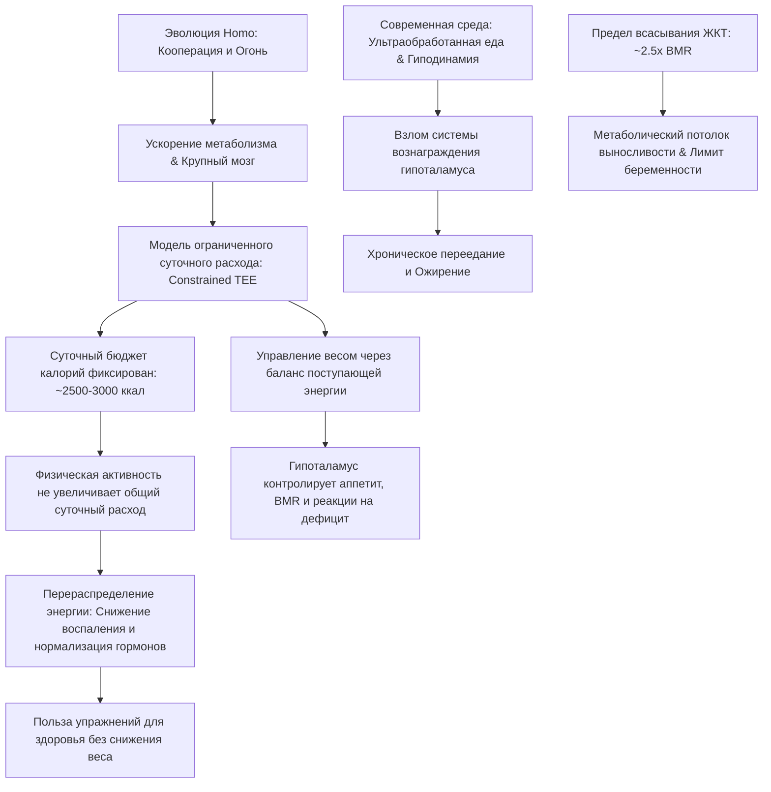

### 0. Полный список глав книги (номер, название по-английски — перевод)

1. **Chapter 1: The Invisible Hand** — Невидимая рука.
2. **Chapter 2: What Is Metabolism Anyway?** — Что вообще такое метаболизм?.
3. **Chapter 3: What Is This Going to Cost Me?** — Во сколько мне это обойдётся?.
4. **Chapter 4: How Humans Evolved to Be the Nicest, Fittest, and Fattest Apes** — Как люди эволюционировали в самых дружелюбных, выносливых и жирных приматов.
5. **Chapter 5: The Metabolic Magician: Energy Compensation and Constraint** — Метаболический фокусник: компенсация и ограничение энергии.
6. **Chapter 6: The Real Hunger Games: Diet, Metabolism, and Human Evolution** — Настоящие голодные игры: диета, метаболизм и эволюция человека.
7. **Chapter 7: Run for Your Life!** — Беги, спасая свою жизнь!.
8. **Chapter 8: Energetics at the Extreme: The Limits of Human Endurance** — Энергетика на пределе: границы человеческой выносливости.
9. **Chapter 9: The Past, Present, and Uncertain Future of Homo energeticus** — Прошлое, настоящее и неопределённое будущее *Homo energeticus*.

### 1. О чём книга в 3 предложениях

Книга Германа Понтцера исследует эволюционную биологию метаболизма человека и опровергает классическую модель «простого двигателя» (armchair engineer's model), согласно которой суточный расход энергии прямо пропорционален физической активности. На основе исследований племени охотников-собирателей хадза и приматов автор доказывает концепцию ограниченного суточного расхода энергии (constrained total energy expenditure), в рамках которой организм перераспределяет ресурсы внутренних систем для сохранения стабильного бюджета калорий [177–180]. Понтцер объясняет, что масса тела регулируется гипоталамусом через баланс поступающей энергии, а физические упражнения необходимы не для снижения веса, а для перераспределения ресурсов, подавления системного воспаления и поддержания базового здоровья [185–187, 210, 241–242].

### 2. Главные идеи по главам

#### Глава 1. The Invisible Hand (Невидимая рука)

* **Метаболизм как клеточный оркестр:** Метаболизм представляет собой суммарную химическую работу 37 триллионов клеток организма, сжигающих энергию каждые 24 часа.
* **Несостоятельность модели «простого двигателя»:** Распространенное представление о том, что тело работает как обычный двигатель (больше физической нагрузки = больше сжёг калорий в сутки), ошибочно, так как игнорирует эволюционную адаптивность организма.
* **Метаболическое своеобразие приматов:** Приматы расходуют примерно в два раза меньше энергии в сутки, чем другие плацентарные млекопитающие аналогичного размера, что обеспечивает им более медленный темп жизни и высокую продолжительность жизни.
* **Метаболический ускоритель человека:** Человек расходует на 20–60% больше калорий в сутки, чем другие человекообразные обезьяны (шимпанзе, горилы, орангутаны) одинаковой массы.
* **Эволюционная роль жировых запасов:** Высокий базовый метаболизм человека эволюционировал параллельно с увеличением жировых отложений (в 2 раза больше, чем у других обезьян), служащих энергетическим страховочным резервом для энергозатратного мозга.

#### Глава 2. What Is Metabolism Anyway? (Что вообще такое метаболизм?)

* **Сущность клеточной работы:** Метаболизм включает постоянную транспортировку молекул через мембраны и их химическую трансформацию (синтез ферментов, гормонов, нейромедиаторов).
* **Единая энергетическая валюта — АТФ:** Все биохимические процессы питаются за счет аденозинтрифосфата (adenosine triphosphate, ATP), молекулы которого циклически перезаряжаются из АДФ тысячи раз в день.
* **Три станции макронутриентов:** Углеводы, жиры и белки проходят три ключевых этапа в организме — переваривание (Digest), строительство (Build) и сжигание (Burn) с образованием общего промежуточного продукта — ацетил-КоА (acetyl CoA).
* **Ограниченность гликогена и безграничность жира:** Запасы гликогена в печени и мышцах строго ограничены по объему и удерживают воду, тогда как жировая ткань способна накапливать энергию практически без физических лимитов.
* **Универсальность превращения избытка калорий:** Любые калории, поступившие в избытке (независимо от того, получен ли избыток из сахаров, жиров или белков), превращаются организмом в жировую ткань.

#### Глава 3. What Is This Going to Cost Me? (Во сколько мне это обойдётся?)

* **Калории как естественная валюта отбора:** Естественный отбор действует как строгого бухгалтера, отбирая особи с наиболее эффективной стратегией получения и распределения калорий.
* **Структура суточного расхода калорий:** Основной обмен веществ (basal metabolic rate, BMR) составляет около 60% суточных энергозатрат и определяется работой внутренних органов (печень — 20%, мозг — 20%, почки — 9%, сердце — 12%), а не скелетных мышц в покое (16%) [83–88, 98, 99, 101].
* **Закон Клейбера (Kleiber's law):** Расход энергии масштабируется с массой тела по степени 3/4; мелкие организмы расходуют значительно больше калорий на единицу массы, чем крупные.
* **Метод двойной маркировки воды (doubly labeled water):** Изотопный метод Натана Лифсона позволяет с высокой точностью измерять суточный расход энергии человека в свободных условиях по скорости выведения изотопов водорода и кислорода [104–107, 120, 121].
* **Ошибочность факториального метода:** Простой подсчет суточных трат путем сложения BMR и энергозатрат на отдельные виды активности (MET/PAR) дает сбои, так как не учитывает внутренние компенсаторные механизмы [102, 103, 114–117].

#### Глава 4. How Humans Evolved to Be the Nicest, Fittest, and Fattest Apes (Как люди эволюционировали в самых дружелюбных, выносливых и жирных приматов)

* **Кооперация и разделение пищи:** Обязательный обмен пищей (sharing) в группах ранних *Homo* снизил риски индивидуального голода и создал фундамент для метаболической революции [133–135, 146, 147].
* **Инвестиция в крупный мозг:** Увеличение мозга у *Homo erectus* потребовало колоссального расхода калорий (у детей мозг потребляет более 60% BMR), что стало возможным благодаря высококалорийной кооперативной добыче пищи [88, 101, 148–150].
* **Человеческий парадокс жизненного цикла:** Дети человека растут медленнее, чем детеныши обезьян, но благодаря помощи группы и совместному выкармливанию человеческие матери рожают чаще (раз в 3 года против 5+ лет у обезьян).
* **Выносливая физиология:** Переход к охоте и собирательству потребовал преодоления больших расстояний, сформировав высокую аэробную мощность (VO2​ max) и механизмы терморегуляции (потоотделение).
* **Плата за метаболическую адаптацию:** Эволюционная склонность откладывать жир про запас в сочетании с современным избытком пищи и гиподинамией приводит к метаболическим болезням (ожирение, диабет 2 типа, сердечно-сосудистые заболевания) [155–157].

#### Глава 5. The Metabolic Magician: Energy Compensation and Constraint (Метаболический фокусник: компенсация и ограничение энергии)

* **Феномен племени хадза:** Охотники-собиратели хадза, ежедневно проявляющие высокую физическую активность, расходуют в сутки ровно столько же калорий, сколько офисные жители США и Европы аналогичной массы [177–179].
* **Модель ограниченного суточного расхода (Constrained TEE):** Тело удерживает общий суточный расход энергии в узком целевом диапазоне; при росте физической активности организмом урезаются траты на другие физиологические процессы.
* **Неэффективность физических упражнений для похудения:** Длительные программы тренировок (например, подготовка к полумарафону) дают незначительный прирост суточного расхода калорий из-за метаболической компенсации [185–187, 192–196].
* **Реакция на голодание (starvation response):** При дефиците калорий гипоталамус снижает уровень тиреоидных гормонов, замедляя клеточный метаболизм и BMR (что показано в Миннесотском эксперименте и шоу *The Biggest Loser*) [172–175, 202–205].
* **Роль гипоталамуса:** Масса тела регулируется гипоталамусом на основе сигналов лептина, грелина и уровня глюкозы; ожирение — это сбой регуляции аппетита и переедание, а не «медленный метаболизм» [178–180, 210–212, 217–219].

#### Глава 6. The Real Hunger Games: Diet, Metabolism, and Human Evolution (Настоящие голодные игры: диета, метаболизм и эволюция человека)

* **Отсутствие единой «Палеодиеты»:** Рацион традиционных популяций варьируется от почти 100% животной пищи у эскимосов до 65%+ углеводов у хадза (мёд, клубни, ягоды); человек эволюционировал как гибкий всеядный организм [198–203, 244–248, 251, 252].
* **Углеводы не являются главным врагом:** Высокое потребление сахара с мёдом у хадза не приводит к диабету или ожирению, что опровергает углеводно-инсулиновую модель ожирения (carbohydrate-insulin model) [189–192, 210, 211, 244, 260–264].
* **Законы термодинамики и кето-диеты:** Кетогенные и низкоуглеводные диеты приводят к снижению веса исключительно за счёт дефицита калорий и первоначальной потери воды с гликогеном, а не за счёт «метаболической магии» [212–217, 267–270].
* **Взлом системы вознаграждения мозга:** Ультраобработанные продукты (ultra-processed foods), сочетающие жир, сахар и соль, провоцируют сенсорно-специфическое насыщение (sensory specific satiety) и приводят к автоматическому перееданию [221–225, 276–279].
* **Принципы сытной диеты:** Наиболее сытными являются цельные продукты, богатые клетчаткой и белком; выбор рациона должен опираться на степень насыщения и общую калорийность [226, 227, 281, 285–287].

#### Глава 7. Run for Your Life! (Беги, спасая свою жизнь!)

* **Настоящая функция упражнений:** Физическая активность не увеличивает суточный бюджет калорий, но перераспределяет траты внутри него, отнимая энергию у вредных процессов [236–238, 306–308].
* **Подавление системного воспаления:** Регулярная активность заставляет организм снижать траты на избыточные воспалительные реакции и цитокины, предотвращая сердечно-сосудистые и аутоиммунные заболевания.
* **Нормализация гормонального фона:** Нагрузки умеренно снижают уровень эстрогена и тестостерона до естественных эволюционных норм, существенно снижая риск рака груди и простаты [243–245, 315–317].
* **Синдром перетренированности (overtraining syndrome):** При чрезмерных нагрузках физическая активность исчерпывает весь доступный бюджет энергии, угнетая иммунную систему, репродуктивную функцию и вызывая хроностаз [245–248, 318–322].
* **Опасность гиподинамии и удержание веса:** Полная неактивность нарушает способность гипоталамуса регулировать аппетит; упражнения критически важны для предотвращения повторного набора веса после его сброса [252–258, 327–335].

#### Глава 8. Energetics at the Extreme: The Limits of Human Endurance (Энергетика на пределе: границы человеческой выносливости)

* **Закон предельной выносливости:** Максимальный устойчивый расход энергии человека при многомесячных нагрузках ограничен значением примерно 2.5 от основного обмена (2.5x BMR, или ~4000–5000 ккал/сутки) [273–276, 361–363, 366–368].
* **Пищеварительный барьер (alimentary limit):** Предел выносливости определяется не мышцами или легкими, а физиологической способностью желудочно-кишечного тракта переваривать и всасывать калории за сутки [276–278, 365–368].
* **Беременность как метаболический ультрамарафон:** Потребление энергии роженицей в третьем триместре достигает физиологического потолка (~2.5x BMR), что служит метаболическим триггером для начала родов [274, 362, 369–371].
* **Центральная регуляция утомления мозге:** Мозг непрерывно анализирует сигналы от внутренних органов и прекращает нагрузку задолго до полного израсходования запасов АТФ [263–265, 345–347].
* **Разгадка «энигмы Майкла Фелпса»:** Сообщения о рационе спортсменов в 10 000–12 000 ккал являются преувеличением; с учетом крупного размера тела и массы мышц их относительный всасываемый расход лежит в пределах человеческого метаболического потолка [280–282, 372–375].

#### Глава 9. The Past, Present, and Uncertain Future of Homo energeticus (Прошлое, настоящее и неопределённое будущее Homo energeticus)

* **Становление пиробиологического вида:** Освоение огня позволило *Homo* осуществлять внешнее переваривание пищи, высвободив энергию для эволюции мозга и сокращения длины кишечника [292–295, 391–395].
* **Экспансия внешней энергии:** Сельскохозяйственная и промышленная революции заменили человеческий труд внешней энергией ископаемого топлива, снизив стоимость калорий до исторического минимума [295–303, 396–399].
* **Создание «человеческого зоопарка»:** Современный человек живет в искусственной среде с постоянным доступом к дешёвым калориям и минимальной физической активностью, что противоречит нашей биологической эволюции [300–302, 308–311, 400–404].
* **Экологические и метаболические кризисы:** Зависимость от внешней энергии привела к двойному глобальному кризису — климатическим изменениям и эпидемии метаболических заболеваний.
* **Путь к гармонизации среды:** Для восстановления здоровья необходимо проектировать внешнюю среду: ограничивать доступность ультраобработанных продуктов, повышать повседневную двигательную активность и проводить время на открытом воздухе [308–313, 401–405].

### 3. Схема связей между главными идеями (Mermaid)

### 4. Пошаговый чек-лист практических действий

1. **Разделите цели похудения и тренировок в сознании:** Примите, что снижением веса управляет диета (поступление энергии), а физические упражнения управляют качеством работы внутренних систем [185–187, 191–196, 217–219, 236–238].
2. **Уберите ультраобработанную еду из прямого доступа:** Исключите из дома и рабочего места рафинированные продукты с сочетанием добавленных сахаров, промышленных масел и соли, обходящие механизмы насыщения [223–225, 276–279, 285–287, 401–403].
3. **Формируйте рацион из цельных продуктов:** Опирайтесь на продукты с высокой степенью насыщения (цельные овощи, клубни, фрукты, нежирные источники белка), богатые клетчаткой [226, 227, 281, 285–287].
4. **Оценивайте дефицит калорий по динамике массы тела:** Используйте напольные весы как главный объективный инструмент контроля энергетического баланса вместо фитнес-трекеров.
5. **Внедрите ежедневную физическую активность:** Стремитесь к 150+ минутам умеренной/интенсивной нагрузки в неделю или к нескольким часам нахождения на ногах для сброса системного воспаления [237, 238, 241–243, 251, 252, 323–325].
6. **Избегайте непрерывного сидения:** Используйте более активные позы и регулярные паузы на ходьбу, чтобы мышцы продолжали поглощать глюкозу и липиды из крови.
7. **Учитывайте пищеварительный предел выносливости:** Не пытайтесь потреблять и усваивать более 2.5x BMR (~4000–5000 ккал/сутки) на длительных дистанциях — ЖКТ не сможет это переварить, и организм начнет терять собственные ткани [276–278, 365–368].

### 5. Типичные ошибки и как их избежать

1. **Ошибка: Попытка «сжечь» съеденный фастфуд на тренировке.**
  * *Как избежать:* Помнить о модели ограниченного расхода (Constrained TEE). Организм скомпенсирует потраченные на пробежке калории снижением внутренних трат и повышением аппетита [13, 160–165, 185–187, 196].
2. **Ошибка: Поиск «виновного» макронутриента (углеводов или жиров).**
  * *Как избежать:* Соблюдать законы термодинамики. Любые необработанные калории в рамках дефицита приводят к потере веса; любой избыток калорий откладывается в жир [61, 211–217, 267–270].
3. **Ошибка: Слепая вера показаниям фитнес-браслетов о «сожженных калориях».**
  * *Как избежать:* Понимать, что трекеры используют базовые формулы сложения, игнорирующие метаболическую компенсацию и индивидуальные колебания BMR.
4. **Ошибка: Отказ от спорта из-за того, что вес не уходит.**
  * *Как избежать:* Осознать, что упражнения критически важны для снижения уровня хронического воспаления, регуляции гормонов и предотвращения возврата веса [187, 236–238, 241–245, 255–258].
5. **Ошибка: Попытки «ускорить метаболизм» специальными напитками или добавками.**
  * *Как избежать:* Помнить, что базовый обмен жестко регулируется гипоталамусом, а слабый эффект веществ вроде кофеина (до 20 ккал) быстро компенсируется организмом.

### 6. 20 карточек «вопрос — ответ» для повторения

1. **Вопрос:** Что такое метаболизм по определению Германа Понтцера?
**Ответ:** Это суммарная химическая работа, выполняемая всеми 37 триллионами клеток организма за сутки.
2. **Вопрос:** В чём заключается суть модели ограниченного суточного расхода энергии (Constrained TEE)?
**Ответ:** Организм удерживает общий суточный расход калорий в узком диапазоне, урезая траты на другие физиологические процессы при росте физической нагрузки.
3. **Вопрос:** Каков реальный средний суточный расход энергии у взрослого человека?
**Ответ:** Около 2500 ккал для женщин и 3000 ккал для мужчин.
4. **Вопрос:** Чем метаболизм человека отличается от метаболизма других человекообразных обезьян?
**Ответ:** Человек расходует на 20–60% больше энергии в сутки и имеет в 2 раза больше жировых запасов.
5. **Вопрос:** Чем различаются физиологические запасы гликогена и жира?
**Ответ:** Гликоген ограничен по объему и связывает воду, а жировая ткань способна накапливать калории практически без физических лимитов.
6. **Вопрос:** Какой орган потребляет наибольшую долю BMR у детей в возрасте 3–7 лет?
**Ответ:** Мозг, расходующий более 60% от основного обмена.
7. **Вопрос:** Какова доля скелетных мышц в основном обмене (BMR) в состоянии покоя?
**Ответ:** Около 16% от BMR, несмотря на то что мышцы составляют ~42% массы тела.
8. **Вопрос:** Что показало измерение энергозатрат охотников-собирателей хадза?
**Ответ:** Их суточный расход энергии идентичен расходу жителей современных городов Запада аналогичной массы тела [177–179].
9. **Вопрос:** Как гипоталамус реагирует на сильный дефицит калорий (реакция на голодание)?
**Ответ:** Снижает уровень тиреоидных гормонов, замедляя клеточный метаболизм и BMR на 10–25% [172–175, 202–205].
10. **Вопрос:** В чём заключается главная причина кризиса ожирения по Понтцеру?
**Ответ:** В переедании, вызванном доступностью ультраобработанной еды, обходящей системы вознаграждения мозга [214, 217–219, 223–225].
11. **Вопрос:** Какова главная биологическая функция физических упражнений?
**Ответ:** Перераспределение внутреннего бюджета энергии: подавление воспаления, нормализация гормонов и защита от хронических болезней [236–238, 241–245].
12. **Вопрос:** Каков абсолютный предел длительного усвоения энергии человеческим ЖКТ?
**Ответ:** Примерно 2.5 значения от основного обмена веществ (2.5x BMR, или ~4000–5000 ккал/сутки) [276–278, 366–368].
13. **Вопрос:** Почему упражнения помогают удерживать вес после похудения?
**Ответ:** Они помогают гипоталамусу точнее согласовывать аппетит с расходом и возвращают суточные траты к додиетическому целевому уровню [255–258, 331–335].
14. **Вопрос:** Что происходит в организме при синдроме перетренированности?
**Ответ:** Затраты на физическую активность превышают бюджет, заставляя организм угнетать иммунитет, репродукцию и процессы восстановления [245–248, 318–322].
15. **Вопрос:** Куда уходит жировая ткань при «сжигании»?
**Ответ:** Большая часть выдыхается в виде углекислого газа (CO2​), а меньшая часть выводится в виде воды (H2​O).
16. **Вопрос:** Как соотносятся низкоуглеводная и низкожировая диеты по эффективности снижения жира при равной калорийности?
**Ответ:** Они одинаково эффективны, так как похудение определяется дефицитом калорий, а не соотношением макронутриентов [212, 213, 262–264].
17. **Вопрос:** Какое состояние организма является физиологическим метаболическим ультрамарафоном?
**Ответ:** Беременность, при которой энергозатраты матери достигают предел усвоения (~2.5x BMR) [274, 362, 369–371].
18. **Вопрос:** Какая ключевая особенность делает *Homo sapiens* «пиробиологическим» видом?
**Ответ:** Анатомическая и физиологическая зависимость от термически обработанной пищи для нормального получения энергии [292–295, 391–395].
19. **Вопрос:** В чём заключается вред непрерывного сидения в удобных креслах?
**Ответ:** Полное отсутствие микросокращений мышц нарушает регуляцию липидов и глюкозы в крови и работу гипоталамуса [251, 252, 325–329].
20. **Вопрос:** На сколько процентов в среднем люди занижают количество съеденных калорий в опросах?
**Ответ:** В среднем на 29%.

### 7. 5 практических заданий на применение

#### 1. Интернет-магазин одежды: Проектирование системы допродаж по модели «ультраобработанной еды»

* **Контекст книги:** Ультраобработанная еда сочетает сахара, жиры и соль, блокируя сигналы гипоталамуса о насыщении за счет феномена сенсорно-специфического насыщения [221–225, 276–279].
* **Задание:** Разработайте концепцию интерфейса оформления заказа (Checkout). Вместо предложения аналогичных крупных товаров (что вызывает у покупателя «насыщение корзиной»), внедрите блок мелких дополнений (носки, уходовые средства, аксессуары) разной визуальной категории. Опишите, как разнообразие мелких позиций обходит психологический барьер «достаточности покупки».

#### 2. Интернет-магазин одежды: Аудит маркетингового бюджета по модели «Constrained TEE»

* **Контекст книги:** Модель Constrained TEE показывает, что прямое увеличение расходов на один элемент (физическая активность) приводит к компенсаторному снижению трат на другие внутренние системы, сохраняя общий бюджет неизменным.
* **Задание:** Проведите анализ рекламных каналов магазина. Сформулируйте гипотезу: почему неограниченное увеличение бюджета на контекстную рекламу ведет к «метаболической компенсации» (снижению органического трафика или LTV) и как перераспределить фиксированный бюджет между удержанием клиентов и привлечением без попыток «выжечь» рынок.

#### 3. B2B-лидогенерация: Замена опросников объективными метриками (урок метода двойной маркировки воды)

* **Контекст книги:** Самоотчеты людей о питании систематически врут на 29%, тогда как метод двойной маркировки воды (DLW) дает точные физические данные [103–107, 118, 140].
* **Задание:** Переработайте B2B-квалификацию лидов. Замените субъективные анкета-опросы (где клиенты завышают свои бюджеты и готовность к сделке) на объективные поведенческие маркеры (частота посещения раздела документации, просмотр прайс-листа, число приглашенных коллег в демо-версию).

#### 4. B2B-лидогенерация: Определение предела пропускной способности отдела продаж (по модели Alimentary Limit)

* **Контекст книги:** Предел выносливости организма определяется пищеварительным барьером ЖКТ (~2.5x BMR), выше которого поступающие калории не могут быть усвоены [276–278, 365–368].
* **Задание:** Рассчитайте максимальный барьер первичной обработки лидов для менеджера по продажам. Постройте регламент, предотвращающий «синдром перетренированности отдела» (overtraining syndrome), когда поток входных заявок превышает предел усвоения менеджера, приводя к выгоранию и падению конверсии.

#### 5. Сборщики данных на Claude/Python: Алгоритм компенсации ресурсов парсера

* **Контекст книги:** Организм при резком росте расхода на движение снижает траты на воспаление и гормоны, сохраняя базовые жизненные функции и BMR.
* **Задание:** Напишите архитектурную концепцию или скрипт на Python для сбора данных, реализующий модель компенсации. При возрастании нагрузки на обработку сложного элемента (например, решение капчи или обход блокировок, аналогично интенсивной физической нагрузке) скрипт должен автоматически уменьшать частоту фоновых сервисных задач (логирование, обновление второстепенных индексов), сохраняя общий суточный лимит запросов API в жестких рамках.