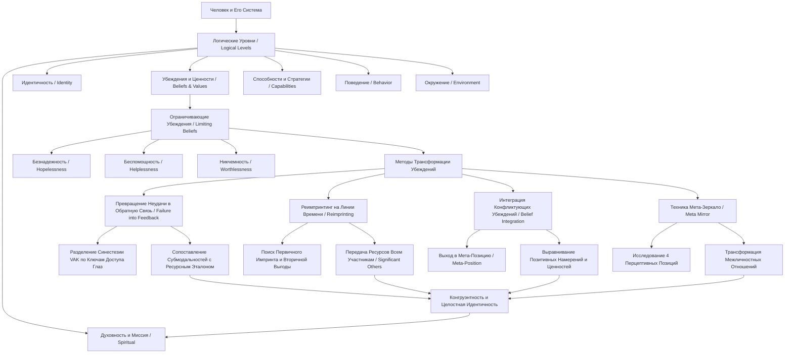

#### 0. Полный список глав книги

1. **Глава I**: Chapter I: The Nature of Belief — Природа убеждений
2. **Глава II**: Chapter II: Beliefs About Capability — Убеждения о способностях
3. **Глава III**: Chapter III: Belief Systems and Core Beliefs — Системы убеждений и глубинные убеждения
4. **Глава IV**: Chapter IV: Integrating Conflicting Beliefs — Интеграция конфликтующих убеждений
5. **Глава V**: Chapter V: Belief Systems and Relationships — Системы убеждений и взаимоотношения
6. **Глава VI**: Chapter VI: Conclusion — Заключение
7. **Приложение A**: Appendix A: Meta Program Patterns — Паттерны метапрограмм
8. **Приложение B**: Appendix B: Predicates and Eye Movements — Предикаты и движения глаз
9. **Приложение C**: Appendix C: Neurological Levels — Неврологические / логические уровни
10. **Приложение D**: Appendix D: Submodalities — Субмодальности
11. **Глоссарий**: Glossary of NLP Terminology — Глоссарий терминов НЛП

#### 1. О чём книга в 3 предложениях

Книга Роберта Дилтса посвящена исследованию природы человеческих убеждений (Beliefs) и практическим методам НЛП (Neuro-Linguistic Programming) для трансформации ограничивающих установок на уровнях способностей, идентичности и системных взаимоотношений. Автор демонстрирует, как с помощью работы с линиями времени (Time Line), сенсорными субмодальностями (Submodalities) и реимпринтингом (Reimprinting) переформировать прошлый травматичный опыт из «ошибок» в ресурсную «обратную связь» (Failure into Feedback). В работе раскрываются системные техники интеграции конфликтующих субличностей и изменения неконструктивных сценариев взаимодействия через смену перцептивных позиций и выравнивание логических уровней (Logical Levels) — от внешнего окружения до высшей духовной миссии.

#### 2. Главные идеи по главам

##### Глава I: The Nature of Belief (Природа убеждений)

* **Иерархия логических уровней (Logical Levels)**: Мозг и социальные системы организованы по вертикальным уровням: Окружение (Environment), Поведение (Behavior), Способности (Capabilities), Убеждения/Ценности (Beliefs/Values), Идентичность (Identity) и Духовный уровень/Миссия (Spiritual/Mission). Изменения на более высоких уровнях неизбежно трансформируют нижележащие уровни.
* **Отличие убеждений от реальности и поведения**: Убеждения не являются простым отражением фактов; они представляют собой обобщения (Generalizations) о причинно-следственных связях (Causal Relations), значениях (Meaning) и границах/пределах (Limits).
* **Ожидание собственной эффективности (Self-Efficacy Expectation) и эффекты плацебо**: Вера человека в свою способность достичь результата активирует бессознательные физиологические ресурсы и напрямую определяет уровень результатов (что подтверждают клинические исследования плацебо и выживаемости при тяжелых заболеваниях).
* **Три базовые категории проблем с убеждениями**: Ограничивающие установки обычно сводятся к беспомощности (Helplessness — «результат возможен, но я не способен»), безнадежности (Hopelessness — «результат в принципе невозможен») и никчемности (Worthlessness — «я этого не заслуживаю»).

##### Глава II: Beliefs About Capability (Убеждения о способностях)

* **Превращение неудачи в обратную связь (Turning Failure into Feedback)**: Оценка опыта как «ошибки» или «неудачи» возникает при изолированном сравнении промахов между собой; если же опыт оценивается относительно цели и имеющихся успехов, он превращается в обратную связь и обучение.
* **Разделение сенсорных синестезий (Sorting Synesthesias)**: Ограничивающее убеждение часто хранит в себе синестезию — спутанную «молекулу» одновременных визуальных образов, внутренних критических голосов и телесных зажимов. Процесс трансформации требует пространственного разделения модальностей по ключам доступа глаз (Eye Accessing Cues).
* **Перенос субмодальностей (Mapping Over Submodalities)**: Для формирования устойчивой уверенности субмодальные параметры целевого образа (размер, яркость, дистанция, локация звука) приправляются и приводятся в точное соответствие с субмодальностями ресурсного опыта из прошлого или будущего.
* **Выравнивание всех уровней (Alignment of Logical Levels)**: Личностная конгруэнтность достигается тогда, когда поведение, способности и убеждения полностью сфокусированы на реализации единой высшей миссии.

##### Глава III: Belief Systems and Core Beliefs (Системы убеждений и глубинные убеждения)

* **Системный характер глубинных убеждений (Core Beliefs)**: Серьезные ограничения вызваны не одиночным убеждением, а целой системой взаимосвязанных установок и семейных ролевых моделей, сформированных в раннем детстве.
* **Четыре препятствия при поиске убеждений**: Проявлению глубинного убеждения мешают Дымовая завеса (Smoke Screen — внезапное замешательство/туман), Ложный след (Red Herring — увод внимания), «Рыба в снах» (Fish in Dreams — подгонка под теорию) и Критическая масса (Critical Mass — наслоение многих мелких факторов).
* **Техника реимпринтинга (Reimprinting Technique)**: Метод позволяет вернуться по линии времени (Time Line) к первичному импринту (Imprint), выявить позитивное намерение всех участников системы (включая значимых других) и передать им необходимые взрослые ресурсы.
* **Стадии развития импринтов**: Импринты формируются последовательно на уровнях биологического выживания, эмоционально-территориальном, интеллектуальном (способности), социальном (роли), эстетическом и мета-уровне (идентичность/духовность).

##### Глава IV: Integrating Conflicting Beliefs (Интеграция конфликтующих убеждений)

* **Конфликты на уровне идентичности**: Внутренние субличности часто формируют противоборствующие убеждения (например, «хочу помогать другим» vs «нужно думать о собственном выживании»), создавая состояние двойного зажима (Double Bind) и потерю энергии.
* **Использование мета-позиции (Meta-Position)**: Разрешение конфликта невозможно на том же уровне, где он возник; необходим выход в диссоциированную третью позицию (Meta-Position), чтобы охватить всю систему целиком.
* **Поиск позитивного намерения и общих ценностей**: Каждая из конфликтующих частей обладает позитивным намерением (Positive Intent); подъем по иерархии критериев позволяет найти общую миссию, объединяющую обе субличности.
* **Обмен ресурсами и слияние (Integration of Identities)**: Части передают друг другу свои уникальные ресурсы (например, видение и логику от одной части, энергию и смелость — от другой), после чего объединяются в новую целостную идентичность.

##### Глава V: Belief Systems and Relationships (Системы убеждений и взаимоотношения)

* **Зеркальный характер внешних конфликтов**: Сложности в коммуникации с другими людьми часто являются прямое отражением (Mirror Image) того, как человек относится к самому себе во внутреннем диалоге.
* **Техника «Мета-зеркало» (Meta Mirror Technique)**: Системный метод, включающий последовательную смену четырех перцептивных позиций (1-я — Я, 2-я — Другой, 3-я — Наблюдатель, 4-я — Наблюдатель за внутренним отношением), позволяющий перестроить реакцию и сохранить жесткость к ценностям при гибкости поведения.
* **Поддерживающая среда и уровни любви**: Изменение убеждений требует создания системы экологической поддержки в окружении; глубокие отношения развиваются от поведенческого уровня до уровня совместных ценностей, идентичности и духовного единства.

##### Глава VI: Conclusion (Заключение)

* **Трансформация «молекул» на всех уровнях**: Эффективная работа с убеждениями требует последовательной перестройки «молекулы сенсорных репрезентаций» (VAK), «молекулы межличностных отношений» и «молекулы собственной идентичности».
* **Экологичность и цельность изменений**: Настоящие изменения не насилуют психику, а создают плодородный контекст, в котором новое убеждение естественным образом пускает корни и интегрируется на всех уровнях.

#### 3. Схема связей между главными идеями (Mermaid)

#### 4. Пошаговый чек-лист практических действий

1. **Диагностика логического уровня проблемы (Identification of Logical Level)**:
  * [ ] Определить, на каком уровне лежит затруднение: Окружение, Поведение, Способности, Убеждения или Идентичность.
  * [ ] Проверить формулировку: относится ли ограничение к причине, значению или пределу возможностей.
2. **Калибровка и разделение сенсорной синестезии (VAK Sorting)**:
  * [ ] Отследить физиологию, дыхание и движение глаз клиента при вызове проблемы.
  * [ ] Разнести элементы спутанной синестезии по зонам глазного доступа: визуальный образ (вверх-влево), внутренний диалог (вниз-влево), кинестетическое ощущение (вниз-вправо).
  * [ ] Переоценить прошлый опыт относительно конечной цели, трансформировав «ошибку» в обратную связь (Feedback).
3. **Коррекция субмодальностей по референтному опыту (Mapping Over Submodalities)**:
  * [ ] Найти в опыте клиента событие полной уверенности в будущем (референтное состояние).
  * [ ] Сопоставить субмодальные параметры цели (размер, яркость, локация, тон) с параметрами референтного состояния.
4. **Проработка глубинного импринта по линии времени (Reimprinting)**:
  * [ ] Разместить на полу физическую линию времени (Time Line).
  * [ ] Пройти спиной вперед от настоящего к первичному событию импринта (Imprint).
  * [ ] Сделать шаг до импринта (в зону безопасности) и выйти в диссоциированную мета-позицию.
  * [ ] Определить позитивные намерения всех участников событий (родителей, значимых других).
  * [ ] Передать из настоящего необходимые ресурсы ключевым фигурам прошлого через мысленный луч света или якорение.
  * [ ] Ассоциироваться в обновленные ролевые модели и пройти по линии времени вперед до настоящего, интегрируя опыт.
5. **Интеграция конфликтующих убеждений (Belief Integration)**:
  * [ ] Разнести на линии времени позицию будущей цели (A) и позицию удерживающего ограничения (C).
  * [ ] Встать в диссоциированную мета-позицию (B) и поднять критерии обеих частей до общего позитивного намерения и единой миссии.
  * [ ] Провести взаимный физический перенос ресурсов между частями и шагнуть в интегрированное состояние.
6. **Выравнивание коммуникации (Meta Mirror)**:
  * [ ] Исследовать 4 перцептивные позиции взаимодействия с неконструктивным партнером.
  * [ ] Поменять местами внутреннее отношение к себе и внешнюю реакцию на партнера, установив гибкость поведения при жесткой защите своих ценностей.
7. **Экологическая проверка и подстройка к будущему (Future Pacing)**:
  * [ ] Мысленно отрепетировать поведение в будущих критических ситуациях.

#### 5. Типичные ошибки и как их избежать

1. **Попытка менять убеждения спорами и логическими аргументами**:
  * *Ошибка*: Попытка переубедить человека на понятийном или поведенческом уровне («ты же видишь факты!»).
  * *Как избежать*: Работать на уровне субмодальностей, логических уровней и субъективного опыта, так как убеждения функционируют вне рамок прямой формальной логики.
2. **Паника при столкновении с «Дымовой завесой» (Smoke Screen)**:
  * *Ошибка*: Прекращение сессии или потеря раппорта, когда клиент при приближении к ядру проблемы путается, затихает или заявляет «я ничего не вижу».
  * *Как избежать*: Воспринимать «туман» как точный маркер близости к глубинной теме; переключить внимание на сам «туман» и дать ему рассеяться.
3. **Плутание по «Ложным следам» (Red Herrings)**:
  * *Ошибка*: Следование за вторичными отговорками клиента или увод работы в посторонние детские воспоминания.
  * *Как избежать*: Калибровать минимальные невербальные сигналы (асимметрию, дыхание, тон голоса) и искать реальный тупик (Impasse).
4. **Принятие за чистую монету «Рыбы в снах» (Fish in Dreams)**:
  * *Ошибка*: Навязывание клиенту собственных гипотез и подгонка его ответов под теоретическую модель терапевта.
  * *Как избежать*: Опираться только на реальную физиологию клиента и перепроверять изменения ассоциацией в опыт.
5. **Игнорирование «Критической массы» (Critical Mass)**:
  * *Ошибка*: Попытка найти одну «магическую» быструю технику для многоуровневой системы убеждений или обесценивание подготовительных шагов.
  * *Как избежать*: Работать системно, подготавливая почву и трансформируя весь комплекс связанных установок.
6. **Борьба с позитивным намерением или «уничтожение» субличностей**:
  * *Ошибка*: Попытка избавиться от «негативной» части, симптома или воспоминания.
  * *Как избежать*: Всегда выявлять вторичную выгоду (защита, безопасность) и предлагать более экологичные способы ее реализации.

#### 6. 20 карточек «вопрос — ответ» для повторения

1. **В**: Что такое логические уровни (Logical Levels) по Роберту Дилтсу? **О**: Иерархическая структура психики: Окружение (Где/Когда), Поведение (Что), Способности (Как), Убеждения/Ценности (Почему), Идентичность (Кто) и Духовный уровень/Миссия (Ради кого/Чего).
2. **В**: Чем убеждение отличается от знания о внешней реальности? **О**: Убеждение — это генерализация о причинах, значениях и границах, которая служит для интерпретации опыта при отсутствии абсолютного знания.
3. **В**: Что такое «Ожидание собственной эффективности» (Self-Efficacy Expectation)? **О**: Вера человека в свою способность успешно выполнить действие; она задает планку результатов, к которой подтягивается реальное поведение.
4. **В**: Каковы три главных типа проблем с убеждениями? **О**: Беспомощность (Helplessness), Безнадежность (Hopelessness) и Никчемность (Worthlessness).
5. **В**: В чем разница между «неудачей» (Failure) и «обратной связью» (Feedback)? **О**: Восприятие опыта как «неудачи» возникает при изолированном сравнении ошибок друг с другом; «обратной связью» они становятся при соотнесении с конечной целью.
6. **В**: Что такое сенсорная синестезия (Synesthesia) в контексте ограничивающих убеждений? **О**: «Спутавшийся» в единый комплекс набор визуальных образов, критических голосов и кинестетических зажимов.
7. **В**: Как ключи доступа глаз (Eye Accessing Cues) помогают распутать синестезию? **О**: Перевод взгляда в соответствующие физиологические зоны помогает пространственно разделить VAK-каналы.
8. **В**: В чем суть метода переноса субмодальностей (Mapping Over Submodalities)? **О**: Параметры целевого образа переносятся на параметры состояния абсолютной уверенности.
9. **В**: Что такое импринт (Imprint)? **О**: Ключевой опыт прошлого, сформировавший глубинное убеждение, ролевую модель и представление об идентичности.
10. **В**: В чем отличие техники реимпринтинга (Reimprinting) от обычного изменения личной истории (Change Personal History)? **О**: В реимпринтинге ресурсы передаются всей системе — включая родителей и других значимых участников (significant others).
11. **В**: Что означает «безопасный сэндвич» (Safety Sandwich)? **О**: Помещение травматического воспоминания между безопасным прошлым до импринта и безопасным настоящим/будущим.
12. **В**: Что такое «Дымовая завеса» (Smoke Screen)? **О**: Защитная реакция психики в виде внезапной спутанности или тумана, возникающая прямо перед выходом на глубинную проблему.
13. **В**: Что такое «Ложный след» (Red Herring)? **О**: Ложный ориентир или отговорка клиента, предъявляемая для защиты болезненной темы от вмешательства.
14. **В**: Каковы основные стадии развития импринтов по Дилтсу? **О**: Биологическая (выживание), Эмоциональная (территория), Интеллектуальная (способности), Социальная (роли), Эстетическая, Мета-уровень (духовность).
15. **В**: Какова причина появления «двойного зажима» (Double Bind) при конфликте убеждений? **О**: Наличие двух взаимоисключающих установок, где выполнение требований одной автоматически нарушает критерии другой.
16. **В**: Зачем нужна диссоциированная «Мета-позиция» (Meta-Position)? **О**: Она позволяет выйти за пределы конфликта, устранить эмоции и найти общую высшую ценность противоборствующих частей.
17. **В**: Как устроена структура убеждения (Structure of a Belief)? **О**: Причина (Cause) -> Следствие (Effect) -> Критериальный эквивалент/Доказательство (Criterial Equivalence) -> Ценность/Критерий (Value).
18. **В**: В чем суть техники «Мета-зеркало» (Meta Mirror)? **О**: Исследование 4 перцептивных позиций, раскрывающее, что реакция партнера является зеркальным отражением внутреннего отношения человека к самому себе.
19. **В**: Каковы 4 перцептивные позиции в технике «Мета-зеркало»? **О**: 1-я — Я, 2-я — Другой, 3-я — Наблюдатель за отношениями, 4-я — Наблюдатель за тем, как Я в 3-й позиции отношусь к себе в 1-й.
20. **В**: Что такое конгруэнтность (Congruence) на уровне идентичности? **О**: Состояние полной внутренней согласованности, когда все убеждения и действия человека направлены на реализацию его единой миссии.

#### 7. 5 практических заданий на применение

##### Задание 1 (Интернет-магазин одежды): Трансформация неудачи в обратную связь при падении конверсии (Failure to Feedback & VAK Sorting)

* **Контекст**: Команда запустила новую коллекцию одежды, но конверсия карточек товаров упала на 40%. У маркетолога возникла синестезия паники и убеждение безнадежности (Hopelessness — «коллекция ужасна, ничего нельзя сделать»).
* **Инструкция по книге**:
  1. Разделить VAK-синестезию маркетолога по ключам доступа глаз: разнести образ падающего графика (Visual, вверх-влево), внутренний диалог «мы прогорели» (Auditory, вниз-влево) и физический зажим в груди (Kinesthetic, вниз-вправо).
  2. Переоценить данные аналитики не как «катастрофу», а как обратную связь от клиентов (неудобная размерная сетка, недостаток фото в движении) относительно цели.
  3. Сопоставить субмодальности целевого образа карточки товара с прошлой успешной коллекцией (привести размер, яркость и дистанцию к эталону уверенности).

##### Задание 2 (B2B-лидогенерация): Разрешение конфликта «Агрессивные продажи vs Помощь клиенту» (Belief Integration)

* **Контекст**: Менеджер по B2B-продажам саботирует холодные звонки крупным клиентам из-за конфликта субличностей: Часть A хочет закрывать чеки («быть успешным»), а Часть B считает звонки «навязыванием и неэтичным давлением» (Double Bind).
* **Инструкция по книге**:
  1. Разнести Часть A (Будущее) и Часть B (Прошлое) на линии времени и калибровать их физиологию.
  2. Из Мета-позиции выявить позитивные намерения: Часть A хочет «процветания компании», Часть B — «уважения и сохранения достоинства».
  3. Поднять критерии обеих частей до объединяющей миссии («построение экспертного партнерства, спасающего бизнес клиента от потерь») и провести взаимный обмен ресурсами.

##### Задание 3 (Сборщики данных / Claude / Python): Перестройка импринта разработчика при блокировке парсеров (Reimprinting)

* **Контекст**: Python-разработчик при блокировке парсеров антибот-системами (Cloudflare) впадает в ступор и испытывает убеждение беспомощности (Helplessness — «это невозможно обойти, я плохой программист») из-за травматичного опыта жесткого деблифинга на первой работе.
* **Инструкция по книге**:
  1. Отследить физиологический отклик на ошибку кода в настоящем и пройти назад по линии времени к первичному импринту.
  2. Выйти в мета-позицию до импринта и определить позитивные намерения участников (тимлид хотел качества архитектуры, молодой разработчик — безопасности).
  3. Передать из настоящего ресурсы (знания Claude API, асинхронных библиотек playwright/httpx, навык ротации прокси) себе и тимлиду в прошлом, перестроив реакцию на баги кода как на логическую задачу.

##### Задание 4 (Интернет-магазин одежды): Техника «Мета-зеркало» при переговорах с швейной фабрикой (Meta Mirror)

* **Контекст**: Закупщик бренда одежды сталкивается с индифферентностью и срывом сроков со стороны фабрики-поставщика, реагируя на это жесткой ригидностью и требованиями.
* **Инструкция по книге**:
  1. 1-я позиция: Назвать поведение фабрики («безразличие») и свое поведение («ригидность»).
  2. 2-я позиция: Встать на место директора фабрики и определить, какого ресурса ему не хватает (например, «уверенности и четкости планирования графиков загрузки»).
  3. 3-я и 4-я позиции: Исследовать внутреннее отношение к самому себе и обнаружить, что закупщик сам проявляет индифферентность к собственным графикам утверждения образцов.
  4. Поменять местами внутреннюю реакцию и внешнее поведение: сохранять жесткую сфокусированность на стандартах качества внутри себя, проявляя открытость и поддержку в коммуникации с директором.

##### Задание 5 (B2B-лидогенерация / Claude / Python): Выравнивание логических уровней ИИ-агента рассылки (Logical Levels Alignment)

* **Контекст**: Автоматический ИИ-агент на Claude/Python генерирует холодные B2B-письма, но отклик близка к нулю, так как промпты составлены исключительно на уровне Поведения («купите наш софт») без учета глубинного выравнивания логических уровней ЛПР.
* **Инструкция по книге**:
  1. Настроить системный промпт Claude для последовательного движения по 6 логическим уровням клиенторасположения:
    * *Окружение (Environment)*: Признание текущего контекста и рынка клиента.
    * *Поведение (Behavior)*: Упоминание конкретных рутинных задач, забирающих время.
    * *Способности (Capabilities)*: Демонстрация технологического алгоритма решения.
    * *Убеждения/Ценности (Beliefs/Values)*: Совпадение с ценностями ЛПР (рост маржинальности, надежность).
    * *Идентичность (Identity)*: Обращение к ЛПР как к визионеру и лидеру отрасли.
  2. Отрегулировать метапрограммы генерации (Towards/Away From, Match/Mismatch) под профиль конкретной ниши.