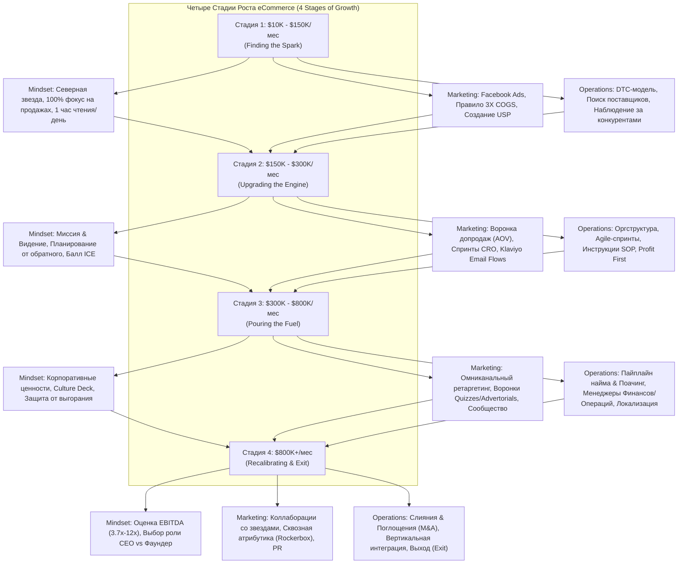

Ниже представлен подробный учебный конспект книги **«8-Figure Ecommerce Engine»** (Дариус Кунца и Джастин Гечевич) на русском языке с сохранением ключевых английских терминов в скобках и точными ссылками на первоисточник.

#### 0. Полный список глав книги (номер, название по-английски — перевод)

1. **Chapter 1: Mindset Magic: How to Go From $10K to $150K/Month** — Магия мышления: как вырасти с $10K до $150K в месяц
2. **Chapter 2: The Systems and Structure to Get to $150K/Month** — Системы и структура для достижения $150K в месяц
3. **Chapter 3: The Marketing Method to Get to $150K/Month** — Маркетинговый метод для достижения $150K в месяц
4. **Chapter 4: Your Mission and Vision: The Mindset Shift to Grow to $300K/Month** — Ваша миссия и видение: сдвиг мышления для роста до $300K в месяц
5. **Chapter 5: The Operations Engine to Grow to $300K/Month** — Операционный двигатель для роста до $300K в месяц
6. **Chapter 6: Building Your Brand: The Marketing Engine to Grow to $300K/Month** — Построение бренда: маркетинговый двигатель для роста до $300K в месяц
7. **Chapter 7: Level Up Your Mindset to Scale to $800K/Month** — Вывод мышления на новый уровень для масштабирования до $800K в месяц
8. **Chapter 8: Bullet Proof Processes to Scale to $800K/Month** — Пуленепробиваемые процессы для масштабирования до $800K в месяц
9. **Chapter 9: Your Ten Million Dollar Funnel** — Ваша десятимиллионная воронка
10. **Chapter 10: Defining What’s Next: The Key to an 8-Figure Business** — Определение следующего шага: ключ к 8-значному бизнесу
11. **Chapter 11: Next Level Operations Hacks** — Операционные лайфхаки следующего уровня
12. **Chapter 12: Ubiquity: The Marketing Methods to Become a Household Name** — Вездесущность: маркетинговые методы, чтобы стать известным брендом (Household Name)

#### 1. О чём книга в 3 предложениях

1. Книга представляет собой практическое руководство по трансформации бренда прямой торговли с покупателем (Direct-to-Consumer, DTC) из стартапа с оборотом от $10K в месяц в 8-значный бизнес с доходом в десятки миллионов долларов.
2. Авторы выделяют 4 предсказуемые стадии роста компании (10K–150K, 150K–300K, 300K–800K и $800K+ в месяц), каждая из которых требует задействования трех главных рычагов: сдвига мышления (Mindset), маркетинга (Marketing) и операционных систем (Operations).
3. Фокусируясь на ценности клиента (Lifetime Value, LTV), окупаемости рекламы (ROAS), регламентации процессов (SOP) и реинвестировании прибыли, предприниматель учится делегировать операционку и превращать компанию в устойчивый актив, готовый к выходу или продаже.

#### 2. Главные идеи по главам (по каждой главе 3–5 пунктов)

##### Chapter 1: Mindset Magic: How to Go From $10K to $150K/Month

* **Поиск «Северной звезды» (North Star):** Понимание личных целей определяет, строит ли основатель бизнес для стиля жизни (Lifestyle Business) или миллионный актив на продажу (Legacy Business).
* **Платная реклама как искра (Paid Advertising is the Spark):** Платная реклама в Facebook — самый быстрый источник данных для проверки соответствия продукта рынку (Product-Market Fit) и взрывного роста.
* **Фокус на одной вещи (Make THIS One Thing Work):** До достижения $50K/мес все усилия направляются исключительно на продажи, тестирование креативов и воронку, а не на редизайн сайта или смену поставщиков.
* **Быстрые неудачи (Fail Fast and Break Things):** В e-commerce до 95% тестов оканчиваются неудачей; главный фактор успеха — скорость проверки гипотез и офферов.
* **Постоянное обучение (Commit to Learning):** Рост бизнеса никогда не опережает личностный рост владельца, поэтому необходимо ежедневно выделять минимум 1 час на чтение профильной литературы.

##### Chapter 2: The Systems and Structure to Get to $150K/Month

* **Бизнес-план и SWOT-анализ:** Составление плана и детальный анализ сильных и слабых сторон конкурентов помогают найти незанятые ниши на рынке.
* **Глубокое изучении целевой аудитории (Stalk Your Target Market):** Исследование эмоций, страхов и сленга покупателей позволяет создавать резонирующие рекламные сообщения.
* **Правило 3X для ценообразования (The 3X Rule):** Розничная цена товара должна минимум в 3 раза превышать его себестоимость (Cost of Goods Sold, COGS), чтобы выдерживать расходы на платную рекламу.
* **Владение процессом заказа (Own the Order Process):** Модель DTC дает полный контроль над данными клиентов и повторными продажами, в отличие от Amazon, где нет доступа к базам покупателей.
* **Стратегия производства и качественный найм:** Локальные поставщики дают скорость доставки, а найм сотрудников не из круга знакомых формирует профессиональную команду.

##### Chapter 3: The Marketing Method to Get to $150K/Month

* **Конкуренция по ценности (Compete on Value):** Вместо демпинга необходимо строить уникальное торговое предложение (Unique Selling Proposition, USP) и упаковывать эмоциональные офферы.
* **Удвоение усилий на ведущем канале (Double Down on Your Leading Channels):** Распыление бюджета по множеству площадок губительно; нужно выжать 80% потенциала из одного главного рекламного канала.
* **Оптимизация конверсии (Conversion Rate Optimization, CRO):** Инструменты UserTesting, HotJar и Google Optimize помогают находить утечки на сайте и поднимать доход с каждого посетителя.
* **Мастерство воронки (Master Your Funnel):** Внедрение бандлов (Bundles), допродаж до покупки (Pre-purchase Upsells) и после покупки (Post-purchase Upsells) существенно повышает средний чек (Average Order Value, AOV).
* **Удержание клиентов через Email:** Запуск автоматических сценариев писем добавляет от 20% до 30% к чистой прибыли бизнеса.

##### Chapter 4: Your Mission and Vision: The Mindset Shift to Grow to $300K/Month

* **Миссия и видение (Mission and Vision):** Понятная миссия отвечает на вопрос «что и для кого мы делаем», а видение вдохновляет A-игроков (A-Players) работать ради идеи.
* **Планирование от обратного (Backward Planning):** Постановка годовых целей и их разбивка на квартальные и месячные спринты снимает эмоциональные блоки.
* **Доверие команде и контекстное руководство:** Делегирование задач сотрудникам с принятием качества их работы на уровне 80–90% от идеала владельца.
* **Метод 5 «Почему» и балл ICE:** Нахождение первопричин проблем с помощью метода 5 Whys и приоритезация задач по модели ICE (Impact, Confidence, Ease).
* **Правило 24–72 часов при сбоях (Don’t Panic):** При блокировках рекламных аккаунтов или просадках ROAS нельзя принимать импульсивные решения минимум 24–72 часа.

##### Chapter 5: The Operations Engine to Grow to $300K/Month

* **Оргструктура (Organizational Chart):** Четкое определение ролей, обязанностей и зарплатных фондов до непосредственного найма новых сотрудников.
* **Методология Agile и Спринты (Sprints):** Управление проектами с помощью 1–2 недельных спринтов с фиксированными дедлайнами в ClickUp или Asana.
* **База регламентов (Standard Operating Procedures, SOP):** Создание коротких текстовых и видео-инструкций в Google Drive для автоматизации обучения новичков.
* **Принцип Profit First:** Переход от стандартного учета к формуле Выручка - Прибыль = Расходы (Revenue - Profit = Expenses) и распределению денег по отдельным банковским счетам.
* **Управление оборотным капиталом и эквайринг:** Формирование 3–12 месячной подушки безопасности и использование надежных платежных процессоров во избежание заморозок средств.

##### Chapter 6: Building Your Brand: The Marketing Engine to Grow to $300K/Month

* **Создание бренда и Брендбука (Brand Book):** Бренд строится на восприятии покупателя, эмоциональной истории, "враге" ниши и едином визуальном стиле.
* **Очеловечивание бренда (Humanizing the Brand):** Демонстрация основателя, команды, закулисных процессов и даже ошибок вызывает искреннее доверие клиентов.
* **Неотразимое предложение (Irresistible Offer):** Создание офферов с высоким восприятием ценности (подписки с бесплатным первым месяцем, комплекты "3 по цене 2", годовые скидки).
* **Рефрейминг маркетинга для новых сегментов:** Изменение рекламных углов (Angles) и хуков (Hooks) для привлечения новых аудиторий с тем же продуктом.
* **Пожизненная ценность клиента (LTV) и ретаргетинг:** Фокус на удержании клиентов через автоматические сценарии Klaviyo (Email Flows), SMS и подключение YouTube-ретаргетинга.

##### Chapter 7: Level Up Your Mindset to Scale to $800K/Month

* **Корпоративные ценности (Company Values):** Совместное с командой определение 5–9 ключевых ценностей, определяющих найм, увольнения и культуру (Extreme Ownership, Limitless Growth).
* **Культурный код (Culture Deck):** Создание документа по примеру Netflix, регулирующего правила принятия решений и автономию менеджеров.
* **Непрерывное обучение и мастермайнды:** Участие в закрытых сообществах высокого уровня (eCommerce Fuel) для решения нетиповых проблем.
* **Предотвращение выгорания (Preventing Burnout):** Ограничение рабочего времени до 4–8 часов сфокусированной работы в день и проведение командных мероприятий.

##### Chapter 8: Bullet Proof Processes to Scale to $800K/Month

* **Регулярный аудит оргструктуры и SOP:** Понимание того, что процессы уровня $50K/мес не работают на уровне $500K/мес, и внедрение анонимных квартальных опросов сотрудников.
* **Пайплайн найма и прямое переманивание (Poaching):** Проактивное формирование кадрового резерва и прямое привлечение сильных специалистов из агентств и компаний-конкурентов.
* **Формирование звена менеджеров:** Найм руководителей направлений финансов и операций (Finance & Operations Managers) вместо ранней раздачи незрелых C-level титулов.
* **Диверсификация всего (Diversify Everything):** Работа с поставщиками из разных стран, использование нескольких платежных процессоров и рекламных площадок.
* **Локализация (Localization):** Создание выделенных локальных сайтов (.com.au, .co.uk), номеров телефонов и склада в целевой стране увеличивает ROAS на величину до 40%.

##### Chapter 9: Your Ten Million Dollar Funnel

* **Генерация спроса и обучающие воронки:** Использование адверториалов (Advertorials), викторин (Quiz Funnels), сравнительных страниц и 7-дневных цифровых курсов для работы с неосведомленным рынком.
* **Инвестиции в визуальный контент:** Профессиональная видеосъемка и фотосессии, заточенные под конверсию.
* **Теневые воронки (Shadow Funnels) и PR:** Понимание того, что 70–80% покупателей перед покупкой ищут отзывы в Google, что делает PR и SEO мощными усилителями прямой рекламы.
* **Сообщество бренда (Brand Community):** Создание закрытых групп в Facebook для топ-10% клиентов и программы бренд-амбассадоров с элементами геймификации.
* **Сквозная атрибутика и вечные запуски:** Использование специализированного софта (Rockerbox, Hyros) для точного отслеживания многоканальных касаний и регулярный запуск новинок раз в квартал.

##### Chapter 10: Defining What’s Next: The Key to an 8-Figure Business

* **Определение дальнейшего пути:** Принятие решения о масштабировании компании до $50M+, найме стороннего CEO или подготовке к выходу (Exit).
* **Мультипликаторы EBITDA и оценка бизнеса:** Понимание оценки бизнеса: от 1.5–2.5X EBITDA для несистемных компаний до 2.5X–3.7X для компаний с независимым менеджментом и регламентами.
* **Структура сделок по продаже:** Понимание условий покупки (20% наличными сразу, остальное через 3–4 года) и применение стратегии частичного выхода (Partial Exit).
* **Принцип победы наибольшего бюджета на привлечение:** В долгосрочной перспективе побеждает компания с максимальным LTV, способная платить больше всех за привлечение клиента (Customer Acquisition Cost, CAC).
* **Использование привлеченного капитала и кредитов:** Восприятие долга и кредитных линий как инструмента ускорения закупки инвентаря.

##### Chapter 11: Next Level Operations Hacks

* **Перекалибровка бизнеса (Revisit Everything):** Временная приостановка агрессивного роста для оптимизации внутренних процессов, улучшения условий у поставщиков и дачи отдыха команде.
* **Опасности розничных сетей ("Retail Jail"):** Осторожность при выходе в ритейл из-за заморозки капитала в инвентаре и снижения маржинальности.
* **Стратегия слияний и поглощений (M&A):** Покупка более мелких конкурентов (5M–10M) и их объединение под одной управляющей структурой для роста оценки.
* **Вертикальная интеграция:** Покупка смежных бизнесов, собственных фабрик, складов или маркетинговых медиа-площадок.

##### Chapter 12: Ubiquity: The Marketing Methods to Become a Household Name

* **Изыскание инкрементальных приростов (Incremental Gains):** На зрелом этапе рост формируется за счет суммирования мелких улучшений по 2–3% на каждом канале.
* **Маркетинг со знаменитостями и коллаборации:** Выпуск лимитированных коллекций (Limited Editions) со знаменитостями и инфлюенсерами с выплатой роялти.
* **Защита от копирок (Dealing with Copycats):** Защита лидерства за счет барьера качества, безупречного сервиса и уникального сообщества.

#### 3. Схема связей между главными идеями в формате Mermaid (graph TD)

#### 4. Пошаговый чек-лист практических действий

##### Этап 1: Запуск и проверка гипотез ($10K – $150K / мес)

* [ ] **Сформулировать «Северную звезду» (North Star):** Определить личную миссию фаундера и формат бизнеса (Lifestyle vs Legacy).
* [ ] **Зафиксировать ценообразование по правилу 3X:** Убедиться, что розничная цена минимум в 3 раза превышает себестоимость (COGS).
* [ ] **Запустить платную рекламу в Facebook:** Использовать таргетированную рекламу как главный источник данных и быстрых продаж.
* [ ] **Внедрить метод 5 «Почему» (5 Whys):** Находить первопричины низких конверсий или высокой стоимости привлечения.
* [ ] **Внедрить допродажи в воронку:** Установить скрипты бандлов, Pre-purchase и Post-purchase допродаж (через CartHook / ReConvert).
* [ ] **Настроить базовый Email-маркетинг в Klaviyo:** Запустить автоматические цепочки Welcome, Cart Abandonment и Browse Abandonment.

##### Этап 2: Построение систем и структуры ($150K – $300K / мес)

* [ ] **Составить оргструктуру (Org Chart):** Описать роли, обязанности и необходимый зарплатный фонд до закрытия вакансий.
* [ ] **Внедрить систему Profit First:** Открыть отдельные счета (Прибыль, Налоги, Операции) и распределять выручку по фиксированным %.
* [ ] **Перейти на Agile-спринты:** Планировать работу команды 1–2 недельными спринтами в ClickUp или Asana.
* [ ] **Задокументировать регламенты (SOP):** Записать короткие видео и текстовые инструкции в Google Drive для частых процессов.
* [ ] **Провести CRO-тесты:** Запустить UserTesting, HotJar и A/B тесты в Google Optimize для роста дохода на посетителя.
* [ ] **Формировать подушку безопасности:** Накопить от 3 до 12 месяцев операционных расходов на счетах.

##### Этап 3: Масштабирование и диверсификация ($300K – $800K / мес)

* [ ] **Разработать Культурный код (Culture Deck):** Зафиксировать 5–9 ценностей компании и правила принятия решений.
* [ ] **Нанять менеджеров по финансам и операциям:** Передать операционный контроль профильным руководителям.
* [ ] **Построить воронку найма:** Организовать постоянный поиск и переманивание (Poaching) A-игроков из агентств и смежных ниш.
* [ ] **Диверсифицировать цепочки поставок и эквайринг:** Подключить запасных поставщиков в разных странах и дополнительные платежные шлюзы.
* [ ] **Запустить локализацию:** Создать отдельные локальные сайты (.co.uk, .com.au) с местными складами и номерами телефонов.
* [ ] **Запустить теневые воронки (Shadow Funnels):** Усилить прямую рекламу публикациями в СМИ (PR), SEO и статьями-сравнениями.

##### Этап 4: Вездесущность и подготовка к выходу ($800K+ / мес)

* [ ] **Внедрить сквозную атрибутику:** Подключить Rockerbox или Hyros для точной оценки многоканальных касаний.
* [ ] **Создать закрытое сообщество клиентов:** Запустить VIP-группу в Facebook и программу амбассадоров.
* [ ] **Внедрить регулярные запуски новинок:** Запустить квартальный календарь обновлений ассортимента.
* [ ] **Подготовить аудит EBITDA:** Увеличивать мультипликатор оценки бизнеса (до 3.7x–12x) за счет полной автономности процессов.
* [ ] **Рассмотреть стратегию M&A:** Покупать конкурентов и смежные сервисы для горизонтальной и вертикальной интеграции.

#### 5. Типичные ошибки и как их избежать

1. **Ошибка: Конкуренция по цене (демпинг)**
  * *Почему происходит:* Новички считают низкую цену главным преимуществом.
  * *Как избежать:* Сосредоточиться на уникальном торговом предложении (USP), упаковывать комплекты (Bundles), повышать скорость доставки и конкурировать по ценности.
2. **Ошибка: Преждевременная диверсификация рекламных каналов**
  * *Почему происходит:* Фаундер пытается одновременно запускать TikTok, Pinterest, Google Ads и SEO на раннем этапе.
  * *Как избежать:* Удвоить усилия на одном главном канале (например, Facebook Ads) до исчерпания 80% его потенциала, а новые каналы подключать через профильных экспертов.
3. **Ошибка: Бесконечный редизайн сайта вместо работы над продажами**
  * *Почему происходит:* Психологический уход от сложных задач (тестирования рекламы) в сторону декоративных изменений.
  * *Как избежать:* Оценивать задачи по шкале ICE (Impact, Confidence, Ease) и до достижения $50K/мес фокусироваться только на оффере и воронке.
4. **Ошибка: Фаундер как «узкое горлышко» бизнеса (микроменеджмент)**
  * *Почему происходит:* Нежелание передавать контроль и иллюзия, что «никто не сделает лучше меня».
  * *Как избежать:* Переходить к контекстному руководству, принимать работу сотрудников на уровне 80–90% качества, внедрять SOP и проектное управление.
5. **Ошибка: Фокус на выручке (Top-Line Revenue) вместо Прибыли (Profit)**
  * *Почему происходит:* Желание хвастаться большими цифрами оборота в ущерб финансовому здоровью.
  * *Как избежать:* Внедрить методологию *Profit First* (Выручка - Прибыль = Расходы), распределять средства по целевым счетам.
6. **Ошибка: Зависимость от одной площадки (Amazon / 1 поставщик / 1 эквайринг)**
  * *Почему происходит:* Удобство работы на начальном этапе создает слепую зону риска.
  * *Как избежать:* Развивать собственный DTC-магазин, формировать базу Email/SMS и диверсифицировать поставщиков и эквайринги.
7. **Ошибка: Паника при блокировках или падении показателей ROAS**
  * *Почему происходит:* Эмоциональные решения при сбоях алгоритмов.
  * *Как избежать:* Соблюдать «правило 24–72 часов», не удалять кампании сразу, обращаться в поддержку и опираться на аналитику.
8. **Ошибка: Продажа только одного товара без допродаж**
  * *Почему происходит:* Непонимание экономики повторных покупок.
  * *Как избежать:* Внедрять Quantity Upsells, бандлы, программы подписок и автоматические Email-сценарии Klaviyo.

#### 6. 20 карточек «вопрос — ответ» для повторения

1. **В: На какие 4 стадии роста разделен eCommerce-бизнес в книге?** **О:** 1) Поиск искры ($10K–$150K/мес), 2) Обновление двигателя ($150K–$300K/мес), 3) Заливка топлива ($300K–$800K/мес), 4) Перекалибровка ($800K+/мес).
2. **В: Что такое «Северная звезда» (North Star) фаундера?** **О:** Это четкое понимание личной миссии и целей предпринимателя, определяющее, строит ли он бизнес для стиля жизни (Lifestyle) или актив на продажу (Legacy).
3. **В: В чем суть Правила 3X (3X Rule) для ценообразования?** **О:** Розничная цена товара должна быть минимум в 3 раза выше себестоимости (COGS), чтобы заложить маржу на оплату платного трафика и налоги.
4. **В: Почему платная реклама считается «искрой» для бизнеса?** **О:** Платная реклама дает мгновенный поток данных и трафика, позволяя за дни валидировать продукт и воронку вместо месяцев органического продвижения.
5. **В: Чем модель DTC превосходит продажи исключительно на Amazon?** **О:** DTC даёт полный контроль над цепочкой заказа, контактами клиентов, возможностью повторных продаж (LTV) и защищает от внезапной блокировки аккаунта.
6. **В: Что гласит формула методологии Profit First?** **О:** Выручка - Прибыль = Расходы (Revenue - Profit = Expenses), в отличие от традиционной Выручка - Расходы = Прибыль.
7. **В: Как работает Метод 5 «Почему» (5 Whys)?** **О:** Последовательное задавание вопроса «Почему?» (минимум 5 раз) для отсечения симптомов и выявления корневой причины проблемы.
8. **В: Что такое балл ICE и для чего он применяется?** **О:** Это модель приоритезации задач по 10-балльной шкале на основе показателей: Impact (Влияние), Confidence (Уверенность), Ease (Легкость).
9. **В: В чем отличие Миссии (Mission) от Видения (Vision)?** **О:** Миссия тактична и отвечает на вопросы "что делаем, для кого и как"; Видение стремительно и описывает вдохновляющие долгосрочные цели.
10. **В: Какие 3 типа допродаж (Upsells) рекомендуется использовать?** **О:** 1) Quantity Pre-purchase Upsells (пакеты из 2–3 штук), 2) Pop-up Upsells (сопутствующие товары), 3) Post-purchase Upsells (допродажи после оплаты).
11. **В: Что такое теневая воронка (Shadow Funnel)?** **О:** Это невидимый путь покупателя через поиск отзывов в Google, чтение PR-статей и SEO-материалов между первым кликом по рекламе и финальной покупкой.
12. **В: Почему важно создавать инструкции SOP (Standard Operating Procedures)?** **О:** SOP (видео и текст) высвобождают время фаундера, стандартизируют качество и позволяют новичкам автономно выполнять 80% задач.
13. **В: Какова роль локализации при выходе на новые рынки?** **О:** Создание локального домена (.co.uk, .com.au), указание местного склада и номера телефона увеличивают окупаемость рекламы (ROAS) на величину до 40%.
14. **В: Какую подушку безопасности (Financial Pillow) рекомендуют авторы?** **О:** Запас денежных средств на счетах компании, покрывающий от 3 до 12 месяцев операционных расходов.
15. **В: Что такое Очеловечивание бренда (Humanizing the Brand)?** **О:** Открытый показ основателя, сотрудников, производственных процессов и даже трудностей, превращающий клиентов в фанатов.
16. **В: Чем отличаются автоматические сценарии (Flows) от рассылок (Newsletters) в Email-маркетинге?** **О:** Flows срабатывают автоматически на действия пользователя (брошенные корзины, просмотры); Newsletters отправляются вручную всей базе или сегментам с новостями и акциями.
17. **В: Зачем использовать софт сквозной атрибуции (Rockerbox / Hyros)?** **О:** Чтобы видеть реальный вклад всех рекламных каналов в многоканальную цепочку касаний, так как встроенная аналитика рекламных кабинетов искажает данные.
18. **В: Каковы типичные мультипликаторы EBITDA при продаже e-commerce бизнеса?** **О:** От 1.5X–2.5X EBITDA для несистемного бизнеса до 2.5X–3.7X для системного бизнеса с менеджментом, и до 12X EBITDA при продаже частным инвестиционным фондам (Private Equity).
19. **В: Что означает правило «Побеждает тот, кто может больше всех заплатить за клиента»?** **О:** Бизнес с высоким LTV и развитой воронкой допродаж имеет более высокую маржу и может выкупать трафик по ценам, недоступным для конкурентов.
20. **В: Что такое «перекалибровка» на уровне $800K+/мес (Recalibrating)?** **О:** Обоснованная пауза в агрессивном масштабировании для настройки эффективности процессов, переговоров с фабриками и снижения нагрузки на команду.

#### 7. 5 практических заданий на применение

##### Задание 1. Интернет-магазин одежды (DTC Apparel Brand)

* **Контекст:** Магазин базовой и спортивной одежды делает $40K/мес, продавая товары поштучно, столкнулся с просадкой ROAS и высокой стоимостью привлечения клиента (CAC).
* **Задача:**
  1. Пересчитать цены по **Правилу 3X** и сформировать бандлы (например, «Спортивный комплект из 3 предметов»).
  2. Разработать Post-purchase оффер (допродажа сопутствующего аксессуара со скидкой 25% сразу после оплаты).
  3. Настроить автоматический сценарий **Cart Abandonment** и **Browse Abandonment** в Klaviyo с уникальными темами писем.

##### Задание 2. B2B-лидогенерация (Услуги продвижения и продаж)

* **Контекст:** B2B-агентство привлекает клиентов на чеки $3K–$5K/мес, но столкнулось с долгим циклом сделки и нехваткой доверия.
* **Задача:**
  1. Сформировать **Неотразимое предложение (Irresistible Offer)** с убиранием трения (например, аудит или персонализированный видео-разбор бесплатно / за символическую плату).
  2. Разработать **Advertorial / Сравнительную страницу** с кейсами и видео-отзывами существующих клиентов.
  3. Внедрить систему оценки потенциальных клиентов и проектов по баллу **ICE**.

##### Задание 3. Сборщики данных на Claude / Python для маркетинговых исследований (Market Research Scraper)

* **Контекст:** Разработчик строит парсер на Python и Claude для автоматического исследования конкурентов и отзывов в e-commerce нишах.
* **Задача:**
  1. Написать Python-скрипт для сбора отзывов клиентов с сайтов конкурентов и Amazon.
  2. Настроить промпт для Claude, анализирующий собранный текст по методу **SWOT** (выявление слабых мест конкурентов: долгая доставка, рвущиеся швы, плохая упаковка).
  3. На основе сгенерированного отчета сформулировать 3 конкретных **USP** и сленговые фразы для рекламных копирайтов.

##### Задание 4. Оптимизация финансов и операционки по Profit First (Любой e-commerce проект)

* **Контекст:** Магазин электроники делает $180K/мес выручки, но фаундер регулярно сталкивается с нехваткой денег на закупку товара и уплату налогов.
* **Задача:**
  1. Рассчитать целевые проценты распределения доходов по методологии **Profit First** (Прибыль, Налоги, Операционные расходы, Зарплата фаундера).
  2. Составить схему из 4 отдельных банковских счетов и регламент еженедельного перевода средств.
  3. Рассчитать требуемый размер **финансовой подушки (Financial Pillow)** на 6 месяцев и составить план её пополнения.

##### Задание 5. Создание баз знаний SOP и проектного спринта для команды

* **Контекст:** Растущая команда e-commerce магазина (10 человек) путается в задачах, а обучение новых сотрудников занимает у фаундера до 20 часов в неделю.
* **Задача:**
  1. Составить оргструктуру (Org Chart) с разделением функций Финансов, Маркетинга и Операций.
  2. Разработать стандартную структурированную видео- и текстовую инструкцию (**SOP**) для процесса обработки возвратов или запуска рекламной кампании.
  3. Сформировать план 2-недельного **Agile-спринта** в ClickUp/Asana с дедлайнами и назначением ответственных A-игроков.
💡 Если вы хотите детально разобрать конкретный этап роста, углубиться в финансовые формулы Unit-экономики или составить регламент (SOP) под ваши задачи — дайте знать!