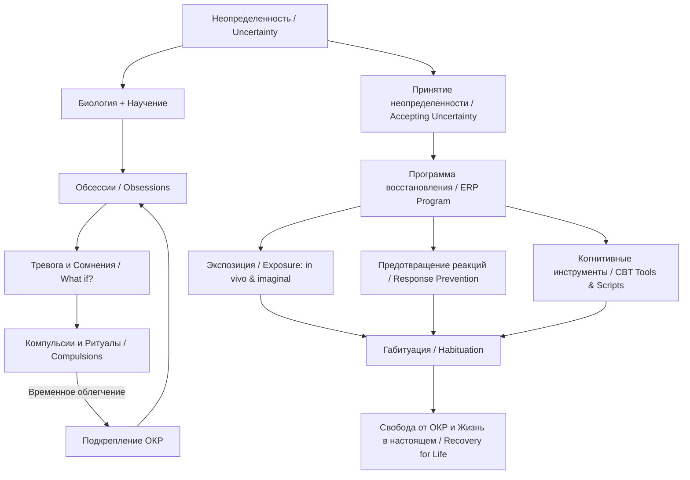

#### 0. Полный список глав книги (номер, название по-английски — перевод)

**Часть I. Понимание обсессивно-компульсивного расстройства (PART I: Understanding Obsessive-Compulsive Disorder)**
* **Глава 1.** *Uncertainty: The Core of OCD* — Неопределенность: ядро ОКР.
* **Глава 2.** *Causes of OCD: Biology and Learning, Not Biology vs. Learning* — Причины ОКР: биология и научение, а не биология против научения.
* **Глава 3.** *Obsessions and Compulsions: What Sufferers Fear and What Sufferers Do* — Обсессии и компульсии: чего боятся и что делают страдающие ОКР.
* **Глава 4.** *Understanding the Role of Medication* — Понимание роли медикаментозного лечения.
* **Глава 5.** *Accepting Uncertainty: Your First Step* — Принятие неопределенности: ваш первый шаг.
* **Глава 6.** *Exposure and Response Prevention: The B in Cognitive Behavioral Therapy* — Экспозиция и предотвращение реакций: поведенческий аспект в когнитивно-поведенческой терапии.
* **Глава 7.** *Tools to Counter the Voice of OCD: The C in Cognitive Behavioral Therapy* — Инструменты противостояния голосу ОКР: когнитивный аспект в когнитивно-поведенческой терапии.
* **Глава 8.** *Designing Your Recovery Program* — Разработка вашей программы восстановления.
**Часть II / III. Персонализация вашей программы: руководство по лечению конкретных форм ОКР (Personalizing Your Program: Treatment Guidelines for Your Specific OCD Concerns)**
* **Глава 9.** *Contamination: The Obsession That Spreads* — Загрязнение: распространяющаяся обсессия.
* **Глава 10.** *Checking: The Pervasive Compulsion* — Проверки: всепроникающая компульсия.
* **Глава 11.** *Ordering, Symmetry, Counting, and Movement: Rituals of Perfection and Magic* — Упорядочивание, симметрия, счет и движения: ритуалы перфекционизма и магии.
* **Глава 12.** *The Primary Mental Obsessions: It Really Is All in Your Mind* — Первичные ментальные обсессии: это действительно всё в вашей голове.
* **Глава 13.** *Selected Obsessive-Compulsive Spectrum Disorders: OCD Problems with Another Name* — Некоторые расстройства спектра ОКР: проблемы ОКР под другим названием.
**Часть IV. Восстановление и дальнейший путь (Recovery and Beyond)**
* **Глава 14.** *Building Supports for Recovery: Beyond Exposure and Response Prevention* — Создание системы поддержки для восстановления: за пределами экспозиции и предотвращения реакций.
* **Глава 15.** *In Recovery for Life* — В процессе восстановления на всю жизнь.
**Приложения:**
* *Appendix A: Therapy Scripts Starters* — Шаблоны сценариев для терапии.
* *Appendix B: OCD Resources* — Ресурсы по ОКР.

#### 1. О чём книга в 3 предложениях

1. Книга Джонатана Грейсона «Свобода от ОКР» раскрывает, что в основе обсессивно-компульсивного расстройства лежит неспособность переносить неопределенность и бесплодное стремление к недостижимой 100% уверенности.
2. Автор предлагает индивидуализированную программу самопомощи, основанную на методе экспозиции и предотвращения реакций (Exposure and Response Prevention, ERP), которая учит сталкиваться со страхами без выполнения ритуалов.
3. Помогая изменить отношение к тревоге и разработать терапевтические сценарии (therapy scripts), книга ведет пациента к принятию риска и возвращению к полноценной жизни в настоящем моменте.

#### 2. Главные идеи по главам

##### Глава 1. Неопределенность: ядро ОКР (Uncertainty: The Core of OCD)

* В основе всех проявлений ОКР лежит неспособность переносить интеллектуальную и эмоциональную неопределенность (Uncertainty), а компульсии — это попытка достичь абсолютной 100% гарантии.
* Чувство уверенности (Certainty) в повседневной жизни — это не объективный факт, а лишь эмоция или субъективная оценка вероятности.
* Логика не способна избавиться от сомнений, так как на любой логический ответ ОКР создает новый вопрос «А что, если...?» (What if?).
* Для преодоления ОКР требуется смена цели: вместо стремления к гарантиям нужно научиться жить с неопределенностью и делать «лучшую догадку» (Best Guess) с помощью «Теста с пистолетом» (Gun Test).

##### Глава 2. Причины ОКР: биология и научение, а не биология против научения (Causes of OCD: Biology and Learning, Not Biology vs. Learning)

* ОКР возникает на стыке биологической уязвимости мозга и механизмов психологического научения.
* Биология задает пониженный порог тревожности и сбой в ощущении завершенности действия («я знаю, что сделал X, но не чувствую этого»).
* Посредством классического обусловливания (Classical Conditioning) нейтральные стимулы связываются с тревогой.
* Оперантное обусловливание (Operant Conditioning) подкрепляет ритуалы и избегание, так как они временно снижают дискомфорт, формируя ловушку, подобную азартным играм.
* Ритуалы не являются непреодолимыми — их выполнение всегда представляет собой выбор, зависящий от контекста (Context) и внутреннего состояния (State-dependent learning).

##### Глава 3. Обсессии и компульсии: чего боятся и что делают страдающие ОКР (Obsessions and Compulsions: What Sufferers Fear and What Sufferers Do)

* Обсессии (Obsessions) — это пугающие мысли и чувства, возникающие из-за непереносимости конкретных видов неопределенности.
* Компульсии или ритуалы (Compulsions / Rituals) — это любые действия, направленные на нейтрализацию пугающих последствий с целью достижения 100% уверенности.
* Основные функции ритуалов включают: предотвращение и восстановление (Preventing and restoring), анализ и выяснение (Analyzing and figuring out), контроль мыслей и чувств (Controlling thoughts/feelings), а также загадывание/пожелание (Wishing).
* Стремление к чувству «как надо» (Just right feeling) является невыполнимой компульсией, обрекающей на бесконечные повторы.

##### Глава 4. Понимание роли медикаментозного лечения (Understanding the Role of Medication)

* Препараты группы СИОЗС (SSRIs) и другие серотонинергические средства являются важным вспомогательным инструментом, снижающим «громкость» тревоги.
* Лекарства не лечат ОКР сами по себе и не стирают прежние привычки — они лишь создают биологическое окно возможностей для эффективного прохождения психотерапии.
* Ключевым элементом долговременного восстановления остается поведенческая и когнитивная перестройка.

##### Глава 5. Принятие неопределенности: ваш первый шаг (Accepting Uncertainty: Your First Step)

* Первый и важнейший шаг в лечении — дательный ответ на вопрос: «Готовы ли вы научиться жить с неопределенностью?».
* Отрицание реальности (Denial) выражается в сравнении настоящего момента с фантазией об абсолютной безопасности, что отнимает у человека жизнь в настоящем.
* Принятие (Acceptance) означает отказ от бесплодной борьбы за гарантии и согласие рисковать ради возможности жить полноценной жизнью.

##### Глава 6. Экспозиция и предотвращение реакций: «П» в КПТ (Exposure and Response Prevention: The B in Cognitive Behavioral Therapy)

* Экспозиция и предотвращение реакций (Exposure and Response Prevention, ERP) — золотой стандарт терапии ОКР.
* Экспозиция (Exposure) заключается в намеренном столкновении с пугающими стимулами в реальности (in vivo) или воображении (imaginal exposure).
* Цель экспозиции — не доказательство безопасности, а габитуация (Habituation) — естественное привыкание нервной системы к тревоге.
* Предотвращение реакций (Response Prevention) — это полный отказ от выполнения любых ментальных и поведенческих ритуалов.
* Инструменты оценки включают иерархию страхов (Fear Hierarchy), дневники самомониторинга (Daily Self-Monitoring Log) и субъективную шкалу дискомфорта (SUDs).

##### Глава 7. Инструменты противостояния голосу ОКР: «К» в КПТ (Tools to Counter the Voice of OCD: The C in Cognitive Behavioral Therapy)

* Когнитивная терапия в контексте ОКР используется не для успокоения или поиска доказательств безопасности (что превратилось бы в ритуал), а исключительно для поддержки экспозиции.
* Типичные когнитивные искажения (Cognitive Distortions): непереносимость неопределенности, черно-белое мышление (Black-and-White thinking), чтение мыслей (Mind reading), слияние мыслей и действий (Thought-Action Fusion), гиперответственность (Inflated responsibility).
* Ключевые техники: техника падающей стрелы (Downward Arrow) для вскрытия глубинного страха, метод опроса (Survey Method), метод двойных стандартов (Double-Standard Method), Сократовский диалог (Socratic Questioning) и внешнее противостояние голосу ОКР.
* Подходы терапии принятия и ответственности (ACT) и осознанности (Mindfulness) адаптируются для развития разделения с мыслями (Defusion) и состояния готовности выдерживать тревогу.

##### Глава 8. Разработка вашей программы восстановления (Designing Your Recovery Program)

* Программа требует регулярных ежедневных активных экспозиций (1–2 часа) и непрерывного пассивного погружения (Passive exposure).
* Составление и регулярное прослушивание сценариев воображаемой экспозиции (Imaginal exposure scripts) помогает выстроить мощную анти-ОКР кампанию.
* Использование напоминаний — красных точек (Red-dot labels) и карточек со сценариями (Script cards).
* Обязательный учет и нейтрализация поведения, мешающего лечению (Treatment Interfering Behaviors, TIBs).

##### Глава 9. Загрязнение: распространяющаяся обсессия (Contamination: The Obsession That Spreads)

* Обсессии загрязнения склонны распространяться через вторичные и третичные контакты.
* Успешное лечение требует тотального и неизбежного погружения (Total immersion) — полного загрязнения личного пространства и вещей.
* Правила предотвращения реакций: полный отказ от мытья рук (или жесткое ограничение в модифицированных программах), 10-минутный «неправильный» душ, запрет на дезинфекцию и поиск заверения.

##### Глава 10. Проверки: всепроникающая компульсия (Checking: The Pervasive Compulsion)

* Проверки (Checking) — это компульсивные попытки воздействия на среду или проверки корректности ее восприятия (плиты, замки, бытовые приборы, автовождение).
* Страх сбить человека на машине (Hit-and-run) требует отказа от возвращений, разглядывания дороги в зеркала, просмотра новостей и ментального воспроизведения маршрута.
* Техники экспозиции: выключение приборов «неправильно», заклеивание надписей скотчем, намеренное создание неопределенности и использование бинарных вспомогательных средств при нерешительности (Indecision).

##### Глава 11. Упорядочивание, симметрия, счет и движения: ритуалы перфекционизма и магии (Ordering, Symmetry, Counting, and Movement: Rituals of Perfection and Magic)

* Перфекционистские ритуалы и попытки добиться ощущения «как надо» (Just right) приводят к бесконечным повторам и истощению.
* Экспозиция при упорядочивании требует делать всё «неправильно» — намеренно оставлять вещи несимметричными, создавать легкий беспорядок и сбивать идеальные схемы.
* При двигательных и магических ритуалах цель экспозиции — совершать слишком много «ошибочных» движений, чтобы мозг физически не мог их отследить и пересчитать.

##### Глава 12. Первичные ментальные обсессии: это действительно всё в вашей голове (The Primary Mental Obsessions: It Really Is All in Your Mind)

* Ментальные обсессии (насилие, сексуальные табу, богохульство, отношения, нейтральные/сенсорные темы) питаются высокой креативностью и интеллектом, превращающими «что, если» в детектор опасности.
* Попытки подавить или проанализировать мысли лишь увеличивают частоту их появления (эффект «красной машины»).
* Основной метод лечения — прослушивание детальных аудиозаписей со сценариями воображаемой экспозиции (Imaginal exposure scripts) о самых худших возможных исходах.
* Работа с нейтральными/сенсорными обсессиями (SF-OCD) и «обсессиями об обсессиях» строится на принятии их фонового присутствия («ten-minute frame of mind») без ритуала «загадывания» (Wishing).

##### Глава 13. Некоторые расстройства спектра ОКР: проблемы ОКР под другим названием (Selected Obsessive-Compulsive Spectrum Disorders: OCD Problems with Another Name)

* Генерализованное тревожное расстройство (GAD), ипохондрия (Hypochondriasis), обсессивно-компульсивное расстройство личности (OCPD) и дисморфофобия (BDD) объединены сверхценными идеями (Overvalued Ideation, OVI).
* При ипохондрии ритуалы самопроверок и визитов к врачам ограничиваются строгими правилами, а пациент учится жить с симптомами без непрерывного поиска диагноза.
* При дисморфофобии (BDD) используется экспозиция взглядами мельком (Sneak peeks) и отказ от многочасового разглядывания в зеркале.

##### Глава 14. Создание системы поддержки для восстановления: за пределами экспозиции и предотвращения реакций (Building Supports for Recovery: Beyond Exposure and Response Prevention)

* Близкие и родственники должны прекратить потакать ритуалам и давать заверения, перейдя к поддержке экспозиционных усилий.
* Создание и проведение групп поддержки GOAL (Giving Obsessive-Compulsives Another Lifestyle) строится на четкой структуре: обсуждение темы, постановка конкретных поведенческих целей и социализация.

##### Глава 15. В процессе восстановления на всю жизнь (In Recovery for Life)

* Выздоровление от ОКР — это непрерывный процесс ухода за «садом жизни», где возможны срывы и рецидивы (Slips / Relapses).
* Небольшой срыв — это нормальное проявление конкуренции между старыми и новыми нейронными связями, а не поворот к поражению.
* Стратегия поддержания включает отслеживание триггеров (Red flags), упреждающие экспозиционные удары перед стрессовыми событиями и наполнение освободившегося времени ценностными жизненными целями.

#### 3. Схема связей между главными идеями в формате Mermaid (graph TD)

#### 4. Пошаговый чек-лист практических действий

1. **Принять фундаментальное решение**: Задать себе главный вопрос: «Готов ли я научиться жить с неопределенностью?» и ответить «Да».
2. **Провести первичную самооценку**: Заполнить контрольные списки обсессий и компульсий (Obsessive Concerns Checklist & Compulsive Activities Checklist).
3. **Вести дневник самомониторинга**: В течение 3 дней фиксировать триггеры, ритуалы, затраченное время и уровень дискомфорта по шкале SUDs (0–100).
4. **Провести анализ «Затраты — Выгода»**: Заполнить формы мотивации ERP, выписав потери от ОКР и потенциальные выгоды выздоровления.
5. **Составить иерархию страхов (Fear Hierarchy)**: Ранжировать пугающие ситуации от наименее тревожных (SUDs 25–50) до самых тяжелых.
6. **Выявить когнитивные искажения**: С помощью техники «Падающая стрела» (Downward Arrow) определить худшие опасения и искажения (черно-белое мышление, гиперответственность и др.).
7. **Подготовить терапевтические сценарии (Therapy Scripts)**: Написать и записать на диктофон аудиозаписи воображаемой экспозиции, подчеркивающие возможность худших исходов.
8. **Установить правила предотвращения реакций (Response Prevention)**: Полностью прекратить или жестко ограничить все поведенческие и ментальные ритуалы.
9. **Выделять 1–2 часа ежедневно на активную экспозицию**: Начинать с доступных шагов иерархии, не сокращая время сессии.
10. **Обеспечить пассивное погружение (Passive Exposure)**: Постоянно прослушивать сценарии в течение дня и ночью на низкой громкости.
11. **Разместить визуальные напоминания**: Использовать красные точки (Red-dot labels) и карточки со сценариями (Script cards) в местах триггеров.
12. **Применять технику задержки при позывах**: Если позыв сглазить/выполнить ритуал слишком силен, откладывать его на фиксированное время (Distraction and Refocusing).
13. **Отслеживать TIBs (поведение, мешающее лечению)**: Фиксировать любые попытки саботировать экспозицию и вносить коррективы.
14. **Привлечь и проинструктировать помощников**: Обучить близких не давать заверения и поддерживать правила ERP.
15. **Составить план предотвращения рецидивов (Relapse Prevention)**: Признать неизбежность срывов (Slips), отслеживать красные флаги (Red flags) и делать упреждающие экспозиционные удары.

#### 5. Типичные ошибки и как их избежать

1. **Использование логики для снятия тревоги**: Попытка логически доказать себе «все безопасно» превращает когнитивную терапию в ритуал анализа. *Как избежать*: Использовать когнитивные инструменты только для подтверждения необходимости риска и экспозиции, а не для успокоения.
2. **Ожидание, что экспозиция сразу снизит страх**: Сдаваться при росте тревоги в начале экспозиции. *Как избежать*: Помнить, что в начале экспозиции страх неизбежно растет; лечение происходит через габитуацию при длительном пребывании в ситуации.
3. **Восприятие экспозиции как «эксперимента на безопасность»**: Использование экспериментального метода (Experimental Method) для проверки «случилась ли беда». *Как избежать*: Понимать, что отсутствие катастрофы сегодня не дает 100% гарантии на завтра; цель — научиться жить с вероятностью риска.
4. **Неполное предотвращение реакций (селективные ритуалы)**: Оставлять «безопасные зоны» в доме или продолжать незаметные ментальные ритуалы. *Как избежать*: Стремиться к тотальному погружению и регулярно проверять себя на скрытое ментальное нейтрализовывание.
5. **Поиск заверений (Reassurance Seeking) у близких и врачей**: Задавать вопросы «Точно ли все в порядке?», что дает лишь временное облегчение и усиливает ОКР. *Как избежать*: Заранее проинструктировать близких отвечать нейтрально или неопределенно («Все может быть, но мы рискуем»).
6. **Трактовка срыва (Slip) как полного поражения**: Опускать руки при единичном выполнении ритуала. *Как избежать*: Относиться к срыву как к красному флагу и сигналу немедленно возобновить упражнения ERP.

#### 6. 20 карточек «вопрос — ответ» для повторения

1. **В**: Что является ядром (Core) ОКР по Джонатану Грейсону? **О**: Неспособность переносить неопределенность (Uncertainty) и стремление к 100% уверенности.
2. **В**: Чем отличается уверенность у людей без ОКР и с ОКР? **О**: У людей без ОКР уверенность — это субъективное чувство/эмоция, основанная на высокой вероятности, а не абсолютный факт.
3. **В**: Что такое «Тест с пистолетом» (Gun Test) и для чего он нужен? **О**: Упражнение, в котором человек делает «лучшую догадку» под угрозой жизни; оно помогает отделить то, что человек логически знает, от эмоционального чувства уверенности.
4. **В**: Какова роль биологии и научения в возникновении ОКР? **О**: Биология создает сбой в ощущении завершенности и понижает порог тревоги, а классическое и оперантное обусловливание формируют конкретные страхи и ритуалы.
5. **В**: В чем разница между обсессиями и компульсиями? **О**: Обсессии — это пугающие мысли/чувства о потенциальной катастрофе; компульсии (ритуалы) — действия по нейтрализации этого страха.
6. **В**: Какова главная функция любого ритуала? **О**: Нейтрализация потенциальных последствий обсессий и попытка получить 100% гарантию безопасности.
7. **В**: Какова роль медикаментов (СИОЗС) в лечении ОКР? **О**: Они снижают интенсивность тревоги, создавая условия для проведения психотерапии, но не стирают обученные стереотипы.
8. **В**: В чем заключается главный шаг перед началом программы восстановления? **О**: В сознательном принятии решения учиться жить с неопределенностью и риском.
9. **В**: Что такое ERP (Exposure and Response Prevention)? **О**: Экспозиция и предотвращение реакций — столкновение с триггером страха без последующего выполнения ритуалов.
10. **В**: Что такое габитуация (Habituation)? **О**: Процесс естественного привыкания нервной системы к тревожному стимулу при длительном нахождении в нем без бегства.
11. **В**: В чем опасность Экспериментального метода (Experimental Method) в терапии ОКР? **О**: Он пытается использовать отсутствие катастрофы как доказательство безопасности, что укрепляет поиск заверений вместо принятия риска.
12. **В**: Для чего используется техника «Падающая стрела» (Downward Arrow)? **О**: Для выявления самых худших опасений (Feared Consequences) путем последовательных вопросов «Что произойдет дальше, если это случится?».
13. **В**: Что такое воображаемая экспозиция (Imaginal Exposure)? **О**: Прослушивание или чтение сценариев, подробно описывающих возможность наступления самых худших страхов.
14. **В**: Зачем нужны красные точки (Red-dot labels)? **О**: Визуальные напоминания в среде для активизации противостояния ОКР и предотвращения автоматических ритуалов.
15. **В**: Что такое TIBs (Treatment Interfering Behaviors)? **О**: Любое поведение пациента, которое объективно мешает прохождению и выполнению программы терапии.
16. **В**: Как проводить экспозицию при загрязнении (Contamination)? **О**: Путем тотального и неизбежного загрязнения (Total Immersion) всего пространства, вещей и тела без последующего мытья.
17. **В**: Что такое эффект «красной машины» при первичных ментальных обсессиях? **О**: Попытка не думать о чем-то (например, о красных машинах или плохих мыслях) неизбежно заставляет мозг постоянно отслеживать и находить этот объект.
18. **В**: Какова цель работы с первичными ментальными обсессиями? **О**: Не избавиться от мыслей, а прийти к состоянию осознанности («ten-minute frame of mind»), позволяющему мыслям быть на фоне без выполнения ритуалов.
19. **В**: Что такое срыв (Slip) и как к нему относиться? **О**: Естественное проявление конкуренции между старыми и новыми навыками; срыв является «красным флагом» для возобновления ERP, а не поводом для отчаяния.
20. **В**: В чем суть работы групп поддержки GOAL? **О**: Совместная постановка конкретных поведенческих целей на неделю, обсуждение проблемных тем и взаимная поддержка без предоставления заверений.

#### 7. 5 практических заданий на применение

*Примечание:* Книга Джонатана Грейсона «Свобода от ОКР» представляет собой клиническое руководство по лечению обсессивно-компульсивного расстройства и не содержит сведений об интернет-магазинах одежды, B2B-лидогенерации или сборе данных на Claude/Python. В соответствии с требованием опираться исключительно на текст книги без использования внешних знаний, ниже приведены 5 практических заданий на применение методик книги (ERP, работа с неопределенностью и ритуалами) к реальным жизненным ситуациям страдающих ОКР, описанным автором.
* **Задание 1 (Проверки и перфекционизм / Checking & Perfectionism)**: Разработка протокола ERP для работы с навязчивыми проверками и нерешительностью (составление иерархии страхов, заклеивание скотчем приборов и использование бинарных средств решения вроде монетки/секундомера).
* **Задание 2 (Загрязнение и тотальное погружение / Contamination & Total Immersion)**: Проектирование плана тотального загрязнения домашнего пространства с отработкой правил полного отказа от мытья рук и 10-минутного «неправильного» душа.
* **Задание 3 (Воображаемая экспозиция / Imaginal Exposure Scripting)**: Составление и запись аудиосценария воображаемой экспозиции с помощью техники «Падающая стрела» для ментальных обсессий (насилие, ущерб, ошибки) с включением формулировок вероятностного риска.
* **Задание 4 (Инструменты противостояния TIBs и рефрейминг заверений / TIBs & Reassurance Prevention)**: Разработка карты противодействия поведению, мешающему лечению (TIBs), и инструкций для близких по отказу от заверений с использованием красных точек-напоминалок.
* **Задание 5 (Профилактика срывов / Relapse Prevention Plan)**: Составление схемы отслеживания красных флагов (Red flags), распознавания медленных и внезапных срывов (Slips) и проведения упреждающих экспозиций.