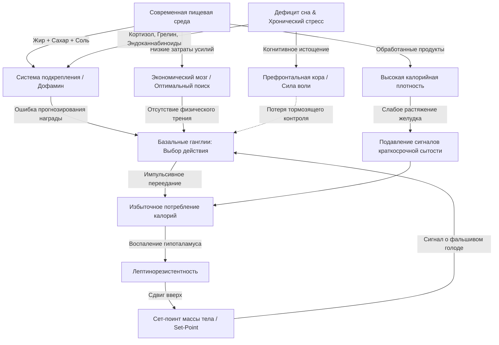

#### 0. Полный список глав книги (номер, название по-английски — перевод)

* **Введение (Introduction)** — *Введение*
* **Глава 1:** Chapter 1. The Fattest Man on the Island — *Самый толстый человек на острове*
* **Глава 2:** Chapter 2. The Decision Problem — *Проблема выбора*
* **Глава 3:** Chapter 3. The Temptation Formula — *Формула искушения*
* **Глава 4:** Chapter 4. The United States of Food Reward — *Соединенные штаты пищевого подкрепления*
* **Глава 5:** Chapter 5. The Economic Brain — *Экономика пищеварения (Экономический мозг)*
* **Глава 6:** Chapter 6. The Satiety Factor — *Фактор сытости*
* **Глава 7:** Chapter 7. The Hungry Neuron — *Голодный нейрон*
* **Глава 8:** Chapter 8. Rhythms — *Ритмы*
* **Глава 9:** Chapter 9. Stressful Times — *Жизнь в современном мире (Стресс)*
* **Глава 10:** Chapter 10. The Human Computer — *Человеческий компьютер*
* **Глава 11:** Chapter 11. Outsmarting the Hungry Brain — *Как перехитрить голодный мозг*

#### 1. О чём книга в 3 предложениях

Книга объясняет, что современная эпидемия ожирения вызвана эволюционным несоответствием (**evolutionary mismatch**) между древними бессознательными нейронными программами мозга и современной изобильной пищевой средой. Бессознательные структуры мозга — базальные ганглии (**basal ganglia**), гипоталамус (**hypothalamus**) и система подкрепления (**food reward system**) — непрерывно побуждают человека искать калории, реагируя на дофаминовые триггеры, падение затрат усилий на добычу еды и развитие лептинорезистентности (**leptin resistance**). Поскольку сознательный самоконтроль префронтальной коры (**prefrontal cortex**) легко истощается, единственный надежный способ остановить переедание — осознанно перестроить окружающую среду и перехитрить инстинкты «голодного мозга».

#### 2. Главные идеи по главам (по 3–5 пунктов на главу)

##### Глава 1: Самый толстый человек на острове (The Fattest Man on the Island)

* **Эволюционное несоответствие (evolutionary mismatch):** Мозг человека сформировался в условиях постоянного дефицита калорий, поэтому механизмы регуляции не приспособлены к современному избытку еды.
* **Феномен острова Китава (Kitava islanders):** Жители острова Китава, питающиеся традиционной цельной пищей без рафинированных продуктов, абсолютно не знают ожирения, диабета и инфарктов, несмотря на изобилие калорий.
* **Причина эпидемии ожирения:** Сдвиг массы тела населения произошел после 1978 года из-за резкого роста калорийности ежедневного рациона при одновременном падении физической активности.
* **Неадекватность упрощенного подсчета:** Потребление калорий подчиняется сложным бессознательным неврологическим командам, а не простому сознательному выбору.

##### Глава 2: Проблема выбора (The Decision Problem)

* **Древний центр принятия решений (action selection):** Базальные ганглии (**basal ganglia**), сохранившиеся со времен примитивных позвоночных (миног), определяют, какое действие организм должен выполнить в каждый момент времени.
* **Дофаминовый переключатель (dopamine switch):** Выброс дофамина в базальных ганглиях активирует конкретную программу поведения и мощно затормаживает все альтернативные варианты.
* **Иерархия импульсов:** Бессознательные базальные ганглии способны мгновенно перехватывать управление телом вопреки сознательным планам префронтальной коры.
* **Автоматизм пищевого отклика:** При появлении яркого пищевого стимула базальные ганглии автоматически направляют внимание и действия на получение калорий.

##### Глава 3: Формула искушения (The Temptation Formula)

* **Первичные пищевые награды (primary food rewards):** Мозг на генетическом уровне запрограммирован реагировать на калории, жир, сахар, крахмал, соль и глутамат (умами).
* **Обучение «вкус — калории» (flavor-calorie learning):** Мозг связывает сенсорные качества еды (вид, запах, вкус) с поступлением калорий в желудочно-кишечный тракт посредством дофамина.
* **Ошибка прогнозирования награды (reward prediction error):** Дофаминовые нейроны реагируют на условный триггер (**cue**), вызывая непреодолимое желание (**wanting/craving**) еще до того, как еда попадет в рот.
* **Закрепление привычек (habit formation):** Многократное повторение цепочки «триггер — поведение — калорийное подкрепление» формирует автоматические пищевые привычки.

##### Глава 4: Соединенные штаты пищевого подкрепления (The United States of Food Reward)

* **Инженерия сверхаппетитной еды (hyperpalatable engineered food):** Пищевая промышленность создает продукты с искусственными комбинациями жира, сахара и соли, отсутствующими в природе.
* **Эксперименты Склафани (Sclafani's experiments):** Интрагастральное вливание калорий прямо в желудок (минуя рот) заставляет животных страстно любить любой нейтральный вкус, сопутствовавший вливанию.
* **Взлом дофаминовой системы (dopamine hijacking):** Рафинированные продукты вызывают аномально высокий выброс дофамина, приводя к систематическому перееданию сверх физиологической потребности.
* **Простота рациона традиционных обществ:** Племена охотников-собирателей (Кунг-Сан, Яномамо) потребляют простую цельную пищу с низким уровнем пищевого подкрепления.

##### Глава 5: Экономика пищеварения (The Economic Brain)

* **Теория оптимального фуражирования (optimal foraging theory):** Мозг оценивает добычу еды как экономический процесс, вычисляя соотношение полученных калорий к затраченным усилиям и времени (**effort cost**).
* **Опыт племени Хадза (Hadza hunter-gatherers):** В естественных условиях получение калорий требует часовых поисков, копки или опасной охоты, что природно огранивает потребление.
* **Падение затрат на добычу пищи:** В современном мире калорийная еда доступна мгновенно при нулевых затратах физических усилий (фастфуд, доставка, вендинг).
* **Формула переедания:** Сочетание высокой калорийной плотности и отсутствия физического трения при добыче заставляет «экономический мозг» запасать максимум калорий.

##### Глава 6: Фактор сытости (The Satiety Factor)

* **Сигналы краткосрочной сытости (short-term satiety signals):** Растяжение желудка (**stomach mechanoreceptors**) и кишечные гормоны (**CCK, PYY, GLP-1**) уведомляют мозг об окончании приема пищи.
* **Индекс сытости продуктов (satiety index):** Белок (**protein**), клетчатка (**dietary fiber**) и вода обеспечивают максимальный физический объём и чувство сытости на каждую съеденную калорию.
* **Ловушка калорийной плотности (calorie density):** Продукты с высокой калорийной плотностью (жиры, сухие сладости) обеспечивают слабый сигнал растяжения желудка при огромном калораже.
* **Сенсорно-специфическая сытость (sensory-specific satiety):** Разнообразие вкусовых профилей в рамках одного приема пищи (эффект шведского стола) отключает торможение сытости и ведет к перееданию.

##### Глава 7: Голодный нейрон (The Hungry Neuron)

* **Липостат и регуляция жира (lipostat / adiposity regulation):** Гипоталамус (**hypothalamus**) непрерывно отслеживает уровень жировых запасов организма с помощью гормона лептина (**leptin**).
* **Открытие лептина (leptin discovery):** Лептин выделяется жировыми клетками; мутантные мыши без лептина (**ob/ob**) ощущают постоянный смертельный голод и страдают тяжелым ожирением.
* **Конкуренция нейронных ансамблей:** Нейроны **AgRP/NPY** стимулируют аппетит и экономят энергию, а нейроны **POMC/CART** подавляют аппетит и ускоряют метаболизм.
* **Лептинорезистентность и сдвиг сет-поинта (leptin resistance & set-point elevation):** Высококалорийная рафинированная диета вызывает воспаление гипоталамуса (**hypothalamic inflammation**), блокирует сигналы лептина и сдвигает заданный уровень веса (**set-point**) вверх.

##### Глава 8: Ритмы (Rhythms)

* **Супрахиазмальное ядро (suprachiasmatic nucleus / SCN):** Главный циркадный осциллятор мозга синхронизирует метаболизм и секрецию гормонов с суточными циклами света и темноты.
* **Дефицит сна и тяга к калориям (sleep deprivation):** Недостаток сна понижает уровень лептина, повышает грелин (**ghrelin**) и эндоканнабиноиды, усиливая тягу к высококалорийному фастфуду.
* **Световое загрязнение (nighttime blue light):** Искусственное освещение и синий свет экранов в ночное время подавляют мелатонин (**melatonin**) и разрушают метаболический ритм.
* **Ограниченное по времени питание (time-restricted feeding):** Согласование приемов пищи с естественным световым днем нормализует работу гипоталамуса и метаболизм.

##### Глава 9: Жизнь в современном мире (Stressful Times)

* **Хронический стресс и ось ГГН (HPA axis & chronic stress):** Длительное выделение кортизола (**cortisol**) перестраивает работу систем пищевого поиска.
* **Утешительная еда (comfort eating):** Кортизол в сочетании с инсулином стимулирует тягу к высококалорийной жирной и сладкой пище, которая временно глушит реакцию на стресс.
* **Патологическая зацикленность:** Заедание стресса формирует нейронную привычку использовать калории как химический успокоитель.
* **Разделение голода и эмоций:** Стрессовый зажор происходит при полном отсутствии физиологической потребности организма в калориях.

##### Глава 10: Человеческий компьютер (The Human Computer)

* **Иерархическая структура мозга (hierarchical computer):** Высшая сознательная префронтальная кора пытается управлять мощными бессознательными подкорковыми структурами.
* **Истощение ресурса самоконтроля (executive control limitations):** Сила воли (**willpower**) — это ограниченный ресурс, который быстро иссякает при усталости, стрессе и когнитивной перегрузке.
* **Бесполезность лобовой борьбы:** Прямые волевые запреты бессильны против эволюционных инстинктов в длительной перспективе.
* **Архитектура окружения:** Главный способ управления поведением — изменение внешних входящих сигналов (**inputs**), а не попытки удержать самоконтроль.

##### Глава 11: Как перехитрить голодный мозг (Outsmarting the Hungry Brain)

* **Очистка пищевого окружения:** Удалите калорийные триггеры и соблазны из зоны видимости и прямого доступа дома и на работе.
* **Снижение пищевого подкрепления:** Перейдите на простые, цельные, минимально обработанные продукты без сочетаний сахара, жира и соли.
* **Максимизация сытости на калорию:** Составляйте рацион из продуктов с высоким содержанием белка, клетчатки и воды (низкая калорийная плотность).
* **Защита сет-поинта:** Обеспечьте 7–9 часов качественного сна, физическую активность и непищевые способы снятия стресса для восстановления чувствительности к лептину.

#### 3. Схема связей между главными идеями (Mermaid graph TD)

#### 4. Пошаговый чек-лист практических действий

1. **Реорганизовать домашнее и рабочее пространство (Food Environment Audit):**
  * [ ] Полностью убрать из дома и с рабочего стола все видимые сладости, снеки и ультраобработанные продукты.
  * [ ] Покупать только непереработанные цельные ингредиенты; не держать дома калорийные продукты «про запас».
2. **Снизить подкрепляющую ценность пищи (Manage Food Reward):**
  * [ ] Готовить простые блюда без добавления рафинированных сахаров, избыточного масла и усилителей вкуса.
  * [ ] Исключить сочетания «жир + сахар» или «жир + рафинированный крахмал» в рамках одного блюда.
3. **Максимизировать сытость на калорию (Maximize Satiety per Calorie):**
  * [ ] Увеличить долю постного белка (птица, рыба, яйца, бобовые) и клетчатки (цельные овощи, зелень, зелень).
  * [ ] Полностью исключить жидкие калории (газировка, соки, сладкие кофейные напитки, алкоголь).
4. **Снизить разнообразие вкусов (Reduce Variety):**
  * [ ] Сократить количество вкусовых профилей в один прием пищи (избегать сложной многокомпонентной еды и шведских столов).
5. **Создать физическое трение при доступе к еде (Increase Effort Cost):**
  * [ ] Готовить еду самостоятельно из сырых ингредиентов, требующих чистки, нарезки и варки.
  * [ ] Отказаться от использования сервисов быстрой доставки готовой калорийной еды.
6. **Нормализовать сон и циркадные ритмы (Sleep & Circadian Alignment):**
  * [ ] Спать не менее 7–9 часов каждую ночь.
  * [ ] Выключать яркое освещение и синие экраны за 2 часа до сна; принимать пищу в строго определенное временное окно.
7. **Внедрить непищевое снятие стресса (Non-Food Stress Relief):**
  * [ ] Заменить заедание стресса прогулками, физическими упражнениями, дыхательными практиками или медитацией.

#### 5. Типичные ошибки и как их избежать

1. **Ошибка 1: Попытка регулировать питание исключительно силой воли (Relying on Willpower)**
  * *Почему это ошибка:* Префронтальная кора быстро истощается при утомлении и стрессе, отдавая контроль бессознательным базальным ганглиям.
  * *Как избежать:* Изменяйте внешнее окружение (**inputs**) — физически удаляйте триггеры, чтобы мозгу не приходилось принимать волевые решения.
2. **Ошибка 2: Употребление «диетических» сладостей и ароматизированных продуктов**
  * *Почему это ошибка:* Яркие искусственные вкусы и подсластители стимулируют дофаминовые нейроны и ожидание калорий, усиливая пищевую тягу.
  * *Как избежать:* Переходите на простые цельные продукты с естественным, нестимулирующим вкусовым профилем.
3. **Ошибка 3: Потребление жидких калорий (Liquid Calories)**
  * *Почему это ошибка:* Соки, газировка и сладкий кофе быстро проходят через желудок, не вызывают механорецепторного растяжения и сигналов сытости (**CCK/PYY**).
  * *Как избежать:* Употребляйте калории только в твердом виде, требующем пережевывания, а пить воду, чай или кофе без сахара.
4. **Ошибка 4: Избыточное разнообразие блюд в один прием пищи (Buffet Effect / Sensory-Specific Satiety)**
  * *Почему это ошибка:* Смена вкусов сбрасывает механизм сенсорно-специфической сытости, заставляя съедать значительно больше калорий.
  * *Как избежать:* Составляйте простые монокомпонентные рационы с минимальным набором вкусовых сочетаний.
5. **Ошибка 5: Игнорирование дефицита сна и ночной активности (Sleep Debt & Nighttime Light)**
  * *Почему это ошибка:* Недостаток сна понижает лептин, повышает грелин и активирует эндоканнабиноиды, выключая самоконтроль и провоцируя тягу к фастфуду.
  * *Как избежать:* Соблюдайте жесткий режим сна (7–9 часов) и ограничивайте освещение в вечернее время.

#### 6. 20 карточек «вопрос — ответ» для повторения

1. **В:** Что такое «эволюционное несоответствие» (**evolutionary mismatch**) в контексте регуляции веса? **О:** Конфликт между древними бессознательными программами мозга, сформированными для выживания в условиях дефицита еды, и современной изобильной высококалорийной средой.
2. **В:** Какова главная функция базальных ганглиев (**basal ganglia**) в пищевом поведении? **О:** Они выступают древней системой выбора действий (**action selection**), определяющей наиболее приоритетное поведение на основе уровня дофамина.
3. **В:** Что показало исследование населения острова Китава (**Kitava**)? **О:** Население, питающееся цельной пищей без рафинированных продуктов, не страдает ожирением при неограниченном доступе к еде, что доказывает определяющую роль состава пищи.
4. **В:** Что такое «ошибка прогнозирования награды» (**reward prediction error**)? **О:** Всплеск дофамина при обнаружении условного сигнала (**cue**), предсказывающего калории, который формирует острое желание (**wanting/craving**) до приема пищи.
5. **В:** Что доказали эксперименты Энтони Склафани (**Anthony Sclafani**) с интрагастральным вливанием? **О:** Введение калорий прямо в желудок обучает мозг переедать и любить любой сопутствующий вкус, подтверждая бессознательную оценку калорийности в ЖКТ.
6. **В:** Как теория оптимального фуражирования (**optimal foraging theory**) объясняет эффект фастфуда? **О:** Мозг стремится получить максимум калорий при минимуме затрат усилий и времени; фастфуд сводит затраты усилий к нулю, выбывая максимальный стимул к перееданию.
7. **В:** Какой гормон выделяется жировой тканью и регулирует долгосрочные запасы энергии? **О:** Лептин (**leptin**), подавляющий голод и стимулирующий расход энергии при связывании с рецепторами гипоталамуса.
8. **В:** Что происходило с мышами линии **ob/ob** в исследованиях Джеффри Фридмана? **О:** Из-за генетического отсутствия лептина их мозг воспринимал организм как умирающий от голода, вызывая зверский аппетит и тяжелое ожирение.
9. **В:** Что такое лептинорезистентность (**leptin resistance**) и как она возникает? **О:** Снижение чувствительности гипоталамуса к лептину из-за воспаления, вызванного высококалорийной рафинированной диетой; мозг перестает «видеть» жир и поднимает заданный вес.
10. **В:** Что такое сет-поинт (**set-point**) массы тела? **О:** Заданный гипоталамусом уровень жировых запасов, который мозг жестко защищает от снижения с помощью усиления голода и замедления метаболизма.
11. **В:** Какие две группы нейронов гипоталамуса конкурируют в регуляции аппетита? **О:** Нейроны **AgRP/NPY** (стимулируют голод и экономят энергию) и нейроны **POMC/CART** (подавляют голод и стимулируют расход энергии).
12. **В:** Как механорецепторы растяжения желудка влияют на краткосрочную сытость? **О:** Они реагируют на физический объём пищи и отправляют сигналы через блуждающий нерв в ствол мозга, останавливая прием пищи.
13. **В:** Какова роль кишечных гормонов **CCK, PYY и GLP-1**? **О:** Они выделяются ЖКТ в ответ на белки, жиры и клетчатку, замедляют опорожнение желудка и вызывают чувство сытости.
14. **В:** Что такое сенсорно-специфическая сытость (**sensory-specific satiety**)? **О:** Постепенное снижение привлекательности конкретного вкуса по мере его поедания; разнообразие вкусов (шведский стол) обходит этот тормоз и ведет к перееданию.
15. **В:** Как дефицит сна влияет на гормоны аппетита согласно исследованиям Сент-Онж? **О:** Дефицит сна понижает лептин, повышает грелин (**ghrelin**) и активирует эндоканнабиноиды, увеличивая тягу к высококалорийному фастфуду.
16. **В:** Какую функцию выполняет супрахиазмальное ядро (**SCN**) гипоталамуса? **О:** Главный циркадный осциллятор (биологические часы), синхронизирующий метаболизм, секрецию гормонов и суточные ритмы с внешним светом.
17. **В:** Как хронический стресс и кортизол (**cortisol**) провоцируют переедание? **О:** Кортизол в присутствии инсулина стимулирует поиск высококалорийной «комфортной» еды, которая временно снижает активность стрессовых систем мозга.
18. **В:** Почему префронтальная кора (**prefrontal cortex**) не может постоянно сдерживать переедание? **О:** Сознательный контроль требует больших когнитивных ресурсов и легко истощается при стрессе, усталости, дефиците сна или избытке триггеров.
19. **В:** Что показал калориметр Уилбура Этуотера (**Wilbur Atwater**)? **О:** Организм человека подчиняется закону сохранения энергии (уравнение энергетического баланса), однако количество потребляемых калорий управляется бессознательным мозгом.
20. **В:** Каков главный принцип успешного управления весом по Стефану Гийанэю? **О:** Не пытаться бороться с инстинктами с помощью силы воли, а перестроить пищевое окружение и образ жизни (**inputs**), чтобы перехитрить «голодный мозг».

#### 7. 5 практических заданий на применение (strictly grounded in book mechanisms)

##### Задание 1: Интернет-магазин одежды / Дофаминовая система подкрепления и триггеры

* **Неврологический механизм книги:** Ошибка прогнозирования награды (**reward prediction error**) и условные триггеры (**cues**) в дофаминовой системе (Глава 3).
* **Применительное задание:** Спроектировать карточку товара интернет-магазина одежды так, чтобы визуальные сигналы (яркий декор, динамический просмотр, ограниченные плашки) выступали аналогами «аппетитных триггеров еды», вызывая предвосхищение покупки до совершения действия. Разработать механизм устранения «когнитивного торможения» (аналога торможения префронтальной коры) при клике на покупку.

##### Задание 2: Интернет-магазин одежды / Теория оптимального фуражирования и снижение трения

* **Неврологический механизм книги:** Теория оптимального фуражирования (**optimal foraging theory**) и снижение затрат усилий (**effort cost**) (Глава 5).
* **Применительное задание:** Проанализировать процесс оформления заказа (**checkout**) и рассчитать «показатель трения/усилий» пользователя. Переработать интерфейс по принципу «фастфуда» (минимальные затраты времени и действий на единицу ценности): внедрить покупку в 1 клик, сохранение данных карты и автоматический подбор размера, аналогично снижению затрат на добычу калорий.

##### Задание 3: B2B-лидогенерация / Сенсорно-специфическая сытость и утомление от однообразия

* **Неврологический механизм книги:** Сенсорно-специфическая сытость (**sensory-specific satiety**) и эффект шведского стола (Глава 6).
* **Применительное задание:** Разработать стратегию цепочки B2B-касаний (**outreach/email**), предотвращающую утомление от одинаковых офферов (аналог пресыщения монотонным вкусом). Создать вариативную матрицу контента (кесы, аналитика, демо, графики), удерживающую внимание B2B-лида по аналогии с обходом механизмов краткосрочного насыщения.

##### Задание 4: B2B-лидогенерация / Стресс, кортизол и истощение ресурса ЛПР

* **Неврологический механизм книги:** Влияние хронического стресса, кортизола и истощения префронтальной коры (**willpower/cognitive effort**) (Главы 9 и 10).
* **Применительное задание:** Спроектировать коммерческое предложение для перегруженных B2B-руководителей (ЛПР в состоянии высокого кортизола и дефицита времени), исключающее необходимость сложных аналитических решений. Оформить предложение в виде готового «быстрого решения под ключ» (аналог легкой калорийной еды для стрессового мозга), минимизирующего когнитивную нагрузку при принятии решения.

##### Задание 5: Сборщики данных на Claude/Python / Циркадные ритмы и таймауты процессов

* **Неврологический механизм книги:** Работа супрахиазмального ядра (**SCN**), циркадные ритмы (**circadian rhythms**) и временные окна сытости/питания (Главы 8 и 11).
* **Применительное задание:** Написать архитектурное ТЗ и скрипт Python/Claude для парсинга и обработки данных, использующий принципы «ограниченного по времени питания» (**time-restricted feeding**). Скрипт должен группировать пакетную сборку данных в оптимальные временные окна с обязательными периодами «метаболического отдыха» (**cooldowns**) для предотвращения блокировок и перегрузок API по аналогии с гипоталамо-циркадной регуляцией.