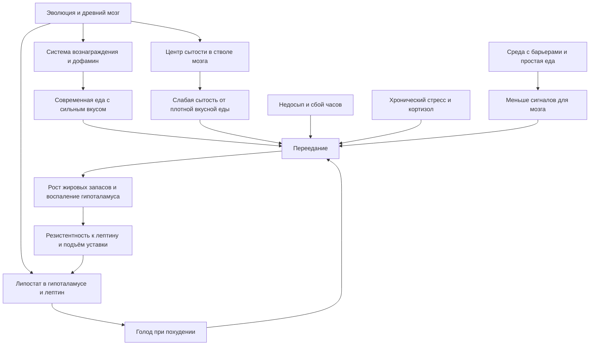

<!-- Claude Sonnet по тексту книги, «Голодный мозг. Как перехитрить инстинкты, которые заставляют нас переедать» (Стефан Дж. Гийанэй, рус. изд. Эксмо 2018), конспект; 17.10.2026; не сверено -->

# Конспект: «Голодный мозг» (Стефан Гийанэй)

Это пересказ книги для личной учёбы, а не врачебная рекомендация. Всё про питание, вес, сон и стресс — «по книге». Если есть вопросы по здоровью, к врачу.

## 0. Полный список глав (по тексту)

- Введение
- 1. Самый толстый человек на острове
- 2. Проблема выбора
- 3. Формула искушения
- 4. Соединённые штаты пищевого подкрепления
- 5. Экономика пищеварения
- 6. Фактор сытости
- 7. Голодный нейрон
- 8. Ритмы
- 9. Жизнь в современном мире
- 10. Человеческий компьютер
- 11. Как перехитрить голодный мозг (внутри: «Расклад не в нашу пользу», «Ликвидация эпидемии ожирения», «Шесть шагов к стройной фигуре»)
- Благодарности
- Примечания (ссылки на источники и 161 авторская сноска)

Файлы пересказа: `hungry_brain_01.md` (введение, гл. 1–3), `_02` (гл. 4–5), `_03` (гл. 6–7), `_04` (гл. 8–10), `_05` (гл. 11 и сноски). Страниц в тексте нет (fb2), поэтому ссылки только на главы.

## 1. О чём книга в 3 предложениях

Переедание — это не слабость характера, а результат того, что древний бессознательный мозг (его «система 1» по Канеману — быстрая интуитивная часть) настроен на поиск калорий и работает в современном мире изобилия. Основные «актёры» — система вознаграждения (дофамин), «липостат» в гипоталамусе (термостат для жира: лептин, NPY-нейроны), центр сытости в стволе мозга, сон и биологические часы, система стресса. Поэтому автор советует не воевать силой воли, а менять сигналы среды: убирать соблазны, есть простую сытную еду, высыпаться, двигаться и справляться со стрессом не едой.

## 2. Главные идеи по главам

**Введение.**
- Советы «ешьте правильно» (руководство США 1980 года) не остановили ожирение: информация адресована сознательной части мозга, а едой управляет бессознательная.
- Эволюционное несоответствие: качества, нужные при дефиците еды, вредны при изобилии.
- Канеман: система 1 (быстрая) против системы 2 (рассудочная); в быту первая сильнее.

**Глава 1. Самый толстый человек на острове.**
- Люди с традиционным образом жизни (Китава, Ютала) стройны и не болеют «болезнями цивилизации»; переехав, Ютала располнел.
- США: ожирение с 1 из 17 (1890, мужчины среднего возраста) до 24–41% (1999–2000); поворот около 1978 года; потребление выросло на 218–367 ккал в день.
- «Ресторанная диета» Склафани у крыс и автоматы Равуссина у людей (173% нормы, +2,5 кг за 7 дней) — аппетитная еда в свободном доступе заставляет переедать.
- Вес выходит на плато: после увеличения калорий расход растёт вместе с массой тела.

**Глава 2. Проблема выбора.**
- Базальные ганглии (древнейший «селектор» из конкурирующих сигналов, у миноги и человека почти одинаковый) выбирают самый настойчивый сигнал.
- Выбор еды — цепочка соревнований: мотивация, план, движение; всё бессознательно.
- Дофамин регулирует чувствительность селектора (болезнь Паркинсона, абулия).

**Глава 3. Формула искушения.**
- Дофамин — «обучающая молекула»: закрепляет то, что дало калории (опыты МакДевитта, Склафани, Павлова).
- Мозг ценит калории, сладкий и мясной (умами) вкус; индустрия концентрирует эти стимулы.
- Пищевая зависимость (опросник Гирхардт и Браунелл, 11%) встречается не у всех.
- Эффект шведского стола: сенсорная сытость только по съеденному вкусу; безвкусная диета резко снижает потребление.
- RRVfood (Эпштейн) и импульсивность определяют, у кого «тормоза отказали».

**Глава 4. Соединённые штаты пищевого подкрепления.**
- Неиндустриальные диеты: мало продуктов, нет концентрированных сахара, соли, жира, 2–3 способа приготовления.
- США: 44 000 наименований в магазине, сахар, добавленные жиры, глутамат, алкоголь, кофеин; «виноваты и жиры, и сахар».
- Сверхнормальные стимулы (птичьи яйца, кукушка) и реклама (20 роликов еды в день).

**Глава 5. Экономика пищеварения.**
- Хадза: оптимальное фуражирование — ценность пищи = (калории − затраты) / время; мозг ищет «выгодные предложения».
- Охотники-собиратели прожорливы, но стройны (дефицит чередуется с пиром).
- Наша еда — вечное выгодное предложение: дешёвая, под рукой (конфеты Уонсинка 9 / 6 / 4).
- ОФК считает субъективную ценность; отложенное дисконтирование (зефирный эксперимент); совет: представлять будущее.

**Глава 6. Фактор сытости.**
- Липостат: гипоталамус и лептин защищают жировые запасы; при похудении падает лептин, растут голод и одержимость едой, обмен замедляется.
- Лептиновая недостаточность (сёстры О’Рейли и Фаруки) показывает мощь инстинкта; лептин как лекарство не сработал.
- Уставка липостата может подниматься (вкусная еда у крыс Левина) и снижаться при простой еде; белок и упражнения помогают.

**Глава 7. Голодный нейрон.**
- NPY-нейроны запускают голод, ПОМК-нейроны — сытость; лептин и инсулин управляют ими.
- При ожирении в гипоталамусе воспаление и «шрамы» (у мышей обратимы на здоровой диете).
- Мозговой ствол контролирует насыщение в рамках приёма пищи; индекс сытности Хольт: плотность калорий, вкус, жирность, клетчатка, белок.
- Гены определяют до 70% различий в весе, но «среда нажимает на курок».

**Глава 8. Ритмы.**
- Недосып: на 300 ккал больше, сильнее реакция на еду, «предвзятый оптимизм».
- Сбитые биологические часы (синий свет вечером, сменная работа, еда в «неправильное» время) ведут к набору жира.
- Практика: темнота ночью, тёплый свет вечером, яркий свет утром.

**Глава 9. Жизнь в современном мире.**
- Стресс запускает миндалевидное тело, КРФ, кортизол; кортизол вызывает резистентность к лептину и тягу к еде.
- Неконтролируемый стресс + вкусная еда = стрессовое переедание (обезьяны Уилсона).
- Калорийная еда успокаивает систему стресса (Даллман, Ульрих-Лай); искать другие способы утешения.

**Глава 10. Человеческий компьютер.**
- Итог по системам: вознаграждение, экономический выбор, липостат, сытость, генетика, сон и ритмы, система угроз.
- Гастропластика меняет уставку липостата, а не просто размер желудка.

**Глава 11. Как перехитрить голодный мозг.**
- Общество: информации мало; нужны контрмаркетинг, налоги, субсидии, ограничение рекламы; индустрия сама не изменится (конфликт прибыли и здоровья).
- Личные шесть шагов: среда, аппетит, остерегаться вознаграждения, сон, движение, стресс.

## 3. Схема связей

## 4. Пошаговый чек-лист практических действий (по книге)

1. Убрать из дома и с работы вкусную калорийную еду, которую легко взять; убрать продукты и рекламу из поля зрения.
2. Поставить барьеры: оставлять то, что надо чистить, готовить или разогревать.
3. Выбирать сытную простую еду: низкая плотность калорий, белок, клетчатка, умеренный вкус (фрукты, овощи, картофель, бобы, яйца, йогурт, мясо, рыба, овсянка).
4. Хлеб и изделия из белой муки ограничить; крахмал брать из картофеля, батата, бобов.
5. Для «десерта» сначала съесть небольшой фрукт; на шведском столе выбрать 2–3 блюда.
6. Не пить газировку; калории из напитков (алкоголь, сладкий кофе) учитывать; безкалорийные напитки: зелёный чай, чёрный кофе.
7. Праздники: шесть недель от Дня Благодарения до Нового года — быть внимательнее, готовить лёгкие блюда.
8. Спать столько, сколько нужно, чтобы чувствовать себя восстановленным; в спальне темно; одно время сна; утром свет, вечером тёплый свет, меньше экранов с синим спектром.
9. Двигаться ежедневно, выбрать приятное и вписанное в расписание.
10. Определить свои стресс-факторы, составить план для управляемых; пробовать медитацию осознанности (5, затем до 15 минут).
11. Заменить еду как утешение другим занятием (позвонить, прогулка, ванна, садоводство).
12. Перед выбором «съесть или нет» ярко представить себя в хорошем будущем (приём Эпштейна).
13. Если трудно, расставить приоритеты среди шести шагов и сосредоточиться на самых сильных для себя.

## 5. Типичные ошибки и мифы (по книге)

- Миф: ожирение — слабая воля. По книге, решает бессознательный мозг, гены и среда.
- Миф: дофамин — «молекула удовольствия». На самом деле «обучающая молекула»; удовольствие — эндорфины.
- Ошибка: считать, что 218 лишних калорий дадут +10 кг в год. Вес выходит на плато.
- Ошибка: давать только информацию (этикетки, калорийность) — мало влияет на поведение.
- Ошибка: мерить успех упражнений по весам. Мышцы сохраняются, смотреть на зеркало и самочувствие.
- Миф: упражнения не помогают худеть. Помогают, но аппетит у одних вырастает (компенсация).
- Ошибка: резкие диеты с большим дефицитом — запускают реакцию на голод и высокое «плато».
- Миф: надо спать строго 8 часов по средним нормам. Нужно столько, сколько нужно вам.
- Ошибка: заедать стресс калорийной едой — помогает мозгу, но вредит весу.
- Миф: сахар или жир, что-то одно. Виноваты оба, особенно сочетание.
- Ошибка: «разнообразие всегда полезно»: разнообразие увеличивает съеденное (шведский стол).
- Ошибка: оставлять еду на виду «просто так».

## 6. 20 карточек «вопрос — ответ»

1. Что такое «система 1» по Канеману? — Быстрое интуитивное бессознательное мышление; в быту сильнее, чем рассудочная система 2.
2. Какие три требования к «селектору» выбора? — Выбрать одну опцию, подходящую ситуации, и окончательно отвергнуть остальные.
3. Что делают базальные ганглии? — Выбирают самый настойчивый сигнал из конкурирующих, как вышибалы.
4. Почему дофамин называют «обучающей молекулой»? — Он усиливает связи, которые только что работали, и закрепляет то, что принесло калории.
5. Что показал опыт Склафани с крахмалом? — Крысы полюбили вкус, который сопровождался глюкозой в кишечнике; дофамин делает это предпочтение.
6. Что такое «сенсорная сытость»? — Сытость только по тому вкусу, который уже съели; поэтому на десерт «находится место».
7. Что такое RRVfood? — Относительная ценность еды как вознаграждения: насколько человек готов работать ради еды по сравнению с другим удовольствием.
8. Что такое «патология подкрепления»? — Высокая чувствительность к вознаграждению плюс высокая импульсивность.
9. Какие три признака неиндустриальной диеты? — Мало видов продуктов, нет концентрированных сахара, соли, жира, 2–3 способа готовки.
10. Что такое оптимальное фуражирование? — Ценность еды растёт с калориями и падает с затратами времени и сил; мозг ищет «выгодные предложения».
11. Почему современная еда — вечное «выгодное предложение»? — Много калорий, мало усилий и денег.
12. Что показал зефирный эксперимент? — Дети, дольше ждавшие, во взрослом возрасте были стройнее (по книге, 10 минут ожидания ≈ 7 кг).
13. Что такое липостат? — Система в гипоталамусе, поддерживающая запасы жира; сигнал — лептин.
14. Что происходит при похудении по Лайбелу и Хиршу? — Падает лептин, растёт голод, обмен замедляется, усиливается реакция на калорийную еду.
15. Что такое резистентность к лептину? — Мозг плохо «слышит» лептин, считает полноту новой нормой, уставка липостата поднимается.
16. Какие нейроны запускают голод и сытость? — NPY-нейроны — голод; ПОМК-нейроны — сытость.
17. Что входит в индекс сытности? — Плотность калорий, вкус, жирность, клетчатка, белок.
18. Как недосып влияет на еду? — Усиливает реакцию центра вознаграждения, +300 ккал в день в опыте, «предвзятый оптимизм».
19. Как стресс ведёт к перееданию? — Через миндалевидное тело, КРФ и кортизол (резистентность к лептину) и через «утешение» вкусной едой.
20. Как на уровне среды помогает «барьер»? — Любой лишний шаг (шкаф, чистка, готовка) снижает потребление; конфеты на столе 9, в шкафу 6, на шкафу в 2 м — 4.

## 7. Пять практических заданий

1. **Жизнь, дом (неделя 1).** Пройти по кухне и по рабочему месту. Что лежит на виду? Убрать на глаза и в закрытые шкафы, оставить на виду только фрукты в кожуре. Записать, что изменилось в тяге к перекусам. (Шаг 1 книги.)
2. **Здоровье, сон (две недели).** Каждый день записывать время отхода ко сну, подъёма, наличие яркого экрана вечером и общее самочувствие утром; вечером сделать свет теплее, утром 10–15 минут на улице. Проверить, как меняется голод к вечеру. (Не оценивать себя как больную; при сильных нарушениях сна — к врачу.)
3. **Здоровье, стресс (неделя).** Вести дневник: «когда тянуло к еде — что до этого случилось, можно ли было это контролировать». Для одного неподконтрольного стресса составить план из 3 шагов; попробовать 5 минут дыхательной медитации по описанию книги.
4. **Учёба (по книге Канемана и Гийанэя).** Написать своими словами, что делают система 1 и система 2, и привести два примера из своей жизни (не только про еду: покупки, телефон). Объяснить схему другому человеку за 2 минуты.
5. **Жизнь, выбор еды.** В магазине выбрать 5 продуктов с низкой плотностью калорий (по книге: фрукты, картофель, бобы, яйца, белый йогурт) и сравнить, насколько после них сытно через 2 часа, с обычным перекусом. Использовать приём «представить будущее» перед спонтанной покупкой сладкого.

## 8. Что в книге спорно или устарело

- Часть выводов — на крысах, мышах и обезьянах; для людей автор прямо пишет, что многое не доказано (например, обратимость «шрамов» гипоталамуса на здоровой диете, лептин и кортизол в быту).
- Роль дофамина в обучении оспаривает Кент Берридж (сноска 35); автор спор не раскрывает.
- Данные об эффекте высокобелковых диет получены на малых группах (19 человек у Вейгла).
- «Зефирный эксперимент» критиковали (дети могли не доверять экспериментатору, сноска 88).
- Сведения о ценах, налогах, субсидиях и программах (SNAP, CFBAI, налог Дании и Мексики) относятся к США около 2015–2017 годов; в России, по примечанию редактора, цифры актуальны лишь для «среднего» класса (сноска 62).
- Лептин и римонабант: автор пишет «на момент написания»; сведения о лекарствах со временем меняются, это не рекомендация.
- Автор рекомендует конкретные продукты (очки UVEX SCT-Orange, f.lux) — оценка за автором; это не реклама и не совет, а пересказ.
- Рабочий стол с беговой дорожкой (Бушар): автор оговаривает, что данных пока мало.
- Автор подчёркивает: книга не заменяет врача.
