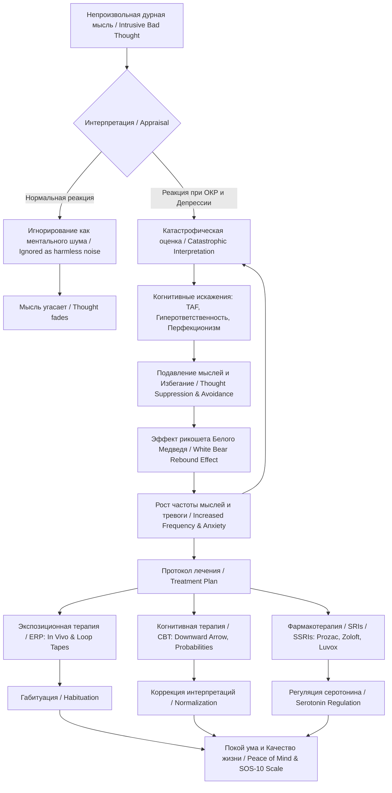

Подробный учебный конспект книги Ли Баера **«Пленники навязчивых мыслей: Исследование тихой эпидемии обсессивных дурных мыслей»** (*The Imp of the Mind: Exploring the Silent Epidemic of Obsessive Bad Thoughts*, Lee Baer, Ph.D.).

#### 0. Полный список глав книги (номер, название по-английски — перевод)

* **Предисловие**: *Preface* (Предисловие).
* **ЧАСТЬ 1: PART ONE: THE PROBLEM OF BAD THOUGHTS** (Проблема дурных мыслей):
  * **Глава 1**: *Chapter 1. The Imp of the Perverse* (Бес противоречия / Черт извращенности).
  * **Глава 2**: *Chapter 2. Thoughts of Harming Children* (Мысли о причинении вреда детям).
  * **Глава 3**: *Chapter 3. How Can I Be Certain They're Just Thoughts?* (Как я могу быть уверен, что это всего лишь мысли?).
  * **Глава 4**: *Chapter 4. What Causes Bad Thoughts?* (Что вызывает дурные мысли?).
* **ЧАСТЬ 2: PART TWO: TREATMENT OF BAD THOUGHTS** (Лечение дурных мыслей):
  * **Глава 5**: *Chapter 5. Facing Your Fears Head-on: Exposure Therapy* (Встреча со страхами лицом к лицу: экспозиционная терапия).
  * **Глава 6**: *Chapter 6. Questioning Your Bad Thoughts: Cognitive Therapy* (Подвергая сомнению дурные мысли: когнитивная терапия).
  * **Глава 7**: *Chapter 7. Blasphemous Bad Thoughts* (Богохульные дурные мысли).
  * **Глава 8**: *Chapter 8. Medications for Bad Thoughts* (Медикаменты от дурных мыслей).
  * **Глава 9**: *Chapter 9. A Plan of Action* (План действий).

#### 1. О чём книга в 3 предложениях

1. Книга известного гарвардского психолога доктора Ли Баера исследует скрытую эпидемию обсессивно-компульсивного расстройства (Obsessive-Compulsive Disorder, OCD), выражающуюся в непроизвольных, табуированных и крайне пугающих навязчивых мыслях насильственного, сексуального или религиозного характера.
2. Автор объясняет, что подобные мысли регулярно возникают у большинства здоровых людей, однако у лиц с ОКР или депрессией они вызывают глубокую вину и попытки подавления, что парадоксальным образом лишь увеличивает их частоту и интенсивность.
3. В работе представлено научно обоснованное руководство по преодолению этих состояний с помощью метода экспозиции и предотвращения реакции (Exposure and Response Prevention, ERP), когнитивно-поведенческой терапии (Cognitive Behavioral Therapy, CBT) и медикаментозной поддержки ингибиторами обратного захвата серотонина (Serotonin Reuptake Inhibitors, SRIs).

#### 2. Главные идеи по главам (по каждой главе 3–5 пунктов)

##### **Предисловие (Preface)**

* **Тихая эпидемия**: Миллионы людей страдают от навязчивых дурных мыслей (obsessive bad thoughts) в полном одиночестве и мольчаливом стыде, боясь признаться врачам или близким.
* **Главное отличие от реальной опасности**: Мучительное чувство вины, ужас и стыд, испытываемые человеком от своих мыслей, служат прямым доказательством того, что он не является преступником или психопатом.
* **Основные категории дурных мыслей**: Навязчивости делятся на неадекватные агрессивные мысли (harming loved ones or children), неадекватные сексуальные мысли (unwanted sexual obsessions) и богохульные религиозные мысли (blasphemous thoughts).
* **Практическая цель**: Обучить читателя самодиагностике и пошаговому «приручению» (taming) мыслей для возвращения качества жизни и покоя ума.

##### **Глава 1. The Imp of the Perverse (Бес противоречия)**

* **Метафора Эдгара По**: Термин «Бес противоречия» (Imp of the Perverse), взятый из рассказа Эдгара Аллана По (1845 г.), описывает врожденный человеческий импульс подумать или сделать самое неподобающее действие в самый неподходящий момент.
* **Универсальность мыслей (Исследование Рачмана)**: Эксперименты Стэнли Рачмана (Stanley Rachman) доказали, что около 90% здоровых людей испытывают нежелательные навязчивые мысли, абсолютно идентичные по содержанию мыслям больных ОКР.
* **Проблема интерпретации**: Разница между нормой и ОКР заключается не в появлении мысли, а в реакции на нее: больной ОКР приписывает мысли глубокий зловещий смысл и считает ее признаком своей «порочности».
* **Ловушка подавления мыслей (Thought Suppression)**: Эксперименты Дэниэла Вегнера (Daniel Wegner) с «белым медведем» (white bear effect) показывают, что попытка насильственно выгнать мысль из головы вызывает эффект рикошета (rebound effect), усиливая ее частоту.

##### **Глава 2. Thoughts of Harming Children (Мысли о причинении вреда детям)**

* **Послеродовые навязчивости (Postpartum Obsessions)**: Молодые матери и отцы часто сталкиваются с кошмарными мыслями о причинении вреда младенцу (выбросить из окна, утопить в ванной, ударить ножом, положить в микроволновку).
* **Масштаб проблемы**: По данным исследований Кэтрин Уиснер (Katherine Wisner), около 5% всех молодых матерей (около 200 000 женщин в год в США) страдают от обсессивных мыслей о вреде новорожденным.
* **Разграничение с послеродовым психозом (Postpartum Psychosis)**: При психозе матери теряют связь с реальностью, испытывают бред/галлюцинации и считают вред ребенку необходимостью; при ОКР матери сохраняют критику, испытывают ужас от мыслей и прячут острые предметы.
* **Эволюционный сбой**: Мысли о вреде младенцу представляют собой сбой гипертрофированной системы материнской бдительности и защиты от потенциальных опасностей.

##### **Глава 3. How Can I Be Certain They're Just Thoughts? (Как я могу быть уверен, что это всего лишь мысли?)**

* **Ловушка абсолютной определенности**: Поиск 100% гарантии того, что человек никогда не совершит ужасный поступок — главное топливо «болезни сомнений» (doubting disease); попытки найти полную уверенность только усиливают расстройство.
* **ОКР против социопатии**: В отличие от реальных преступников (Susan Smith, Jeffrey Dahmer), которые действуют хладнокровно и не испытывают раскаяния, пациенты с ОКР страдают от гиперответственности и гипертрофированной совести.
* **Опасность телесного сканирования (Body Scanning)**: Попытки «проверить» отсутствие сексуального возбуждения при нежелательных мыслях вызывают приток крови к гениталиям из-за концентрации внимания, что ошибочно принимается за желание.
* **Маркеры истинной опасности (Warning Signs)**: Настоящее опасение вызывают случаи, когда мысли приносят удовольствие, сопровождаются отсутствием вины, реальными актами насилия в прошлом, галлюцинациями или неуправляемым гневом.

##### **Глава 4. What Causes Bad Thoughts? (Что вызывает дурные мысли?)**

* **Нейробиологический контур**: Сканирование мозга показывает, что при ОКР наблюдается гиперактивность в цепи между орбитофронтальной корой (orbital-frontal cortex), базальными ганглиями (basal ganglia), хвостатым ядром (caudate nucleus) и серотонинергической системой.
* **Слияние мысли и действия (Thought-Action Fusion, TAF)**: Иррациональная убежденность в том, что подумать о плохом поступке морально равноценно его совершению или увеличивает вероятность его наступления.
* **Эволюционное торможение**: Тормозящая функция орбитофронтальной коры у больных ОКР работает с избыточной нагрузкой, подавляя древние инстинкты и импульсы.
* **Феномен высокой чувствительности (Highly Sensitive People, HSP)**: Концепции И. Павлова, Д. Кагана (Jerome Kagan) и Э. Арон (Elaine Aron) связывают ОКР с детской застенчивостью, высокой чувствительностью нервной системы и строгим воспитанием.

##### **Глава 5. Facing Your Fears Head-on: Exposure Therapy (Встреча со страхами лицом к лицу: экспозиционная терапия)**

* **Золотой стандарт (ERP)**: Метод экспозиции и предотвращения реакции (Exposure and Response Prevention, ERP) — наиболее эффективный немедикаментозный способ лечения ОКР.
* **Механизм габитуации (Habituation)**: Длительное (1–2 часа) пребывание в пугающей ситуации без применения ритуалов или избегания приводит к естественному затуханию тревоги.
* **Инструменты экспозиции**: Использование натурных упражнений (*in vivo* exposure), составление иерархии страхов (шкала SUDS) и прослушивание аудиозаписей с зацикленными сценариями худших опасений (*loop tapes*).
* **Предотвращение реакций**: Полный запрет на поиск заверений (reassurance), мытье рук, ментальные нейтрализации и избегание предметов.

##### **Глава 6. Questioning Your Bad Thoughts: Cognitive Therapy (Подвергая сомнению дурные мысли: когнитивная терапия)**

* **Изменение интерпретаций**: Когнитивная терапия (CBT) работает не с самими автоматическими мыслями, а с их оценкой и значением для человека.
* **6 когнитивных ошибок при ОКР**: Переоценка важности мыслей, потребность в абсолютном контроле, переоценка опасности, непереносимость неопределенности, перфекционизм и гиперответственность.
* **Когнитивные техники**: Метод «падающей стрелы» (Downward Arrow Technique) для поиска глубинных убеждений, техники когнитивного континуума (Cognitive Continuum) и математический расчет истинной вероятности опасности.
* **Эксперимент с жирафом**: Практическое упражнение на попытку не думать о жирафе доказывает пациенту невозможность волевого контроля над содержимым ума.

##### **Глава 7. Blasphemous Bad Thoughts (Богохульные дурные мысли)**

* **Скрупулезность (Scrupulosity)**: Религиозная форма ОКР, выражающаяся в непроизвольных хульных мыслях о Боге, Иисусе, Святой Деве Марии или порывах осквернить святыни.
* **Духовная терапия (Dr. William Minichiello)**: Коррекция «небогословского взгляда на Бога» — переход от страха перед карающим Богом к пониманию Бога как безусловной любви.
* **Грех против симптома**: Грех требует сознательного намерения и волевого выбора, тогда как навязчивости — непроизвольный продукт сбоя нейрохимии мозга.
* **Связь с духовенством**: Согласование экспозиционных заданий с грамотными священнослужителями для исключения морального конфликта.

##### **Глава 8. Medications for Bad Thoughts (Медикаменты от дурных мыслей)**

* **Серотонинергические препараты (SRIs / SSRIs)**: Первая линия фармакотерапии — Прозак (Prozac), Золофт (Zoloft), Паксил (Paxil), Лювокс (Luvox), Ципралекс/Циталопрам (Celexa), Анафранил (Anafranil).
* **Специфика дозировок и сроков**: Лечение ОКР требует более высоких доз (например, Luvox до 300 мг/сут, Prozac 40–80 мг/сут) и более длительного ожидания эффекта (8–12 недель) по сравнению с депрессией.
* **Стратегии усиления (Augmentation)**: Добавление малых доз атипичных нейролептиков (Risperdal, Seroquel, Zyprexa) при ярких визуальных навязчивостях или тиках.
* **Синергия с КПТ**: Наилучшие долгосрочные результаты дает сочетание приема СИОЗС и экспозиционной терапии.

##### **Глава 9. A Plan of Action (План действий)**

* **Инвентаризация мыслей (Table 14)**: Заполнение и ранжирование 94 типов навязчивостей из инвентаря по уровню вызываемого дискомфорта [124, 125–128].
* **Системный алгоритм**: Исключение красных флагов -> выбор психотерапии/медикаментов -> составление иерархии -> регулярное проведение ERP и когнитивных упражнений.
* **Шкала качества жизни SOS-10**: Смена цели с полного уничтожения мыслей на достижение покоя ума (peace of mind) и высокого качества жизни по шкале Schwartz Outcome Scale [132, 133–136].

#### 3. Схема связей между главными идеями в формате Mermaid (graph TD) в блоке кода

#### 4. Пошаговый чек-лист практических действий

1. **[ ] Пройти первичный скрининг безопасности (Safety Check)**: Убедиться в отсутствии реального намерения навредить, отсутствия удовольствия от мыслей, отсутствия психотических симптомов (галлюцинаций) и отсутствия актов насилия в прошлом.
2. **[ ] Заполнить Инвентарь дурных мыслей (Inventory of Bad Thoughts — Table 14)**: Отметить все беспокоящие сюжеты и проранжировать их от наиболее тяжелого (1) до наименее тревожного [124, 125–128].
3. **[ ] Составить иерархию страхов (Anxiety Hierarchy)**: Оценить каждый триггер (ситуацию, предмет, мысль) по субъективной шкале дискомфорта SUDS от 0 до 100.
4. **[ ] Прекратить подавление мыслей (Stop Thought Suppression)**: Отказаться от попыток насильственно выгнать мысли из ума; позволить им проплывать как фоновому шуму.
5. **[ ] Создать экспозиционную аудиопетлю (Loop Tape)**: Написать подробный 1–2 минутный сценарий наихудшего опасения без успокоительных фраз («но этого не случится»), записать на аудио и зациклить.
6. **[ ] Проводить сеансы ERP ежедневно**: Прослушивать аудиопетлю во включенных наушниках по 45–60 минут в день до снижения уровня тревоги минимум на 50% (габитуация).
7. **[ ] Внедрить предотвращение реакций (Response Prevention)**: Полностью исключить ментальные ритуалы, проверки тела (body scanning), поиск заверений у близких и избегание предметов/мест.
8. **[ ] Применить когнитивную реструктуризацию**: Использовать метод «падающей стрелы» (Downward Arrow), вести дневник мыслей (Thought Record) и рассчитывать математическую вероятность катастрофы.
9. **[ ] Оценивать качество жизни по шкале SOS-10**: Отслеживать динамику покоя ума и общего функционирования каждую неделю по 10-пунктовой шкале Шварца.

#### 5. Типичные ошибки и как их избежать

1. **Ошибка 1: Попытка насильственно подавлять навязчивости (Thought Suppression)**.
  * *Как избежать*: Понять эффект «белого медведя» Д. Вегнера. Вместо выталкивания мысли — разрешить ей присутствовать в уме, не вступая с ней в диалог и борьбу.
2. **Ошибка 2: Поиск заверений (Reassurance Seeking) у близких, врачей или священников**.
  * *Как избежать*: Осознать, что поиск заверений — это компульсивный ритуал, который временно снижает тревогу, но подкармливает цикл сомнений. Полностью прекратить задавать вопросы «А точно ли я этого не сделаю?».
3. **Ошибка 3: Проверка тела и генитальное сканирование (Body Scanning / Genital Monitoring)**.
  * *Как избежать*: Понять физиологию: сфокусированное внимание на любой чувствительной зоне вызовет ощущение притока крови или покалывания. Прекратить проверять гениталии на «возбуждение» при нежелательных мыслях.
4. **Ошибка 4: Включение успокоительных фраз в экспозиционные сценарии (Reassurances in Loop Tapes)**.
  * *Как избежать*: При составлении текста для аудиозаписи удалять все фразы типа «Боже упаси», «но я этого никогда не сделаю», так как они нейтрализуют экспозицию и мешают габитуации.
5. **Ошибка 5: Попытка достичь 100% определенности (Search for Absolute Certainty)**.
  * *Как избежать*: Принять цитату Джона Стюарта Милля: абсолютной определенности не существует, но есть уверенность, достаточная для человеческой жизни. Учиться выдерживать неопределенность.
6. **Ошибка 6: Прекращение приема СИОЗС через 4–6 недель из-за «отсутствия эффекта»**.
  * *Как избежать*: Помнить, что при ОКР противообсессивный эффект антидепрессантов разворачивается значительно дольше, чем при депрессии (от 8 до 12 недель на высоких дозах).

#### 6. 20 карточек «вопрос — ответ» для повторения

1. **В: Что такое «Бес противоречия» (Imp of the Perverse)?** **О:** Врожденный психологический феномен, проявляющийся в виде непроизвольного побуждения подумать или сделать самое неподобающее действие в самый неподходящий момент.
2. **В: Какова распространенность дурных мыслей среди здоровых людей по данным Стэнли Рачмана?** **О:** Около 90% здоровых людей регулярно испытывают нежелательные агрессивные, сексуальные или богохульные мысли.
3. **В: Чем мысли при ОКР отличаются от нормальных непроизвольных мыслей?** **О:** Содержание мыслей одинаково; отличие заключается в катастрофической интерпретации мыслей пациентом с ОКР, чувстве вины и попытках их подавить.
4. **В: Что такое «эффект белого медведя» Дэниэла Вегнера?** **О:** Феномен, при котором прямое намерение не думать о чем-либо приводит к рефлекторному рикошетному росту частоты этой мысли.
5. **В: Сколько молодых матерей сталкивается с навязчивыми мыслями о вреде младенцу?** **О:** Около 5% всех родивших женщин (около 200 000 в год в США) испытывают обсессии о причинении вреда своему новорожденному.
6. **В: Как отличить обсессивные мысли от послеродового психоза?** **О:** При психозе есть бред/галлюцинации и нет критики; при ОКР мать сохраняет реальность, испытывает ужас от мыслей и прячет опасные предметы.
7. **В: Почему чувство вины является доказательством того, что человек не совершит преступление?** **О:** Преступники и социопаты не испытывают вины; наличие интенсивной вины показывает активную работу орбитофронтальной коры, тормозящей опасные импульсы.
8. **В: Что такое «слияние мысли и действия» (Thought-Action Fusion, TAF)?** **О:** Когнитивное искажение, при котором человек верит, что сама мысль о плохом поступке морально эквивалентна его совершению или повышает вероятность его свершения.
9. **В: Какова главная цель экспозиционной терапии (ERP)?** **О:** Вызвать габитуацию (привыкание) нервной системы к пугающему стимулу путем длительного контакта без использования ритуалов и избегания.
10. **В: Что такое SUDS в контексте ERP?** **О:** Субъективная шкала дискомфорта (*Subjective Units of Distress Scale*) от 0 до 100, используемая для ранжирования страхов в иерархии.
11. **В: Как изготавливается и используется аудиопетля (****loop tape****)?** **О:** На аудиозапись наговаривается сценарий худшего опасения без успокоительных фраз; запись прослушивается во включенных наушниках 45–60 минут ежедневно.
12. **В: Что такое предотвращение реакций (****Response Prevention****)?** **О:** Полный отказ от физических и ментальных ритуалов, проверок, мытья рук, поиска заверений и избегания во время и после экспозиции.
13. **В: В чем заключается метод «падающей стрелы» (****Downward Arrow Technique****)?** **О:** Последовательное задавание вопроса «Если эта мысль правда, что это значит для меня?», позволяющее дойти до глубинных убеждений (например, «Я evil/злой человек»).
14. **В: Что такое скрупулезность (****Scrupulosity****)?** **О:** Форма ОКР, выражающаяся в богохульных мыслях, страхе совершить грех и боязни вечного проклятия.
15. **В: В чем разница между грехом и симптомом ОКР с точки зрения богословия?** **О:** Грех требует осознанного волевого согласия и намерения, а симптомы ОКР — непроизвольный продукт сбоя работы мозга.
16. **В: Каковы особенности дозирования СИОЗС (SRIs) при ОКР по сравнению с депрессией?** **О:** При ОКР требуются существенно более высокие дозы препаратов (например, Prozac 40–80 мг/день, Luvox до 300 мг/день).
17. **В: Сколько времени требуется СИОЗС для проявления противообсессивного эффекта?** **О:** От 8 до 12 недель постоянного приема на терапевтической дозе.
18. **В: Когда к СИОЗС добавляют атипичные антипсихотики (антагонисты дофамина)?** **О:** При наличии ярких визуальных образов или сопутствующих тиков (синдром Туретта).
19. **В: Что такое шкала SOS-10?** **О:** Шкала исходов Шварца (*Schwartz Outcome Scale*) из 10 пунктов для оценки качества жизни и покоя ума в процессе терапии.
20. **В: Какова главная цель лечения навязчивых мыслей по Ли Баеру?** **О:** Не «полное искоренение мыслей» (что невозможно), а снижение их эмоциональной значимости, достижение покоя ума и высокого качества жизни.

#### 7. 5 практических заданий на применение

**Уточнение по источнику**: Книга доктора Ли Баера «Пленники навязчивых мыслей» (*The Imp of the Mind*) целиком посвящена клинической психологии, обсессивно-компульсивному расстройству (ОКР), борьбе с навязчивыми дурными мыслями и научно обоснованным методам психотерапии (ERP, КПТ, СИОЗС). В тексте книги **отсутствуют** упоминания, кейсы или практические задачи, связанные с интернет-магазинами одежды, B2B-лидогенерацией или скраперами данных на Claude/Python.Ниже представлены 5 практических заданий, разработанных строго на основе клинических протоколов и методик Ли Баера, приведенных в книге:
1. **Задание 1. Протокол самодиагностики и инвентаризации навязчивостей (Inventory Protocol)**:
  * *Инструкция из книги*: Открыть Инвентарь дурных мыслей (Table 14), отметить все присутствующие типы навязчивостей (агрессивные, сексуальные, религиозные, социальные) и проранжировать их от 1 до N по степени вызываемого дискомфорта [124, 125–128].
  * *Цель*: Систематизировать симптомы и составить первичное дерево проблем для терапии.
2. **Задание 2. Составление иерархии страхов и разработка сценария аудиопетли (ERP Loop Tape Design)**:
  * *Инструкция из книги*: Выбрать наиболее тревожащую идею из Инвентаря (например, страх причинения вреда). Написать подробный 1–2 минутный сценарий наихудшего опасения без успокоительных фраз («но я этого не сделаю»). Записать текст на аудио и зациклить прослушивание во включенных наушниках по 60 минут в день до наступления габитуации.
  * *Цель*: Проведение классической экспозиционной терапии *imaginal exposure* для истощения реакции тревоги.
3. **Задание 3. Выявление глубинных убеждений методом «падающей стрелы» (Downward Arrow Exercise)**:
  * *Инструкция из книги*: Выписать возникшую дурную мысль. Последовательно задавать к ней вопрос «Если это правда, что это значит для меня?», пока не будет открыто глубинное убеждение (например, «Я считаю себя злодеем»). После этого заполнить когнитивный дневник (*Thought Record*) и провести переоценку через технику когнитивного континуума.
  * *Цель*: Ослабить *Thought-Action Fusion* (слияние мысли и действия) и перфекционизм.
4. **Задание 4. Математический расчет истинной вероятности катастрофы (Calculating True Probability)**:
  * *Инструкция из книги*: При боязни заражения или нанесения непроизвольного вреда выписать цепочку из 4–5 независимых событий, обязательных для реализации катастрофы. Присвоить каждому событию реальную вероятность, перемножить их и сравнить полученный итоговый процент с субъективной первоначальной оценкой (например, 0,00001% против 30%).
  * *Цель*: Демонстрация переоценки опасности с использованием математической логики.
5. **Задание 5. Мониторинг качества жизни и покоя ума по шкале SOS-10 (Quality of Life Tracking)**:
  * *Инструкция из книги*: Заполнить 10 пунктов Шкалы исходов Шварца (SOS-10) перед началом работы и повторно через 4–6 недель терапии. Сфокусироваться на росте балла по пункту «Покой ума» (*peace of mind*) и общей удовлетворенности вместо попыток контролировать 100% мыслей.
  * *Цель*: Перевод критерия успеха с «отсутствия мыслей» на объективное качество жизни.
