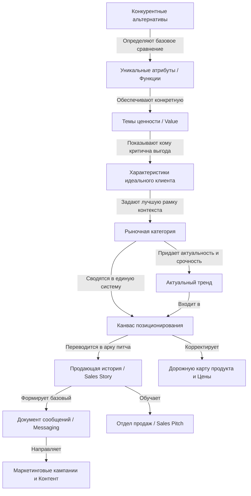

# Учебный конспект по книге Эйприл Данфорд «Obviously Awesome» («Продуманно восхитительны»)

---

### 0. Полный список глав книги

* **Введение (Introduction)** — *Introduction*
* **Глава 1** — *Positioning as Context* / Позиционирование как контекст
* **Глава 2** — *The Five (Plus One) Components of Effective Positioning* / Пять (плюс один) компонентов эффективного позиционирования
* **Глава 3 (Шаг 1)** — *Step 1: Understand the Customers Who Love Your Product* / Шаг 1. Поймите клиентов, которые любят ваш продукт
* **Глава 4 (Шаг 2)** — *Step 2: Form a Positioning Team* / Шаг 2. Сформируйте команду по позиционированию
* **Глава 5 (Шаг 3)** — *Step 3: Align Your Positioning Vocabulary and Let Go of Your Positioning Baggage* / Шаг 3. Согласуйте терминологию и избавьтесь от багажа позиционирования
* **Глава 6 (Шаг 4)** — *Step 4: List Your True Competitive Alternatives* / Шаг 4. Составьте список ваших настоящих конкурентных альтернатив
* **Глава 7 (Шаг 5)** — *Step 5: Isolate Your Unique Attributes or Features* / Шаг 5. Выделите ваши уникальные атрибуты или функции
* **Глава 8 (Шаг 6)** — *Step 6: Map the Attributes to Value “Themes”* / Шаг 6. Сопоставьте атрибуты с темами ценности
* **Глава 9 (Шаг 7)** — *Step 7: Determine Who Cares a Lot* / Шаг 7. Определите, кому эта ценность действительно важна
* **Глава 10 (Шаг 8)** — *Step 8: Find a Market Frame of Reference That Puts Your Strengths at the Center and Determine How to Position in It* / Шаг 8. Найдите рыночную категорию, ставящую ваши сильные стороны в центр, и определите стиль позиционирования
* **Глава 11 (Шаг 9)** — *Step 9: Layer On a Trend (but Be Careful)* / Шаг 9. Наложите актуальный тренд (но с осторожностью)
* **Глава 12 (Шаг 10)** — *Step 10: Capture Your Positioning so It Can Be Shared* / Шаг 10. Зафиксируйте позиционирование для трансляции в компании
* **Глава 13** — *After Positioning: What Happens Next?* / После позиционирования: что делать дальше?
* **Заключение (Conclusion)** — *Conclusion* / Заключение

---

### 1. О чём книга в 3 предложениях

1. **Позиционирование — это сознательное установление контекста для продукта, который объясняет целевым покупателям его уникальную ценность и причины для покупки.**
2. **Без четкого процесса компании попадают в ловушки инерции, ошибочно ориентируются на нерелевантных конкурентов и тратят бюджеты на маркетинг, который не приносит результатов.**
3. **Эйприл Данфорд предлагает проверенную методику из 10 шагов, позволяющую на основе анализа самых счастливых клиентов определить истинную ценность продукта и занять лидирующую рыночную категорию.**

---

### 2. Главные идеи по главам

#### Введение и Глава 1. Позиционирование как контекст
* **Идея:** Контекст задаёт систему координат для покупателя; даже выдающийся продукт, помещенный в неверный контекст, останется непонятым и неоцененным.
* **Правило:** Не полагайтесь на позиционирование «по умолчанию» — осознанно выбирайте рыночный фрейм, через который клиенты должны смотреть на ваш продукт.
* **Пример из книги:** Концертный скрипач Джошуа Белл, собирающий залы по \$300 за билет, сыграл в метро и заработал всего \$32.17, так как контекст метрополитена и мусорной корзины рядом скрыл его ценность. Другой пример — «Cake Pop» (торт на палочке): позиционируемый как «торт» он казался странной мини-порцией со штырем, а позиционируемый как «леденец из торта для взрослых» стал понятным инновационным перекусом к кофе.

#### Глава 2. Пять (плюс один) компонентов эффективного позиционирования
* **Идея:** Традиционные шаблоны «positioning statement» вредны, так как они закрепляют статус-кво, предполагают, что вы уже знаете все ответы, и создают нечитаемый набор слов.
* **Правило:** Позиционирование состоит из 5 взаимосвязанных элементов (альтернативы, атрибуты, ценность, целевой сегмент, рыночная категория) и 1 бонусного (тренд), которые должны определяться в строго последовательном порядке.
* **Пример из книги:** Опыт автора в IBM при заполнении официального шаблона для СУБД DB2 привел лишь к формальной отписке («наша база данных не для мейнфреймов — это база данных, которая предоставляет возможности базы данных...»), не давшей никаких идей для маркетинга.

#### Глава 3 / Шаг 1. Поймите клиентов, которые любят ваш продукт
* **Идея:** Истинные сильные стороны продукта видны только через призму самых счастливых клиентов (raving fans), а не усредненного рынка.
* **Правило:** Опирайтесь при анализе только на тех клиентов, которые быстро поняли продукт, быстро совершили покупку, не просили скидок и активно рекомендуют вас.
* **Пример из книги:** Сервис Wave Accounting сменил позиционирование с «бесплатного бухгалтерского ПО» на «финансовые сервисы для малого бизнеса», когда увидел, что их самые ценные клиенты активно используют интегрированные платежи и расчет зарплат.

#### Глава 4 / Шаг 2. Сформируйте команду по позиционированию
* **Идея:** Позиционирование — это инструмент общей бизнес-стратегии, а не изолированная задача отдела маркетинга.
* **Правило:** Процесс должен возглавлять лидер бизнеса (CEO / руководитель направления), а в команду должны входить руководители продаж, маркетинга, поддержки и разработки.
* **Пример из книги:** Позиционирование, созданное только маркетологами, не принимается отделами продаж и разработки; привлечение внешнего фасилитатора позволяет разрушить внутрикорпоративные догмы и услышать все подразделения.

#### Глава 5 / Шаг 3. Согласуйте терминологию и избавьтесь от багажа
* **Идея:** Команда не сможет найти новую рыночную позицию, пока не откажется от истории создания продукта и прежних представлений о нем («багажа позиционирования»).
* **Правило:** Покупатели ничего не знают о вашей истории и оценивают продукт исключительно по его текущему состоянию.
* **Пример из книги:** Компания Arm & Hammer в 1970-х годах отбросила представление о соде только как о пищевом ингредиенте и позиционировала её как дезодорант для холодильников, подняв продажи с \$16 млн до \$318 млн. Производитель Clearpath Robotics переименовал промышленных роботов в «самоходные транспортные средства» (OTTO Motors), установив фары и стоп-сигналы, что сразу сделало понятным их назначение.

#### Глава 6 / Шаг 4. Составьте список настоящих конкурентных альтернатив
* **Идея:** Конкуренты в голове покупателя — это то, что он сделал бы, если бы вашего продукта не существовало (Excel, ручной труд, привлечение стажера или отсутствие действий).
* **Правило:** Оценивайте альтернативы глазами идеального клиента, а не по вашему знанию технологических стартапов-соперников.
* **Пример из книги:** При отсутствии аналитической СУБД Эйприл Данфорд клиенты выбирали не другие СУБД, а системы бизнес-аналитики (BI) и хранилища данных.

#### Глава 7 / Шаг 5. Выделите уникальные атрибуты и функции
* **Идея:** Уникальные атрибуты — это факты, технологии и компетенции, которые есть у вас, но отсутствуют у выбранных конкурентных альтернатив.
* **Правило:** Не используйте субъективные заявления («мы просты в использовании», «у нас отличный сервис») без объективных фактов и независимых подтверждений третьих сторон.
* **Пример из книги:** Наличие запатентованного алгоритма выполнения сложных аналитических запросов к большим объемам данных.

#### Глава 8 / Шаг 6. Сопоставьте атрибуты с темами ценности
* **Идея:** Клиент покупает не техническую функцию, а бизнес-результат и ценность, которые эта функция обеспечивает для его целей.
* **Правило:** Сгруппируйте все выделенные атрибуты в 1–4 понятные клиенту темы (кластера) ценности.
* **Пример из книги:** Перевод параметра «запатентованный алгоритм» в ценность: получение ответов на аналитические запросы за минуты вместо часов, что позволяет банкам мгновенно выявлять мошеннические операции.

#### Глава 9 / Шаг 7. Определите, кому это действительно важно (Who Cares a Lot)
* **Идея:** Эффективная сегментация опирается на легко идентифицируемые характеристики клиентов, которым ваша ценность жизненно необходима.
* **Правило:** Сужайте целевой сегмент настолько, насколько это возможно для выполнения текущих бизнес-целей по продажам.
* **Пример из книги:** Вместо продажи СУБД «любым компаниям с большими данными» команда сфокусировалась на банках с жесткими требованиями к скорости анализа угрожающих транзакций.

#### Глава 10 / Шаг 8. Выберите рыночную категорию и стиль позиционирования
* **Идея:** Рыночная категория запускает у клиента мощный набор автоматических допущений о функционале, конкурентах и ценах.
* **Правило:** Выберите один из трех стилей:
  1. *Head to Head* (Плечом к плечу) — стать лидером существующей категории;
  2. *Big Fish, Small Pond* (Большая рыба в маленьком пруду) — доминировать в узком субсегменте;
  3. *Create a New Game* (Создать новую игру) — сформировать новую категорию с нуля.
* **Пример из книги:** Стартап Janna Systems пытался конкурировать со гигантом Siebel на рынке «CRM для всех», где казался «дешевым и плохим Siebel». Сменив позиционирование на «CRM для инвестиционных банков» (стиль *Big Fish, Small Pond*), компания вырастила выручку с \$2 млн до \$70 млн и была продана за \$1.7 млрд.

#### Глава 11 / Шаг 9. Наложите актуальный тренд (но с осторожностью)
* **Идея:** Тренд помогает клиенту понять, почему продукт важен и актуален именно сейчас.
* **Правило:** Накладывайте тренд только тогда, когда есть прямая логическая связь с вашей рыночной категорией и продуктом; не пытайтесь заменить категорию трендом.
* **Пример из книги:** Redgate Software связали свои инструменты для баз данных с трендом DevOps («Database DevOps»), что подняло входящий поток лидов на 100%. Антипример: переименование Long Island Iced Tea в «Long Blockchain» без реальной связи с продуктом привело к краху акций и делистингу с биржи.

#### Глава 12 / Шаг 10. Зафиксируйте позиционирование в Канвасе
* **Идея:** Позиционирование бесполезно, если оно не зафиксировано в едином документе для всех отделов компании.
* **Правило:** Используйте 1-страничный Канвас позиционирования (Positioning Canvas), отражающий логическую связь всех компонентов.
* **Пример из книги:** Таблица Канваса, содержащая: Имя продукта -> Рыночную категорию -> Конкурентные альтернативы -> Уникальные атрибуты -> Ценность -> Профиль целевого клиента.

#### Глава 13. После позиционирования: отдел продаж и коммуникации
* **Идея:** Позиционирование необходимо сразу перевести в продающую историю (Sales Story) и эталонный документ сообщений (Messaging Document).
* **Правило:** Продающая история должна иметь структуру: Описание проблемы -> Текущие способы решения и их недостаток -> Идеальный мир -> Представление продукта и категории -> Темы ценности -> Призыв к действию.
* **Пример из книги:** Изменение логики первой встречи с клиентом позволило продавцам доносить позиционирование без длительных объяснений суть продукта.

---

### 3. Схема связей в формате Mermaid (graph TD)

---

### 4. Чек-лист: что делать на практике по шагам

1. **Шаг 1. Составить список «самых счастливых клиентов»:** Выпишите 10–20 клиентов, которые быстрее всех купили продукт, активно им пользуются и искренне рекомендуют вас.
2. **Шаг 2. Сформировать кросс-функциональную команду:** Соберите группу из CEO/руководителя бизнеса, глав отделов продаж, маркетинга, клиентской поддержки и разработки (при необходимости привлеките внешнего фасилитатора).
3. **Шаг 3. Согласовать понятия и сбросить «багаж»:** Договоритесь абстрагироваться от истории создания продукта и принятых ранее терминов.
4. **Шаг 4. Определить реальные альтернативы:** Ответьте на вопрос: «Что сделают наши лучшие клиенты, если наш продукт исчезнет?» (Excel, ручной труд, другие программы).
5. **Шаг 5. Выделить уникальные атрибуты:** Составьте полный список технических особенностей, функций и ресурсов, которыми владеете вы, но не обладают альтернативы.
6. **Шаг 6. Сгруппировать атрибуты в темы ценности:** Переведите каждую функцию в бизнес-пользу и объедините их в 1–4 ключевые темы ценности.
7. **Шаг 7. Описать целевой сегмент (Who Cares a Lot):** Сформулируйте четкие, легко проверяемые критерии компаний или пользователей, которым выделенная ценность критически важна.
8. **Шаг 8. Выбрать рыночную категорию и стиль:** Определите контекст (категорию) и стиль позиционирования (*Head to Head*, *Big Fish Small Pond* или *Create a New Game*).
9. **Шаг 9. Привязать тренд (при наличии):** Найдите актуальный отраслевой тренд, подкрепляющий вашу ценность, и свяжите его с базовой категорией.
10. **Шаг 10. Заполнить Канвас позиционирования:** Оформите результаты на одном листе и утвердите его со всей командой.
11. **Внедрение:** На основе Канваса создайте продающую историю для отдела продаж (Sales Story), зафиксируйте Messaging Document, скорректируйте цены и приоритеты разработки.

---

### 5. Типичные ошибки и как их избежать

1. **Ловушка позиционирования «по умолчанию» (Default Positioning):** Сохранение первоначального контекста задумки, несмотря на то, что продукт и рынок изменились.
   *Как избежать:* Регулярно проводить аудит позиционирования и осознанно сбрасывать «исторический багаж».
2. **Использование традиционного «Positioning Statement»:** Заполнение бессмысленных шаблонов с пропущенными словами, которые закрепляют статус-кво.
   *Как избежать:* Заменить упражнения по заполнению пропусков на пошаговый процесс анализа компонентов, начиная с альтернатив клиентов.
3. **Ориентация на инвесторов вместо клиентов:** Попытка продавать клиентам «видение компании на 10 лет» или абстрактный «дизрапшн».
   *Как избежать:* Разделять питч для инвесторов и позиционирование для покупателей, которым нужно решение сиюминутной проблемы.
4. **Неверное определение конкурентов:** Сравнение себя с другими стартапами вместо реальных альтернатив в голове клиента (Excel, ручной труд).
   *Как избежать:* Всегда задавать вопрос: «Что бы делал клиент, если бы нашего продукта не существовало?».
5. **Подмена ценности атрибутами и отсутствие доказательств:** Заявления в духе «мы просты в использовании» или перечисление сухих технических характеристик без бизнес-пользы.
   *Как избежать:* Переводить каждый атрибут в бизнес-результат и подкреплять его объективными фактами или отзывами третьих сторон.
6. **Слишком широкая сегментация:** Попытка продавать «всем подряд», распыляя ограниченные ресурсы.
   *Как избежать:* Сужать фокус до узкой группы идеальных клиентов, достаточной для выполнения текущих планов по продажам.
7. **Использование тренда вместо категории:** Замена понятной категории громкими словами (AI, Blockchain, Sharing Economy) без объяснения сути продукта.
   *Как избежать:* Сначала зафиксировать рыночную категорию, и только затем привязывать ее к тренду.

---

### 6. 20 карточек «вопрос — ответ» для повторения

1. **В: Что такое позиционирование по Эйприл Данфорд?**
   **О:** Это сознательное определение того, как ваш продукт является лучшим в том, что очень важно для четко определенного рынка.
2. **В: Почему увеличение маркетингового бюджета не помогает при слабом позиционировании?**
   **О:** Потому что позиционирование — это фундамент. Увеличение бюджета без четкого позиционирования похоже на громкую и медленную речь на иностранном языке с человеком, который его не знает.
3. **В: Назовите симптомы проблем с позиционированием.**
   **О:** Длинные циклы продаж, низкий процент конверсии, высокий отток клиентов (churn), постоянные жалобы на высокую цену и непонимание продукта новыми покупателями.
4. **В: В чем главное откровение эксперимента со скрипачом Джошуа Беллом?**
   **О:** Контекст полностью меняет восприятие ценности: виртуоз в метро заработал \$32, а в концертном зале собирает аншлаги по \$300 за билет при той же самой музыке.
5. **В: В чем суть ловушки «Cake Pop»?**
   **О:** Если позиционировать торт на палочке как «торт», он кажется плохим тортом со штырем; если позиционировать как «леденец из торта», он становится понятным лакомством.
6. **В: В чем главные пороки традиционного Positioning Statement?**
   **О:** Он предполагает, что вы уже знаете все ответы, закрепляет статус-кво, не дает идей для дальнейших действий и его тяжело запомнить.
7. **В: Назовите 5 основных (плюс 1 бонусный) компонентов позиционирования.**
   **О:** 1) Конкурентные альтернативы, 2) Уникальные атрибуты, 3) Ценность, 4) Характеристики целевого рынка, 5) Рыночная категория; + Bonus: Актуальные тренды.
8. **В: Почему анализ компонентов нужно начинать с конкурентных альтернатив?**
   **О:** Потому что альтернативы в голове клиента являются той линейкой, по которой он измеряет вашу ценность и уникальность.
9. **В: Что такое «конкурентная альтернатива» в понятии Данфорд?**
   **О:** Это то, что сделал бы или использовал клиент, если бы вашего продукта не существовало.
10. **В: Чем атрибут отличается от ценности?**
    **О:** Атрибут — это функция или технология продукта; ценность — это выгода и бизнес-цель, которой клиент достигает с помощью этой функции.
11. **В: Кто такие идеальные клиенты (best-fit customers)?**
    **О:** Это клиенты, которые быстро понимают продукт, быстро покупают, не требуют скидок, получают высокую выгоду и рекомендуют вас.
12. **В: С какого действия начинается 10-шаговый процесс позиционирования?**
    **О:** С составления списка самых счастливых и успешных текущих клиентов.
13. **В: Кто должен входить в команду по позиционированию?**
    **О:** Руководитель бизнеса (CEO/основатель) и лидеры отделов продаж, маркетинга, поддержки и разработки.
14. **В: Что такое «багаж позиционирования»?**
    **О:** Устаревшие представления о продукте и история его разработки, которые мешают команде увидеть новые рыночные возможности.
15. **В: Назовите 3 стиля позиционирования.**
    **О:** 1) Head to Head (Плечом к плечу), 2) Big Fish, Small Pond (Большая рыба в маленьком пруду), 3) Create a New Game (Создать новую игру).
16. **В: Когда выбирают стиль «Big Fish, Small Pond»?**
    **О:** Когда на рынке есть сильный лидер, и вы хотите захватить конкретный субсегмент с особыми неотвеченными потребностями.
17. **В: В чем главная сложность стиля «Create a New Game»?**
    **О:** Вам приходится с нуля продавать рынку саму проблему и доказывать необходимость существования новой категории.
18. **В: Зачем использовать тренды в позиционировании?**
    **О:** Тренды помогают объяснить клиенту, почему ваш продукт важен и актуален для него именно сейчас.
19. **В: Что такое Канвас позиционирования?**
    **О:** Одностраничный документ, сводящий воедино все 6 компонентов и показывающий их взаимосвязь.
20. **В: Как позиционирование переносится в работу отдела продаж?**
    **О:** Через продающую историю (Sales Story), структурированную по схеме: Проблема -> Текущие несовершенные решения -> Идеальный мир -> Введение продукта и категории -> Темы ценности.

---

### 7. 5 практических заданий на применение

#### Задание 1. Выделение истинных конкурентных альтернатив (Шаг 4)
* **Интернет-магазин (например, специализированный магазин органической косметики):** Определите, что сделает покупатель, если ваш сайт недоступен. Сгруппируйте альтернативы (1. Покупка масс-маркет косметики в супермаркете; 2. Поиск на Wildberries/Ozon; 3. Отказ от покупки).
* **B2B-продажи вентиляции (системы промышленной аспирации):** Сформулируйте альтернативы главного инженера завода (1. Оставить старую советскую вентиляцию и платить штрафы; 2. Регулярно нанимать ремонтную бригаду; 3. Покупка стандартных турецких/китайских установок общепромышленного назначения).

#### Задание 2. Картирование «Атрибут -> Выгода -> Бизнес-ценность» (Шаги 5 и 6)
Заполните таблицу по образцу из книги:

| Сфера | Атрибут (Feature) | Выгода (Benefit) | Бизнес-ценность (Value) |
| :--- | :--- | :--- | :--- |
| **Интернет-магазин** | Онлайн-сканер кожи по фото на базе алгоритма | Точный подбор уходовых средств без визита к косметологу | Экономия времени и 100% гарантия от аллергических реакций и напрасных трат |
| **B2B-вентиляция** | Встроенный рекуператор тепла с автоматической очисткой фильтров | Снижение энергопотребления на 40% и отсутствие простоев на обслуживание | Сокращение операционных расходов завода на 3 млн руб./год и исключение рисков остановки цеха |

#### Задание 3. Сегментация «Who Cares a Lot» (Шаг 7)
* **Интернет-магазин:** Сформируйте профиль идеального клиента (Best-Fit) не по возрасту, а по характеристикам. Например: «Покупатели с чувствительной кожей, перепробовавшие масс-маркет и совершающие регулярные повторные заказы от 3 единиц товаров».
* **B2B-вентиляция:** Сформулируйте характеристики предприятий, которым стандартная вентиляция категорически не подходит. Например: «Фармацевтические цеха и чистые помещения, где малейшее отклонение по пыли ведет к браку всей партии лекарств».

#### Задание 4. Выбор стиля позиционирования (Шаг 8)
* **Интернет-магазин:** Смените стиль с *Head to Head* (конкуренция со всеми маркетплейсами) на *Big Fish, Small Pond* — например, «Гипоаллергенный уход для профессиональных спортсменов».
* **B2B-вентиляция:** Смените стиль с «вентиляция для любых зданий» на *Big Fish, Small Pond* — например, «Взрывозащищенные системы пылеудаления для деревообрабатывающих комбинатов».

#### Задание 5. Разработка структуры продающей истории (Sales Story) (Глава 13)
Составьте структуру питча для отдела продаж вентиляции по схеме:
1. **Проблема:** «Фармацевтические заводы теряют миллионы из-за брака партий при сбоях микроклимата».
2. **Текущие решения:** «Стандартные промышленные системы вентиляции не держат стерильность и требуют частых остановок на техобслуживание».
3. **Идеальный мир:** «В идеальном мире система вентиляции сама поддерживала бы класс чистоты и предупреждала об износе фильтров без остановки линии».
4. **Продукт и Категория:** «[Название] — это специализированная система климат-контроля для фармацевтических чистых помещений».
5. **Ценность:** «Бесперебойность производства 24/7 и ноль забракованных партий».

---

💡 *Хотите, чтобы мы взяли один из ваших реальных продуктов (например, интернет-магазин или направление вентиляции) и вместе проработали для него заполненный Канвас позиционирования по этой методике?*
