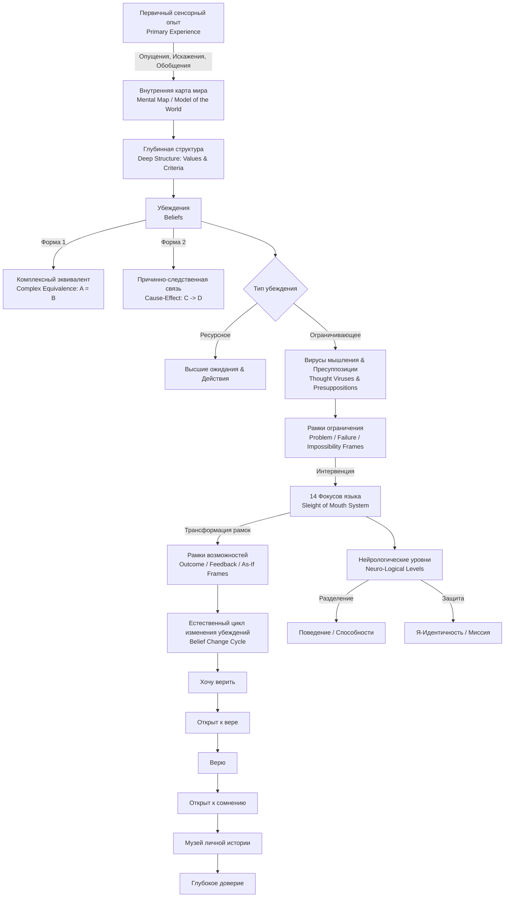

#### 0. Полный список глав книги (номер, название по-английски — перевод)

1. **Chapter 1: Language and Experience** — Язык и опыт.
2. **Chapter 2: Frames and Reframing** — Рамки и рефрейминг.
3. **Chapter 3: Chunking** — Укрупнение и разукрупнение (Чанкинг).
4. **Chapter 4: Values and Criteria** — Ценности и критерии.
5. **Chapter 5: Beliefs and Expectations** — Убеждения и ожидания.
6. **Chapter 6: The Basic Structure of Beliefs** — Базовая структура убеждений.
7. **Chapter 7: Internal States and Natural Belief Change** — Внутренние состояния и естественное изменение убеждений.
8. **Chapter 8: Thought Viruses and the Meta Structure of Beliefs** — Вирусы мышления и мета-структура убеждений.
9. **Chapter 9: Applying the Patterns as a System** — Применение паттернов как системы.
10. **Chapter 10: Conclusion** — Заключение.

#### 1. О чём книга в 3 предложениях

1. Книга Роберта Дилтса раскрывает языковые механизмы и вербальные паттерны НЛП, известные как **«Фокусы языка» (Sleight of Mouth)**, которые позволяют переформировывать и трансформировать ограничивающие убеждения и вирусы мышления непосредственно в ходе беседы.
2. Автор показывает, как с помощью изменения рамок восприятия, рефрейминга, нейрологических уровней и смещения внимания между ценностями, критериями и ожиданиями расширять внутренние ментальные карты человека.
3. В издании описана целостная система из 14 разговорных паттернов и естественный цикл изменения убеждений, позволяющие экологично переводить собеседника из рамок проблемы и неудачи в рамки результата, обратной связи и возможностей.

#### 2. Главные идеи по главам

##### Глава 1: Language and Experience (Язык и опыт)

* **Двоякая функция языка**: Человек использует язык как для внутреннего моделирования собственного опыта (греческое *logos*), так и для коммуникации своей модели мира окружающим (*rhema*).
* **Карта — это не территория (The map is not the territory)**: Фундаментальный принцип Альфреда Коржибски и НЛП гласит, что наше поведение определяется внутренними нейролингвистическими картами, а не самой объективной реальностью.
* **Первичный и вторичный опыт**: Первичный сенсорный опыт (*primary experience*) богат и динамичен, в то время как вторичный языковой опыт (*secondary experience*) неизбежно содержит опущения, искажения и обобщения.
* **Языковые рамки внимания**: Связующие слова вроде «но» (*but*), «и» (*and*) и «хотя» (*even though*) смещают фокус восприятия между позитивными и негативными аспектами события.

##### Глава 2: Frames and Reframing (Рамки и рефрейминг)

* **Психологические рамки (Frames)**: Рамки задают контекст и границы восприятия, определяя, какие детали попадают в фокус внимания, а какие остаются на заднем плане.
* **Сдвиг основных рамок**: Ключевая цель — перевод восприятия из **«рамки проблемы» (Problem Frame)**, **«рамки неудачи» (Failure Frame)** и **«рамки невозможности»** в **«рамку результата» (Outcome Frame)**, **«рамку обратной связи» (Feedback Frame)** и **«рамку “как если бы”» (As If Frame)**.
* **Виды рефрейминга**: Контекстуальный рефрейминг (*context reframing*) находит контекст, где конкретное поведение полезно, а содержательный рефрейминг (*content reframing*) выявляет позитивное намерение (*positive intention*) за поведением.
* **Трансформация критики**: Преобразование оценочных суждений критика в обучающие «как»-вопросы (*how questions*) превращает критика из разрушителя в конструктивного советника.
* **Базовые рефрейминговые сдвиги**: Выявление позитивного намерения (*Intention*), переопределение терминов (*Redefining*) и смена позиций восприятия (*Model of the World*).

##### Глава 3: Chunking (Укрупнение и разукрупнение)

* **Чанкинг (Chunking)**: Способность гибко перемещать внимание между деталями (микрочанки) и общими категориями (макрочанки).
* **Укрупнение (Chunking Up)**: Обобщение элементов к более широким классам, помогающее выявлять высшие ценности и позитивные намерения.
* **Разукрупнение (Chunking Down)**: Разбиение обобщений и ярлыков на конкретные подпроцессы и детали, восстанавливающее рамку обратной связи.
* **Аналогия / Латеральный чанкинг (Chunking Laterally)**: Поиск метафор и изоморфизмов на том же уровне абстракции за счет абдуктивного мышления (*abductive thinking*).
* **Когнитивная пунктуация (Punctuation)**: Размещение мысленных «вопросительных и восклицательных знаков», придающее нейтральным фактам эмоциональную интерпретацию.

##### Глава 4: Values and Criteria (Ценности и критерии)

* **Структура смысла**: Смысл возникает на стыке карты и территории, а его главным источником выступают глубинные ценности (*values*) и критерии (*criteria*).
* **Критериальный эквивалент (Criterial Equivalence)**: Конкретные сенсорно-очевидные свидетельства и наблюдения, по которым человек определяет, удовлетворен ли критерий.
* **Стратегии реальности (Reality Strategies)**: Последовательность внутренних проверок и субмодальностей, с помощью которых мозг отличает воспоминания от фантазий.
* **Иерархия критериев (Hierarchy of Criteria)**: Порядок приоритетов ценностей, выявляемый через поиск противопримеров (*counter-examples*).
* **Техника иерархии критериев**: Пространственное якорение и рычаги высших критериев для преодоления внутреннего сопротивления.

##### Глава 5: Beliefs and Expectations (Убеждения и ожидания)

* **Природа убеждений**: Убеждения — это устойчивые обобщения о причинах, значениях и границах, вызывающие вегетативные и нейрофизиологические реакции.
* **Три типа ограничивающих убеждений**: **Безнадежность (Hopelessness)** — цель недостижима; **Беспомощность (Helplessness)** — цель возможна, но у меня нет способностей; **Никчемность (Worthlessness)** — я не заслуживаю успеха.
* **Виды ожиданий**: Разделение на ожидания результата (*outcome expectations*) и ожидания собственной эффективности (*self-efficacy expectations*).
* **Паттерн «Последствия» (Consequence)**: Направление внимания на будущие позитивные или негативные результаты для укрепления или ослабления убеждения.
* **Рамка «Как если бы» (As If frame)**: Симуляция достижения цели, активирующая нейрологию и снимающая ограничения.

##### Глава 6: The Basic Structure of Beliefs (Базовая структура убеждений)

* **Лингвистические формы убеждений**: Строятся либо как **Комплексный эквивалент (Complex Equivalence: **A=B**)**, либо как **Причинно-следственная связь (Cause-Effect: **C→D**)**.
* **Четыре типа причин по Аристотелю**: Предшествующие (*Precipitating*), Сдерживающие (*Constraining*), Конечные/Целевые (*Final*) и Формальные (*Formal Causes*).
* **Аудит ценностей и убеждений**: Использование лингвистических связок (*because, therefore, although, if*) для выстраивания системы аргументов и проверок.
* **Поиск противопримеров (Counter Examples)**: Поиск исключений, разрушающих кванторы общности («всегда», «никогда», «все»).

##### Глава 7: Internal States and Natural Belief Change (Внутренние состояния и естественное изменение убеждений)

* **Естественный цикл изменения убеждений (Belief Change Cycle)**: Последовательный переход через фазы: *Хочу верить *→* Открыт к вере *→* Верю *→* Открыт к сомнению *→* Музей личной истории (Раньше верил) *→* Доверие*.
* **Состояния как контейнеры**: Физиологическое и эмоциональное состояние определяет доступ к ресурсам («знание — только слух, пока оно не в мышцах»).
* **Якорение и Внутренние менторы**: Использование пространственных якорей (*spatial anchors*) и интеграция позиций менторов (*Inner Mentors*) для мягкой трансформации.
* **Цепочки убеждений (Belief Chaining)**: Пошаговое связывание промежуточных состояний (например, от разочарования через замешательство и любопытство к мотивации).
* **Невербальная коммуникация**: До 92% информации передается по аналоговому каналу (тон, жесты), задавая мета-сообщение.

##### Глава 8: Thought Viruses and the Meta Structure of Beliefs (Вирусы мышления и мета-структура убеждений)

* **Вирус мышления (Thought Virus)**: Самоподтверждающееся ограничивающее убеждение, оторванное от первичного опыта и содержащее скрытые предпосылки.
* **Пресуппозиции (Presuppositions)**: Невысказанные языковые условия, принимаемые за истину по умолчанию для понимания фразы.
* **Самореференция и парадоксы**: Замкнутая логика, приводящая к двойным связкам (*Double Binds / Catch-22*).
* **Применение к себе (Apply to Self)**: Направление критериев самого убеждения на само это убеждение для вскрытия противоречий.
* **Нейрологические уровни (Neuro-Logical Levels)**: Иерархия *Окружение *→* Поведение *→* Способности *→* Убеждения/Ценности *→* Идентичность *→* Духовность*, позволяющая отделять личность от ее поведения.

##### Глава 9: Applying the Patterns as a System (Применение паттернов как системы)

* **Системный рефрейминг**: 14 паттернов Фокусов языка образуют взаимосвязанную систему операторов для сдвига внимания.
* **Закон необходимого разнообразия (Law of Requisite Variety)**: Управлять системой может только тот элемент, который обладает наибольшей гибкостью; фокусы языка создают психологический иммунитет.
* **Разбор классических демонстраций**: Анализ знаменитых кейсов Бендлера с паранойей и систематизированная матрица вопросов для работы с любыми убеждениями.

##### Глава 10: Conclusion (Заключение)

* **Перевод рамок**: Главная цель применения инструментария — экологичный сдвиг из рамок проблемы, неудачи и невозможности в рамки результата, обратной связи и возможностей.
* **Целостная интеграция**: Эффективное изменение убеждений сочетает вербальные структуры с задействованием физиологии, ценностей и смысловой идентичности.

#### 3. Схема связей между главными идеями (Mermaid graph TD)

#### 4. Пошаговый чек-лист практических действий

1. **Формулировка убеждения**: Запишите убеждение в виде четкой структуры: «A означает B» (Комплексный эквивалент) или «C вызывает D» (Причинно-следственная связь).
2. **Выявление позитивного намерения (Intention)**: Задайте вопрос: «Какую положительную цель или защиту пытается обеспечить это убеждение?».
3. **Калибровка и сдвиг рамок (Framing)**: Определите, находится ли собеседник в рамке проблемы/неудачи, и наметьте переход в рамку результата или обратной связи.
4. **Выявление скрытых пресуппозиций**: Задайте вопросы для вскрытия невысказанных предпосылок, на которых держится убеждение.
5. **Переопределение ключевых слов (Redefining)**: Замените жесткие и негативно окрашенные термины суждения на более нейтральные или динамичные понятия.
6. **Применение каскада фокусов языка**: Выберите и примените 3–5 целевых паттернов (например, *Противопример, Аналогия, Иерархия критериев, Применение к себе, Изменение размера рамки*).
7. **Проведение по Циклу изменения убеждений**: Переведите убеждение из состояния «Верю» через «Открыт к сомнению» в «Музей личной истории», задействуя пространственные якоря и внутренних менторов.
8. **Экологическая проверка и физиологическая интеграция**: Убедитесь, что новое убеждение удовлетворяет ценностям высшего порядка и закрепилось в телесном состоянии (*«в мышцах»*).

#### 5. Типичные ошибки и как их избежать

1. **Использование паттернов для спора и манипуляций (Adversarial Framework)**:
  * *Ошибка*: Использовать паттерны как спортивное фехтование, агрессивно загоняя собеседника в угол.
  * *Как избежать*: Применять Фокусы языка с уважением к модели мира собеседника, сохраняя ориентацию на поддержку его ценностей.
2. **Атака на уровень идентичности (Attacking Identity)**:
  * *Ошибка*: Смешивать личность человека с его поведением («Ты поступил так, потому что ты глупый»).
  * *Как избежать*: Использовать разделение нейрологических уровней: отделять идентичность (*Who*) от конкретных действий (*What*) и способностей (*How*).
3. **Игнорирование невербальных мета-сообщений**:
  * *Ошибка*: Произносить правильные слова с саркастическим тоном или напряженным телом.
  * *Как избежать*: Помнить, что до 92% информации передается по аналоговому каналу; удерживать собственное ресурсное состояние и конгруэнтность.
4. **Увязновение в «рамке проблемы» при подстройке**:
  * *Ошибка*: Чрезмерно присоединяться к негативным аргументам собеседника, подкрепляя его вирус мышления.
  * *Как избежать*: Строить присоединение к позитивному намерению, а не к негативной формулировке проблемы.
5. **Прямое опровержение пресуппозиций**:
  * *Ошибка*: Пытаться оспорить поверхностное утверждение напрямую, не замечая скрытых предпосылок.
  * *Как избежать*: Сначала выводить пресуппозиции на поверхность с помощью мета-модельных вопросов, а затем применять рефрейминг.

#### 6. 20 карточек «вопрос — ответ» для повторения

1. **В**: Что означает принцип «Карта — это не территория»?
  * **О**: Наше поведение определяется не самой объективной реальностью, а нашими внутренними нейролингвистическими моделями и картами.
2. **В**: В чем отличие «рамки проблемы» от «рамки результата»?
  * **О**: Рамка проблемы фокусируется на симптомах и вине («Почему всё плохо?»), а рамка результата — на целях и ресурсах («Чего мы хотим добиться?»).
3. **В**: В чем разница между первичным и вторичным опытом?
  * **О**: Первичный опыт получаем напрямую через органы чувств, а вторичный — это его вербальные и символические описания.
4. **В**: В чем разница между контекстуальным и содержательным рефреймингом?
  * **О**: Контекстуальный находит условия, где поведение полезно; содержательный меняет смысл поведения, выявляя позитивное намерение.
5. **В**: Как перевести критику в конструктивное русло?
  * **О**: Выявить позитивное намерение критика и переформулировать его суждение в вопрос, начинающийся со слова «Как...?».
6. **В**: Что такое чанкинг и каковые его направления?
  * **О**: Это управление масштабом внимания: укрупнение (вверх к категориям), разукрупнение (вниз к деталям) и латеральный чанкинг (вбок к аналогиям).
7. **В**: Чем критериальный эквивалент отличается от критерия?
  * **О**: Критерий — это абстрактная ценность (например, «качество»), а критериальный эквивалент — сенсорно-очевидные признаки ее выполнения.
8. **В**: Что такое «Стратегия реальности»?
  * **О**: Набор внутренних проверок и субмодальностей, по которым мозг отличает реальные воспоминания от фантазий.
9. **В**: Назовите три главных типа ограничивающих убеждений.
  * **О**: Безнадежность (цель недостижима), Беспомощность (у меня нет способностей) и Никчемность (я не заслуживаю).
10. **В**: В чем разница между ожиданиями результата и ожиданиями собственной эффективности?
  * **О**: Ожидание результата — вера в то, что действие приведет к цели; ожидание эффективности — вера в способность выполнить это действие.
11. **В**: В каких двух лингвистических формах выражаются убеждения?
  * **О**: Комплексный эквивалент (A=B) и Причинно-следственная связь (C→D).
12. **В**: Назовите четыре типа причин по Аристотелю.
  * **О**: Предшествующие (осадочные), Сдерживающие, Конечные (целевые) и Формальные.
13. **В**: Какова роль паттерна «Противопример»?
  * **О**: Найти исключение из правила, подрывающее абсолютную универсальность обобщения.
14. **В**: Назовите ключевые этапы естественного цикла изменения убеждений.
  * **О**: Хочу верить → Открыт к вере → Верю → Открыт к сомнению → Музей личной истории → Доверие.
15. **В**: Что такое «Вирус мышления»?
  * **О**: Ограничивающее убеждение, оторванное от опыта и ценностей, содержащее скрытые пресуппозиции и замкнутую логику.
16. **В**: Чем пресуппозиция отличается от логического вывода?
  * **О**: Пресуппозиция заложена в самой структуре фразы и должна быть истинной, чтобы фраза имела смысл.
17. **В**: В чем суть паттерна «Применение к себе»?
  * **О**: Оценка самого утверждения по критериям, которые это утверждение декларирует.
18. **В**: Перечислите нейрологические уровни по Дилтсу снизу вверх.
  * **О**: Окружение → Поведение → Способности → Убеждения/Ценности → Идентичность → Духовность.
19. **В**: Как Закон необходимого разнообразия применим к убеждениям?
  * **О**: Системой управляет элемент с наибольшей гибкостью; фокусы языка дают необходимую гибкость для трансформации блоков.
20. **В**: Сколько паттернов Фокусов языка выделяет Дилтс и какова их главная цель?
  * **О**: 14 паттернов; цель — перевод из рамок проблемы и неудачи в рамки результата и обратной связи.

#### 7. 5 практических заданий на применение

##### Задание 1 (Интернет-магазин одежды): Обработка возражения по цене

* **Сценарий**: Покупатель пишет в чат: *«Эта куртка слишком дорогая для бренда без мировой известности (*A=B*)»*.
* **Задача**: Применить 3 паттерна:
  1. *Переопределение (Redefining)*: «Вы имеете в виду, что хотите быть уверенным в высокой долговечности и премиальном качестве материалов, а не переплачивать за марку?».
  2. *Другой результат (Another Outcome)*: «Вопрос не столько в раскрученности бренда, сколько в том, насколько идеально куртка сидит на вас и защищает от мороза».
  3. *Иерархия критериев (Hierarchy of Criteria)*: «Комфорт, идеальный крой и теплота в зимний период гораздо важнее, чем логотип на бирке, не так ли?».

##### Задание 2 (B2B-лидогенерация): Преодоление сопротивления ЛПР

* **Сценарий**: Директор по маркетингу B2B-компании говорит: *«У нас уже есть подрядчик по лидогенерации, менять что-то слишком сложно и рискованно (*C→D*)»*.
* **Задача**: Применить 3 паттерна:
  1. *Изменение размера рамки (Change Frame Size)*: «Если посмотреть на перспективы следующего года, ограничение только одним каналом привлечения создаст гораздо больший риск отставания от конкурентов».
  2. *Противопример (Counter Example)*: «Бывали ли случаи, когда тестирование параллельного подрядчика на небольшом тест-сплите приносило целевые лиды вдвое дешевле без какого-либо риска для текущих процессов?».
  3. *Разукрупнение (Chunk Down)*: «Нам не нужно менять вашего текущего подрядчика. Что если мы заузим задачу до тестовой кампании на 50 целевых аккаунтов?».

##### Задание 3 (Сборщики данных на Claude/Python): Рефрейминг ошибок парсинга

* **Сценарий**: Разработчик заявляет: *«Скрипты постоянно падают из-за антибот-защиты Cloudflare, автоматический сбор данных с этого сайта невозможен (*C→D*)»*.
* **Задача**: Перевести проблему из *Problem Frame* в *Feedback Frame* и *As-If Frame* с опорой на причину по Аристотелю:
  1. *Перевод в Feedback Frame*: «Блокировки — это не показатель невозможности, а обратная связь о том, что текущий профиль заголовков и прокси легко детектируется».
  2. *Анализ формальной причины (Formal Cause)*: «Что именно мы определяем как “автоматический сбор”? Если мы изменим форму задержек и применим Claude для имитации естественных движений человека, останется ли это детектируемым ботом?».
  3. *Рамка “Как если бы” (As-If Frame)*: «Представим, что скрипт уже работает ровно и обходит защиту с вероятностью 99%. Какие конкретно параметры сессии и ротации задействованы в этой архитектуре?».

##### Задание 4 (B2B-лидогенерация / Продажи): Преодоление синдрома беспомощности

* **Сценарий**: Сейлз-менеджер заявляет: *«Холодные аутрич-письма больше не работают в 2026 году, клиенты их просто удаляют (Helplessness / Hopelessness)»*.
* **Задача**: Провести менеджера по Циклу изменения убеждений (*Belief Change Cycle*):
  1. *Хочу верить / Намерение*: «Я понимаю твое желание беречь свое время и не делать бесполезных рассылок. Но хочешь ли ты найти способ, как писать так, чтобы конверсия в ответ была выше 15%?».
  2. *Открыт к сомнению / Применение к себе*: «Все ли письма 100% клиентов действительно удаляют? Не является ли сама эта идея хорошим оправданием, чтобы не адаптировать офферы под новые тренды?».
  3. *Музей личной истории*: «Вспомни, как 3 года назад ты думал, что звонки в LinkedIn не работают, а потом заключил крупную сделку. Давай отправим старое представление в музей пройденных этапов».

##### Задание 5 (Claude/Python и интернет-магазин одежды): Разработка ИИ-инструкции

* **Сценарий**: Создание системного промпта для ИИ-ассистента клиентской поддержки на базе Claude, обрабатывающего претензии типа: *«Мне не подошел размер, ткань ужасная, верните деньги!»*.
* **Задача**: Запрограммировать алгоритм обработки на основе 14 Фокусов языка:
  1. *Шаг 1: Выделение позитивного намерения*: ИИ идентифицирует стремление клиента получить стильную одежду и комфорт.
  2. *Шаг 2: Переопределение*: ИИ переопределяет «ужасную ткань» в «особую текстуру и плотность материала, требующую специальной посадки».
  3. *Шаг 3: Разукрупнение и Подбор альтернативы*: ИИ разукрупняет проблему до замера параметров и предлагает бесплатный обмен на смежный размер с консультацией стилиста.
  4. *Шаг 4: Вывод в рамку результата*: «Наша цель — чтобы вещи сидели на вас идеально. Давайте оформим примерку подходящего размера курьером уже завтра».