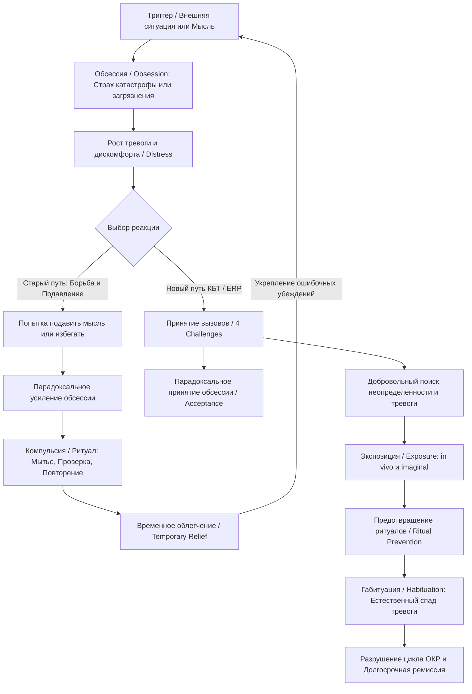

Ниже представлен подробный учебный конспект книги Эдны Фоа и Рида Уилсона «Stop Obsessing!» («Победа над навязчивостями»).

#### 0. Полный список глав книги (номер, название по-английски — перевод)

* **Foreword** — Предисловие (Дэвид Х. Барлоу)
* **Introduction** — Введение
* **Part I: Understanding Your Problem** — Часть I. Понимание вашей проблемы
  * **Chapter 1: Do You Have Obsessions or Compulsions?** — Глава 1. Есть ли у вас навязчивости или компульсии?
  * **Chapter 2: The Lives of Obsessive-Compulsives: Washers and Cleaners; Checkers; Repeaters; Orderers; Hoarders; Thinking Ritualizers, Worriers, and Pure Obsessionals** — Глава 2. Жизнь людей с ОКР: моющие и чистящие; проверяющие; повторяющие; упорядочивающие; накопители; мыслительные ритуализаторы, беспокойные и «чистые» обсессионалы
  * **Chapter 3: Preparing for Your Self-Help Program** — Глава 3. Подготовка к вашей программе самопомощи
* **Part II: The Initial Self-Help Program** — Часть II. Начальная программа самопомощи
  * **Chapter 4: Meeting the Challenges** — Глава 4. Принятие вызовов
  * **Chapter 5: Letting Go of Worries and Obsessions** — Глава 5. Освобождение от беспокойств и обсессий
  * **Chapter 6: Mastering Your Compulsions** — Глава 6. Преодоление компульсий
* **Part III: The Intensive Three-Week Program** — Часть III. Интенсивная трехнедельная программа
  * **Chapter 7: Treatment for Ritualizers** — Глава 7. Лечение для ритуализаторов
  * **Chapter 8: Your Three-Week Self-Help Program** — Глава 8. Ваша трехнедельная программа самопомощи
  * **Chapter 9: Medications That Help OCD** — Глава 9. Лекарства, помогающие при ОКР
  * **Chapter 10: Graduating from the Program: Encouraging Stories from Recovered Obsessive-Compulsives** — Глава 10. Завершение программы: Вдохновляющие истории выздоровевших от ОКР
* **Resources** — Ресурсы
* **Appendix A: The Obsessive-Compulsive Inventory (OCI)** — Приложение А. Опросник обсессивно-компульсивных расстройств
* **Appendix B: [Form for Analyzing Rituals]** — Приложение Б. [Форма анализа ритуалов]

#### 1. О чём книга в 3 предложениях

1. Книга Эдны Фоа и Рида Уилсона «Stop Obsessing!» представляет собой научно обоснованное руководство по когнитивно-поведенческой самопомощи для людей, страдающих от нежелательных навязчивых мыслей (**obsessions**) и компульсивных ритуалов (**compulsions**).
2. Авторы подробно разъясняют механизмы возникновения обсессивно-компульсивного расстройства (**OCD**) и предлагают метод экспозиции и предотвращения ритуалов (**Exposure and Ritual Prevention — ERP**), направленный на разрыв порочного круга тревоги.
3. Пошаговая трехнедельная программа помогает людям сознательно встретиться с пугающими ситуациями и неопределенностью, отказаться от выполнения ритуалов и возвратить контроль над собственной жизнью.

#### 2. Главные идеи по главам (по каждой главе 3–5 пунктов)

##### Глава 1. Есть ли у вас навязчивости или компульсии? (Do You Have Obsessions or Compulsions?)

* **Разграничение обсессий и компульсий**: Обсессии (**obsessions**) — это устойчивые нежелательные мысли, образы или позывы, вызывающие тревогу и дискомфорт, а компульсии (**compulsions**) — действия или мыслительные ритуалы, совершаемые для снижения этого дискомфорта.
* **Цикл ОКР**: Расстройство подпитывается циклическим процессом: триггер стимулирует обсессию, возникает сильный дискомфорт, компульсивный ритуал дает временное облегчение, после чего обсессия неизбежно возвращается.
* **Парадокс подавления**: Активные попытки бороться с навязчивыми мыслями, подавлять их или предотвращать их появление приводят к обратному эффекту — укоренению и усилению обсессий.
* **Общие черты больных ОКР**: К ним относятся фокусировка на катастрофических последствиях, понимание иррациональности своих страхов вне приступа тревоги, строгое следование последовательностям в ритуалах и вовлечение окружающих в свои симптомы.
* **Эффективность терапии**: Когнитивно-поведенческая терапия (**CBT**) приводит к устойчивому улучшению состояния примерно у 75% людей с тяжелыми формами ОКР.

##### Глава 2. Жизнь людей с ОКР (The Lives of Obsessive-Compulsives)

* **Семь подтипов ОКР**: Врачи и авторы выделяют моющих/чистящих (**washers and cleaners**), проверяющих (**checkers**), повторяющих (**repeaters**), упорядочивающих (**orderers**), накопителей (**hoarders**), мыслительных ритуализаторов (**thinking ritualizers**), а также беспокойных и «чистых» обсессионалов (**worriers and pure obsessionals**).
* **Моющие и проверяющие**: Моющие пытаются избавиться от чувства загрязнения (**contamination**) от микробов, химикатов или «эмоциональных» триггеров, а проверяющие пытаются предотвратить гипотетические катастрофы (пожар, ограбление, причинение вреда другим).
* **Повторяющие и упорядочивающие**: Повторяющие используют действия с магической логикой для предотвращения бед, а упорядочивающие одержимы симметрией, нетерпимостью к неидеальности и правильным расположением предметов.
* **Накопители и мыслительные ритуализаторы**: Накопители с трудом выбрасывают ненужные вещи из-за страха, что они понадобятся в будущем, а мыслительные ритуализаторы используют внутренние молитвы, счет или списки для снятия тревоги.
* **«Чистые» обсессионалы**: Страдают от повторяющихся дискомфортных или контрастных мыслей (например, причинить вред ребенку) и ведут непрерывные внутренние успокаивающие диалоги без внешних поведенческих ритуалов.

##### Глава 3. Подготовка к вашей программе самопомощи (Preparing for Your Self-Help Program)

* **Три компонента обсессии**: Любое навязчивое состояние включает провоцирующие ситуации/триггеры, навязчивые мысли/образы и опасаемые катастрофические последствия.
* **Иерархия дискомфорта**: Оценка тяжести симптомов проводится путем составления списка триггеров и ранжирования уровня дискомфорта по шкале от 0 до 100.
* **Дифференциальная диагностика**: Важно отличать ОКР от органических расстройств, привычек (переедание, выдергивание волос), обсессивно-компульсивного расстройства личности (**OCPD**) и первичной депрессии.
* **Критерии выбора формата**: Если человек тратит на ритуалы и обсессии более 2 часов в день и твердо верит в реальность катастроф, ему рекомендуется проходимость программы под контролем специалиста.

##### Глава 4. Принятие вызовов (Meeting the Challenges)

* **Четыре вызова (Four Challenges)**: Для выздоровления нужно проработать: 1) Решимость победить проблему; 2) Понимание преувеличенности опасений; 3) Осознание, что ритуалы — не единственный способ снижения тревоги; 4) Парадоксальное принятие обсессий вместо борьбы с ними.
* **Парадоксальный сдвиг**: Чтобы избавиться от обсессивной мысли, необходимо выразить добровольную готовность разрешить ей присутствовать («Это нормально, что у меня возникла эта мысль»).
* **Установка практики**: Каждый эпизод проявления симптомов следует рассматривать не как «тест» на успех или неудачу, а как тренировочную практику (**practice, not test**).

##### Глава 5. Освобождение от беспокойств и обсессий (Letting Go of Worries and Obsessions)

* **Техники в момент обсессирования**: Применение откладывания обсессии (**postpone obsessing**) на фиксированный срок или изменение способа обсессирования (дословная запись мыслей, пропевание фразы на мотив, смена мысленной картинки/карикатуризация).
* **Самоподдержка и релаксация**: Использование поддерживающих утверждений (**supportive statements**), а также техник «успокаивающего дыхания» (**Calming Breath**) и «успокаивающего счета» (**Calming Counts**) для снятия телесного напряжения.
* **Структурированные практики**: Введение ежедневного «времени для беспокойства» (**Daily Worry Time**) по 10–15 минут 2 раза в день, во время которого разрешено только сосредоточенно беспокоиться.
* **Аудиопрактика**: Прослушивание 45 минут в день зацикленной аудиозаписи (**loop tape**) для коротких мыслей или развернутого аудиосценария (**extended audiotape**) пугающей катастрофы до наступления привыкания (**habituation**).
* **Прямая экспозиция**: Постоянное возобновление контакта с ситуациями, которые ранее избегались ради безопасности.

##### Глава 6. Преодоление компульсий (Mastering Your Compulsions)

* **Две ключевые цели**: Добровольно искать неопределенность (**seek out uncertainty**) и искать дискомфорт/тревогу (**seek out distress**).
* **Способы манипуляции ритуалами**: Откладывание проведения ритуала, выполнение движений в замедленном темпе (**slow motion**) для укрепления памяти о действии, осознанное изменение параметров ритуала (порядок, количество повторений, предметы, поза).
* **Добавление стоимости**: Назначение искусственного трудоемкого «последствия» (**add a consequence**) за совершение ритуала (например, 30 минут быстрой ходьбы) для создания паузы осознанности.
* **Отказ от ритуализации**: Осознанный выбор не проводить ритуал (**choose not to ritualize**) и выдерживание возникающего дискомфорта до его естественного спада.

##### Глава 7. Лечение для ритуализаторов (Treatment for Ritualizers)

* **Три столбца КБТ**: Профессиональная программа опирается на реальную экспозицию (**exposure**), экспозицию в воображении (**imagery practice**) и предотвращение ритуалов (**ritual prevention**).
* **Механизм габитуации (Habituation)**: При длительном нахождении в пугающей ситуации без применения ритуала тревога физиологически и эмоционально снижается сама по себе.
* **Опровержение трех убеждений**: ERP разрушает установки о том, что тревога длится вечно, что ритуалы предотвращают катастрофу и что без ритуала человек сойдет с ума.
* **Структура занятий**: Сеансы реальной экспозиции проводятся ежедневно по 2 часа с постепенным продвижением от средних триггеров к самым тяжелым.

##### Глава 8. Ваша трехнедельная программа самопомощи (Your Three-Week Self-Help Program)

* **Подготовка окружения**: Перераспределение обязанностей, инструктаж членов семьи (полный отказ от заверения и помощи в ритуалах) и выбор поддерживающих помощников (**support people**).
* **Протокол для моющих**: Первые 3 дня — полный запрет на мытье рук, уборку и душ; с 4-го дня — один 10-минутный душ с изменением порядка мытья и немедленным повторным загрязнением.
* **Протокол для проверяющих и повторяющих**: Поэтапное сокращение проверок до одного контроля, запрет на использование зеркал заднего вида и прослушивание аудиосценариев катастроф.
* **Протоколы для других типов**: Упорядочивающие поддерживают преднамеренный беспорядок в доме, накопители ежедневно выбрасывают вещи, а мыслительные ритуализаторы записывают или проговаривают обсессивные сюжеты без заглаживания.
* **Поддерживающий этап**: После 3 недель необходимо строго соблюдать ограничения (не более 5 мытей рук в день по 30 секунд, не более 1 проверки) для предотвращения рецидивов (**setbacks**).

##### Глава 9. Медикаменты, помогающие при ОКР (Medications That Help OCD)

* **Разрешенные препараты**: При ОКР эффективны селективные ингибиторы обратного захвата серотонина (SSRIs: Prozac, Zoloft, Luvox, Paxil) и трициклический антидепрессант Anafranil (кломипрамин).
* **Ограничения фармакотерапии**: Медикаменты в среднем снижают симптоматику лишь на 20–38% и редко приводят к полному исчезновению ОКР.
* **Высокий риск рецидива**: При отмене медикаментов без проведения КБТ более чем у 90% пациентов происходит возврат симптомов.
* **Комбинированный подход**: Сочетание фармакотерапии с упражнениями ERP позволяет закрепить навыки и успешно отменить препараты в будущем.

##### Глава 10. Завершение программы: Вдохновляющие истории выздоровевших от ОКР (Graduating from the Program)

* **Истории ремиссии**: Приводятся подробные случаи Ширли (тяжелое мытье и счет), Джоэла (контрастные навязчивости вреда ребенку), Аннетт (страх канцерогенов и болезней), Кейт (страх отравления и вреда) и Гастины (преодоление ОКР через группу самопомощи).
* **Общий фактор успеха**: Готовность пройти через сильный временный дискомфорт и страх ради обретения свободы от ритуалов.
* **Долгосрочные результаты**: Формирование новых привычек и применение инструментов ERP позволяют сохранять ремиссию на протяжении многих лет.

#### 3. Схема связей между главными идеями в формате Mermaid (graph TD)

#### 4. Пошаговый чек-лист практических действий

1. **Диагностика и анализ симптомов**:
  * [ ] Заполнить таблицы 1–3: выписать провоцирующие ситуации, навязчивые мысли и опасаемые катастрофы с оценкой дискомфорта от 0 до 100 баллов.
  * [ ] Заполнить таблицу 5: составить список всех ритуалов и хронометраж времени, затрачиваемого на них в день.
  * [ ] Пройти опросник OCI (Appendix A) для оценки общей тяжести.
2. **Подготовка и установка установок (4 вызова)**:
  * [ ] Сформировать твердую решимость и принятие установки «Это нормально — испытывать такую мысль».
  * [ ] Переключиться с позиции «экзамена» на позицию «обучающей практики».
  * [ ] Запретить членам семьи помогать в ритуалах и давать заверения (**reassurance**).
3. **Работа с обсессиями**:
  * [ ] Применять откладывание обсессий (**postpone obsessing**) на фиксированные интервалы.
  * [ ] Освоить релаксационные техники: «успокаивающее дыхание» (**Calming Breath**) и «успокаивающий счет» (**Calming Counts**).
  * [ ] Внедрить «время для беспокойства» (**Daily Worry Time**) по 10–15 минут 2 раза в день.
  * [ ] Составить и записать на аудио 4–5 страниц сценария худшей катастрофы, слушать по 45 минут в день до снижения тревоги.
4. **Работа с компульсиями**:
  * [ ] Применять техники модификации: откладывание ритуала, выполнение в замедленном темпе (**slow motion**), смену параметров или добавление «стоимости»/последствия.
  * [ ] Перейти к осознанному выбору отказа от ритуалов (**choose not to ritualize**).
5. **Прохождение 3-недельной интенсивной программы ERP**:
  * [ ] Начать реальную экспозицию со средних триггеров (~50 баллов) и проводить непрерывные сеансы по 1–2 часа ежедневно.
  * [ ] Соблюдать жесткие правила предотвращения ритуалов (например, отказ от мытья рук в первые 3 дня для «моющих»).
6. **Закрепление и поддерживающий этап (Follow-Up)**:
  * [ ] Соблюдать правила поддерживающего режима (не более 5 мытей рук в день по 30 секунд, не более 1 проверки).
  * [ ] Намеренно сохранять элементы беспорядка и неидеальности в доме.

#### 5. Типичные ошибки и как их избежать

1. **Попытка активно бороться с мыслями и подавлять их**:
  * *Ошибка*: Напряженные попытки приказывать себе «не думать» о пугающем предмете.
  * *Как избежать*: Применять парадоксальное принятие: разрешать мысли присутствовать («Это нормально, что у меня возникла эта мысль»), пропевать её или записывать.
2. **Прерывание экспозиции на пике тревоги**:
  * *Ошибка*: Прекращение контакта с триггером через 5–10 минут из-за сильного страха, что лишь укрепляет избегание.
  * *Как избежать*: Проводить сеансы экспозиции непрерывно (от 1 до 2 часов), пока уровень дискомфорта не снизится минимум вдвое за счет естественной габитуации.
3. **Запрашивание заверений (Reassurance Seeking)**:
  * *Ошибка*: Постоянные расспросы близких или врачей («Точно ли все закрыто?», «Точно ли у меня нет болезни?») для краткосрочного успокоения.
  * *Как избежать*: Заключить соглашение с близкими о категорическом отказе отвечать на подобные вопросы («Мы договорились не отвечать на этот вопрос»).
4. **Скрытые («ментологические») ритуалы во время экспозиции**:
  * *Ошибка*: Быстрый взгляд в зеркало заднего вида при проезде на машине или мысленная передача ответственности спутнику.
  * *Как избежать*: Полностью исключать любые незаметные действия подстраховки и отслеживать ментальные способы снятия ответственности.
5. **Преждевременное прекращение программы до проработки самых тяжелых триггеров**:
  * *Ошибка*: Ограничение экспозиции только легкими ситуациями из-за страха перед верхними пунктами иерархии.
  * *Как избежать*: Обязательно доходить до самых дискомфортных пунктов (90–100 баллов) к 3-й неделе, иначе высок риск рецидива.
6. **Отношение к неудачам как к «поражению»**:
  * *Ошибка*: Самокритика и разочарование при единичном совершении ритуала.
  * *Как избежать*: Относиться к процессу как к обучающей практике (**practice stance**), анализируя трудности и продолжая работу.

#### 6. 20 карточек «вопрос — ответ» для повторения

1. **Вопрос:** Что такое обсессии (**obsessions**) в определении авторов? **Ответ:** Это устойчивые, повторяющиеся нежелательные мысли, образы или позывы, которые воспринимаются как неуместные и вызывают сильную тревогу, стыд или дискомфорт.
2. **Вопрос:** Чем компульсии (**compulsions**) отличаются от обсессий? **Ответ:** Обсессии — это мысли или образы, создающие дискомфорт; компульсии — это действия или мыслительные ритуалы, совершаемые для снижения этого дискомфорта или предотвращения катастрофы.
3. **Вопрос:** В чем заключается парадоксальный эффект борьбы с обсессиями? **Ответ:** Чем активнее человек пытается подавить навязчивую мысль или заставить себя «не думать» о ней, тем более частой и интенсивной она становится.
4. **Вопрос:** Назовите 7 основных типов ОКР, выделяемых в книге. **Ответ:** Моющие/чистящие (**washers/cleaners**), проверяющие (**checkers**), повторяющие (**repeaters**), упорядочивающие (**orderers**), накопители (**hoarders**), мыслительные ритуализаторы (**thinking ritualizers**) и «чистые» обсессионалы/беспокойные (**pure obsessionals/worriers**).
5. **Вопрос:** Какова распространенность ОКР и эффективность КБТ согласно источникам книги? **Ответ:** ОКР страдает около 2% населения (~5 млн человек в США); когнитивно-поведенческая терапия приносит существенное улучшение примерно у 75% пациентов.
6. **Вопрос:** Назовите четыре вызова (**four challenges**) при начале программы самопомощи. **Ответ:** 1) Решимость победить проблему; 2) Понимание иррациональности и преувеличенности опасений; 3) Осознание, что ритуалы — не единственный способ снять тревогу; 4) Парадоксальное принятие обсессий вместо борьбы.
7. **Вопрос:** Как правильно формулировать установку при принятии обсессий? **Ответ:** Вместо «Я не должен об этом думать» следует говорить: «Это нормально, что у меня возникла эта мысль прямо сейчас».
8. **Вопрос:** В чем суть техники «откладывания обсессии» (**postpone obsessing**)? **Ответ:** Человек соглашается уделить внимание навязчивой мысли, но сознательно откладывает фокусировку на ней на фиксированный короткий интервал (например, на 5 минут).
9. **Вопрос:** Каковы правила проведения «ежедневного времени для беспокойства» (**Daily Worry Time**)? **Ответ:** Выделяются два периода по 10–15 минут в день, во время которых человек непрерывно думает только о худших исходах, не пытаясь искать позитивные альтернативы или успокаивать себя.
10. **Вопрос:** Что такое зацикленная аудиозапись (**loop tape**) и как она используется? **Ответ:** Это непрерывно повторяющаяся запись короткой навязчивой фразы или вопроса, которую слушают по 45 минут в день для наступления привыкания (**habituation**).
11. **Вопрос:** Какие две фундаментальные цели ставит программа при работе с компульсиями? **Ответ:** 1) Искать неопределенность (**seek out uncertainty**); 2) Искать дискомфорт/тревогу (**seek out distress**).
12. **Вопрос:** Перечислите 4 техники модификации ритуалов до полного отказа от них. **Ответ:** Откладывание ритуала, выполнение в замедленном темпе (**slow motion**), изменение параметров/порядка ритуала и добавление искусственной «стоимости»/последствия.
13. **Вопрос:** В чем заключается принцип габитуации (**habituation**) в терапии экспозицией? **Ответ:** При длительном непрерывном нахождении в присутствии пугающего объекта без выполнения ритуала физиологическая и эмоциональная тревога естественным образом снижается.
14. **Вопрос:** Каковы три компонента трехнедельной интенсивной программы для ритуализаторов? **Ответ:** Экспозиция (**exposure**), воображаемая экспозиция (**imagery practice**) и предотвращение ритуалов (**ritual prevention**).
15. **Вопрос:** Какова минимальная продолжительность одного эффективного сеанса реальной экспозиции? **Ответ:** От 1 до 2 часов непрерывного контакта, пока уровень дискомфорта не снизится минимум в два раза.
16. **Вопрос:** Каков порядок предотвращения ритуалов мытья в первую неделю трехнедельной программы для «моющих»? **Ответ:** Первые 3 дня полностью запрещен контакт с водой (включая мытье рук); на 4-й и 6-й дни разрешен один 10-минутный душ с изменением порядка мытья, после которого сразу следует повторное загрязнение.
17. **Вопрос:** Какова роль членов семьи в программе самопомощи при ОКР? **Ответ:** Семья должна полностью прекратить помогать в выполнении ритуалов и категорически отказаться давать заверения (**reassurance**) при расспросах.
18. **Вопрос:** Какие медикаменты доказанно помогают при ОКР и какова их средняя эффективность? **Ответ:** СИОЗС (Prozac, Zoloft, Luvox, Paxil) и трициклический антидепрессант Anafranil (кломипрамин); среднее снижение симптомов составляет лишь 20–38%.
19. **Вопрос:** Что происходит при отмене медикаментозного лечения ОКР без проведения КБТ? **Ответ:** Более чем у 90% пациентов происходит полный возврат исходных симптомов ОКР.
20. **Вопрос:** Каковы основные правила поддерживающей программы (**follow-up**) для предотвращения рецидивов? **Ответ:** Ограничение мытья рук до 5 раз в день по 30 секунд, не более одной быстрой проверки перед сном/выходом, намеренное сохранение элементов неидеальности/беспорядка в доме и продолжение контакта с триггерами.

#### 7. 5 практических заданий на применение

**Примечание о содержании источника:** Книга Эдны Фоа и Рида Уилсона «Stop Obsessing!» посвящена клинической психологии, психотерапии и самопомощи при обсессивно-компульсивном расстройстве (ОКР). В тексте книги **полностью отсутствуют** темы интернет-магазинов одежды, B2B-лидогенерации и разработки скриптов/парсеров на Python или Claude. Ниже приведены 5 практических заданий, построенных **строго на клинических протоколах и методологии самопомощи**, изложенных авторами книги:
* **Задание 1 (Протокол ERP для профиля «Моющие и чистящие» / Washers and Cleaners)**:
  * *Цель*: Проведение экспозиции с загрязнителем без последующего мытья.
  * *Действие*: Соприкоснуться обеими руками с объектом средней степени дискомфорта (~50 баллов, например, с дверной ручкой общественного здания). Затем перенести загрязнение на свое лицо, волосы и одежду. Совершить обход жилья и перенести загрязнение на мебель, постельное белье и посуду. В соответствии с правилами первой недели программы полностью удерживаться от мытья рук и приема душа течение первых трех суток.
* **Задание 2 (Протокол ERP для профиля «Проверяющие» / Checkers)**:
  * *Цель*: Ликвидация повторных проверок при выходе из дома.
  * *Действие*: Перед выходом из дома совершить ровно один визуальный контроль окон и кухонных приборов, после чего закрыть входную дверь и проверить замок ровно один раз. Сесть в автомобиль или транспорт и уехать от дома минимум на 1 час, не возвращаясь для перепроверки. В течение поездки не задавать спутникам вопросов для успокоения и концентрироваться на мыслях о возможных последствиях.
* **Задание 3 (Протокол воображаемой экспозиции для профиля «Чистые обсессионалы» / Pure Obsessionals)**:
  * *Цель*: Габитуация к контрастным навязчивым мыслям вреда.
  * *Действие*: Написать подробный сценарий (на 4–5 страниц) в настоящем времени с детальным описанием худшей опасаемой катастрофы (например, спонтанной утраты контроля). Записать текст на аудионоситель с эмоциональной интонацией. Прослушивать данную запись через наушники ежедневно по 45 минут непрерывно до тех пор, пока уровень дискомфорта при прослушивании не снизится минимум в два раза.
* **Задание 4 (Протокол ERP для профиля «Упорядочивающие» / Orderers)**:
  * *Цель*: Повышение толерантности к асимметрии и беспорядку.
  * *Действие*: Попросить близкого человека расставить книги на полке в случайном порядке, сместить предметы декора и оставить дверцы шкафа приоткрытыми. Находиться в комнате и непрерывно смотреть на расстроенный порядок в течение 20–45 минут, не делая попыток поправить предметы. Сохранять созданную асимметрию в течение всего периода прохождения программы.
* **Задание 5 (Протокол ERP для профиля «Накопители» / Hoarders)**:
  * *Цель*: Избавление от ненужных коллекций предметов.
  * *Действие*: Записать и прослушать аудиосценарий о ситуации, когда выброшенная вещь срочно потребовалась, но её не оказалось рядом. Совместно с помощником (**support person**) приступить к ежедневному выбросу накопившихся газет, чеков или ненужных бумаг, выдерживая возникшее чувство неопределенности.
