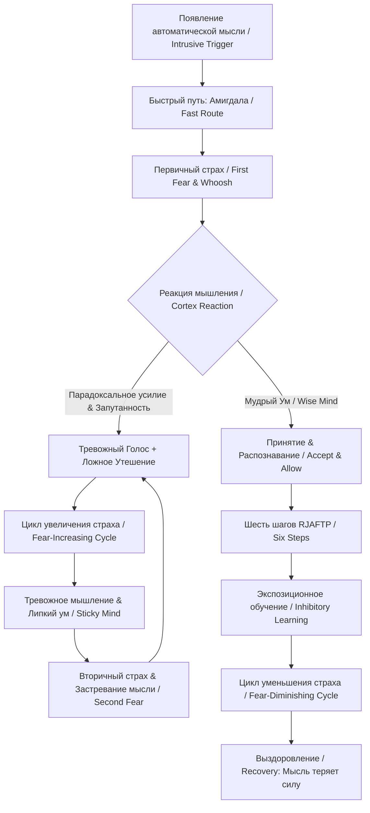

#### 0. Полный список глав книги (номер, название по-английски — перевод)

* **Глава 1**: Chapter 1: Recovering from Unwanted Intrusive Thoughts — Преодоление нежелательных навязчивых мыслей.
* **Глава 2**: Chapter 2: Varieties of Intrusive Thoughts — Разновидности навязчивых мыслей.
* **Глава 3**: Chapter 3: What Thoughts Mean: Myths and Facts — Что означают мысли: мифы и факты.
* **Глава 4**: Chapter 4: Unwanted Intrusive Thoughts Q and A — Вопросы и ответы о нежелательных навязчивых мыслях.
* **Глава 5**: Chapter 5: How the Brain Creates Unwanted Intrusive Thoughts — Как мозг создает нежелательные навязчивые мысли.
* **Глава 6**: Chapter 6: Why Nothing Has Worked — Почему ничего не работало.
* **Глава 7**: Chapter 7: How to Handle Thoughts When They Happen — Как справляться с мыслями, когда они возникают.
* **Глава 8**: Chapter 8: Getting Over Unwanted Thoughts for Good — Избавление от нежелательных мыслей навсегда.
* **Глава 9**: Chapter 9: What Does Recovery Mean? — Что означает выздоровление?.
* **Глава 10**: Chapter 10: When to Seek Professional Help — Когда обращаться за профессиональной помощью.

#### 1. О чём книга в 3 предложениях

Книга раскрывает природу нежелательных навязчивых мыслей (unwanted intrusive thoughts), объясняя, что они являются обычными автоматическими вспышками ума, которые застревают исключительно из-за попыток человека бороться с ними, подавлять их или доказывать их ложность. Авторы подробно описывают нейробиологический механизм тревоги, при котором миндалевидное тело (amygdala) запускает ложную тревогу (false alarm), а попытки внутренней речи успокоить себя лишь подпитывают вторичный страх. Главный вывод произведения заключается в том, что освобождение от навязчивостей достигается не сопротивлением или отвлечением, а радикальным изменением отношения через безоценочное принятие (acceptance) и намеренную экспозиционную практику (exposure).

#### 2. Главные идеи по главам

##### Глава 1: Recovering from Unwanted Intrusive Thoughts

* Почти у всех людей возникают случайные странные или пугающие мысли, однако застревают они только тогда, когда им придают повышенное значение и начинают с ними бороться.
* В уме человека действуют три внутренних голоса: Тревожный Голос (Worried Voice), Ложное Утешение (False Comfort) и Мудрый Ум (Wise Mind).
* Попытки намеренно прогнать мысль запускают «иронический процесс» (ironic process): чем сильнее сопротивление, тем настойчивее становится мысль.
* Навязчивые мысли кардинально отличаются от реальных импульсов (impulses) — навязчивости представляют собой проблему чрезмерного контроля (overcontrol) и сомнений, а не склонности к деструктивным действиям.
* Липкость ума (sticky mind) возрастает при физической усталости, стрессе, похмелье, гормональных колебаниях и в ситуациях с высокими ставками.

##### Глава 2: Varieties of Intrusive Thoughts

* Морально отвратительные мысли (morally repugnant thoughts) включают идеи о причинении вреда себе или близким, запретные сексуальные сюжеты и богохульные образы.
* Мысли о «больших вопросах» («Big Issue» thoughts) выражаются в бесконечных попытках разрешить неразрешимые экзистенциальные темы, сомнениях в реальности или смысле жизни.
* Нелепые мысли (nonsensical thoughts) охватывают страх сойти с ума, сомнения в отношениях (ROCD) и ментальную проверку (mental checking) воспоминаний.
* Навязчивости, связанные с сексуальной ориентацией и идентичностью, сопровождаются не любопытством или желанием, а ужасом и срочной потребностью в стопроцентной гарантии.
* Токсичная тревога (toxic worry) определяется не своей тематикой, а поведением мыслей — они циклично повторяются и не приводят к практическому решению.

##### Глава 3: What Thoughts Mean: Myths and Facts

* Существует 9 распространенных мифов о мыслях, развенчание которых снижает способность ума удерживать навязчивости.
* Мысли не находятся под нашим полным сознательным контролем и не являются отражением нашего характера или истинного глубинного «я» (inner self).
* Процесс мышления не влияет на вероятность событий в реальном мире: размышление о чем-то не делает событие более или менее вероятным (thought-action fusion).
* Появление диких или странных мыслей не означает наличие психического заболевания — они возникают у подавляющего большинства здоровых людей.
* Мысли повторяются не потому, что они важны или содержат скрытое послание, а потому, что им оказывают активное сопротивление.

##### Глава 4: Unwanted Intrusive Thoughts Q and A

* Мысли о причинении вреда детям или близким не свидетельствуют о скрытой агрессии или бессознательных желаниях; они застревают именно потому, что глубоко мерзки человеку.
* Ощущение «позыва» к действию — это иллюзия, создаваемая тревожным мышлением (anxious thinking), стирающим грань между мыслью и поступком.
* Первичный страх (first fear) возникает автоматически на нейронном уровне за долю секунды, поэтому его невозможно заблокировать волей.
* Популярные методы вроде остановки мыслей (thought-stopping) или отвлечения внимания не работают, так как они подкрепляют восприятие мысли как реальной угрозы.
* Содержание навязчивой мысли совершенно неважно; значение имеет только реакция человека на её появление.

##### Глава 5: How the Brain Creates Unwanted Intrusive Thoughts

* Миндалевидное тело (amygdala) отвечает за реакцию тревоги (alarm response) и предпочитает создавать множество ложных тревог (false alarms), чтобы не пропустить реальную опасность.
* Сигнал от органов чувств идет к амигдале двумя путями: быстрым прямым и более медленным через кору головного мозга (cortex), из-за чего реакция испуга опережает осмысление.
* Вторичный страх (second fear) подпитывается спором между Тревожным Голосом и Ложным Утешением в коре мозга, формируя цикл увеличения страха.
* Мудрый Ум запускает цикл уменьшения страха, признавая, что выброс адреналина — это всего лишь ложная тревога, не требующая действий.
* Тревожное мышление искажает восприятие: любые риски кажутся неразумными, а неопределенность становится непереносимой.

##### Глава 6: Why Nothing Has Worked

* Три главных фактора поддерживают проблему: липкий ум (sticky mind), парадоксальное усилие (paradoxical effort) и запутанность (entanglement).
* Парадоксальное усилие работает по принципу «чем больше сила сжатия, тем сильнее захват» (как в китайской ловушке для пальцев).
* Запутанность возникает тогда, когда человек вступает в диалог с мыслью, начинает её анализировать, оспорить или доказывать её нереальность.
* Поиск заверений (reassurance) у себя или окружающих дает лишь временное облегчение, формируя зависимость и провоцируя новый виток сомнений.
* Попытки решить проблему с помощью молитвенных ритуалов или здорового образа жизни не устраняют парадоксальное усилие и запутанность.

##### Глава 7: How to Handle Thoughts When They Happen

* Пошаговая инструкция снижения дистресса состоит из 6 шагов RJAFTP: Распознать (Recognize), Просто мысли (Just thoughts), Принять и позволить (Accept and allow), Плыть и чувствовать (Float and feel), Дать времени пройти (Let time pass), Продолжать (Proceed).
* Главными врагами принятия выступают чувство вины (guilt), сомнения (doubt) и чувство срочности (urgency).
* Настоящее принятие — это не пассивное смирение с мучениями, а активный отказ от борьбы с присутствием мысли в уме.
* Чувство срочности является ложным сигналом амигдалы; дистресс требует терпеливого ожидания, а не срочных спасательных действий.
* Использование терапевтических метафор (незваный гость на вечеринке, грязь на лобовом стекле, водопад) помогает удерживать позицию наблюдателя.

##### Глава 8: Getting Over Unwanted Thoughts for Good

* Для долгосрочного освобождения необходимо намеренно идти навстречу дискомфорту с помощью планируемой экспозиции (planned practice).
* Механизм тормозного обучения (inhibitory learning) создает в мозге новые нейтральные пути, которые со временем перекрывают старые реакции страха.
* Оптимальная практика опирается на принцип 5 A's: Установка принятия, Точная оценка, Активное позволение осознания, Избегание избеганий и Продвижение вперед.
* Намеренное воспроизведение пугающих мыслей в измененной или абсурдной форме (пение, стихи, карточки) лишает их пугающего контекста.
* Главная цель экспозиции заключается не в полном уничтожении тревоги, а в развитии способности переносить тревогу (tolerate anxiety).

##### Глава 9: What Does Recovery Mean?

* Выздоровление — это не отсутствие случайных мыслей, а такое изменение отношения к ним, при котором они перестают волновать и вызывать реакцию.
* Отказ от тревоги ожидания (anticipatory anxiety) и постоянного контроля запускает естественный цикл выздоровления.
* Временный возврат мыслей или обострение (setback) является нормальной частью процесса, вызванной усталостью или стрессом, а не знаком провала.
* К обострениям следует относиться как к возможности освежить навыки Мудрого Ума и закрепить пройденный материал.
* Когда мысль лишается эмоционального топлива и внимания, она естественным образом угасает и превращается в проходящий шум.

##### Глава 10: When to Seek Professional Help

* Квалифицированная помощь необходима, если мысли являются вызванными (invited thoughts) или представляют собой реальные намерения причинения вреда.
* Настоящие суицидальные состояния сопровождаются депрессией, безнадежностью и желанием умереть, в отличие от навязчивого страха случайно причинить себе вред.
* Реальные педофильные склонности связаны с поиском сексуального возбуждения и удовлетворения, а не с ужасом от незваного образа.
* Помощь специалиста требуется при полной потере перспективы, глубокой безнадежности или ажитации с хаотичными скачущими мыслями.
* Сомнения в том, является ли состояние навязчивостью или реальной угрозой, сами по себе выступают типичным проявлением тревожного ума.

#### 3. Схема связей между главными идеями (Mermaid graph TD)

#### 4. Пошаговый чек-лист практических действий

1. **Реагирование на навязчивую мысль в моменте (Алгоритм RJAFTP)**:
  * **R (Recognize / Распознать)**: Сделайте паузу и обозначьте: «Это навязчивая мысль (intrusive thought)».
  * **J (Just thoughts / Просто мысли)**: Напомните себе: «Это автоматические мысли, они безопасны и их лучше оставить в покое».
  * **A (Accept and allow / Принять и позволить)**: Активно разрешите мысли находиться в уме, не пытайтесь её вытолкнуть или оспорить.
  * **F (Float and feel / Плыть и чувствовать)**: Переключитесь с размышлений («что если») на текущие физические чувства («что есть»).
  * **T (Let time pass / Дать времени пройти)**: Не проверяйте, ушел ли дискомфорт; дайте времени идти своим чередом.
  * **P (Proceed / Продолжать)**: Вернитесь к тому делу, которым занимались до появления мысли.
2. **Отключение неэффективных защитных механизмов**:
  * Замолчите голос Ложного Утешения (False Comfort) и не вступайте в дискуссии с Тревожным Голосом.
  * Прекратите искать заверения (reassurance) у близких, врачей или на форумах в интернете.
  * Откажитесь от ритуалов отвлечения, счета, мысленных проверок памяти и попыток «заменить негативную мысль позитивной».
3. **Проведение планируемой экспозиционной практики (Planned Practice & 5 A's)**:
  * Соблюдайте 5 A's: Наглая установка принятия (Attitude of acceptance), Точная оценка (Accurate assessment), Активное позволение осознания (Active allowance), Избегание избеганий (Avoid avoidances), Продвижение вперед (Advance activities).
  * Намеренно вызывайте пугающую мысль в измененной форме: пойте её на мотив детской песни, записывайте на карточках, доводите до абсурда.
  * Оставайтесь в контакте с вызываемой тревогой до тех пор, пока мозг не выработает привыкание и новые тормозные пути.

#### 5. Типичные ошибки и как их избежать

1. **Попытки остановки мыслей (Thought-stopping)**: Применение резинок на запястье или попытки «приказать себе не думать» подкрепляют идею об опасности мысли и усиливают застревание. *Как избежать*: Разрешать мысли звучать на фоне, не оказывая ей никакого сопротивления.
2. **Поиск заверений (Reassurance seeking)**: Постоянные расспросы близких («ты уверен, что я хорошая мать?») дают лихорадочный покой на пару минут, но превращают человека в «зависимого от заверений». *Как избежать*: Ввести жесткий лимит заверений и при сомнениях проходить мысленный «тест с пистолетом у виска» (Gun Test) для связи с Мудрым Умом.
3. **Отвлечение внимания (Distraction)**: Попытки срочно переключиться на другое дело показывают амигдале, что мысль смертельно опасна. *Как избежать*: Продолжать текущее дело вместе с присутствующей тревогой.
4. **Избегание триггерных ситуаций (Avoidance)**: Отказ от поездок на балконы, прятание ножей или избегание общения подкармливает тревогу. *Как избежать*: Применять принцип «всегда идти навстречу» (always attempt approach) и возвращаться в пугающие контексты.
5. **Проверка состояния («Сработало ли принятие?»)**: Постоянный мониторинг («ушла ли мысль?») сам по себе является формой контроля и борьбы. *Как избежать*: Отказаться от проверок и спокойно позволить дискомфорту присутствовать столько, сколько нужно.

#### 6. 20 карточек «вопрос — ответ» для повторения

1. **Вопрос**: Что представляет собой нежелательная навязчивая мысль (unwanted intrusive thought)? **Ответ**: Это незваная автоматическая мысль, образ или импульс, выбивающийся из потока сознания и застревающий из-за борьбы с ним.
2. **Вопрос**: В чем главное отличие навязчивости от реального импульса (impulse)? **Ответ**: Навязчивость — это расстройство чрезмерного контроля (overcontrol) и сомнений, а импульс — проблема недостатка контроля (undercontrol).
3. **Вопрос**: Какова функция миндалевидного тела (amygdala) при возникновении навязчивостей? **Ответ**: Амигдала запускает первичный страх (first fear) и генерирует ложные тревоги (false alarms), реагируя на мысль как на реальную угрозу.
4. **Вопрос**: Что такое парадоксальное усилие (paradoxical effort)? **Ответ**: Явление, при котором чем больше усилий прилагается для подавления мысли, тем более интенсивной и частой она становится.
5. **Вопрос**: За что отвечают три внутренних голоса ума? **Ответ**: Тревожный Голос задает вопросы «что если?», Ложное Утешение пытается спорить и успокаивать, а Мудрый Ум спокойно наблюдает и принимает.
6. **Вопрос**: Почему страшные мысли о вреде близким не означают скрытой агрессии? **Ответ**: Навязчивые мысли чужды эго (ego-dystonic) и застревают именно потому, что они глубоко мерзки и противоположны ценностям человека.
7. **Вопрос**: Что такое слияние мысли и действия (thought-action fusion)? **Ответ**: Искажение тревожного мышления, при котором мысль о событии кажется морально эквивалентной самому поступку или повышающей его вероятность.
8. **Вопрос**: Почему человек не может предотвратить первичный страх (first fear)? **Ответ**: Сигнал поступает в амигдалу по прямому быстрому пути раньше, чем кора головного мозга (cortex) успевает осмыслить ситуацию.
9. **Вопрос**: Что означает понятие «липкий ум» (sticky mind)? **Ответ**: Обусловленная биологией и стрессом склонность мозга удерживать и повторять случайные вызывающие дискомфорт мысли.
10. **Вопрос**: Расшифруйте аббревиатуру алгоритма RJAFTP. **Ответ**: Recognize (Распознать), Just thoughts (Просто мысли), Accept and allow (Принять и позволить), Float and feel (Плыть и чувствовать), Let time pass (Дать времени пройти), Proceed (Продолжать).
11. **Вопрос**: Почему поиск заверений (reassurance) вредит выздоровлению? **Ответ**: Заверение подкрепляет запутанность (entanglement) и подтверждает для мозга, что мысль представляет реальную опасность.
12. **Вопрос**: В чем суть тормозного обучения (inhibitory learning) при экспозиции? **Ответ**: В создании новых нейронных путей, которые со временем подавляют и перекрывают старые автоматические реакции страха.
13. **Вопрос**: Чем токсичная тревога отличается от продуктивной? **Ответ**: Продуктивная тревога ведет к конкретному плану и завершается, а токсичная крутится в бесконечном цикле неразрешимых сомнений.
14. **Вопрос**: Для чего применяется мысленный «тест с пистолетом у виска» (Gun Test)? **Ответ**: Для мгновенного обращения к Мудрому Уму, когда нужно сделать один единственный правильный выбор без долгих сомнений.
15. **Вопрос**: Почему здоровый образ жизни не излечивает от навязчивых мыслей? **Ответ**: Он снижает общую липкость ума, но не влияет на механизмы парадоксального усилия и запутанности.
16. **Вопрос**: Как правильно реагировать на ощущение срочности (urgency)? **Ответ**: Обозначить его как дискомфорт, замедлить действия и дать времени пройти без совершения защитных ритуалов.
17. **Вопрос**: Какова главная цель экспозиционной практики? **Ответ**: Научиться переносить тревогу (tolerate anxiety) и неопределенность, а не мгновенно уничтожать дискомфорт.
18. **Вопрос**: Что представляет собой обострение (setback) в процессе выздоровления? **Ответ**: Временный возврат мыслей из-за стресса или усталости, выступающий отличным поводом попрактиковать Мудрый Ум.
19. **Вопрос**: В каких случаях навязчивые мысли требуют вмешательства психотерапевта? **Ответ**: При наличии реальных планов вреда, депрессивного желания умереть, истинных педофильных склонностей или полной потери связи с реальностью.
20. **Вопрос**: Что является главным критерием выздоровления от нежелательных навязчивых мыслей? **Ответ**: Полнейшее равнодушие к тому, появляются эти мысли в уме или нет.

#### 7. 5 практических заданий на применение

##### Задание 1: Анализ «ложных тревог» и амигдалы в поддержке пользователей интернет-магазина одежды

* **Контекст**: При задержке доставки на 1 день клиенты отправляют панические запросы («Мой заказ украли? Я останусь без одежды на мероприятие?»).
* **Практическая задача**: Проанализировать поведение клиентов через призму понятий «первичный страх» (first fear), «тревожное мышление» (anxious thinking) и «поиск заверений» (reassurance seeking). Разработать регламент ответов службы поддержки, который не подкармливает цикл токсичной тревоги клиента бесконечными запевками и ложными гарантиями, а дает точный статус и переводит общение в конструктивное русло.

##### Задание 2: Проработка «липкого ума» и парадоксального усилия в B2B-лидогенерации

* **Контекст**: Менеджер по продажам перед важным звонком крупному клиенту испытывает навязчивые мысли («Я все испорчу», «Меня поднимут на смех») и начинает бесконечно перепроверять презентацию (mental checking).
* **Практическая задача**: Составить кейс-анализ поведения менеджера с использованием концепций «Ложное Утешение» (False Comfort) и «Парадоксальное усилие» (paradoxical effort). Описать, как менеджеру применить алгоритм RJAFTP (Распознать, Просто мысли, Принять и позволить, Плыть, Дать времени пройти, Продолжить), чтобы совершить звонок без бесконечной отсрочки.

##### Задание 3: Обработка ложных срабатываний и циклических ошибок в сборщиках данных (Claude / Python)

* **Контекст**: Инженер разрабатывает скрипт сборщика данных (scraper). Скрипт периодически сталкивается со случайными таймаутами или блокировками парсинга. Разработчик впадает в гиперконтроль и зацикливание («Что если данные испорчены? Нужно обернуть каждую строчку в try-except и бесконечные проверки»).
* **Практическая задача**: Перенести концепцию «амигдала и ложные положительные сигналы» (false positives) на архитектуру мониторинга скрипта. Разработать алгоритм обработчика ошибок, который различает критические сбои (требующие остановки) и безвредные шумы/таймауты (не требующие панической перестройки всего парсера), предотвращая «парадоксальное зацикливание» процесса.

##### Задание 4: Борьба с «поиском идеальной уверенности» при смене технологического стека или закупке инвентаря

* **Контекст**: Руководитель интернет-магазина одежды полгода не может утвердить закупку новой коллекции или переход на новую CRM из-за мысли: «Что если мы прогорим и выберем не то?».
* **Практическая задача**: Используя разбор Мифа 5 (мысль не делает событие вероятным) и концепцию «непереносимости неопределенности» (intolerance of uncertainty), составить практическую матрицу принятия решений с ограниченным временем проверки, исключающую ловушку бесконечного поиска заверений (reassurance addiction).

##### Задание 5: Проектирование алгоритма авто-восстановления скриптов (Claude/Python) на основе модели «тормозного обучения» (Inhibitory Learning)

* **Контекст**: При сборке данных Claude-агент при сбое возвращает некорректный ответ и начинает генерировать повторные ошибочные запросы, «застревая» в цикле (аналог 'sticky mind').
* **Практическая задача**: Описать логику пайплайна Python, которая при появлении зацикливания не пытается спорить с ошибочным контекстом (не вступает в 'entanglement'), а применяет сброс состояния (pivoting/proceed), давая процессу продолжить работу по новому скриптовому пути (аналогично созданию новых путей в тормозном обучении).