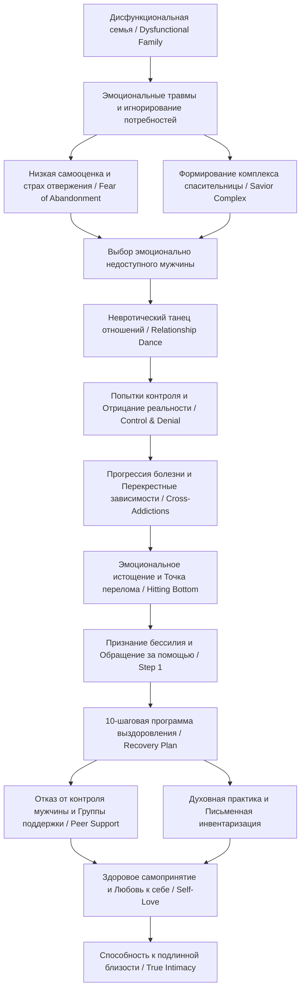

#### 0. Полный список глав книги (номер, название по-английски — перевод)

* **Preface** — Предисловие
* **Chapter 1: Loving the Man Who Doesn't Love Back** — Глава 1: Любовь к мужчине, который не отвечает взаимностью
* **Chapter 2: Good Sex in Bad Relationships** — Глава 2: Хороший секс в плохих отношениях
* **Chapter 3: If I Suffer for You, Will You Love Me?** — Глава 3: Если я страдаю ради тебя, полюбишь ли ты меня?
* **Chapter 4: The Need to Be Needed** — Глава 4: Потребность быть нужной
* **Chapter 5: Shall We Dance?** — Глава 5: Потанцуем?
* **Chapter 6: Men Who Choose Women Who Love Too Much** — Глава 6: Мужчины, которые выбирают женщин, любящих слишком сильно
* **Chapter 7: Beauty and the Beast** — Глава 7: Красавица и Чудовище
* **Chapter 8: When One Addiction Feeds Another** — Глава 8: Когда одна зависимость питает другую
* **Chapter 9: Dying for Love** — Глава 9: Умереть ради любви
* **Chapter 10: The Road to Recovery** — Глава 10: Путь к выздоровлению
* **Chapter 11: Recovery and Intimacy: Closing the Gap** — Глава 11: Выздоровление и близость: преодоление пропасти
* **Appendix 1: How to Start Your Own Support Group** — Приложение 1: Как создать собственную группу поддержки
* **Appendix 2: Sources of Help** — Приложение 2: Источники помощи

#### 1. О чём книга в 3 предложениях

Книга психотерапевта Робин Норвуд исследует феномен эмоциональной зависимости (relationship addiction), при которой женщина одержима партнером, терпит боль и ошибочно принимает страдание за глубинное чувство.Автор показывает, что корни деструктивного поведения уходят в опыт проживания в дисфункциональной семье (dysfunctional family), где детские эмоциональные травмы трансформируются в подсознательное стремление спасать и контролировать эмоционально недоступных мужчин.В качестве решения Норвуд предлагает пошаговую 10-пунктовую программу выздоровления (10-point recovery plan), помогающую перенаправить энергию с попыток изменить другого человека на развитие самоуважения, духовности и здоровой любви к себе.

#### 2. Главные идеи по главам

##### Предисловие (Preface)

* **Определение феномена:** Любить слишком сильно — значит измерять величину любви глубиной испытываемых страданий и постоянно оправдывать жестокое или равнодушное поведение партнера.
* **Концентрация на другом:** Одержимость мужчиной заставляет женщину полностью игнорировать собственное физическое и эмоциональное благополучие.
* **Роль отрицания:** Психологическая защита в виде отрицания (denial) часто мешает объективно оценить тяжесть ситуации и начать изменения.
* **Главная цель книги:** Помочь женщинам распознать деструктивные паттерны и дать конкретные инструменты для смены вектора с контроля партнера на собственное исцеление.

##### Глава 1: Loving the Man Who Doesn't Love Back (Любовь к мужчине, который не отвечает взаимностью)

* **Суть одержимости:** Любить слишком сильно — это не о том, чтобы любить слишком многих людей или любить чересчур искренне, а о психологической зависимости от мужчины (obsession).
* **Корни в детстве:** Паттерн формируется у женщин, выросших в дисфункциональных семьях, где их потребности игнорировались или подавлялись.
* **Искажение восприятия:** Женщины из таких семей не доверяют своим чувствам и испытывают подсознательное влечение к опасным и деструктивным ситуациям.
* **Страх отвержения:** Главным двигателем подобной «любви» является не забота, а глубокий страх быть брошенной (fear of abandonment).
* **Перегрузка ответственностью:** Зависимые женщины берут на себя более 50% ответственности за проблемы в отношениях и верят, что должны тяжелым трудом заслужить право на счастье.

##### Глава 2: Good Sex in Bad Relationships (Хороший секс в плохих отношениях)

* **Секс как инструмент:** В деструктивных союзах сексуальная связь часто используется для манипулирования партнером и попыток завоевать его любовь.
* **Разрядка напряжения:** Интенсивные сексуальные переживания в плохих отношениях часто являются результатом снятия накопившегося эмоционального и физического стресса после конфликтов.
* **Путаница эмоций:** Зависимые женщины склонны путать тревогу, страх, боль и физический дискомфорт с любовным и сексуальным возбуждением.
* **Эрос против Агапе:** Острая страсть (eros) расцветает в условиях препятствий и недостижимости партнера, в то время как настоящая глубокая любовь (agape) базируется на покое и безопасности.

##### Глава 3: If I Suffer for You, Will You Love Me? (Если я страдаю ради тебя, полюбишь ли ты меня?)

* **Иллюзия жертвенности:** Вера в то, что собственные страдания и жертвы способны изменить другого человека — это опасное самообманчивое заблуждение.
* **Комплекс спасительницы:** Женщина берет на себя роль «спасителя» (savior complex), надеясь, что гигантский объем её усилий докажет её ценность.
* **Страдание как мерило:** Чем больнее и хаотичнее отношения, тем ценнее кажется потенциальная «победа» над нечувствительностью мужчины.
* **Смещение ориентиров:** Тяжелый эмоциональный труд внутри союза ошибочно воспринимается как глубина любовного чувства.

##### Глава 4: The Need to Be Needed (Потребность быть нужной)

* **Детская роль:** Потребность «быть нужной» вырастает из детского опыта псевдо-взрослого (pseudo-adult), заботившегося о незрелых или больных родителях.
* **Компульсивная опека:** Заболевание заботой (compulsive caretaking) маскирует критически низкую самооценку и страх собственной ненужности.
* **Побег от себя:** Направляя всю энергию на решение чужих проблем, женщина избегает встречи со своей внутренней пустотой.
* **Маска контроля:** Навязчивая опека над партнером является скрытой формой попытки контролировать его жизнь и гарантировать безопасность.

##### Глава 5: Shall We Dance? (Потанцуем?)

* **Невротический танец:** Отношения рассматриваются как парный «танец» (dance), где шаги одного партнера идеально соответствуют деструктивным движениям другого.
* **Подсознательные сигналы:** Женщина с легкостью считывает невербальные сигналы (subliminal cues) эмоционально недоступных мужчин и выбирает именно их.
* **Иллюзия всемогущества:** Попытка добиться любви от холодного человека подкрепляет детскую иллюзию своего магического могущества (omnipotence).
* **Непривлекательность нормы:** Надежные и добрые мужчины кажутся зависимым женщинам скучными (boring) из-за отсутствия привычной эмоциональной встряски.

##### Глава 6: Men Who Choose Women Who Love Too Much (Мужчины, которые выбирают женщин, любящих слишком сильно)

* **Потребность в опекуне:** Проблемные мужчины подсознательно ищут «женщину в белом», готовую взяться за решение их жизненных невзгод.
* **Скрытый запрос:** Главный неозвученный вопрос такого мужчины при знакомстве: «Будешь ли ты заботиться обо мне и решать мои проблемы?».
* **Выгода инфантилизма:** Незрелые или зависимые мужчины выигрывают от гиперзаботы, которая освобождает их от взрослой ответственности.
* **Реакция на изменения:** Когда женщина перестает контролировать партнера, мужчина либо вынужден взрослеть, либо отправляется на поиски новой «спасительницы».

##### Глава 7: Beauty and the Beast (Красавица и Чудовище)

* **Культурный миф:** Сказка о «Красавице и Чудовище» культурно романтизирует идею, что слепая женская любовь способна превратить «монстра» в принца.
* **Искажение смысла:** Общественные стереотипы трактуют этот сюжет как обязанность женщины терпеть и переделывать мужчину.
* **Истинный урок сказки:** Настоящий духовный смысл сказки заключается в принятии (acceptance) — способности видеть реальность без стремления её изменить.
* **Сила принятия:** Только когда Красавица искренне приняла Чудовище таким, каков он есть, произошло его естественное преображение.

##### Глава 8: When One Addiction Feeds Another (Когда одна зависимость питает другую)

* **Перекрестные зависимости:** Зависимость от отношений (relationship addiction) часто сочетается с алкоголизмом, наркоманией или расстройствами пищевого поведения (bulimia, anorexia, sugar addiction).
* **Предрасположенность:** Дочери зависимых родителей имеют биохимическую и эмоциональную склонность к аддиктивному поведению.
* **Еда как анестезия:** Компульсивное переедание, жесткие диеты или чистки используются как способы заглушить внутреннюю боль, гнев и страх.
* **Условие выздоровления:** Для успешной терапии необходимо полностью отказаться от использования веществ или компульсивных действий в качестве анальгетика для чувств.

##### Глава 9: Dying for Love (Умереть ради любви)

* **Концепция болезни:** Зависимость от отношений — это прогрессирующее заболевание (disease process), имеющее динамику ухудшения, аналогичную алкоголизму.
* **График прогрессии:** График развития болезни (адаптированный график Глатта) демонстрирует путь от попыток контроля и отрицания к истощению, изоляции и психосоматике.
* **Опасность для жизни:** Без лечения эта патология ведет к тяжелым депрессиям, утрате контакта с реальностью и даже к суицидальным исходам .
* **Точка перелома:** Признание своего полного бессилия перед зависимостью становится единственной отправной точкой для спасения.

##### Глава 10: The Road to Recovery (Путь к выздоровлению)

* **Системность процесса:** Выздоровление не происходит спонтанно — оно требует четкого выполнения пошаговой программы из 10 пунктов.
* **Смена приоритетов:** Главное условие — сместить приоритет с исправления партнера на собственное исцеление и поставить себя на первое место.
* **Опора на равных:** Обязательным элементом является посещение групп поддержки (support group, Al-Anon) и ежедневная духовная практика.
* **Отказ от контроля:** Полный отказ от манипуляций и управления жизнью партнера высвобождает ресурсы для работы над собственными проблемами.

##### Глава 11: Recovery and Intimacy: Closing the Gap (Выздоровление и близость: преодоление пропасти)

* **Портрет исцеленной женщины:** Выздоровевшая женщина обладает 10 признаками, включая полное самопринятие, уважение своих границ и умение ценить душевный покой.
* **Страх интимности:** При переходе к здоровым отношениям возникает страх перед подлинной интимностью (true intimacy), так как исчезает привычная защитная «броня».
* **Трансформация сексуальности:** Секс перестает быть инструментом манипуляции и превращается в способ глубокого доверительного сближения.
* **Пожизненный процесс:** Выздоровление — это постоянная практика взращивания любви к себе и осознанного выбора собственного благополучия.

#### 3. Схема связей между главными идеями (Mermaid)

#### 4. Пошаговый чек-лист практических действий

Чек-лист основан на 10 шагах выздоровления из Глава 10:
* [ ] **Шаг 1. Обратиться за помощью (Go for help)**
Сделать первый конкретный шаг: записаться к психотерапевту, специализирующемуся на зависимостях, или прийти на встречу группы поддержки. Не использовать это как способ шантажа или давления на партнера.
* [ ] **Шаг 2. Сделать собственное выздоровление приоритетом №1 (Make recovery the first priority)**
Ставить посещение групп и терапевтических сессий выше любых приглашений, разговоров с партнером или попыток получить чьё-либо одобрение.
* [ ] **Шаг 3. Найти группу поддержки равных (Find a support group of peers)**
Регулярно посещать встречи (Al-Anon, «Взрослые дети алкоголиков» и др.), чтобы преодолеть изоляцию, учиться на чужом опыте и получать принятие.
* [ ] **Шаг 4. Развивать духовную сферу через ежедневную практику (Develop spirituality daily)**
Выделять минимум 30–60 минут в день на прогулки, медитацию, молитву или созерцание природы, передавая неуправляемые ситуации Высшей Силе.
* [ ] **Шаг 5. Прекратить управлять и контролировать других (Stop managing and controlling others)**
Полностью отказаться от советов, слежки, выручки из беды, опеки и любых попыток изменить поведение или настроение мужчины.
* [ ] **Шаг 6. Научиться не попадаться на крючок манипулятивных игр (Learn not to get "hooked")**
Распознавать провокации на скандалы, отказываться от участия в деструктивных диалогах и выходить из психологических игр.
* [ ] **Шаг 7. Смело взглянуть на собственные проблемы и недостатки (Courageously face own shortcomings)**
Составить подробную письменную инвентаризацию всей своей жизни, детских травм и прошлых отношений с мужчинами; обсудить её с доверенным лицом.
* [ ] **Шаг 8. Развивать в себе то, что требует роста (Cultivate yourself)**
Возобновить собственные хобби, учебу, карьеру и дружеские связи, перенаправив энергию на личное развитие.
* [ ] **Шаг 9. Стать «эгоисткой» в здоровом смысле (Become "selfish")**
Ставить свои физические и эмоциональные потребности на первое место; отказаться от адаптации к неудобным и разрушительным условиям.
* [ ] **Шаг 10. Делиться с другими тем, что узнала и пережила (Share with others)**
Передавать свой опыт новичкам в группе поддержки только после прохождения собственного пути выздоровления, избегая дачи прямых советов.

#### 5. Типичные ошибки и как их избежать

1. **Ошибка:** Попытка изменить или перевоспитать партнера своей любовью и терпением.
*Как избежать:* Осознать свое полное бессилие перед чужим поведением (Шаг 5) и направить энергию исключительно на собственную жизнь.
2. **Ошибка:** Поспешный разрыв отношений в надежде, что уход сам по себе решит проблему.
*Как избежать:* Сосредоточиться на выполнении 10 шагов выздоровления; по мере роста самоуважения решение о сохранении или прекращении союза сформируется естественно.
3. **Ошибка:** Попытка помогать другим (Шаг 10) на начальных этапах терапии.
*Как избежать:* Помнить, что гиперопека — это симптом болезни. Помощь другим допустима строго после укрепления личного выздоровления.
4. **Ошибка:** Замена зависимости от отношений другими компульсивными привычками (переедание, алкоголь, сигареты, шопоголизм).
*Как избежать:* Полностью исключить использование веществ и компульсивных действий для анестезии чувств; проживать эмоциональную боль при поддержке группы.
5. **Ошибка:** Отвержение надежных, заботливых и спокойных мужчин как «скучных».
*Как избежать:* Осознать, что отсутствие эмоциональной тряски — это не отсутствие любви, а здоровый покой, необходимый для построения подлинной близости (agape).

#### 6. 20 карточек «вопрос — ответ» для повторения

1. **Вопрос:** Что в концепции Робин Норвуд означает «любить слишком сильно» (loving too much)?
**Ответ:** Это не глубина чувств, а эмоциональная зависимость от мужчины, при которой страдание ошибочно принимается за меру любви.
2. **Вопрос:** Каковы основные черты семьи происхождения женщины, любящей слишком сильно?
**Ответ:** Дисфункциональная семья (dysfunctional family) с наличием алкоголизма, эмоциональной холодности, жестокости или смешения ролей.
3. **Вопрос:** В чем заключается психологический механизм отрицания (denial)?
**Ответ:** Это бессознательная защита, заставляющая женщину игнорировать или оправдывать разрушительное поведение партнера.
4. **Вопрос:** Что такое страх отвержения / брошенности (fear of abandonment)?
**Ответ:** Глубинный детский страх остаться в одиночестве, заставляющий женщину терпеть любые унижения ради сохранения связи.
5. **Вопрос:** Какова роль низкой самооценки (low self-esteem) у зависимых женщин?
**Ответ:** Женщина верит, что не заслуживает счастья просто так и должна тяжелым трудом заслужить право на любовь.
6. **Вопрос:** Почему надежные и добрые мужчины кажутся зависимым женщинам скучными (boring)?
**Ответ:** В них отсутствует привычный детский элемент борьбы, опасности, непредсказуемости и эмоциональной драмы.
7. **Вопрос:** Как зависимые женщины путают физиологическое возбуждение и любовь?
**Ответ:** Они принимают тревогу, страх, панику и «узел в животе» за романтическую страсть.
8. **Вопрос:** В чем разница между эросом (eros) и агапе (agape)?
**Ответ:** Эрос — страстная любовь, требующая страданий и препятствий; агапе — зрелая любовь, приносящая покой, безопасность и взаимную поддержку.
9. **Вопрос:** Что такое «комплекс спасительницы» (savior complex)?
**Ответ:** Подсознательное убеждение в своем всемогуществе, приводящее к стремлению исправить или «спасти» проблемного мужчины.
10. **Вопрос:** В чем суть метафоры «невротического танца» (dance)?
**Ответ:** Это взаимодополняющая система деструктивных ролей, где гиперопека женщины подпитывает безответственность мужчины.
11. **Вопрос:** Почему истинный смысл сказки «Красавица и Чудовище» — это принятие (acceptance)?
**Ответ:** Красавица приняла Чудовище таким, каков он есть, не пытаясь его переделать или проконтролировать.
12. **Вопрос:** Как связаны зависимость от отношений и расстройства пищевого поведения?
**Ответ:** Пища (сахар, переедание, голодание) используется как анестетик для глушения негативных эмоций и попытка вернуть контроль.
13. **Вопрос:** Что такое «перекрестная зависимость» (cross-addiction)?
**Ответ:** Переключение с зависимости от отношений на химические или компульсивные зависимости при отсутствии терапии.
14. **Вопрос:** Какой первый шаг (Step 1) в программе выздоровления Робин Норвуд?
**Ответ:** Обратиться за помощью (Go for help) к специалистам или группам поддержки, признав свое бессилие.
15. **Вопрос:** Какова роль групп поддержки равных (support groups, Al-Anon)?
**Ответ:** Они снимают изоляцию, дают безопасное принятие, позволяют обучаться на чужом опыте и взращивать самопринятие.
16. **Вопрос:** Что означает стать «эгоисткой» в контексте Шага 9 (Become "selfish")?
**Ответ:** Поставить свое эмоциональное и физическое благополучие, покой и интересы на первое место.
17. **Вопрос:** Почему помощь другим (Step 10) должна быть строго последней?
**Ответ:** Фокус на других — это симптом болезни; сначала необходимо накопить собственный ресурс выздоровления.
18. **Вопрос:** В чем заключается страх подлинной интимности (true intimacy) при выздоровлении?
**Ответ:** При отказе от манипуляций близость требует снятия защитной брони и проявления уязвимости перед другим человеком.
19. **Вопрос:** Какова главная цель письменной инвентаризации в Шаге 7?
**Ответ:** Честно проанализировать свои прошлые травмы, паттерны и ошибки, чтобы взять ответственность за свою жизнь.
20. **Вопрос:** Каковы ключевые признаки женщины, преодолевшей зависимость от отношений?
**Ответ:** Полное самопринятие, уважение своих границ, ценность душевного покоя и способность выбирать взаимную любовь.

#### 7. Практические задания, тесты и опросники из книги

*Примечание касательно области применения:* Книга Робин Норвуд посвящена межличностной психологии, преодолению созависимости и исцелению от эмоциональной зависимости в личных отношениях. В тексте книги отсутствуют материалы по коммерческим нишам (интернет-магазины одежды, B2B-лидогенерация, Python-парсеры). Чтобы соблюсти точность источников и сохранить запрашиваемые опросники, ниже представлены **5 оригинальных практических тестов и упражнений для самоанализа**, содержащихся непосредственно в книге.

##### Задание 1. Опросник самодиагностики: 15 характеристик женщины, любящей слишком сильно

*Сохраните этот опросник из Главы 1 и отметьте пункты, с которыми вы согласны**:*
1. Вы родом из дисфункциональной семьи, где ваши эмоциональные потребности не удовлетворялись.
2. Вы пытаетесь компенсировать нехватку ласки в детстве, становясь гиперопекающей («спасительницей»).
3. Вы реагируете на эмоционально недоступных мужчин и пытаетесь изменить их своей любовью.
4. Панически боясь отвержения, вы готовы сделать всё, чтобы удерживать отношения от развала.
5. Никакие затраты времени, сил и денег не кажутся чрезмерными, если они помогают «помочь» мужчине.
6. Привыкнув к нехватке любви, вы готовы ждать, надеяться и стараться ещё сильнее.
7. Вы готовы брать на себя более 50% ответственности, вины и бремени в отношениях.
8. Ваша самооценка критически низка, вы верите, что должны заслужить право на счастье.
9. Вы испытываете потребность контролировать мужчину, маскируя это под «помощь».
10. В отношениях вы больше сфокусированы на мечте о том, как всё могло бы быть, чем на реальности.
11. Вы зависимы от мужчин и эмоциональной боли.
12. Вы предрасположены к биохимическим и эмоциональным зависимостям (алкоголь, еда, сахаросодержащие продукты).
13. Привлекаясь к людям с проблемами, вы избегаете ответственности перед самой собой.
14. Вы склонны к депрессиям и пытаетесь предотвратить их с помощью драмы в нестабильных отношениях.
15. Вас не привлекают добрые, надежные и спокойные мужчины — они кажутся вам скучными.

##### Задание 2. Аналитический опросник сексуальной мотивации

*Задание из Главы 2 — честно ответьте на вопросы о ваших сексуальных установках**:*
* Задаете ли вы себе вопрос «Как сильно он меня любит или нуждается во мне?» вместо «Насколько он дорог мне?».
* Мотивированы ли ваши сексуальные контакты стремлением заставить его любить вас сильнее?.
* Используете ли вы секс как инструмент манипуляции или контроля?.
* Путаете ли вы тревогу, страх, боль и напряжение с любовным и сексуальным возбуждением?.
* Чувствуете ли вы скуку и дискомфорт с мужчиной, если в отношениях отсутствует элемент борьбы?.

##### Задание 3. Письменная инвентаризация личной истории (Упражнение к Шагу 7)

*Практическое упражнение из Главы 10**:*
1. **История родителей:** Подробно опишите в тетради свои самые ранние детские воспоминания, паттерны поведения родителей и то, как выражалась любовь или ее нехватка.
2. **История отношений:** Выпишите хронологический список всех ваших романтических связей, начиная с самых первых. Зафиксируйте: чем вас привлек человек, как развивался контроль, какие боли вы пережили и как вели себя.
3. **Анализ паттернов:** Найдите повторяющиеся темы и роли, которые вы играли в этих союзах.
4. **Прочтение:** Зачитайте написанное доверенному лицу (терапевту, спонсору в группе) без попыток оправдать себя или других.

##### Задание 4. Чек-лист оценки «здоровой эгоистичности» (Оценка к Шагу 9)

*Оцените уровень уважения к собственным границам из Главы 10**:*
* [ ] Поставили ли вы свое благополучие, работу, отдых и планы на первое место перед нуждами других взрослых людей?
* [ ] Требуете ли вы, чтобы ситуация и отношения были комфортными для вас, вместо того чтобы адаптироваться к неудобным условия?
* [ ] Считаете ли вы свои желания и потребности принципиально важными?
* [ ] Выделяете ли вы ежедневно время исключительно на уход за собой?

##### Задание 5. Итоговый тест результатов выздоровления (10 признаков исцеленной женщины)

*Диагностический чек-лист из Главы 11 для проверки прогресса выздоровления**:*
1. Я полностью принимаю себя, даже если хочу в чём-то измениться.
2. Я принимаю других людьми такими, какие они есть, без попыток их переделать.
3. Я нахожусь в контакте со своими чувствами во всех сферах жизни.
4. Я ценю свою личность, внешность, убеждения, тело и достижения.
5. Моя самооценка достаточно высока, чтобы наслаждаться общением без потребности «быть нужной».
6. Я способна быть открытой с подходящими людьми, защищая себя от эксплуатации.
7. Я задаю вопрос: «Хороши ли эти отношения для меня? Способствуют ли они моему росту?».
8. Я способна отпускать деструктивные отношения без глубокой депрессии.
9. Я ставлю свой душевный покой превыше всего.
10. Я знаю, что здоровые отношения возможны только при наличии общих ценностей, интересов и способности к взаимной близости.
