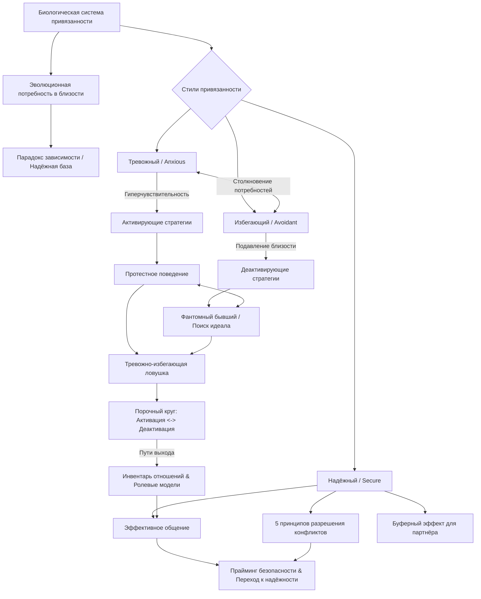

<!-- NotebookLM (Freya), Attached, учебный конспект; 23.10.2026; не сверено -->
Вот подробный учебный конспект книги **Амира Левина и Рашель Хеллер «Наука о взрослых привязанностях»** (*«Attached: The New Science of Adult Attachment and How It Can Help You Find – and Keep – Love»*).

#### 0. Полный список глав книги (номер, название по-английски — перевод)

* **Введение (Introduction)**: The New Science of Adult Attachment — *Новая наука о взрослых привязанностях*
  * **Глава 1 (Chapter 1)**: Decoding Relationship Behavior — *Декодирование поведения в отношениях*
  * **Глава 2 (Chapter 2)**: Dependency Is Not a Bad Word — *Зависимость — это не плохое слово*
* **Часть 1 (Part One)**: Your Relationship Toolkit — Deciphering Attachment Styles — *Ваш инструментарий для отношений: расшифровка стилей привязанности*
  * **Глава 3 (Chapter 3)**: Step One: What Is My Attachment Style? — *Шаг первый: Какой у меня стиль привязанности?*
  * **Глава 4 (Chapter 4)**: Step Two: Cracking the Code — What Is My Partner's Style? — *Шаг второй: Взлом кода — Какой стиль у моего партнёра?*
* **Часть 2 (Part Two)**: The Three Attachment Styles in Everyday Life — *Три стиля привязанности в повседневной жизни*
  * **Глава 5 (Chapter 5)**: Living with a Sixth Sense for Danger: The Anxious Attachment Style — *Жизнь с шестым чувством опасности: Тревожный стиль привязанности*
  * **Глава 6 (Chapter 6)**: Keeping Love at Arm's Length: The Avoidant Attachment Style — *Удержание любви на расстоянии вытянутой руки: Избегающий стиль привязанности*
  * **Глава 7 (Chapter 7)**: Getting Comfortably Close: The Secure Attachment Style — *Комфортное сближение: Надёжный стиль привязанности*
* **Часть 3 (Part Three)**: When Attachment Styles Clash — *Когда стили привязанности сталкиваются*
  * **Глава 8 (Chapter 8)**: The Anxious-Avoidant Trap — *Тревожно-избегающая ловушка*
  * **Глава 9 (Chapter 9)**: Escaping the Anxious-Avoidant Trap: How the Anxious-Avoidant Couple Can Find Greater Security — *Побег из тревожно-избегающей ловушки: Как тревожно-избегающая пара может обрести большую безопасность*
  * **Глава 10 (Chapter 10)**: When Abnormal Becomes the Norm: An Attachment Guide to Breaking Up — *Когда ненормальное становится нормой: Руководство по расставанию с точки зрения теории привязанности*
* **Часть 4 (Part Four)**: The Secure Way — Sharpening Your Relationship Skills — *Надёжный путь: Совершенствование ваших навыков отношений*
  * **Глава 11 (Chapter 11)**: Effective Communication: Getting the Message Across — *Эффективное общение: Донесение своего послания*
  * **Глава 12 (Chapter 12)**: Working Things Out: Five Secure Principles for Dealing with Conflict — *Разрешение противоречий: Пять принципов надёжного стиля для работы с конфликтами*

#### 1. О чём книга в 3 предложениях

1. Книга раскрывает биологическую и эволюционную природу взрослой привязанности (adult attachment), доказывая, что потребность в эмоциональной близости и надежной опоре заложена в генах человека от рождения до смерти.
2. Авторы выделяют три основных стиля привязанности — надёжный (*secure*), тревожный (*anxious*) и избегающий (*avoidant*) — и объясняют, как их взаимодействие определяет выбор партнёра, динамику конфликтов и психологическое благополучие.
3. С помощью практического метода «Прикладной взрослой привязанности» (*Applied Adult Attachment*) книга дает инструменты — от прямого эффективного общения до распознавания «дымящихся пистолетов» (*smoking guns*) и перестройки внутренних рабочих моделей — для выхода из деструктивных союзов и построения гармоничных отношений.

#### 2. Главные идеи по главам

##### Введение (Introduction: The New Science of Adult Attachment)

* Взрослые проявляют паттерны привязанности к романтическим партнёрам, аналогичные паттернам привязанности детей к родителям.
* Выделяются три основных стиля привязанности: надёжный (*secure*, ~50%), тревожный (*anxious*, ~20%) и избегающий (*avoidant*, ~25%), а также редкая дезорганизованная категория (~3–5%).
* Потребность в близком человеке запрограммирована эволюцией для выживания: мозг содержит биологический механизм — систему привязанности (*attachment system*).
* Гетерогенность стилей привязанности обусловлена эволюционной необходимостью выживания популяции в различных экологических условиях (опасных vs спокойных).

##### Глава 1: Декодирование поведения в отношениях (Chapter 1)

* Теория привязанности даёт доказательный научный инструмент для предсказания и объяснения поведения людей в романтических ситуациях.
* Стили привязанности формируются под влиянием воспитания, генов и жизненного опыта.
* Паттерны привязанности устойчивы, но пластичны: примерно 1 из 4 человек меняет свой стиль в течение 4 лет под влиянием отношений.
* Метод прикладной взрослой привязанности (*Applied Adult Attachment*) предлагает практические руководства для всех этапов романтической жизни — от поиска партнёра до расставания.

##### Глава 2: Зависимость — это не плохое слово (Chapter 2)

* «Парадокс зависимости» (*dependency paradox*): чем более эффективно партнеры могут опираться друг на друга, тем более независимыми и смелыми они становятся во внешнем мире.
* Культурный миф о «созависимости» и полной эмоциональной автономности противоречит биологии: призанный партнёр становится частью единого физиологического блока, регулирующего давление, пульс и гормональный фон.
* Наличие «надёжной базы» (*secure base*), доказанное в тесте «Странная ситуация» (*Strange Situation Test*), является необходимым условием для развития и реализации как детей, так и взрослых.
* Связь с эмоционально недоступным партнёром вызывает хроническую тревогу и приводит к физическим недомоганиям.

##### Глава 3: Шаг первый: Какой у меня стиль привязанности? (Chapter 3)

* Оценка стиля привязанности строится на модифицированной версии опросника ECR (*Experience in Close Relationships*).
* Стили привязанности определяются двумя измерениями: уровнем тревоги за доступность партнёра (*relationship anxiety*) и уровнем избегания близости (*intimacy avoidance*).
* Четыре квадранта: надёжный (низкая тревога, низкое избегание), тревожный (высокая тревога, низкое избегание), избегающий (низкая тревога, высокое избегание) и тревожно-избегающий (высокая тревога, высокое избегание) [76–78].
* Понимание своего стиля помогает осознать истинные потребности и прекратить самообвинения.

##### Глава 4: Шаг второй: Взлом кода — Какой стиль у моего партнёра? (Chapter 4)

* Свойства привязанности проявляются в ежедневных действиях, словах и отношении к интимности.
* Пять «Золотых правил» для расшифровки стиля: 1) Стремится ли к близости; 2) Насколько обеспокоен отношениями и чувствителен к отвержению; 3) Опора на паттерн, а не на одиночный симптом; 4) Реакция на прямое общение; 5) Оценка того, о чём человек умалчивает [98–105].
* Прямое выражение своих потребностей служит наилучшим тестом на способность партнёра давать эмоциональное тепло.

##### Глава 5: Жизнь с шестым чувством опасности: Тревожный стиль привязанности (Chapter 5)

* Тревожный стиль обладает гиперчувствительной системой привязанности, считывающей малейшие сигналы отдаления, но склонной к спешным ошибочным выводам.
* Активирующие стратегии (*activating strategies*) — мысли и чувства, вынуждающие искатель близости (навязчивые мысли, идеализация, страх остаться одному).
* Протестное поведение (*protest behavior*) — неконструктивные действия для привлечения внимания (звонки, молчание, подсчёт очков, манипуляции ревностью, угрозы ухода) [139–141].
* Ошибочное приравнивание взбудораженной системы привязанности к романтической страсти приводит к притяжению к избегающим партнёрам.
* «Философия изобилия» (*abundance philosophy*) и выбор надёжных партнёров помогают тревожным людям выйти из «зоны опасности».

##### Глава 6: Удержание любви на расстоянии вытянутой руки: Избегающий стиль привязанности (Chapter 6)

* Избегающий стиль ориентирован на идеал «одинокого странника» (*lonesome traveler*) и ошибочно путает самодостаточность с independence.
* Подсознательная система привязанности у избегающих людей активна, но подавляется с помощью деактивирующих стратегий (*deactivating strategies*).
* Деактивирующие стратегии включают фокус на мелких изъянах партнёра, тоску по «фантомному бывшему» (*phantom ex*), поиск идеального соулмейта (*"the one"*) и избегание физического контакта.
* Восемь практических шагов (включая дневник благодарности и стратегию отвлечения) позволяют избегающим людям постепенно открыться близости [215–219].

##### Глава 7: Комфортное сближение: Надёжный стиль привязанности (Chapter 7)

* «Буферный эффект» (*buffering effect*): надёжный партнёр нейтрализует тревогу и избегание у инсекурного партнёра, повышая общую удовлетворенность союзом [221–223].
* Надёжные люди эмоционально гибки, не играют в игры, легко прощают, ведут прямое общение и берут ответственность за благополучие партнёра.
* Предоставление надёжной базы включает три действия: быть доступным (*be available*), не вмешиваться (*don't interfere*) и поощрять (*encourage*).
* Надёжные люди мгновенно считывают «дымящиеся пистолеты» (*smoking guns*) недоступности и выходят из неперспективных связей.

##### Глава 8: Тревожно-избегающая ловушка (Chapter 8)

* Столкновение противоположных потребностей создает порочный круг: попытка тревожного сблизиться активирует деактивацию у избегающего.
* Признаки ловушки: эмоциональные качели (*roller-coaster effect*), устойчивая нестабильность (*stable instability*), ссоры из-за бытовых мелочей, маскирующие борьбу за дистанцию, и превращение близкого человека в «врага» [264–266].
* Конфликты остаются неразрешёнными, так как само их разрешение создает пугающую избегающего близость.

##### Глава 9: Побег из тревожно-избегающей ловушки (Chapter 9)

* Прайминг безопасности (*security priming*) и использование «интегрированной надёжной ролевой модели» позволяют сдвинуть стиль в сторону надёжности.
* Заполнение «Инвентаря отношений» (*relationship inventory*) помогает осознать неконструктивные схемы и переписать сценарии реакций [277–279].
* Коррекция поведения (короткие текстовые сообщения для снижения тревоги или создание личных буферных зон) способна выравнивать союз.
* Односторонний компромисс и снижение ожиданий позволяют снизить градус конфликта, если партнёр отказывается меняться [311–313].

##### Глава 10: Когда ненормальное становится нормой: Руководство по расставанию (Chapter 10)

* В крайних формах ловушки партнёр во «внутреннем круге» (*inner circle*) начинает восприниматься как «враг», в отличие от «королевского обращения» в надёжных союзах.
* Разрыв связи активирует зоны мозга, ответственные за физическую боль, вызывая «эффект рикошета» (*rebound effect*) и стремление вернуться к источнику боли.
* Девять стратегий выживания при расставании включают деактивацию через списки причин ухода, поддержку близких и отказ от чувства вины за слабость [352–356].

##### Глава 11: Эффективное общение: Донесение своего послания (Chapter 11)

* Эффективное общение (*effective communication*) — прямое, искреннее и необвиняющее выражение своих потребностей.
* Две цели: отбор подходящего партнёра на ранних этапах и обеспечение удовлетворения потребностей в существующих отношениях.
* Пять принципов: 1) Искренность; 2) Фокус на потребностях (глаголы «нуждаюсь», «чувствую», «хочу»); 3) Конкретность; 4) Отсутствие обвинений; 5) Уверенность без извинений [387–390].

##### Глава 12: Разрешение противоречий: Пять принципов надёжного стиля для работы с конфликтами (Chapter 12)

* Обыденные конфликты (*bread-and-butter conflicts*) естественны и полезны, если они не завязаны на борьбу за дистанцию.
* Пять принципов надёжного разрешения конфликтов: 1) Проявление заботы о благополучии партнёра; 2) Фокус на текущей проблеме; 3) Отказ от обобщений; 4) Готовность к вовлечённости; 5) Эффективное выражение потребностей.
* Обнимашки и телесный контакт вызывают выброс окситоцина («гормона обнимашек»), снижая уровень агрессии и предупреждая ссоры.

#### 3. Схема связей между главными идеями (Mermaid)



#### 4. Пошаговый чек-лист практических действий

1. **Диагностика собственного стиля привязанности**:
  * [ ] Пройти опросник ECR (шкалы тревоги и избегания).
  * [ ] Принять свои эмоциональные потребности как законные и биологически обусловленные.
2. **Фильтрация потенциальных кандидатов**:
  * [ ] Применить 5 Золотых правил для распознавания стиля партнёра [98–105].
  * [ ] Отслеживать «дымящиеся пистолеты» (*smoking guns*) — двусмысленные сигналы и обесценивание.
3. **Внедрение эффективного общения (Effective Communication)**:
  * [ ] Формулировать запросы через глаголы «я чувствую», «мне нужно», «я хочу».
  * [ ] Говорить конкретно о проблеме, не обвиняя и не извиняясь за свои потребности [388–390].
  * [ ] Оценивать реакцию партнёра: готовность к диалогу или уклонение/агрессия.
4. **Применение «Философии изобилия» (для тревожного стиля)**:
  * [ ] Поддерживать знакомства с несколькими кандидатами на ранних этапах, снижая гиперактивацию системы.
  * [ ] Не путать тревогу и эмоциональные качели с истинной любовью.
5. **Нейтрализация деактивации (для избегающего стиля)**:
  * [ ] Распознавать деактивирующие стратегии (поиск изъянов, мысль «я не готов»).
  * [ ] Вести ежедневный список благодарности партнёру.
  * [ ] Использовать совместную деятельность как отвлекающий фактор для сближения.
6. **Проработка «Инвентаря отношений» (Relationship Inventory)**:
  * [ ] Проанализировать прошлые и текущие связи, выписав триггеры и неконструктивные реакции.
  * [ ] Выбрать надёжную ролевую модель (*ADP*) и переписать сценарии на надёжные принципы.
7. **Конструктивное разрешение конфликтов**:
  * [ ] Проявлять базовую заботу о благополучии партнёра во время спора.
  * [ ] Фокусироваться только на текущей проблеме, избегая обобщений.
  * [ ] Регулярно использовать телесный контакт для выброса окситоцина.

#### 5. Типичные ошибки и как их избежать

1. **Приравнивание активированной системы привязанности к любви**
  * *Ошибка:* Тревожный человек принимает тревогу, навязчивые мысли и редкие вспышки радости за настоящую страсть.
  * *Как избежать:* Осознать, что биологическая любовь даёт покой и стабильность («тихие воды глубоки»), а не эмоциональные качели.
2. **Использование популярных правил «игры в недоступность»**
  * *Ошибка:* Попытка скрывать потребности и изображать холодность привлечёт исключительно избегающих партнёров.
  * *Как избежать:* Быть аутентичным и открыто заявлять о своих потребностях с первых дней.
3. **Подмена независимости абсолютной самодостаточностью**
  * *Ошибка:* Избегающие считают, что опора на других — признак слабости, что приводит к изоляции.
  * *Как избежать:* Принять «парадокс зависимости»: надежная опора освобождает ресурсы для автономного развития.
4. **Идеализация «фантомного бывшего» и поиск «того самого»**
  * *Ошибка:* Поиск несуществующего идеала используется избегающими как уловка для блокировки текущей близости.
  * *Как избежать:* Осознать деактивирующую природу этих мыслей; делать соулмейтом реального человека через заботу.
5. **Сваливание в протестное поведение вместо диалога**
  * *Ошибка:* Выражение тревоги через сцены, игнорирование звонков и манипуляции ревностью [139–141].
  * *Как избежать:* Сделать паузу, успокоить систему и применить формулу эффективного общения.
6. **Превращение близкого человека во «врага»**
  * *Ошибка:* В деструктивных союзах к посторонним относятся вежливо, а партнера во внутреннем круге обесценивают.
  * *Как избежать:* Переходить на надёжную модель: относиться к близкому как к королевской особе.

#### 6. 20 карточек «вопрос — ответ» для повторения

1. **В:** Что такое система привязанности (*attachment system*)?
**О:** Биологический механизм в мозге, отслеживающий безопасность и доступность фигуры привязанности.
2. **В:** В чём суть «парадокса зависимости» (*dependency paradox*)?
**О:** Чем надежнее мы опираемся на партнёра, тем более независимыми становимся во внешнем мире.
3. **В:** Назовите три основных стиля привязанности взрослых и их доли.
**О:** Надёжный (~50%), тревожный (~20%), избегающий (~25%).
4. **В:** Что такое «надёжная база» (*secure base*)?
**О:** Опора на партнёра, дающая уверенность для исследования мира и риска.
5. **В:** Какие два измерения определяют стиль привязанности в опроснике ECR?
**О:** Уровень тревоги за отношения и уровень избегания близости.
6. **В:** Что такое активирующие стратегии (*activating strategies*)?
**О:** Мысли и чувства, вынуждающие тревожного человека искать близость с партнёром.
7. **В:** Что такое деактивирующие стратегии (*deactivating strategies*)?
**О:** Поведенческие и ментальные уловки избегающего стиля для подавления близости.
8. **В:** Что такое протестное поведение (*protest behavior*)?
**О:** Действия (звонки, молчание, ревность), направленные на восстановление контакта с отдалившимся партнёром [139–142].
9. **В:** Почему избегающие чаще встречаются на рынке знакомств?
**О:** Они чаще расстаются, быстро подавляют чувства, не встречаются друг с другом и долго ищут [152–154].
10. **В:** В чём суть «философии изобилия» (*abundance philosophy*)?
**О:** В свиданиях с несколькими кандидатами на ранних этапах для снижения гиперактивации системы.
11. **В:** Что такое «дымящиеся пистолеты» (*smoking guns*)?
**О:** Сигналы и сообщения партнёра, указывающие на его эмоциональную недоступность.
12. **В:** Что такое «тревожно-избегающая ловушка» (*anxious-avoidant trap*)?
**О:** Порочный круг, где попытка тревожного сблизиться провоцирует уход избегающего.
13. **В:** Что такое феномен «фантомного бывшего» (*phantom ex*)?
**О:** Идеализация прошлого партнёра на безопасном расстоянии для блокировки новых отношений [209–211].
14. **В:** Что такое прайминг безопасности (*security priming*)?
**О:** Вызов воспоминаний о надёжном опыте или ролевых моделях для коррекции поведения.
15. **В:** Зачем нужен «Инвентарь отношений» (*Relationship Inventory*)?
**О:** Для анализа триггеров и переписывания неконструктивных схем реакций на надёжные [277–279].
16. **В:** Что такое «эффект рикошета» (*rebound effect*) при расставании?
**О:** Активация болевых зон мозга и наплыв позитивных воспоминаний, толкающие обратно к эксу.
17. **В:** Каковы 5 принципов эффективного общения?
**О:** Искренность, фокус на потребностях, конкретность, отсутствие обвинений, уверенность [387–390].
18. **В:** Назовите 5 принципов надёжного разрешения конфликтов.
**О:** Забота о партнёре, фокус на проблеме, отказ от обобщений, вовлеченность, прямота.
19. **В:** В чём разница между обыденными конфликтами и конфликтами вокруг близости?
**О:** Обыденные решаются компромиссом, а конфликты вокруг близости маскируют борьбу за дистанцию.
20. **В:** Какова роль окситоцина в предотвращении конфликтов?
**О:** Телесный контакт повышает окситоцин, снижая агрессию и укрепляя доверие.

#### 7. 5 практических заданий на применение

##### Задание 1 (Интернет-магазин одежды): Проектирование «Надёжной базы» (*Secure Base*) в UX примерки

* **Концепт книги:** Концепция «надёжной базы» (*secure base*) снижает тревогу и стимулирует исследование через уверенность в поддержке.
* **Задача:** Проектирование сервиса доставки с бесплатной примеркой.
* **Реализация:** Сформулировать гарантии возврата и примерки без извинений и мелкого шрифта. Заменить фразы вроде «Возврат за ваш счет при ошибке» на надёжное обещание: *«Примерите дома без спешки. Курьер подождет 20 минут или приедет за неподошедшим завтра бесплатно»*.

##### Задание 2 (Интернет-магазин одежды): Искоренение «двусмысленных сигналов» (*Mixed Signals*) в триггерном маркетинге

* **Концепт книги:** Двусмысленные сигналы (*mixed signals*) активируют тревожную систему и разрушают доверие.
* **Задача:** Рефакторинг PUSH-уведомлений и Email-рассылок.
* **Реализация:** Заменить искусственные таймеры дефицита («Скидка сгорит через 5 минут!») моделью прямого общения: *«Ваш размер в наличии. Мы забронировали его на 48 часов, чтобы вы спокойно приняли решение»*.

##### Задание 3 (B2B-лидогенерация): Построение воронки продаж по принципам «Эффективного общения» (*Effective Communication*)

* **Концепт книги:** «Miranda's Law of Dating» — прозрачное озвучивание условий и возможностей на раннем этапе для отбора подходящих партнеров.
* **Задача:** Разработка квалификационного скрипта первого созвона с B2B-клиентом.
* **Реализация:** Исключить манипуляции («у нас остались последние 2 слота на аудит»). Внедрить прямую квалификацию: *«Мы работаем с чеками от $X и интеграцией за Y недель. Если вам нужен результат за 2 дня или бюджет ниже — мы подскажем другие решения, чтобы не тратить ваше время»*.

##### Задание 4 (B2B-лидогенерация): Регламент разрешения конфликтов по 5 принципам надёжного стиля

* **Концепт книги:** 5 принципов разрешения конфликтов (забота о клиенте, фокус на проблеме, отказ от обобщений).
* **Задача:** Создание регламента работы с возражениями при провале месячного KPI лидов.
* **Реализация:** Запретить обвинения («вы долго согласовывали креативы»). Зафиксировать надёжный сценарий: *«Заботимся о ваших продажах (1). Проблема в просадке конверсии конкретной посадочной страницы (2). Давайте вместе пересоберем оффер без поиска виноватых (3, 4)»*.

##### Задание 5 (Сборщики данных на Claude / Python): Детектор «дымящихся пистолетов» (*Smoking Guns*) и классификатор паттернов

* **Концепт книги:** Систематизация триггеров в «Инвентаре отношений» и автоматический отлов сигналов эмоциональной недоступности / манипуляций (*smoking guns*).
* **Задача:** Python-скрипт + Claude API для парсинга отзывов пользователей или стенограмм переговоров.
* **Реализация:** Алгоритм извлекает ключевые фразы недоступности (уклонение от конкретных сроков, обвинения в «требовательности», частая смена условий) и формирует отчет надежности контрагента:

```
import json
import anthropic

def analyze_attachment_patterns(transcript_text: str) -> dict:
    """
    Анализирует текст переговоров/отзывов на наличие манипуляций 
    и 'дымящихся пистолетов' (smoking guns) недоступности.
    """
    client = anthropic.Anthropic()
    prompt = f"""
    Проанализируй текст переговоров контрагента с точки зрения теории привязанности:
    1. Найди 'дымящиеся пистолеты' (smoking guns): двусмысленные обещания, перекладывание вины, уклонение от конкретики.
    2. Определи паттерны (надежный / избегающий / тревожный).
    3. Выдай индекс надежности от 0 до 100 и рекомендации.

    Текст: {transcript_text}
    Формат ответа: JSON.
    """
    response = client.messages.create(
        model="claude-3-5-sonnet-20241022",
        max_tokens=1000,
        messages=[{"role": "user", "content": prompt}]
    )
    return json.loads(response.content.text)
```

💡 *Хотите глубже разбрать один из разделов — например, составить персонализированный «Инвентарь отношений» или адаптировать эффективное общение под ваши личные цели?*