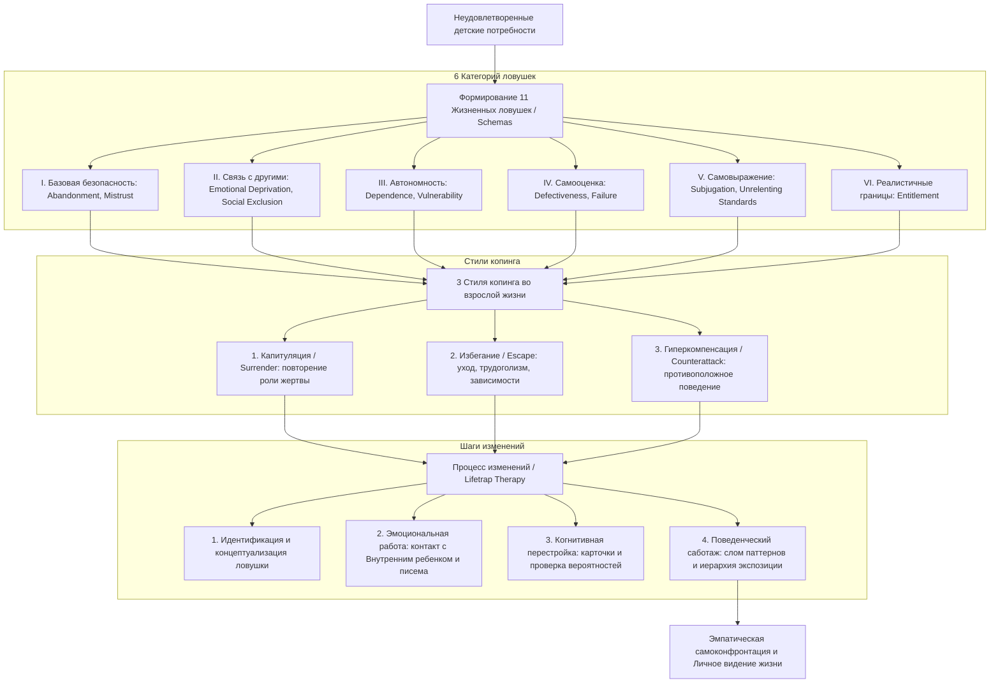

<!-- NotebookLM (Freya), Reinventing Your Life, учебный конспект; 23.10.2026; не сверено -->
#### 0. Полный список глав книги

1. **Глава 1. Lifetraps** («Жизненные ловушки»).
2. **Глава 2. Which Lifetraps Do You Have?** («Какие жизненные ловушки у вас есть?»).
3. **Глава 3. Understanding Lifetraps** («Понимание жизненных ловушек»).
4. **Глава 4. Surrender, Escape, and Counterattack** («Капитуляция, избегание и гиперкомпенсация»).
5. **Глава 5. How Lifetraps Change** («Как меняются жизненные ловушки»).
6. **Глава 6. "Please Don't Leave Me!": The Abandonment Lifetrap** («"Пожалуйста, не оставляй меня!": Ловушка брошенности»).
7. **Глава 7. "I Can't Trust You": The Mistrust and Abuse Lifetrap** («"Я не могу тебе доверять": Ловушка недоверия и жестокого обращения»).
8. **Глава 8. "I'll Never Get the Love I Need": The Emotional Deprivation Lifetrap** («"Я никогда не получу ту любовь, которая мне нужна": Ловушка эмоциональной депривации»).
9. **Глава 9. "I Don't Fit In": The Social Exclusion Lifetrap** («"Я не такой, как все / Я чужой": Ловушка социальной изоляции»).
10. **Глава 10. "I Can't Make It on My Own": The Dependence Lifetrap** («"Я не справлюсь сам": Ловушка зависимости»).
11. **Глава 11. "Catastrophe Is About to Strike": The Vulnerability Lifetrap** («"Вот-вот случится катастрофа": Ловушка уязвимости»).
12. **Глава 12. "I'm Worthless": The Defectiveness Lifetrap** («"Я никчёмен / дефективен": Ловушка дефективности»).
13. **Глава 13. "I Feel Like Such a Failure": The Failure Lifetrap** («"Я чувствую себя неудачником": Ловушка неуспеха»).
14. **Глава 14. "I Always Do It Your Way!": The Subjugation Lifetrap** («"Я всегда делаю всё по-твоему!": Ловушка подчинения»).
15. **Глава 15. "It's Never Quite Good Enough": The Unrelenting Standards Lifetrap** («"Всё недостаточно хорошо": Ловушка завышенных стандартов»).
16. **Глава 16. "I Can Have Whatever I Want": The Entitlement Lifetrap** («"Мне можно всё, что я хочу": Ловушка привилегированности / грандиозности»).
17. **Глава 17. A Philosophy of Change** («Философия изменений»).

#### 1. О чём книга в 3 предложениях

Книга Джеффри Янга и Джанет Клоско посвящена **схема-терапии (schema therapy)** — интегративному психологическому подходу, помогающему распознать и преодолеть 11 хронических саморазрушительных паттернов мышления и поведения, называемых **жизненными ловушками (lifetraps)**. Эти ловушки формируются в детстве под влиянием неблагоприятной семейной среды и врожденного темперамента, приводя к повторению деструктивного опыта во взрослой жизни через капитуляцию, избегание или гиперкомпенсацию. Сочетая методы когнитивной, поведенческой, психоаналитической и эмоционально-сфокусированной терапии, авторы дают пошаговые инструменты для изменения мыслей, чувств и поведения, восстанавливающих эмоциональное благополучие.

#### 2. Главные идеи по главам

##### Глава 1. Lifetraps

* **Определение ловушки**: Жизненная ловушка (схема / schema) — это устойчивый паттерн восприятия и поведения, зародившийся в детстве и воспроизводящийся на протяжении всей жизни.
* **Ирония повторения**: Человек бессознательно воссоздает во взрослом возрасте условия детской травмы, выстраивая разрушительные отношения (компульсивное повторение / repetition compulsion).
* **Происхождение из безопасности**: Схемы дают чувство предсказуемости и знакомого «дома», поэтому психика держится за них, несмотря на причиняемую боль.
* **Необходимость комплексного подхода**: Традиционная кратковременная когнитивно-поведенческая терапия не всегда справляется с глубинными личностными схемами, требуя интеграции эмоциональных и поведенческих техник.

##### Глава 2. Which Lifetraps Do You Have?

* **Самодиагностика**: Специальный опросник из 22 пунктов позволяет определить наличие и степень выраженности каждой из 11 жизненных ловушек.
* **6 сфер детских потребностей**: Все 11 ловушек разделены на 6 категорий в зависимости от того, какая базовая потребность ребенка была нарушена (базовая безопасность, связь с другими, автономность, самооценка, самовыражение, реалистичные границы).
* **Диапазон влияния**: Чем выше балл по конкретной ловушке, тем сильнее ее управляющее воздействие на выбор партнеров, карьеру и эмоциональное состояние.

##### Глава 3. Understanding Lifetraps

* **Взаимодействие генов и среды**: Ловушка формируется на стыке врожденного эмоционального темперамента (например, застенчивость/агрессивность) и деструктивной семейной атмосферы.
* **Базовые детские потребности**: Ребенку для гармоничного развития необходимы базовая безопасность, эмоциональная связь, автономность, здоровая самооценка, свобода самовыражения и реалистичные границы.
* **Тяжесть ранних ловушек**: Ловушки базовой безопасности (брошенность, недоверие) формируются раньше всех и наносят наибольший урон психике.

##### Глава 4. Surrender, Escape, and Counterattack

* **Три стиля копинга (справляющегося поведения)**: Человек реагирует на активированную ловушку через капитуляцию (Surrender / maintenance), избегание (Escape / avoidance) или гиперкомпенсацию (Counterattack / compensation).
* **Капитуляция (Surrender)**: Человек полностью подчиняется ловушке, подтверждает ее истинность и выбирает критикующих или отвергающих партнеров.
* **Избегание (Escape)**: Попытка заглушить боль схемы через эмоциональную отстраненность, трудоголизм, алкоголь, избегание близких отношений или определенных ситуаций.
* **Гиперкомпенсация (Counterattack)**: Попытка действовать и чувствовать себя противоположным образом (демонстрация превосходства, перфекционизм, агрессия), чтобы скрыть внутреннюю уязвимость.

##### Глава 5. How Lifetraps Change

* **Пошаговый процесс терапии**: Изменение включает определение ловушек, проживание боли детского опыта, рациональное опровержение ловушки, написание писем обидчикам, анализ дневных паттернов и поведенческие эксперименты.
* **Контакт с «внутренним ребенком»**: Визуализация детских воспоминаний и переродительствование (re-parenting) собственного детского «Я» дают эмоциональное исцеление.
* **Карточки-преодоления (Flashcards)**: Ежедневное чтение кратких рациональных утверждений помогает разрушать автоматические мысли ловушки.
* **Преодоление препятствий**: Ловушки сопротивляются изменениям; препятствиями выступают сохранение избегания, слишком сложные первые шаги или разорванность между разумом и чувствами.

##### Глава 6. "Please Don't Leave Me!": The Abandonment Lifetrap

* **Суть ловушки Брошенности (Abandonment)**: Убеждение, что близкие люди неизбежно уйдут, умрут или бросят ради кого-то другого.
* **Два типа происхождения**: Брошенность на основе зависимости (вызванная гиперопекой) и брошенность на основе эмоциональной нестабильности или реальной утраты родителей.
* **Цикл брошенности**: Панический страх отдаления партнеров приводит к цеплянию и ревности, что и провоцирует партнера на реальный уход.
* **Стратегия исцеления**: Обучение переносимости одиночества, выбор стабильных и приверженных партнеров, отказ от бегства за эмоционально недоступными людьми.

##### Глава 7. "I Can't Trust You": The Mistrust and Abuse Lifetrap

* **Суть ловушки Недоверия и Жестокого обращения (Mistrust & Abuse)**: Ожидание, что другие обязательно причинят вред, обманут, унизят или используют в своих целях.
* **Происхождение**: Физическое, сексуальное, эмоциональное или вербальное насилие в детстве со стороны членов семьи.
* **Воссоздание травмы**: Жертвы насилия часто выбирают деспотичных партнеров или сами становятся агрессорами.
* **Путь изменений**: Установление жестких границ, прекращение контактов с обидчиками, выплеск гнева в образах и постепенное построение доверия с безопасными людьми.

##### Глава 8. "I'll Never Get the Love I Need": The Emotional Deprivation Lifetrap

* **Суть Эмоциональной депривации (Emotional Deprivation)**: Глубинная убежденность в том, что потребность в любви, тепле, поддержке и понимании никогда не будет удовлетворена.
* **Три вида депривации**: Депривация заботы (Nurturance — отсутствие тепла/объятий), депривация эмпатии (Empathy — отсутствие понимания) и депривация защиты (Protection — отсутствие руководства).
* **Невидимый характер**: В отличие от насилия, депривация — это отсутствие необходимых действий матери, поэтому её трудно осознать.
* **Преодоление**: Осознание скрытых потребностей, открытое выражение своих желаний партнеру и выбор эмоционально щедрых людей.

##### Глава 9. "I Don't Fit In": The Social Exclusion Lifetrap

* **Суть Социальной изоляции (Social Exclusion)**: Ощущение себя неполноценным, некрасивым, скучным или принципиально отличным от остальных людей в группах.
* **Два типа**: Социальная нежелательность (стыд за внешность или навыки) и отчужденность (чувство одиночества и непохожести).
* **Роль избегания**: Главный механизм поддержания ловушки — отказ от посещения вечеринок, встреч и публичных мероприятий.
* **Иерархия экспозиции**: Составление списка избегаемых ситуаций по шкале трудности и постепенное вхождение в социальные группы с отказом от попыток произвести ложное впечатление.

##### Глава 10. "I Can't Make It on My Own": The Dependence Lifetrap

* **Суть ловушки Зависимости (Dependence)**: Ощущение собственной неспособности справляться с повседневными взрослыми обязанностями без постоянной помощи.
* **Причины**: Гиперопекающие родители (делавшие всё за ребенка) или гипоопекающие/беспомощные родители (заставлявшие ребенка быть взрослым слишком рано).
* **Контрзависимость**: Гиперкомпенсация, при которой человек панически боится просить о любой помощи и берет на себя непомерную нагрузку.
* **Шаги к автономии**: Пошаговое самостоятельное выполнение бытовых, финансовых и профессиональных задач с постепенным отказом от поиска подстраховки.

##### Глава 11. "Catastrophe Is About to Strike": The Vulnerability Lifetrap

* **Суть ловушки Уязвимости (Vulnerability)**: Непрерывный страх неизбежной катастрофы (болезнь, нищета, преступность, потеря контроля) и недооценка собственных сил справиться с ней.
* **4 сферы страхов**: Здоровье/болезнь (гипохондрия и панические атаки), опасность (преступность/аварии), бедность (банкротство) и потеря контроля (сумасшествие).
* **Катастрофизация**: Искажение вероятности негативных событий и поиск постоянных заверений от окружающих.
* **Лечение**: Проверка реалистичных вероятностей (odds), дыхательные релаксационные техники и систематическое погружение в пугающие ситуации в воображении и в реальности.

##### Глава 12. "I'm Worthless": The Defectiveness Lifetrap

* **Суть ловушки Дефективности (Defectiveness)**: Внутреннее ощущение своей бракованности, неполноценности и недостойности любви.
* **Центральная эмоция**: Стыд и панический страх того, что истинное «Я» будет разоблачено окружающими.
* **Нарциссизм как компенсация**: Защитная манера вести себя высокомерно, критиковать других и требовать восхищения, чтобы скрыть глубокий стыд.
* **Процесс исцеления**: Осознание нереалистичности детской критики, ведение списка своих достоинств, написание писем родителям и принятие искренней любви без обесценивания партнера.

##### Глава 13. "I Feel Like Such a Failure": The Failure Lifetrap

* **Суть ловушки Неуспеха (Failure)**: Убеждение в собственной некомпетентности в сфере достижений (учеба, карьера, спорт) по сравнению со сверстниками.
* **Синдром самозванца**: Даже при объективных успехи человек верит, что просто дурачит окружающих.
* **Самосаботаж через избегание**: Прокрастинация, откладывание важных проектов, выбор заведомо низких позиций из страха перед провалом.
* **План изменений**: Разделение реального положения и искажений, осознание своих уникальных видов интеллекта и разработка пошагового плана построения карьеры.

##### Глава 14. "I Always Do It Your Way!": The Subjugation Lifetrap

* **Суть ловушки Подчинения (Subjugation)**: Добровольная или вынужденная отдача контроля над своей жизнью другим людям из чувства вины или страха наказания.
* **Две формы**: Самопожертвование (подавление потребностей из вины за чужую боль) и Покорность (подавление желаний из страха гнева/брошенности).
* **Пассивная агрессия и бунт**: Накопленный подавленный гнев проявляется через саботаж, упрямство, прокрастинацию или вспышки бунта.
* **Обучение ассертивности**: Выявление личных предпочтений, прямая формулировка своих желаний, установление равного баланса «давать — получать» в отношениях.

##### Глава 15. "It's Never Quite Good Enough": The Unrelenting Standards Lifetrap

* **Суть Ловушки завышенных стандартов (Unrelenting Standards)**: Непрерывное стремление соответствовать чрезвычайно высоким планкам в ущерб здоровью, радости и отношениям.
* **Три проявления**: Компульсивность (перфекционизм и порядок), ориентация на достижения (трудоголизм) и ориентация на статус (богатство и признание).
* **Черно-белое мышление**: Любой результат ниже 100% воспринимается как полный провал.
* **Снижение давления**: Осознание цены стандартов, преднамеренное снижение планки на 25%, применение тайм-менеджмента и делегирование.

##### Глава 16. "I Can Have Whatever I Want": The Entitlement Lifetrap

* **Суть ловушки Грандиозности / Привилегированности (Entitlement)**: Убеждение в своей exclusive-специальности, правоте ставить свои желания выше правил и отсутствие самодисциплины.
* **Три типа**: Избалованность (эгоизм и контроль), Зависимая привилегированность (требование, чтобы другие обслуживали уязвимость) и Импульсивность (неспособность отложить удовольствие).
* **Отсутствие внутренней боли**: Обладатель ловушки сам не страдает, а заставляет страдать окружающих, пока не столкнется со свалившимся кризисом (развод, увольнение).
* **Установление границ**: Оценка негативных последствий, разбор отговорок, развитие эмпатии и выработка самодисциплины.

##### Глава 17. A Philosophy of Change

* **7 базовых предпосылок**: Стремление к самоактуализации, наличие фундаментальных потребностей, возможность изменения личности, сопротивление изменениям, избегание боли, интегративность методов и необходимость личного видения.
* **Создание персонального видения**: Изменение — это не только убирание ловушек, но и построение наполненной жизни в сфере отношений, автономии, самооценки и самовыражения.
* **Эмпатическая самоконфронтация (Empathic self-confrontation)**: Сочетание сострадания к своему детскому опыту с твёрдой ответственностью за ежедневное изменение поведения.
* **Привлечение поддержки**: Использование помощи близких людей, групп поддержки и обращение к профессиональным терапевтам при тяжелых травмах.

#### 3. Схема связей между главными идеями (Mermaid)

#### 4. Пошаговый чек-лист практических действий

1. **Идентифицируйте свои ловушки**: Пройдите опросник жизненных ловушек (глава 2) и определите, какие схемы набрали наибольший балл.
2. **Исследуйте детские истоки**: Используйте упражнение по визуализации (направленное воображение в затемненной комнате) с закрытыми глазами, чтобы соединить сегодняшнюю эмоциональную боль с детскими воспоминаниями.
3. **Дайте поддержку своему «внутреннему ребенку»**: Войдите в представляемый детский образ в роли взрослого и окажите ребенку защиту, тепло, утешение и руководство.
4. **Соберите доказательства «За» и «Против» ловушки**: Составьте письменную таблицу, чтобы когнитивно опровергнуть истинность вашей ловушки на рациональном уровне.
5. **Напишите неотправляемые письма обидчикам**: Выразите в письме родителям или обидчикам всю накопившуюся гневную и печальную правду о том, как с вами поступили незаслуженно.
6. **Составьте карточки-преодоления (Flashcards)**: Зафиксируйте на небольшой карточке рациональный ответ ловушке и носите её с собой, перечитывая каждый раз при активации схемы.
7. **Зафиксируйте дневные паттерны подкрепления**: Составьте таблицу повседневных действий, которыми вы подкрепляете ловушку (капитулируете, избегаете или гиперкомпенсируете), и пропишите альтернативное поведение.
8. **Постройте иерархию экспозиции**: Для ловушек Уязвимости, Зависимости и Социальной изоляции оформите список пугающих или избегаемых ситуаций по шкале от 0 до 100/0 до 8 и систематически проходите их от легких к сложным.
9. **Ломайте поведенческие паттерны в отношениях**: Прекратите выбирать деструктивных партнеров; если вы в здоровых отношениях — учитесь открыто просить о помощи, заявлять о нуждах и устанавливать границы.
10. **Практикуйте эмпатическую самоконфронтацию**: Сочетайте сострадание к себе с неуклонной дисциплиной ежедневного выполнения намеченных шагов.

#### 5. Типичные ошибки и как их избежать

* **Ошибка 1: Гиперкомпенсация вместо принятия ответственности**.
  * *В чем суть*: Человек обвиняет в проблемах окружающих, хвастается, заставляет себя еще больше работать или производить впечатление.
  * *Как избежать*: Провести эксперимент: составить список всех сожалений и признать уязвимость и несовершенство своего детского опыта.
* **Ошибка 2: Избегание проживания эмоциональной боли (Escape)**.
  * *В чем суть*: Заглушение чувств алкоголем, едой, серией поверхностных связей, заталкивание воспоминаний подальше.
  * *Как избежать*: Отказаться от привычных форм ухода на несколько дней, вести дневник чувств и ежедневно выполнять визуализацию детских воспоминаний.
* **Ошибка 3: Рациональное согласие с ловушкой**.
  * *В чем суть*: Человек искренне верит, что его ловушка отражает реальность (например, «Я действительно некомпетентен»).
  * *Как избежать*: Сыграть в «адвоката дьявола» против схемы, привлечь объективного друга для разбора фактов и ежедневно читать карточки.
* **Ошибка 4: Слишком сложная первая задача**.
  * *В чем суть*: Попытка сразу противостоять самому страшному объекту (например, вступить в жесткий конфликт с отцом) приводит к панике и провалу.
  * *Как избежать*: Разбивать план на мелкие шаги, починать с уровня сложности 2–3 из 8 и переходить выше только после полного освоения.
* **Ошибка 5: Разум понимает, но сердце продолжает чувствовать по-старому**.
  * *В чем суть*: Человек фрустрирован тем, что логические аргументы не снимают эмоциональную тревогу.
  * *Как избежать*: Проявлять терпение; ускорять процесс через эмоциональные техники (диалоги, плач, выплеск гнева) и накопление нового поведенческого опыта.
* **Ошибка 6: Отсутствие системности и дисциплины**.
  * *В чем суть*: Импульсивная и эпизодическая работа над собой без письменного фиксирования.
  * *Как избежать*: Выделять фиксированное время каждый день для обзора прогресса, делать все упражнения строго письменно.
* **Ошибка 7: Упущение важного звена схемы**.
  * *В чем суть*: Неполное понимание всех мыслительных и поведенческих триггеров.
  * *Как избежать*: Перечитать профильную главу книги, свериться со списками типичных проявлений и обсудить план с доверенным лицом.
* **Ошибка 8: Попытка справиться в одиночку при глубокой травме**.
  * *В чем суть*: При тяжелом насилии или жестком застревании самопомощи оказывается недостаточно.
  * *Как избежать*: Обратиться к квалифицированному психотерапевту или группе поддержки.

#### 6. 20 карточек «вопрос — ответ» для повторения

1. **В: Что такое жизненная ловушка (lifetrap / schema)?** *О:* Это сформированный в детстве и повторяющийся в течение жизни паттерн мышления, эмоционального реагирования и поведения, определяющий восприятие себя и мира.
2. **В: Что Фрейд называл «компульсивным повторением» (repetition compulsion)?** *О:* Бессознательную склонность человека воссоздавать во взрослом возрасте деструктивные и болезненные условия своего детства.
3. **В: Каковы три основных стиля копинга при активации ловушки?** *О:* Капитуляция (Surrender), Избегание (Escape) и Гиперкомпенсация (Counterattack).
4. **В: Какая базовая потребность нарушена при ловушках Брошенности и Недоверия?** *О:* Потребность в базовой безопасности (Basic Safety).
5. **В: Чем ловушка Социальной изоляции отличается от ловушки Дефективности?** *О:* Социальная изоляция касается внешних, поверхностных характеристик и групп; Дефективность — это внутреннее чувство собственной бракованности перед близкими.
6. **В: В чем суть трех видов депривации в ловушке Эмоциональной депривации?** *О:* Депривация заботы (Nurturance — отсутствие тепла), эмпатии (Empathy — отсутствие понимания) и защиты (Protection — отсутствие руководства).
7. **В: Что такое контрзависимость (counterdependence)?** *О:* Форма гиперкомпенсации ловушки Зависимости, при которой человек демонстративно отказывается от любой помощи, действуя на пределе сил.
8. **В: Какова главная цель использования карточки-преодоления (flashcard)?** *О:* Перехват автоматических мыслей ловушки в момент её активации и напоминание о рациональной позиции.
9. **В: В чем заключается феномен «синдрома самозванца» при ловушке Неуспеха?** *О:* Убеждение человека в том, что его успехи случайны или являются результатом обмана окружающих, несмотря на реальную компетентность.
10. **В: Чем отличаются две формы ловушки Подчинения — Самопожертвование и Покорность?** *О:* Самопожертвование мотивировано чувством вины за чужую боль; Покорность — страхом наказания или отвержения.
11. **В: Назовите 3 типа ловушки Завышенных стандартов.** *О:* Компульсивность (порядок), Ориентация на достижения (трудоголизм) и Ориентация на статус.
12. **В: Почему обладатели ловушки Грандиозности (Entitlement) редко сами приходят в терапию?** *О:* Они не испытывают внутренней боли от своей ловушки; страдают окружающие их люди.
13. **В: Что представляет собой техника переродительствования (re-parenting)?** *О:* Воображаемое вхождение взрослого «Я» в детское воспоминание для защиты, утешения и удовлетворения потребностей «внутреннего ребенка».
14. **В: Какие 4 сферы охватывает ловушка Уязвимости?** *О:* Здоровье/болезни, Опасность/преступность, Бедность/финансовый крах и Потеря контроля/сумасшествие.
15. **В: Каким образом перфекционизм при Завышенных стандартах приводит к прокрастинации?** *О:* Непомерно высокая планка делает задачу настолько угрожающей и парализующей, что человек откладывает её старт.
16. **В: В чем заключается правило проверки вероятностей (testing the odds) при Уязвимости?** *О:* Сопоставление катастрофической субъективной оценки вероятности беды с объективной оценкой экспертов/окружающих.
17. **В: Какая эмоция является ключевой при ловушке Дефективности?** *О:* Стыд.
18. **В: В чем опасность выбора партнера по принципу «высокой химии» (high chemistry) при наличии ловушек?** *О:* Сильная страсть часто сигнализирует о том, что партнер идеально активирует привычную детскую травму (например, холодность или критику).
19. **В: Что такое эмпатическая самоконфронтация (empathic self-confrontation)?** *О:* Базовый принцип изменений, сочетающий сострадательное понимание причин своих проблем с непреклонным требованием менять поведение.
20. **В: Что рекомендуется сделать со стандартами при ловушке Завышенных стандартов для восстановления баланса?** *О:* Осознанно снизить планку примерно на 25% и разрешить себе делать работу просто хорошо (на 70–80%), а не идеально.

#### 7. 5 практических заданий на применение

##### Задание 1. Интернет-магазин одежды: Преодоление ловушки «Завышенных стандартов» (Unrelenting Standards) владельца

* **Сценарий**: Владелец интернет-магазина одежды полгода откладывает запуск новой коллекции, перешивая образцы, переснимая лукбуки и переписывая карточки товаров из-за стремления к абсолютное совершенству.
* **Вопрос/Задача**:
  1. Составьте список негативных последствий (disadvantages) такого перфекционизма для бизнеса и здоровья.
  2. Разработайте план снижения стандартов на 25% (например, лимит на количество фотосессий и фи