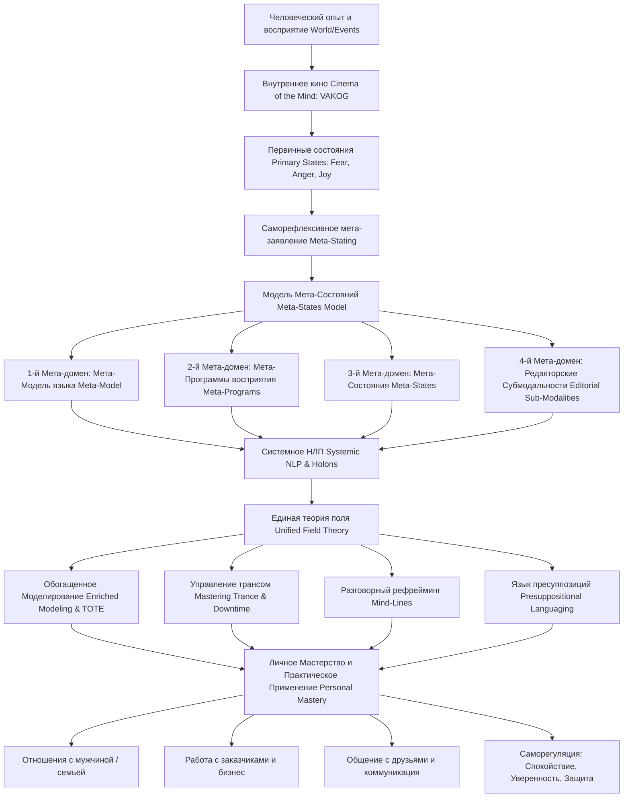

<!-- NotebookLM Freya: Учебный конспект, Users Manual for the Brain Vol II -->

## Учебный конспект книги: «Руководство пользователя мозгом, Том II»

### Раздел 0. Полный список глав книги (номер, название по-английски — перевод)

1. **Chapter One: Thinking Systemically About NLP** — Системное мышление о НЛП

2. **Chapter Two: The Cinema of the Mind** — Кинематограф разума (Внутреннее кино)

3. **Chapter Three: The Pathway to Mastery** — Путь к мастерству

4. **Chapter Four: Mastering the States Our Movies Create** — Управление состояниями, создаваемыми нашим внутренним кино

5. **Chapter Five: Mastering Meta-States** — Овладение мета-состояниями

6. **Chapter Six: Meta-Stating Mastery** — Применение мета-состояний для достижения мастерства

7. **Chapter Seven: "Sub-Modalities" as Editorial Meta-Levels** — «Субмодальности» как редакторские мета-уровни

8. **Chapter Eight: Meta-Modalities using the Cinematic Features Frame** — Мета-модальности с использованием фрейма кинематографических параметров

9. **Chapter Nine: Mastering Programs of Perception** — Управление программами восприятия (Мета-программы)

10. **Chapter Ten: An Advance Listing of Meta-Programs** — Расширенный перечень мета-программ

11. **Chapter Eleven: The Meta-Representation System** — Мета-репрезентативная система (Мета-модель языка)

12. **Chapter Twelve: Meta-Magic and Extended Meta-Model** — Мета-магия и расширенная мета-модель

13. **Chapter Thirteen: Systemic NLP** — Системное НЛП

14. **Chapter Fourteen: Meta-States as a Unifying Field Theory** — Мета-состояния как объединяющая теория поля

15. **Chapter Fifteen: NLP Unified Field Theories** — Объединённые теории поля в НЛП

16. **Chapter Sixteen: The NLP-Enriched Strategy Model** — Обогащенная модель стратегий НЛП

17. **Chapter Seventeen: Modeling using Meta-Levels** — Моделирование с использованием мета-уровней

18. **Chapter Eighteen: Mastering Trance** — Овладение трансом (Трансовые состояния)

19. **Chapter Nineteen: Mind-Lines: Conversationally Reframing** — Линии разума (Mind-Lines): разговорный рефрейминг

20. **Chapter Twenty: Using Mind-Lines in Everyday Life** — Использование Mind-Lines в повседневной жизни

21. **Chapter Twenty-One: Presuppositional Languaging: Part I** — Язык пресуппозиций: Часть I

22. **Chapter Twenty-Two: Presuppositional Languaging: Part II** — Язык пресуппозиций: Часть II

23. **Chapter Twenty-Three: Practical NLP** — Практическое НЛП (в терапии, бизнесе, отношениях, здоровье и личностном росте)

24. **Chapter Twenty-Four: NLP Mastery** — Мастерство в НЛП (Синтез и интеграция)

### Раздел 1. О чём книга в 3 предложениях

1. Книга «Руководство пользователя мозгом, Том II» Майкла Холла и Боба Боденхамера представляет собой фундаментальный труд по системному НЛП (**Systemic NLP**) и нейросемантике (**Neuro-Semantics**), переосмысляющий НЛП не как набор изолированных техник, а как целостную, нелинейную модель человеческого опыта.

2. Авторы вводят концепцию «внутреннего кинематографа разума» (**Cinema of the Mind**) и Модель Мета-Состояний (**Meta-States Model**), доказывая, что мы управляем своими эмоциями и поведением через слои рефлексивных мыслей и чувств высшего порядка (**meta-levels**), которые структурируют субмодальности, мета-программы и языковые рамки.

3. Руководство предлагает практический инструментарий для достижения личного мастерства (**Personal Mastery**), разговорного рефрейминга (**Mind-Lines**), моделирования выдающихся результатов (**Modeling**) и системной трансформации опыта в отношениях, бизнесе, терапии и саморегуляции.

### Раздел 2. Главные идеи по главам (3–5 пунктов по каждой главе)

#### Глава 1. Системное мышление о НЛП (Thinking Systemically About NLP)

* **Переход от линейного мышления к системному (Linear to Systemic Shift):** Традиционное мышление опирается на линейные причинно-следственные связи (**Cause-Effect**), тогда как человеческая психика работает через циклические петли обратной связи (**Feedback Loops**).

* **Концепция холона (Holon Concept):** Каждая психическая структура является одновременно целым самостоятельным элементом и частью более крупного системного целого (**Whole/Part relationship**).

* **Эмерджентные свойства (Emergent Properties):** Системное взаимодействие разума и тела (**Mind-Body System**) порождает гештальт-состояния, свойства которых не сводятся к простой сумме отдельных элементов.

* **Нелинейные реакции нейролингвистики (Non-linear Dynamics):** Малое изменение на ключевом мета-уровне может вызвать колоссальную трансформацию во всей психической системе человека.

#### Глава 2. Кинематограф разума (The Cinema of the Mind)

* **Внутреннее кино как репрезентация опыта (Internal Mental Movie):** Мы воспринимаем и кодируем мир с помощью внутренних сенсорных «кинофильмов», состоящих из визуальных, аудиальных и кинестетических репрезентаций (**VAKOG**).

* **Режиссерская позиция (Director Frame):** Мастерство НЛП начинается с осознания себя не бессильным зрителем внутреннего кино, а его сценаристом, режиссером и редактором.

* **Качество кинофильма определяет состояние (Movie-State Connection):** Яркость, дистанция, объем и звук нашего внутреннего фильма напрямую формируют наше физиологическое и эмоциональное состояние (**Neuro-linguistic state**).

* **Роль убеждений как фреймов кинозала (Belief Frames):** Наше отношение к фильмам (осознание, что это ментальная репрезентация, а не сама реальность) меняет степень их воздействия на наше тело.

#### Глава 3. Путь к мастерству (The Pathway to Mastery)

* **Установка на обучение и любопытство (Attitude of Curiosity):** Настоящее мастерство опирается не на сухое заучивание техник, а на установку непрерывного исследования, игры и безусловного любопытства.

* **Разделение поведения и личности (Separating Behavior from Person):** Человек всегда ценнее его поведения; любое поведение на определенном уровне имеет позитивное намерение (**Positive Intention**).

* **Обратная связь вместо неудачи (Feedback vs. Failure):** В системном НЛП нет поражений — есть лишь информация о том, как работает система, позволяющая гибко менять стратегию (**Flexibility**).

* **Эпистемологическая осознанность (Epistemological Awareness):** Понимание того, как мы строим свои карты реальности (**Map is not Territory**), и готовность постоянно обновлять эти карты.

#### Глава 4. Управление состояниями, создаваемыми нашим внутренним кино (Mastering the States Our Movies Create)

* **Природа первичных состояний (Primary States):** Первичные состояния (страх, радость, гнев, печаль) возникают как прямая нейрофизиологическая реакция на объекты внешнего мира или их прямые репрезентации.

* **Объектность состояний (Object of State):** Каждой эмоции соответствует конкретный ментальный или физический объект, на который направлено внимание.

* **Зависимость состояния от физиологии и репрезентаций (State Drivers):** Состояние поддерживается триадой: внутренним образом/звуком, физиологией тела (дыхание, поза) и фокусировкой внимания.

* **Преходящий характер состояний (State Transience):** Эмоциональные состояния непрерывно меняются; умение калибровать и заякоривать (**Anchoring**) ресурсы позволяет произвольно вызывать нужные состояния.

#### Глава 5. Овладение мета-состояниями (Mastering Meta-States)

* **Сущность Модели Мета-Состояний (Meta-States Model):** Мета-состояние — это состояние, направленное на другое состояние или мысль (мысль о мысли, страх перед страхом, радость по поводу обучения).

* **Саморефлексивность сознания (Self-Reflexive Consciousness):** Человеческий мозг способен отражать сам себя, наслаивая уровни смысла друг на друга и создавая иерархии мыслей.

* **Логические уровни психики (Logical Levels of Mind):** Каждый мета-уровень выступает рамкой (**Frame**) и контекстом для нижележащего уровня, определяя его значение и реакцию.

* **Опасность застревания в негативных петлях (Un-sane Loops):** Наслоение негатива на негатив (вина за гнев, страх перед страхом) создает эмоциональные «зажимы» и порочные круги.

#### Глава 6. Применение мета-состояний для достижения мастерства (Meta-Stating Mastery)

* **Создание гештальт-состояний (Creating Gestalt States):** Наслоение ресурса на ресурс (например, признание + принятие + сострадание на страх) порождает качественно новые состояния (мужество, стойкость).

* **Технология мета-заявления (Meta-Stating Process):** Пошаговый алгоритм: выбор первичного состояния → шаг в мета-позицию → выбор мета-ресурса → применение мета-ресурса к первичному состоянию → проверка интеграции.

* **Исполнительный контроль и высшие рамки (Executive Mind):** Мета-состояния формируют наши высшие убеждения, ценности, намерение и самоидентичность.

* **Принцип высших рамок (Higher Frame Principle):** Изменение высшего мета-уровня автоматически переструктурирует все подчиненные ему первичные состояния и поведенческие паттерны.

#### Глава 7. «Субмодальности» как редакторские мета-уровни ("Sub-Modalities" as Editorial Meta-Levels)

* **Переосмысление субмодальностей (Sub-Modalities are Meta):** Субмодальности (размер, яркость, дистанция, фокус) — это не мелкие элементы, а мета-уровневые оценочные категории и редакторские фреймы.

* **Классификация репрезентаций (Editorial Framing):** Изменяя дистанцию до внутреннего образа (отодвигая его вдаль), мы на мета-уровне сообщаем мозгу: «Это неважно» или «Это в прошлом».

* **Сдвиговые субмодальности (Critical Swish/Driver Sub-modalities):** В каждой системе существуют ключевые субмодальные параметры, изменение которых мгновенно меняет значение всего опыта.

* **Язык пространственного кодирования:** Мозг использует аналоговые характеристики для структурирования времени, значимости и убежденности.

#### Глава 8. Мета-модальности с использованием фрейма кинематографических параметров (Meta-Modalities using Cinematic Features)

* **Кинематографический фрейм (Cinematic Features Frame):** Использование понятий киноиндустрии (крупный план, панорама, закадровый голос, монтаж) делает управление психикой интуитивным.

* **Ассоциация vs. Диссоциация (Associated vs. Dissociated Frames):** Просмотр фильма от первого лица (ассоциация) дает полноту переживания; просмотр со стороны (диссоциация) дает спокойствие и возможность анализа.

* **Трансформация травматического опыта (Movie Editing for Trauma):** Уменьшение экрана, перевод изображения в ч/б формат и добавление веселой музыки мета-заявляют безопасность поверх старого воспоминания.

* **Продюсирование будущего (Future Movie Production):** Создание ярких, привлекательных, ассоциированных внутренних фильмов будущего программирует мозг на достижение целей.

#### Глава 9. Управление программами восприятия / Мета-программы (Mastering Programs of Perception / Meta-Programs)

* **Определение мета-программ (Meta-Programs Definition):** Мета-программы — это привычные паттерны и фильтры восприятия, определяющие, как человек сортирует и обрабатывает информацию.

* **Мета-программы как мета-уровень внимания:** Мета-программы находятся на мета-уровне по отношению к входящей информации, регулируя стиль мышления и принятия решений.

* **Контекстуальность мета-программ (Context Dependence):** Мета-программы не являются неизменными типами личности; они меняются в зависимости от контекста (работа, семья, стресс).

* **Профилирование людей (People Profiling):** Умение калибровать мета-программы собеседника позволяет говорить на его языке и выстраивать глубокий раппорт (**Rapport**).

#### Глава 10. Расширенный перечень мета-программ (An Advance Listing of Meta-Programs)

* **Классификация 51+ мета-программ:** Систематизация мета-программ по 6 категориям: когнитивные, эмоциональные, волевые/мотивационные, коммуникативные, мета-программы «Я» и временные.

* **Ключевые когнитивные мета-программы:** Укрупнение/детализация (**Chunk Size: Global/Specific**), Сходство/Различие (**Relationship Sort: Matching/Mismatching**), Дедукция/Индукция (**Reasoning: Inductive/Deductive**).

* **Ключевые мотивационные мета-программы:** К цели/От проблемы (**Direction: Toward/Away From**), Внутренняя/Внешняя референция (**Frame of Reference: Internal/External**), Возможность/Необходимость (**Modal Operators: Possibility/Necessity**).

* **Гибкость мета-программ (Meta-Program Flexibility):** Мастерство заключается в способности произвольно расширять свой спектр мета-программ и переключаться между ними.

#### Глава 11. Мета-репрезентативная система / Мета-модель языка (The Meta-Representation System / Meta-Model)

* **Язык как мета-репрезентация (Language as Meta-Representation):** Слова не являются самой реальностью — они представляют собой символы второго порядка, описывающие внутренние картины.

* **Структура языка (Surface vs. Deep Structure):** Поверхностная структура предложения (**Surface Structure**) возникает из Глубинной структуры (**Deep Structure**) путем опущений, искажений и обобщений.

* **Три класса мета-модельных нарушений:** Опущения (**Deletions**), Искажения (**Distortions**), Обобщения (**Generalizations**).

* **Восстановление полноты карты (Unpacking the Map):** Мета-модельные вопросы («Кто именно?», «Как именно?», «По сравнению с чем?») возвращают человека к сенсорному опыту.

#### Глава 12. Мета-магия и расширенная мета-модель (Meta-Magic and Extended Meta-Model)

* **Расширения классической Мета-Модели (Extended Meta-Model):** Включение категориальных ошибок (**Category Errors**), многопорядковых терминов (**Multi-ordinal terms**), псевдо-слов и статических фреймов.

* **Номинализации (Nominalizations as Frozen Processes):** Превращение процессов (глаголов) в застывшие существительные («любовь», «проблема», «неудача») замораживает мышление.

* **Де-номинализация (Denominalizing):** Возвращение номинализаций обратно в глагольную форму («Как именно вы любите?», «Что именно вы делаете?») размораживает процессы.

* **Семантическая гигиена Коржибского (General Semantics):** Осознание пределов языка, избегание жесткой идентификации («А есть Б») и различение фактов и интерпретаций.

#### Глава 13. Системное НЛП (Systemic NLP)

* **Архитектура Системного НЛП (Systemic Architecture):** Объединение всех 4 мета-доменов (Мета-Состояния, Субмодальности, Мета-Программы, Мета-Модель) в единую динамическую систему.

* **Взаимосвязь элементов системы (Systemic Interconnectedness):** Изменение в языковой рамке меняет мета-программу внимания, что сдвигает субмодальности и перестраивает мета-состояние.

* **Петли обратной связи (Reinforcing Loops):** Внутренние психические циклы работают как самоусиливающиеся спирали — как негативные (тревожность), так и позитивные (самореализация).

* **Точки чувствительности (Levers of Change):** Поиск минимального эффективного вмешательства (**Leverage point**) на мета-уровне, вызывающего перестройку всей системы.

#### Глава 14. Мета-состояния как объединяющая теория поля (Meta-States as a Unifying Field Theory)

* **Единая теория поля в НЛП (Unified Field Theory in NLP):** Модель Мета-Состояний выступает зонтичной концепцией, объясняющей и интегрирующей все техники и модели НЛП.

* **Субмодальности как мета-состояния:** Любая субмодальная характеристика — это выраженное в аналоговой форме мета-состояние оценки.

* **Мета-программы как мета-состояния:** Мета-программа — это устойчивое, привычное мета-состояние, принявшее форму фильтра восприятия.

* **Языковые фреймы как мета-состояния:** Каждое слово или пресуппозиция закладывает мета-уровневую рамку значения, создавая соответствующее мета-состояние.

#### Глава 15. Объединённые теории поля в НЛП (NLP Unified Field Theories)

* **Сравнительный анализ моделей поля (Comparing Unified Models):** Анализ подходов Роберта Дилтса (Нейрологические уровни), Ричарда Бэндлера (Модель Субмодальностей) и Майкла Холла (Модель Мета-Состояний / Нейросемантика).

* **Иерархия рефлексивности vs. Логические уровни:** Модель Мета-Состояний опирается на естественную рефлексивность человеческого мозга (мышление о мышлении).

* **Рекурсивность мета-уровней (Recursive Meta-Levels):** Мета-уровни не имеют строго фиксированного потолка; любой опыт может быть взят в новую мета-рамку (**Meta-framing without limit**).

* **Свобода мастерства:** Дает мастеру НЛП возможность создавать индивидуальные техники под клиента прямо в ходе сессии.

#### Глава 16. Обогащенная модель стратегий НЛП (The NLP-Enriched Strategy Model)

* **Классическая модель TOTE (Test-Operate-Test-Exit):** Описание последовательности внутренних и внешних действий для достижения конкретного результата.

* **Обогащение модели TOTE мета-уровнями (Enriched TOTE):** Классическая TOTE учитывает лишь сенсорные шаги (VAKOG); обогащенная модель включает мета-состояния, мета-программы и фреймы убеждений.

* **Выявление скрытых мета-шагов (Uncovering Meta-Steps):** Часто сбой стратегии происходит из-за негативного мета-состояния (сомнение, перфекционизм) на этапе «Test».

* **Конструирование стратегий (Strategy Design & Installation):** Встраивание обогащенных стратегий мышления, принятия решений и творчества с учетом высших ценностей.

#### Глава 17. Моделирование с использованием мета-уровней (Modeling using Meta-Levels)

* **Моделирование как сердце НЛП (Modeling as Heart of NLP):** Сущность НЛП заключается в декодировании и воспроизведении структуры человеческого совершенства.

* **Четырехмерная матрица моделирования (4D Modeling Matrix):** Извлечение микро-стратегии (TOTE), мета-состояний (высших рамок), мета-программ (стилей фильтрации) и физиологии.

* **Этапы процесса моделирования:** 1) Наблюдение и калибровка; 2) Имплицитное погружение; 3) Эксплицитный анализ структуры; 4) Проверка минимального набора элементов; 5) Обучение других.

* **Преимущество моделирования мета-уровней:** Позволяет передавать не просто сухие навыки, а глубинное состояние мастерства и уверенности.

#### Глава 18. Овладение трансом (Mastering Trance)

* **Переосмысление транса (Trance as Focused Attention):** Транс — это естественное мета-состояние высокой внутренней сфокусированности внимания (**Inwardly Focused Attention / Down-time**).

* **Состояния Uptime и Downtime:** Uptime — сенсорная включенность во внешний мир; Downtime — мета-погружение во внутренние репрезентации и конструирование рамок.

* **Де-гипнотизация (De-hypnotizing):** Главная задача НЛП — расколдовывание от ограничивающих культурных и личностных трансов, в которых живут люди.

* **Мета-транс (Meta-Trance):** Управляемое вхождение на мета-уровни сознания для глубокой перестройки убеждений и интеграции ресурсов.

#### Глава 19. Линии разума: разговорный рефрейминг (Mind-Lines: Conversationally Reframing)

* **Концепция Mind-Lines (Reframing Meaning):** Mind-Lines — это паттерны разговорного рефрейминга, меняющие значение убеждений прямо в ходе диалога без формального транса.

* **Структура убеждения (Magic Formula):** Любое ограничение закодировано в виде формулы: Причина-Следствие (**Cause-Effect: X вызывает Y**) или Комплексный Эквивалент (**Complex Equivalence: X означает Y**).

* **7 базовых направлений Mind-Lines:** 1) Дефрейминг; 2) Внутренний рефрейминг; 3) Изменение размера чанка; 4) Временной рефрейминг; 5) Мета-рефрейминг; 6) Применение к себе; 7) Рефрейминг результата/контекста.

* **Трансформация реальности через изменение рамок:** Смена языковой рамки мгновенно изменяет эмоциональную реакцию и нейрохимию тела.

#### Глава 20. Использование Mind-Lines в повседневной жизни (Using Mind-Lines in Everyday Life)

* **Разрушение токсичных формул (Breaking Toxic Formulations):** Как с помощью Mind-Lines разлагать убеждения вида «Ты кричишь на меня, значит, ты меня не уважаешь» или «Я совершил ошибку, значит, я неудачник».

* **Паттерн «Применение к себе» (Apply to Self Pattern):** Направление языковой формулы на саму себя («Уверены ли вы в своей неуверенности?», «Не является ли утверждение о бессмысленности бессмысленным?»).

* **Гуманность и раппорт при рефрейминге:** Использование Mind-Lines требует высокой калибровки и уважения к собеседнику, а не превращения диалога в спор.

* **Развитие разговорной гибкости (Conversational Agility):** Практика генерации 20+ различных линий разума на одно ограничение для обретения свободы общения.

#### Глава 21. Язык пресуппозиций: Часть I (Presuppositional Languaging: Part I)

* **Природа пресуппозиций (Nature of Presuppositions):** Пресуппозиции — это явные или скрытые предпосылки, которые обязаны быть истинными, чтобы предложение имело смысл.

* **Управление вниманием через пресуппозиции:** Пресуппозиции направляют фокус внимания слушателя за пределы проверяемого факта, подгружая нужную рамку.

* **Языковые категории пресуппозиций:** Использование слов существования, осознания, времени и порядка для формирования реальности («Заметили ли вы, как стали более спокойны?»).

* **Гипнотический эффект пресуппозиций:** Позволяет обходить сознательное сопротивление, закладывая ресурсы в подсознательную структуру опыта.

#### Глава 22. Язык пресуппозиций: Часть II (Presuppositional Languaging: Part II)

* **Продвинутые категории пресуппозиций:** Поведение в категориях логического выбора (**Exclusive/Inclusive Or**), причинно-следственных связей, условий, числительных.

* **Создание иллюзии выбора (Double Binds / Choice Presuppositions):** Вопросы, предлагающие выбор между двумя позитивными альтернативами («Вы предпочтете расслабиться сейчас или через пару минут?»).

* **Темпоральные пресуппозиции (Temporal Presuppositions):** Перевод проблемы в прошлое с помощью слов «ранее», «до того как», «когда вы думали, что...».

* **Мастерство в переговорах и терапии:** Проектирование фразировок, которые естественным образом ведут клиента к решению.

#### Глава 23. Практическое НЛП (Practical NLP)

* **Применение Системного НЛП в 5 сферах:** 1) Психотерапия; 2) Бизнес и менеджмент; 3) Отношения; 4) Здоровье и психосоматика; 5) Личностный рост.

* **Практика НЛП в бизнесе:** Профилирование мета-программ клиентов, эффективная презентация в мета-программах заказчика, переговоры с помощью Mind-Lines.

* **Практика НЛП в отношениях:** Разделение первичных эмоциональных всплесков и мета-состояний любви/уважения; устранение взаимных обвинений.

* **Практика НЛП в здоровье:** Снятие психосоматических зажимов путем мета-заявления спокойствия и безопасности на физиологическую боль.

#### Глава 24. Мастерство в НЛП (NLP Mastery)

* **Неосознанная компетентность (Implicit Competence):** Мастерство достигается тогда, когда все мета-домены, модели и техники становятся естественной частью личности.

* **Экология и этика мастерства (Ecology & Ethics):** Использование мощных инструментов НЛП с глубоким уважением к экологии личности и окружающих людей.

* **Непрерывный цикл практики (Continuous Practice Cycle):** Путь мастерства — это бесконечный процесс обучения, рефлексии и обновления карт реальности.

* **Завершающее видение:** Мастер НЛП — это не тот, кто знает много техник, а тот, кто живет в ресурсном мета-состоянии свободы, творчества и сострадания.

### Раздел 3. Схема связей между главными идеями в формате Mermaid (graph TD)

### Раздел 4. Пошаговый чек-лист практических действий

1. **Шаг 1. Калибровка первичного состояния (Primary State Calibration):**

  * Задайте вопрос: «Что именно я сейчас чувствую?» и «На какой объект/событие направлена эта эмоция?»

  * Определите параметры физиологии: дыхание, зажимы в теле, позу.

2. **Шаг 2. Анализ и редактирование внутреннего кино (Internal Movie Audit):**

  * Определите ключевые редакторские субмодальности: фильм цветной или ч/б? ассоциирован или диссоциирован? где расположен экран?

  * Отодвиньте стрессовый образ вдаль, уменьшите размер экрана и сделайте изображение менее ярким (диссоциирующий монтаж).

3. **Шаг 3. Запуск процесса мета-заявления (Meta-Stating Process):**

  * Выйдите в мета-позицию (сделайте шаг назад или мысленно поднимитесь над ситуацией).

  * Выберите желаемое ресурсное мета-состояние (Принятие, Сострадание, Спокойствие, Любопытство).

  * Наслоите этот ресурс поверх первичного состояния: «Я привношу полное принятие к тому факту, что я испытываю этот страх/волнение».

4. **Шаг 4. Выявление мета-программных фильтров (Meta-Programs Profile):**

  * Проанализируйте свои фильтры внимания: двигаетесь ли вы «К цели» или «От проблемы»? Воспринимаете ли «Общую картину» или «Детали»?

  * Переключите при необходимости фильтр для расширения возможности выбора.

5. **Шаг 5. Деконструкция языковых ограничений (Meta-Model Unpacking):**

  * Засеките номинализации («неудача», «проблема», «неуважение») и разморозьте их в глаголы («Как именно я могу это изменить?»).

  * Задайте уточняющие вопросы для устранения опущений и искажений.

6. **Шаг 6. Применение разговорного рефрейминга (Mind-Lines Execution):**

  * Выделите языковую формулу ограничений (X→Y или X=Y).

  * Примените направления Mind-Lines: перефразируйте контекст, смените чанк, примените формулу к самой себе.

7. **Шаг 7. Экологическая проверка и интеграция (Ecology Check & Future Pace):**

  * Проверьте: «Нет ли внутри меня части, которая возражает против этого изменения?»

  * Мысленно проиграйте будущую ситуацию с новым мета-состоянием (**Future Pace**) для закрепления нейронной связи.

### Раздел 5. Типичные ошибки и как их избежать

1. **Ошибка 1: Осуждение и подавление первичных эмоций (Fighting Primary States)**

  * *В чём ошибка:* Попытка заставить себя «не бояться» или «не злиться» через борьбу и самокритику, что порождает вторичные негативные петли (стыд за страх, вину за гнев).

  * *Как избежать:* Используйте принцип мета-состояний — сначала примените мета-ресурс **Принятия (Acceptance)** и **Разрешения (Permission)** к первичному состоянию, а затем привносите Спокойствие и Мужество.

2. **Ошибка 2: Восприятие субмодальностей как сухих механических регуляторов (Mechanical Sub-modality Manipulation)**

  * *В чём ошибка:* Попытка двигать внутренние картинки без учета их семантического смысла и высших рамок убеждений.

  * *Как избежать:* Помните, что субмодальности — это мета-уровневые редакторские оценки. Изменяя субмодальность, одновременно осознавайте смену смысла («Я отдаляю эту картинку, потому что это событие уже в прошлом»).

3. **Ошибка 3: Восприятие мета-программ как постоянных «диагнозов» (Static Personality Labeling)**

  * *В чём ошибка:* Навешивание ярлыков («Он отъявленный избегатель От-проблемы», «Я неспособна к деталям»).

  * *Как избежать:* Относитесь к мета-программам как к сиюминутным привычкам внимания в конкретном контексте, сохраняя гибкость для их перенастройки.

4. **Ошибка 4: Превращение Mind-Lines в вербальное фехтование и спор (Conversational Combat)**

  * *В чём ошибка:* Использование рефрейминга для того, чтобы доказать свою правоту или обезоружить собеседника, что разрушает раппорт.

  * *Как избежать:* Используйте Mind-Lines исключительно из состояния глубокого уважения и заботы, предлагая новые перспективные рамки как подарок для расширения карты собеседника.

5. **Ошибка 5: Потеря экологии изменений (Ignoring Ecology)**

  * *В чём ошибка:* Быстрое встраивание новых целей без проверки того, как изменения повлияют на другие сферы жизни или ценности человека.

  * *Как избежать:* Всегда проводите экологическую проверку на высших мета-уровнях: «Согласуется ли это изменение с моими наивысшими ценностями и благополучием близких?».

### Раздел 6. 20 карточек «вопрос — ответ» для повторения

1. **В:** Чем отличаются первичные состояния (**Primary States**) от мета-состояний (**Meta-States**)? **О:** Первичные состояния направлены на объекты внешнего мира (страх перед собакой), а мета-состояния — на другие мысли или состояния (страх перед собственным страхом, радость по поводу обучения).

2. **В:** Что такое «внутреннее кино» (**Cinema of the Mind**) в концепции НЛП? **О:** Это совокупность наших внутренних сенсорных репрезентаций (картины, звуки, ощущения, запахи), формирующих ментальный фильм, который запускает нашу нейрофизиологию.

3. **В:** Какова настоящая природа субмодальностей согласно Майклу Холлу? **О:** Субмодальности — это не суб-компоненты, а мета-уровневые редакторские оценки и фреймы кодирования (размер, яркость, дистанция), которые сообщают мозгу о значимости и смысле опыта.

4. **В:** Что обозначает термин «холон» (**Holon**) в системном НЛП? **О:** Это структура, которая одновременно является целой самостоятельной системой и частью более крупной надсистемы.

5. **В:** Как Модель Мета-Состояний объясняет появление гештальт-состояний (**Gestalt States**)? **О:** При наслоении нескольких мета-ресурсов друг на друга возникает не просто сумма элементов, а качественно новое эмерджентное состояние (например, мужество, стойкость, сострадание).

6. **В:** Что такое мета-программы (**Meta-Programs**) и для чего они служат? **О:** Это мета-уровневые привычные фильтры внимания, определяющие, как человек воспринимает, сортирует и обрабатывает информацию.

7. **В:** В чем заключается разница между мотивационными мета-программами «К» (**Toward**) и «От» (**Away From**)? **О:** Мета-программа «К» фокусирует внимание на целях и выгодах, а мета-программа «От» — на избегании угроз, рисков и проблем.

8. **В:** Что такое номинализация (**Nominalization**) в Мета-Модели языка? **О:** Это превращение динамического процесса (глагола) в застывшее существительное (например, «отношения», «неудача», «любовь»), что создает иллюзию невозможности изменений.

9. **В:** Какова главная цель вопросов Мета-Модели? **О:** Деконструкция обобщений, искажений и опущений для возвращения человека к высококачественному сенсорному опыту и расширения его карты реальности.

10. **В:** Что такое «магическая формула» ограничивающего убеждения в Mind-Lines? **О:** Это языковая структура вида X→Y (Причина-Следствие) или X=Y (Комплексный Эквивалент), связывающая конкретное событие с негативным смыслом.

11. **В:** Каковы 2 основных шага дефрейминга (**Deframing**) в Mind-Lines? **О:** Разделение причинно-следственной связи или комплексного эквивалента на отдельные независимые элементы с проверкой их строгой логической необходимости.

12. **В:** Как работает паттерн Mind-Lines «Применение к себе» (**Apply to Self**)? **О:** Он направляет само ключевое утверждение или критерий на саму формулу (например, «Насколько продуктивно так категорично судить о продуктивности?»).

13. **В:** Что такое языковая пресуппозиция (**Presupposition**)? **О:** Это скрытое базовое предположение, которое должно быть истинным, чтобы предложение имело смысловую целостность.

14. **В:** В чем различие между состояниями Uptime и Downtime? **О:** Uptime — это состояние полной включенности сенсорного внимания во внешний мир; Downtime — это транс и погружение во внутренние мысли, воспоминания и конструирование рамок.

15. **В:** Почему в системном НЛП говорится «нет поражений, есть только обратная связь»? **О:** Потому что любой результат — это информация о том, как сработала текущая система и стратегия, позволяющая скорректировать действия.

16. **В:** Чем обогащенная модель TOTE отличается от классической модели TOTE? **О:** Она включает мета-состояния, мета-программы и убеждения на каждом этапе проверки и выполнения действия, а не только сенсорные VAKOG-шаги.

17. **В:** Что такое «экологическая проверка» (**Ecology Check**) в НЛП? **О:** Проверка того, не нарушит ли планируемое изменение внутреннюю гармонию личности, её наивысшие ценности и качество жизни в социуме.

18. **В:** Как мета-состояние «Принятия» (**Acceptance**) помогает трансформировать негативный опыт? **О:** Оно прекращает борьбу и сопротивление факту реальности, создавая нейтральный, безопасный фундамент для привнесения ресурсных изменений.

19. **В:** Какую роль играет диссоциация при работе с психологической травмой во внутреннем кино? **О:** Позволяет человеку смотреть на тяжелую ситуацию со стороны (из операторской или глазами стороннего наблюдателя), снижая кинестетический накал эмоций.

20. **В:** В чем заключается суть «расколдовывания» или де-гипнотизации (**De-hypnotizing**) в НЛП? **О:** В освобождении человека от автоматических, неосознаваемых ограничивающих трансов и культурных установок, возвращая ему роль активного Автора своей жизни.

### Раздел 7. 5 практических заданий на применение

#### Задание 1. Применение в отношениях с мужчиной (Relationships)

* **Контекст и цель:** Перевод конфликтных ситуаций и претензий в конструктивное русло, снятие эмоционального напряжения и углубление близости.

* **Практический алгоритм:**

  1. *Работа с внутренним кино:* Когда возникают обида или раздражение на партнера, выйдите в диссоциированную позицию — представьте ситуацию на экране кинотеатра в черно-белом цвете.

  2. *Мета-заявление:* Привнесите мета-состояние Спокойствия и Сострадания поверх своего первичного раздражения.

  3. *Разговорный рефрейминг через Mind-Lines:* На претензию партнера «Ты меня не слушаешь» примените рефрейминг намерения и значения: «Я очень ценю наши отношения и хочу услышать тебя максимально глубоко, поэтому я взяла паузу, чтобы обдумать твои слова, а не просто отвечать на эмоциях».

  4. *Использование пресуппозиций:* Задайте продвигающий вопрос: «Как именно мы сможем приятно провести этот вечер, когда обсудим все волнующие нас вопросы?».

#### Задание 2. Применение в работе с заказчиками и клиентами (Business & Clients)

* **Контекст и цель:** Быстрое установление раппорта, выявление скрытых потребностей и эффективные переговоры без давления.

* **Практический алгоритм:**

  1. *Профилирование мета-программ:* Во время разговора откалибруйте ключевые мета-программы заказчика:

    * Мотивация: «К» (говорят о доходах, развитии) или «От» (говорят о рисках, безопасности).

    * Референция: Внутренняя (эксперты сами) или Внешняя (ссылаются на рынок, отзывы).

  2. *Подстройка под мета-программы:* Если заказчик работает в мета-программе «От проблемы» + «Внешняя референция», стройте презентацию через гарантии безопасности и анализ кейсов отрасли: «Наше решение полностью исключит риски сбоев, что подтверждается опытом лидеров рынка».

  3. *Деконструирование возражений с помощью Мета-Модели:* На возражение «Это слишком дорого» задайте вопрошание с де-номинализацией: «По сравнению с какими потерями от использования некачественных аналогов вы оцениваете стоимость?».

#### Задание 3. Применение в общении с друзьями и социальном окружении (Friends & Social)

* **Контекст и цель:** Поддержка близких при их эмоциональных спадах без впадания в спасательство, деконструкция их токсичных убеждений.

* **Практический алгоритм:**

  1. *Калибровка первичного состояния друга:* Когда друг жалобно транслирует жертвенное состояние («У меня ничего не получается, я неудачник»), вербализуйте раппорт и не присоединяйтесь к негативному трансу.

  2. *Применение дефрейминга в диалоге:* Мягко разрушьте комплексный эквивалент (X=Y): «То есть если один конкретный проект задерживается, это автоматически означает, что все твои прошлые успехи и весь твой опыт аннулируются?».

  3. *Мета-рефрейминг и расширение рамок:* Задайте вопрос высшего порядка: «Каким более ценным уроком и ресурсом станет для тебя этот опыт, когда через год ты будешь о нем вспоминать?».

#### Задание 4. Для себя: Обретение глубокого спокойствия и уверенности (Self-Calm & Confidence)

* **Контекст и цель:** Быстрая саморегуляция перед ответственными выступлениями, важными встречами или при вызовах.

* **Практический алгоритм:**

  1. *Аудит внутреннего кинематографа:* Заметьте внутреннюю картинку предстоящего события. Если она огромная, близкая, темная — мысленно уменьшите ее до размера спичечного коробка, измените цвет на мягкие пастельные тона и добавьте легкую, веселую фоновую музыку.

  2. *Создание мета-состояния Уверенности:*

    * Вспомните момент из прошлого, когда вы чувствовали абсолютную, непоколебимую уверенность и мастерство.

    * Полностью ассоциируйтесь с тем состоянием (**VAKOG**).

    * Шагните в мета-позицию и проецируйте это чувство Уверенности и Непоколебимости на мысль о предстоящем событии.

  3. *Закрепление якорем:* Сжмите кулак или сделайте точечное кинестетическое запечатление, произнося мысленное мета-утверждение: «Я полностью обладаю всеми ресурсами для проведения этой встречи».

#### Задание 5. Для себя: Защита от манипуляций и эмоционального давления (Protection from Manipulation)

* **Контекст и цель:** Сохранение хладнокровия, мета-рефлексивной позиции и мгновенная нейтрализация попыток манипулирования, вины или стыда.

* **Практический алгоритм:**

  1. *Вход в Мета-позицию (Stepping Out):* При попытке манипуляции («Если ты не сделаешь этого, значит, ты меня не любишь/плохой специалист») немедленно сделайте внутренний шаг назад и посмотрите на манипулятора как исследователь на объект под микроскопом.

  2. *Разрыв паттерна через Мета-Модель:* Задайте прямой, вскрывающий манипулятивную структуру вопрос: «Как именно мое несогласие с этим конкретным условием связано со степенью моего уважения к тебе?».

  3. *Применение паттерна Mind-Lines «Применение к себе»:* Отправьте манипулятивную формулу обратно: «Насколько честно и этично с твоей стороны использовать ультиматумы для доказательства дружбы/профессионализма?».

  4. *Установка Мета-Щита:* Зафиксируйте внутри себя мета-состояние: «Я разрешаю другим испытывать любые эмоции, сохраняя полнейшую суверенность своего ума и внутренних ценностей».

